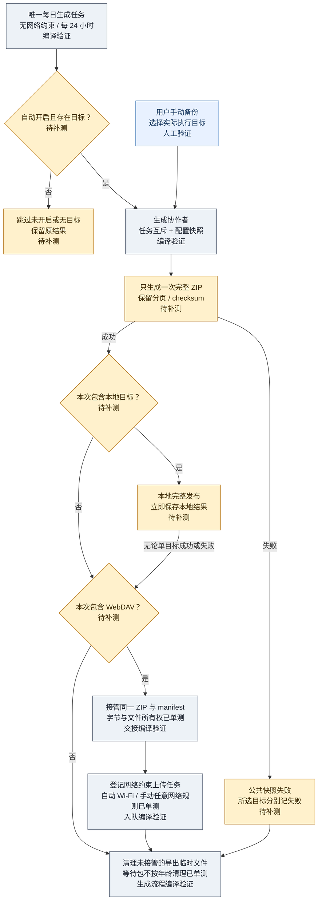
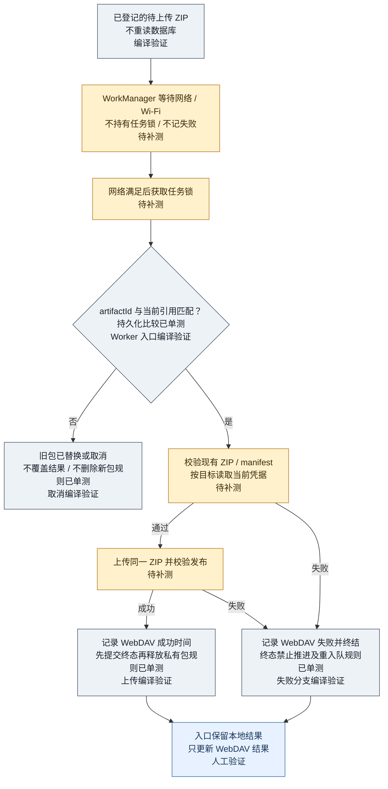
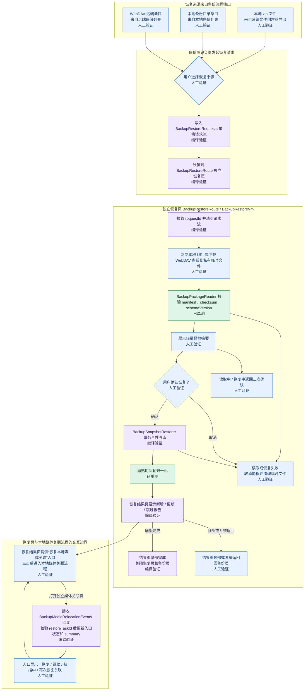
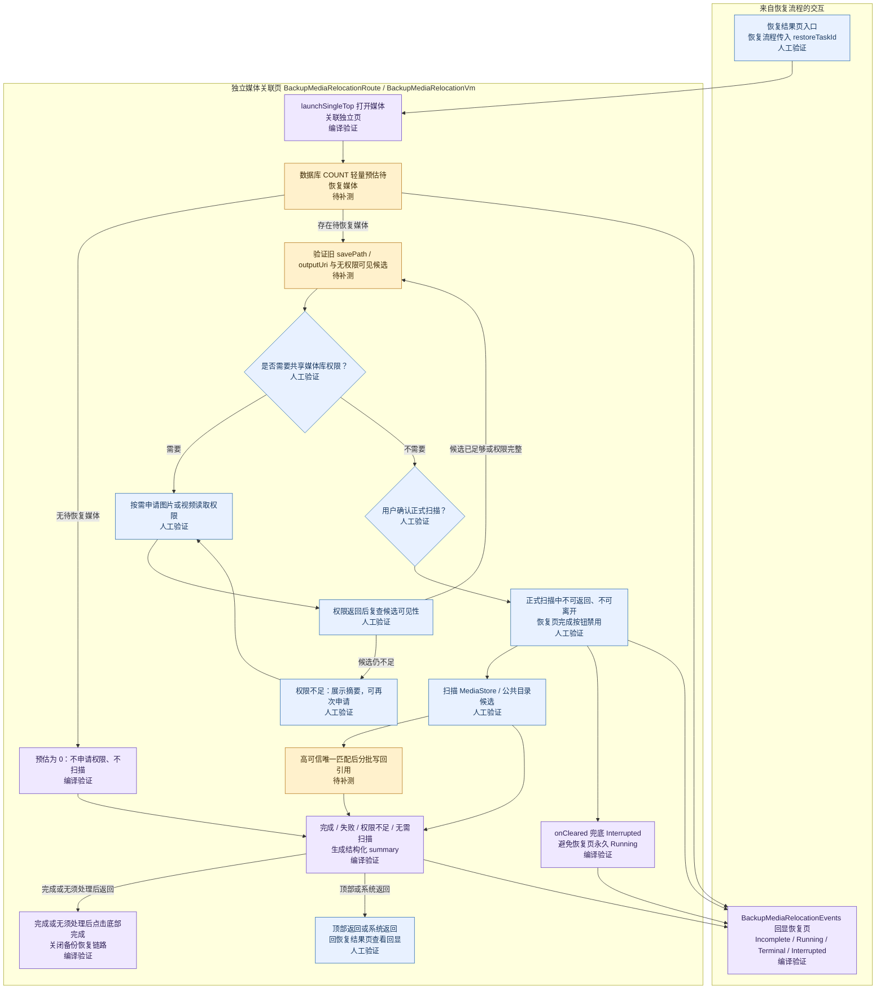

状态：已完成

# WebDAV + 本地自动备份恢复方案

<!-- flow-title: WebDAV本地自动备份恢复流程 -->

## 每日备份与分目标结果改造（已完成，2026-10-01）

本轮状态：已完成。本节依据 2026-09-30 最新代码重新分析，分析基线为 `d9952fa`；用户已确认“每日生成一份包、保存本地、满足网络条件后上传同一份包”的流程，2026-10-01 用户确认实施。生产流程、回归测试、两种功能配置的编译/R8及一次独立审查修复已完成，系统和真实服务验收仍需设备。旧保存版本、变更触发和主动退避机制已删除；本文对应章节统一以每日同包流程为准。其他页面正在维护的无关方案不在本次修改范围。

### 需求与范围

- 自动备份只按每日周期执行，每次读取执行时的最新可备份数据，不再由数据保存、设置修改、恢复或媒体关联完成触发。
- 每日只生成一次 ZIP，先发布到已配置的本地目录，再由受网络约束的上传任务使用同一份 ZIP；本地阶段不设网络约束，WebDAV 阶段不重新读取数据库或生成备份。仅配置 WebDAV 时也先生成私有备份包，但不将私有待上传文件记成本地正式备份成功。
- “我的”页备份入口固定分为本地和 WebDAV 两条结果，分别显示该类别最近一次备份失败，或最近一次成功备份时间；手动和自动共用结果记录。
- 删除业务层的额外调度调用、dirty marker、保存时的版本递增、导出版本捕获和完成后的版本确认，以及对应依赖、提示、资源和失效测试。
- 保留现有备份字段白名单、JSONL/ZIP/manifest/checksum、`schemaVersion = 4`、Room schema、恢复幂等及冲突保护、分页导出 high-water mark、普通备份保留份数和任务互斥。
- “最新数据”指执行时读取的快照；本轮不改为实时同步，也不要求只保留一个备份文件。保留份数仍为现有的 1–20 份，默认 5 份。

### 实施前基线与复用结论

| 当前能力 | 核对结果与本轮处理 |
| --- | --- |
| `BackupAutoScheduler` | 与 Worker 同文件；仍注册 24 小时唯一周期任务和延迟 10 分钟的 `backup_auto_dirty`；删除 dirty 一次性路径，拆出每日生成和待上传调度职责，上传的一次性任务只消费已有包。 |
| `BackupAutoWorker` | 仍读取 dirty/版本、提前解密 WebDAV 密码并按异常安排 retry；改为无网络约束的每日生成、本地保存与待上传登记，不再直接上传。 |
| `BackupRuntimeRepository` | 仍包含 `changeRevision`、`backedUpRevision`、dirty 和一组全局自动结果；保留 DataStore 存储边界，替换为两组目标结果。 |
| `BackupVm` | 本地导出和 WebDAV 上传仍捕获/确认版本，没有统一更新最近结果；保留新加入的 `BackupWebDavFormMapper`、草稿保护和按需密码回填，接入公共执行协作者。 |
| `MineVm` / `BackupEntry` | 设置已改为独立字段 Flow，入口仍显示固定说明；新增备份结果订阅，不恢复整份剪贴设置组合订阅。 |
| `ListEntryCard` | 现有说明是一个最多两行的 Text；不能靠拼接换行保证两种结果都完整显示，扩展说明 slot，复用卡片外壳。 |
| `BackupRepository` 与包 IO、导出、恢复协作者 | 职责符合需求，继续复用，不重写文件协议或恢复管线。 |
| `BackupTaskGate` | 保留完整备份/恢复副作用的进程内互斥；移除版本机制不等于移除任务锁或数据库事务。 |
| `BackupTempFileStore` | 现有导出文件位于 cacheDir，24 小时过期且任务结束会删除；不能复用为等待 Wi-Fi 的长期包。保留临时生成能力，完整 ZIP/manifest 交接到独立待上传存储后再清理导出中间文件。 |
| TorrentSearch contributor | 已参与 schema v4 导出和恢复；仅移除 dirty marker、DI 和恢复批次标记封装，不删除 contributor 或恢复计数规则。 |

按生产源码关键词复核，旧调度/版本/dirty 路径至少涉及 app 18 个、base/general 7 个、TorrentSearch 5 个文件；另有 4 个直接相关旧测试文件。结果模型、入口 UI、字符串及新测试还会增加涉及文件，因此整体为中等规模，主要是清理调用与依赖，不是重做备份系统。数量只代表本次扫描命中，实施时以实际引用为准。

### 每日调度与失败策略

1. 沿用 WorkManager 唯一周期名 `backup_auto_periodic`，间隔 24 小时，移除网络与仅 Wi-Fi 约束。该任务只生成一次包、发布本地并登记待上传包；保留启动、开机和备份配置提交后的周期注册入口。普通业务写入和恢复完成不再调用调度器。
2. 本方案将“每天一次”定义为约 24 小时的后台周期，不承诺固定钟点或按自然日零点结算。系统省电可能推迟每日生成，网络或仅 Wi-Fi 只影响后续上传，参见 [Android PeriodicWorkRequest 文档](https://developer.android.com/reference/androidx/work/PeriodicWorkRequest)。首次开启按 24 小时初始延迟注册，不额外立即备份；已有周期使用 UPDATE 保留周期，不因每次启动、改设置或手动备份重新计时。
3. 无论期间是否有修改，每个周期都生成一份全量快照；删除 dirty 判断和 `INPUT_FORCE_FULL_BACKUP`。仅在 WebDAV 已配置且待上传包完整提交后，登记一次 `backup_webdav_upload_<artifactId>` 按文件身份命名的唯一上传任务：自动任务按仅 Wi-Fi 设置使用 UNMETERED 或 CONNECTED，上传 Worker 不生成快照。手动备份不消耗或重置自动周期。
4. 注册时主动取消旧 `backup_auto_dirty`，取消完成后再更新周期；删除 `markDirtyAndSchedule`、`scheduleAfterCommittedChange`、`enqueueNow`、`scheduleDirtyBackup` 和 dirty 延迟常量。旧任务名称只允许留在带中文注释的兼容取消逻辑中，不能保留空实现入口。
5. 生成、本地发布、待上传登记或实际上传失败记录到对应目标，等待下一周期或用户手动备份；生成与上传 Worker 都移除指数退避及所有主动 `Result.retry()` 分支，包括读取配置/状态、记录结果失败时的 retry。上传失败后该产物不因启动、网络恢复或改设置再次自动上传；次日重新生成的包属于新一轮备份。已处理的业务失败结束本次 Worker，WorkManager 任务结果与目标备份结果分开。
6. 自动关闭、无目标或任务尚未满足网络约束不是一次备份失败，不覆盖历史结果。读取配置失败且无法确认执行目标时只记录低敏错误，不把未知错误分摊成两处失败。
7. 本轮使用一个每日生成任务和一个受网络约束的上传任务，不是两条分别生成快照的每日任务。上传等待期间不持有 `BackupTaskGate`，不让本地等待 Wi-Fi；正在执行的上传仍按现有互斥边界与其他备份/恢复串行。
8. WorkManager 被系统停止后的恢复/重新执行属于平台调度行为；方案取消的是应用主动退避重试，不能承诺系统强杀、约束中途变化时绝对没有重新执行。始终保留唯一任务、产物身份校验与任务级互斥；恢复被停止的上传仍读取已有包，不能重新导出。因普通上传失败已结束的包不能被启动修复逻辑重新入队。

### 同一备份包的交接、等待与清理

1. 导出仍在 `BackupTempFileStore` 的任务目录生成 JSONL、manifest 和完整 ZIP。已配置本地目录时先复制/发布同一 ZIP，保存本地结果；没有本地目录时不新增“本地成功”记录。本地发布普通失败不破坏已生成的私有 ZIP，仍可进入 WebDAV 阶段。
2. WebDAV 已配置时，由具名 `BackupPendingUploadStore` 将同一 ZIP 及上传所需 manifest 接管到 `noBackupFilesDir/backup_pending_upload/`；只交接已有字节，不再导出或重新压缩。待上传目录不在 cacheDir，不能被现有 24 小时临时文件清理或页面退出清理删除；JSONL 和未接管的导出临时文件仍按原边界清理。
3. 待上传记录最小包含 artifactId/taskId、文件身份、生成时间、source、目标身份指纹和 waiting/上传中/已终结状态；通过现有 HostSettingsStore 的固定字段保存，source/phase 使用显式稳定 code，不依赖枚举 name/ordinal，不为新模型整包 keep。不保存密码、授权 URI 或完整 WebDAV 配置。指纹只绑定生成时的服务器/账号/远端目录，防止配置改变后把旧包发送到新目标；上传时从当前已提交设置按需读取匹配凭据。artifactId 是文件身份，不是业务变化版本，不在普通数据保存时递增或写入。
4. 完整复制/移动、校验 ZIP 和 manifest 后，先原子提交待上传引用，再登记唯一上传任务。明确登记失败时记录 schedule_failed 并将本轮标为已终结，不在启动/网络恢复后反复尝试；若进程在交接完成与登记完成之间中断、尚未产生失败结果，启动/开机可为 waiting 包补齐登记。该补齐只消费已有包，不生成新快照，不复活已失败上传。上传的 WorkData 只携带 artifactId，不携带文件字节、凭据或外部路径。
5. 通常只保留最新一个待上传包。次日或新的手动 WebDAV 备份完整就绪后，在任务锁内提交新引用并登记新任务，登记成功才取消旧请求和释放旧包。明确登记失败先提交新包失败，恢复仍有效的旧等待引用及请求，只清理失败新包；旧终态不得复活。临时交接允许旧包与一个新包同时存在，不积累每日队列。仅手动本地导出不替换 WebDAV 等待包。
6. 旧 Worker 获得任务锁后先核对 artifactId 与当前待上传引用，已被替换时直接结束；不得上传已删除旧包、删除新包或把旧任务的结束写成新任务失败。取消操作和文件清理必须等待正在使用该文件的阶段释放所有权，不能仅凭取消请求已提交就删除文件。
7. 上传成功后先保存 WebDAV 完成结果，再释放私有待上传文件；正式本地备份保持原保留策略。实际上传失败记录远端失败并提交终态后释放私有包，不主动重试。结果写盘失败使用独立 result_store_failed 契约，不将已确认发布成功反转为备份失败；尽力保存只清理的 result_store_failed 阶段，重启只做清理。若连此阶段也不能写盘，遗留 uploading 的发布结论未知，保留最近确认结果、取消并清理，不猜测失败也不重传。
8. 关闭自动备份取消每日生成及自动来源的待上传请求并清理对应私有包；手动来源的已明确请求不因自动开关被静默取消。WebDAV 目标删除或服务器/账号/远端目录改变时取消不匹配旧上传，不把旧包发到新配置；仅修改网络策略可为尚未开始的同一包更新等待约束，不产生新快照，也不重试已终结失败。
9. 重启后以完整待上传记录和产物校验恢复等待，不以临时目录枚举猜任务；缺失、损坏或空间不足按可行动失败处理，不为补文件偷偷读取数据库再导出。新包生成或交接失败不删除旧完整包，保留可用产物但明确其时间和不是本轮最新快照。
10. 待上传 ZIP 含用户内容，只属于本次安装的发送中间态，不是另一种用户备份目标；放入 noBackupFilesDir，该目录按 [Android Auto Backup 官方规则](https://developer.android.com/identity/data/autobackup?hl=en) 排除系统备份，实施时仍核对云备份/设备迁移和自定义字段白名单。目录容量以一个已提交包及一个交接中包为边界，生成前检查剩余空间；孤儿清理只处理不被当前引用或执行者持有的任务目录，日志不输出正文、路径或目标指纹。

### 两行入口与结果归属

普通屏幕示例，标题为“备份与恢复”，说明区域固定本地在前、WebDAV 在后：

```text
本地：上次备份 2026-09-30 02:00
WebDAV：上次备份失败
```

| 状态 | 对应目标行 |
| --- | --- |
| 最近一次成功 | `本地：上次备份 yyyy-MM-dd HH:mm` / `WebDAV：上次备份 yyyy-MM-dd HH:mm` |
| 最近一次失败 | `本地：上次备份失败` / `WebDAV：上次备份失败`；低敏具体原因在备份页查看。 |
| 等待上传 | 保留 WebDAV 最近完成结果；没有历史结果时显示 `WebDAV：等待 Wi-Fi` 或 `WebDAV：等待网络`，不显示失败。备份页单独显示待上传包生成时间与等待原因。 |
| 无结果、目标已配置 | `本地：尚未备份` / `WebDAV：尚未备份` |
| 无结果、目标未配置 | `本地：未设置自动备份目录` / `WebDAV：未配置` |
| 正在加载或读取失败 | 两条分别显示加载/状态读取失败，不以默认成功、未配置或零时间替代真实结果。 |

“两行”是两个独立结果区域，不是限制整个说明区只能绘制两行文字。小屏、横屏和大字体时每个区域可自行换行，第二个结果不能被第一个结果挤掉；失败使用主题错误色并保留文字，不能只靠颜色区分。

| 操作 | 本地结果 | WebDAV 结果 |
| --- | --- | --- |
| 手动导出到系统选择的文件 | 更新为本次成功/失败，即使未设置自动目录也能显示成功时间。 | 保留原结果。 |
| 手动 WebDAV 备份，未配置本地目录 | 保留原结果。 | 更新本次结果。 |
| 手动 WebDAV 备份，已配置本地镜像目录 | 更新本地镜像发布结果。 | 更新远端发布结果，互不覆盖。 |
| 每日自动生成/保存 | 仅配置了目录才发布并更新，本地不要求网络。 | 登记同一 ZIP 等待上传，不提前写入成功/失败。 |
| 网络满足后的上传阶段 | 保留原结果，不再次生成或写本地。 | 上传已生成包后更新本次成功/失败。 |
| 取消系统选择器、连接测试、刷新列表、恢复、媒体关联、修改配置 | 均不生成备份结果。 | 均不生成备份结果。 |

两条结果表示本机最近一次该类别备份，不是扫描目录所得“最新文件”，也不表示所有历史变化都已同步。修改目标配置不制造新成功/失败结果；原结果仍是该类别历史，备份页需区分最近任务来源与当前配置，不能据此宣称新目录或新服务器已有备份。当前正在备份不清空最近完成结果。

### 分目标持久化与失败契约

- 在 `base/general/.../backup/settings/` 定义单目标结果快照，沿用 `BackupRuntimeRepository` 和唯一 `HostSettingsStore`；持久化字段按本地/WebDAV 分组，并提供独立结果 Flow，避免一个目标变化或其他设置变化让另一目标重复处理。
- 实际每目标保存最近完成时间、失败 Boolean、低敏失败 code。完成时间以该目标完整发布完成为准，不用 manifest 创建时间充当上传完成时间；无记录表示尚未备份。结果以类别保存，不新增按来源或具体目的地的历史表。
- 新结果不使用 JSON，不依赖 enum name/ordinal、localized 文案或 Kotlin 类型名。旧摘要保留明确序列化字段用于一次兼容读取；UI state、内部协作者和待上传模型不新增 keep。
- 最近完成结果与生成中、等待网络、上传中状态分开。本地成功即提交自己的结果，WebDAV 到上传真正结束才提交；等待可跨页面、进程和日界线。某目标失败只改变自己的最近完成结果，另一目标所有字段保持；当前产品只展示最近结论，不额外保留更早的成功摘要或时间。待上传包被新包替换不记失败。
- 本地成功以所选文件或配置目录的完整产物写入成功为界；WebDAV 成功以临时上传、校验、正式发布及 `latest.json` 所需步骤完成为界。完整发布之前不得提前写入成功。
- 旧备份保留清理失败属于附属操作警告，不把已完整发布的备份改成失败；低敏 WARN 记录维护失败，入口保留成功时间。列表刷新沿用页面操作失败提示，不影响已发布备份结果。
- 结果记录失败是独立的 result_store_failed 契约：保留正式产物，手动提示“备份文件已发布，但结果未能保存”，不把已发布成功改写成备份失败，也不伪造持久化成功。本地结果保存失败仍尝试同包远端交接，最后向入口报告状态存储问题。自动任务不主动重试，最近结果可能保持旧记录。
- 对已确定目标的公共快照生成失败，逐目标记失败；取消选择器及真正执行前退出不记失败。协程取消必须继续传播，不能吞掉取消再尝试其他目标。系统强杀时无法保证终态落盘，入口保留最近已确认结果，日志和临时文件清理遵循既有边界。
- 这些结果、完成时间、健康缓存、待上传引用和私有待上传文件属于设备绑定运行态，继续排除 WebDAV/本地备份白名单及系统恢复；不影响卸载重装后的业务数据恢复，也不能将 ZIP 中间态误纳入快照造成自包含备份。

### 执行协作者与手动/自动一致性

复用现有发布和快照能力，在 app 的 `backup/` 职责包提取 `BackupExecutionCoordinator`，供 `BackupVm` 与每日 `BackupAutoWorker` 调用；入口只选择操作、传入已提交配置/本次文件 URI、连接进度和展示反馈。协作者负责任务锁内生成一次快照、发布本地、记录本地结果、交接待上传包和临时文件清理。另增 `BackupWebDavUploadWorker` 消费已有包，委托单一职责的上传协作者执行凭据校验、WebDAV 发布及结果提交；不能让上传 Worker 调用 `createSnapshot`。文件接管/替换/校验由 app `backup/upload/BackupPendingUploadStore` 承载，通过构造函数注入 Context 与可替换文件/时间依赖；上传登记与约束由 app work 包的具名调度器承载。base/general 只保存具名运行状态，不反向依赖 app 的 Worker 或任务门禁；这些协作者不依赖 Compose、页面 ViewModel 或导航。

`LocalBackupDirectoryWriter` 当前位于备份页面包但已被后台 Worker 使用，随本轮移动到 app 的 `backup/local/`，保持写入和保留清理契约；系统文件 URI 只作为本次操作参数，不另存授权或路径。`BackupAutoScheduler` 拆到 work 包单独文件，只依赖目标设置与 WorkManager，不再依赖版本/dirty 仓库。

本地和 WebDAV 使用同一份快照，先完成本地阶段，再登记已有包的上传；网络已满足也通过同一上传入口消费，避免保留两套远端发布代码。本地镜像失败仍可上传私有完整包，WebDAV 密钥失效或配置校验失败只影响远端，不阻断本地。公共快照失败才同时影响本次选择的全部目标。用户配置的本地文件可被删除或授权失效，上传仍使用私有接管包，不重新读取该外部目录。

手动文件导出仍只更新本地；手动 WebDAV 备份也先生成一次并发布已配置本地镜像，再登记上传。自动“仅 Wi-Fi”设置继续只约束自动来源，手动来源沿用现有可用网络即可的语义。手动生成/交接期间保留当前不可重复操作的进度反馈；进入等待网络后结束页面模态阻塞，显示待上传提示并允许离开，后台最终成功/失败更新入口；不为等待网络一直保留不可取消弹窗，不因离开页面删除待上传包。用户主动重新手动备份才生成新快照，不把旧上传失败包装成无提示重试。

保留 `BackupTaskGate` 的任务级互斥与数据库既有事务；只由一个层级持有任务锁，禁止 ViewModel/Worker 与协作者重复嵌套持锁。恢复或媒体关联在执行期间仍按既有边界与备份互斥，但完成后不再触发新备份。导出途中新增记录留给下一次每日/手动快照，不维护变化版本，普通保存也不再因备份状态写入失败而被误报失败。

### 彻底清理清单

| 层级 | 删除或替换内容 |
| --- | --- |
| app 调度调用 | `ClipboardDataProcessor`、`ClipboardBridgeIconCommitter`、`DetailViewModel`、`SearchViewModel`、`DownloadHistoryVm`、`RecycleBinVm`、`MineVm`、`ClipSourceBlockSettingVm`、`ClipHelper`、`DownloadImagesWorker`、`DownloadVideoWorker`、`RecycleBinCleanupWorker` 中变更后调度及仅服务该调用的 import、Context/依赖、错误反馈。 |
| 恢复与媒体关联 | 删除 `BackupRestoreVm.markDirtyAndSchedule`；删除媒体关联页的 `backupScheduleFailed`、重新调度事件/方法、提示和重试操作，同时更新对应 state、回调和资源引用。真实恢复/关联失败提示继续保留。 |
| base 业务写入 | 从 `ClipRepositoryImpl`、`DownloadRepository`、`ImageExtractRepository`、`SearchHistoryRepository` 移除 `BackupRuntimeRepository` 注入与 `markChanged`；保留 DAO 操作、返回数量和业务失败契约。 |
| 剪贴设置 | 从 `ClipSettingsRepository` 删除 `markBackupChanged` 及调用；保留原子设置提交、字段 Flow、实际变化判断和恢复名单并集/返回值，不因移除版本控制重新组合整份设置 Flow。 |
| 运行态与手动备份 | 删除 `changeRevision`、`backedUpRevision`、dirty 派生、`markChanged`、`captureRevision`、`acknowledgeRevision`、`acknowledgedRevision`、初始版本常量及确认失败分支；将自动专属全局结果替换为分目标记录。 |
| TorrentSearch | 删除 `TorrentSearchBackupDirtyMarker` 文件、NoOp 实现、运行仓库适配器、DI provider、仓库/设置/contributor 参数和 `markDirty` 调用；删除 `runRestoreBatchAndMarkDirty` 的标记职责，保留批次事务和准确恢复计数。不能只替换成 no-op 掩盖残留依赖。 |
| UI / 字符串 / 测试 | 删除仅用于 dirty、待同步版本、确认版本失败、自动重试和媒体关联重新调度的展示与资源；删除旧“写入必须推进备份版本”的断言，改为写入不依赖备份状态、分目标结果和失败隔离的回归测试。 |

上表“版本控制”仅指应用自建的备份变更/确认版本，不涉及 Git、数据库版本、备份格式版本、checksum、分页上界、稳定业务键、本地较新保护或真实的业务变化判断。

### 旧任务与旧状态兼容

- 实施时取消并等待旧 dirty 任务停止，保持任务门禁串行后续导出；不用删除 WorkManager 数据库或取消其他下载/清理任务。保留周期任务名称，更新为新 Worker 行为，忽略旧 force-full 输入。
- 在明确的一次 DataStore 编辑事务中删除 `backup_change_revision`、`backup_backed_up_revision` 和旧全局自动状态/失败/跳过键；不能清空整个设置文件、凭据、授权或业务数据库。
- 新分目标结果尚不存在且旧全局最近状态为 success / partial_success 时，才根据摘要的 localSuccess / webDavSuccess 回填明确成功目标。旧状态 failed / retry_scheduled / running / skipped 不迁移成最近成功，也不猜测为两目标失败；过往摘要不另存历史表。旧时间只保留作兼容历史时间，新结果使用真正完成时间，已有新结果不被覆盖。
- 旧全局失败、retry 或 skip 不能可靠定位失败目标，不迁移为两处失败；旧摘要坏数据按无可迁移结果降级。读取与删除旧摘要在同一事务内完成，避免每次启动重复初始化，不新增备份变更版本或跨安装迁移协议。
- 配置、密码和 WebDAV 健康记录保持现有契约；旧结果没有跨安装恢复价值。兼容读取只用于本机历史，不提升备份 schema，也不创建整包 keep。

### 我的页接入与共享组件

`MineVm` 订阅两组轻量结果 Flow，`MinePage` 用生命周期感知收集连接到 `BackupEntry`，不扫描文件、不下载远端列表、不解密凭据、不生成快照。纯状态/展示映射放入可预测的备份展示 mapper，时间格式化明确使用本机 locale/timezone，测试固定时间来源。

`ListEntryCard` 增加说明内容 slot 的重载，旧 `description: String` 入口委托到同一骨架，旧调用方保持原先行数策略；新的两条结果通过 slot 分别渲染。共享组件完整契约写入 `docs/shared_form_components_plan.md`，本页面只保存适配与导航。备份页最近结果区也改为两组结果，继续单独显示 WebDAV 连接健康，避免与我的页结论矛盾。

### 日志与诊断计划

| 日志点 | 级别、触发与字段 |
| --- | --- |
| 周期注册/更新/关闭和取消旧任务 | DEBUG；记录 enabled、周期小时数、生成任务无网络约束、旧任务取消是否完成，不记录每次业务写入。 |
| 同包交接、上传登记、等待及替换 | DEBUG；记录 taskId/artifactId、source、待上传数量、onlyWifi、是否替换、原因与耗时；waiting 不输出失败日志，等待不按轮询重复打印。 |
| 每日或手动备份开始 | INFO；记录 taskId、source、配置目标布尔值、保留份数、开始时间与耗时基础。 |
| 公共快照及目标发布阶段 | DEBUG；同一 taskId，记录 target、phase、大小和分类数量；成功 INFO，失败 ERROR，附稳定 reasonCode 与异常类型。 |
| 部分成功、清理/刷新或结果提交失败 | WARN；记录 target、已发布布尔值、低敏原因、数量和耗时；明确不会安排额外备份重试。 |
| 配置读取失败或无法确认目标 | ERROR；记录 settings_store_failed 等 code，不猜测目标、不伪造两条失败结果。 |
| 发布后结果保存失败/未知结论 | ERROR result_store_failed、WARN result_store_unknown；仅 taskId、published、类型；保留已确认记录，不重传、不伪造失败。用一次失败后恢复的存储桩及终态清理回归验证。 |
| 新等待包登记回滚/旧包维护清理 | ERROR 登记失败、WARN 旧包释放失败；taskId、phase、reasonCode，不含内容/路径/指纹；验证失败只丢弃新包，不恢复旧终态。 |
| 入口状态读取失败 | WARN；记录读取域与异常类型，重组不重复输出；展示失败可手动重读，不触发备份。 |

删除 dirty、版本递增/捕获/确认、立即入队和退避重试日志。新协调器和 Worker 已接入简体中文低敏诊断，沿用 taskId 和稳定原因；禁止记录剪贴原文、搜索词、完整 JSON/ZIP 内容、WebDAV 地址/用户名/密码、Cookie/Token、授权 URI、真实路径和完整请求响应。JVM 验证归属、保存与清理副作用；真实运行日志及耗时、系统重启行为仍待设备验收，不声明 JVM 已覆盖平台日志输出。

### 实施顺序与测试门禁

1. 先给单目标结果归约、失败隔离、手动归属、旧结果初始化、无网络的每日生成、同包交接/替换/重启等待和上传约束补能失败的测试；更新现有版本/dirty 测试，保留事务、幂等及恢复计数覆盖。
2. 实现两组目标运行态和兼容键清理，删除版本 API；抽取公共生成/本地发布协作者，迁移本地发布器，实现待上传存储、上传协作者及 Worker，接入手动/自动同包交接与逐目标提交。
3. 调度器保留无网络约束的每日生成周期，新增消费已有包的网络约束上传任务并取消旧 dirty 任务；清除所有业务仓库、页面、Worker、恢复及 TorrentSearch 的旧调用和 DI，去掉媒体关联“重新调度失败”分支。核对 noBackupFilesDir 与系统恢复排除边界。
4. 接入两行结果和共享说明 slot，更新备份页结果、字符串资源和 Preview；不恢复旧的整设置订阅或修改 WebDAV 表单 mapper 行为。
5. 全仓扫描残留，更新本主文档的现行自动备份、状态、日志、实施和验证章节；我的页和共享组件文档只记录接入/公共契约，来源过滤、详情、搜索、下载、TorrentSearch 与 DataStore 方案只删除过期说明并引用本主文档，不覆盖其他待实施需求。
6. 运行受影响模块单测与编译，验证功能开/关两种宿主构建；实现中若修改摘要序列化/keep，追加 release/R8 验证并保留 mapping。最后更新流程图和验证记录，再标记本轮已完成。

默认需要选择性 TDD：结果归约、存储原子性、失败契约、兼容初始化、状态 Flow 和恢复回归都是可独立验证的逻辑。UI 排版以 Preview/设备验证为主，不为样式写镜像实现的单测。测试只用合成数据、fake clock/dispatcher/发布器，不依赖真实网络或本机授权目录。

必测验收包括：

- 业务保存、设置修改、下载结束、恢复/媒体关联和 TorrentSearch 写入都不推进版本、不调用备份运行仓库或额外入队；删除版本依赖后业务保存不会因备份状态存储失败被误报失败。
- 无变化的每日周期也全量备份；首次开启不额外立即执行；重启/配置更新/手动备份不重置周期；任一业务失败分支都不返回 retry，旧 dirty 任务被取消。
- 无 Wi-Fi 时仍生成并成功发布本地，WebDAV 等待不记失败；网络恢复后读取同一 artifactId 的既有 ZIP，字节/checksum 相同且 `createSnapshot` 次数仍为 1。没有本地目录时私有包不更新本地成功。
- 待上传包不会被 24 小时 cache 清理、页面退出或正常重启删除；新包完整就绪才替换旧包，旧 Worker 不上传过期引用或覆盖新结果；新包交接/登记失败不损坏旧包。
- 实际上传失败结束该次尝试，启动或网络恢复不重试已终结包；等待中的包可修复登记；目标变更不把旧数据发往新目标，关闭自动只取消对应自动来源。
- 校验待上传元数据损坏、文件缺失、磁盘不足、上传期间系统停止与结果落盘失败的边界；终态后释放私有包，已发布本地正式备份不受待上传清理影响。
- 本地成功/远端失败、远端成功/本地失败、两处失败、仅一个目标、密钥失效、公共快照失败，以及保存第一个结果后第二个目标失败时的持久化一致性。
- 手动文件导出只更新本地，WebDAV 无本地镜像只更新远端，有本地镜像分别更新；取消选择器、测试连接和刷新列表不覆盖结果。
- 后续失败不显示历史成功为最近结果；运行中、无目标和未满足约束不清空最近结果；发布后清理/刷新失败保持成功，结果存储失败不重复发布。
- 清理旧版本键不删除设置/凭据，坏摘要不伪造历史结果，新结果不被旧摘要覆盖；backup schema v4 与旧包读取/幂等恢复继续通过。
- 两条结果在小屏、大字体、深色、横屏和 TalkBack 下均能读到；我的页不可见时停止不必要的收集，进入页面只读低敏运行态，不预热备份 IO。

实施验证命令：`./gradlew.bat :base:general:testDebugUnitTest :feature:torrent-search:testDebugUnitTest :app:testDebugUnitTest :app:compileDebugKotlin`；宿主以 `-PenableMagnetFeature=true` / `false` 分别编译验证引用清理，并执行 `:app:minifyReleaseWithR8`。2026-10-01 独立审查发现的两项边界已修正，全量测试、两种编译和 R8 通过，最终证据见“验证记录”。

### 已知取舍与后续待办

- 业务写入不再承担备份状态写入成本，代价是当日修改只能等下次周期或手动备份；移除版本确认后不提供“所有最新变化已备份”的即时承诺。
- 本轮采用约 24 小时周期、失败等下一周期、首次开启不立即执行。若需要自然日或指定钟点，另行调整调度规则，不以 WorkManager 周期假装精确时钟。
- 用户已确认每日生成一次、本地先保存、远端受网络约束消费同包；原草案“本地随 WebDAV 等待 Wi-Fi”的耦合已撤销。为跨进程等待增加私有待上传存储和一个上传 Worker，通常只保留最新待上传包，代价是临时占用一份 ZIP 空间；不新增第二次数据库导出或业务变化版本。
- 本地结果包括系统文件导出和自动目录发布，是类别历史而不是当前目录的存在性保证；如需按具体目录/服务器分别保留历史，后续扩展，当前不引入目标版本或多目标历史表。
- 系统强杀和磁盘不可写可能阻止结果落盘；保留最近已确认结果并提供低敏诊断，不追加当天自动重试或恢复前自动备份。

### 本轮实现与验证边界（2026-10-01）

- 实际接入 `BackupExecutionCoordinator`、独立 Scheduler/两类 Worker、`backup/local` 发布器、`backup/upload` 私有存储/目标摘要/终态清理协作者、分目标结果 repository、旧状态兼容事务、纯展示 mapper、`BackupResultsSummary`/详情和兼容说明 slot。
- 固定 phase 为 ready / enqueuing / queued / uploading / succeeded / failed / cancelled / result_store_failed；最后四类为终态。enqueuing 中断保守终结，不重传；遗留 uploading 无法区分发布成功但未写盘与真正中断，不猜测最近结论，取消仅做清理。WorkManager 明确终态也阻止重新入队。取消与等待不覆盖历史结果。
- 独立审查两项 Important 均加入缺实现 RED 后修复：发布完成与结果存储用 `BackupPublicationCompletion`/`BackupResultPersistence` 区分；新包登记用 `BackupPendingHandoff` 保护旧等待包。旧包维护清理失败只 WARN，不反转新登记任务；已确认的结果保存阶段屏蔽协程取消，但真实发布取消继续传播。
- 业务版本及 dirty marker 的旧断言删除；真实业务提交、恢复计数、排序和 DAO 边界断言保留。新测试覆盖结果隔离、旧身份不能结束新包、文件所有权、网络约束、历史优先及目标绑定。
- 待上传与两类结果使用固定 DataStore 键，不增加 JSON 模型/整包 keep，不更改 schema v4、Room 或 manifest。一次旧状态兼容事务只在旧最近结论成功且摘要明确标志时回填目标，同时删除旧版本、全局状态和摘要键；旧全局失败不猜测归属。终态不可再次推进或覆盖完成结果。
- 选择性 TDD：目标持久化先观察到 API 缺失失败；同包流程横跨原全局 UI/Worker，测试先添加，红阶段被旧入口接口编译阻断，需完成接口集成后执行；此处是有限例外，不声称所有新纯规则都经历了独立红绿。目标归一化和终态防复活另做红绿回归。
- 无设备/AVD 时不能验收系统周期、SAF 授权失效、真实 WebDAV、进程强杀和视觉/TalkBack；Preview 与 JVM 不替代这些系统验证。测试、编译、R8 的最终命令结果在验证记录更新。
- 注释范围例外：新增及实质调整的协作者、模型、mapper、UI 和关键变量补中文说明；仅删除旧备份调用的既有业务方法保留原变量说明，未对全部未变业务声明扩写，避免扩大其他用户改动。风险是个别旧变量说明不足，后续修改所属业务时补齐；本次无新增无注释规则变量。

## 当前状态

2026-09-30 提交前最终复核：app Kotlin 编译、app 150 项单测及 base/general 64 项单测全部通过，失败、错误和跳过均为 0；`git diff --check` 通过。密码表单映射回归已包含在 app 单测中；真实 WebDAV 连接、显隐与布局交互仍需设备验收。

项目当前数据主要存放在 Room 数据库和宿主 Preferences DataStore 中：剪贴数据、来源 App、链接预览、搜索历史、视频下载记录、图片下载记录由 base 主库承载；剪贴快捷动作、回收站保留天数、剪贴来源 App 过滤名单等轻量设置由 `ClipSettingsRepository` 承载。TorrentSearch 已通过 feature-local `BackupFeatureContributor` 以字段白名单参与 `schemaVersion = 4` 的备份预检、计数和恢复报告，书签、搜索历史、已查看和非敏感排序设置可恢复，旧磁力 entry 一律视为不兼容并跳过。06D 的 Provider 开关、Torznab 配置及密钥、安全模式、DoH 和披露确认均属于本机网络/隐私状态，不进入备份或 dirty；仅默认排序条件与方向属于非敏感设置白名单。统一备份恢复支持本地手动导出/导入预检恢复，以及 WebDAV 手动测试、上传、列表、预览和恢复；旧 v1/v2 备份按既有兼容策略只读处理。

本方案新增统一 `BackupSnapshot` 备份包，同一套导出、预检、恢复和报告逻辑同时服务本地文件备份与 WebDAV 备份。第一版定位是“备份/恢复”，不是多设备实时同步；多个设备可以共用同一 WebDAV 目录并看到彼此备份，但不保证自动双向同步或冲突同步。

恢复剪贴记录时会对 `timestamp`、`pinned_time`、`folded_at`、`deleted_at` 做本机时间轴归一化：如果备份来自时钟偏快的设备，先按 manifest 创建时间和本机恢复时间的正向偏移整体平移，再把仍落在未来的字段限制到恢复开始时间以内；本地较新状态保护也使用归一化后的备份创建时间，避免远端数据长期显示“现在”并压过后续新复制内容。

当前代码组织已将备份包 IO、导出、恢复和 mapper 拆到独立协作者：`BackupPackageWriter` / `BackupPackageReader` 负责 JSONL、zip、manifest 和 checksum，`BackupSnapshotExporter` 负责分页导出、high-water mark、设置白名单读取、可选 `BackupFeatureContributor` 扩展和 manifest 组装，`BackupSnapshotRestorer` 负责 v1/v2/v4 预检后的事务恢复、chunk 写库、幂等报告、本地较新保护和可选功能恢复参与者调用，`BackupEntityMappers` 负责 base Room 实体与备份协议模型转换，`BackupRepository` 聚焦对外 API、互斥和预检委托。TorrentSearch 已通过 feature-local `TorrentSearchBackupContributor` 注册到这些扩展点，保留书签、搜索历史、已查看和默认排序的导出恢复，但删除保存副作用中的版本标记；旧磁力备份仍由预检统一分类为不兼容跳过，而非可选功能恢复参与者。

## 目标

- 完成“导出备份 → 卸载重装 → 恢复数据”的可靠闭环。
- 第一版支持本地手动导出/导入、WebDAV 手动备份/恢复、恢复前预检和恢复后报告。
- 当前阶段补齐 WebDAV/本地每日同包备份、分目标结果、普通备份保留份数、大数据量导出/导入流式化和恢复后的下载媒体重新定位入口；后续阶段再补齐前台通知、首次恢复引导和分类恢复。
- 备份包不加密；当前以 `.zip` 承载 `manifest.json`、设置 JSON 和多个业务 JSONL 文件，用户界面必须提示备份文件包含剪贴内容，应保存到可信位置。

## 范围

第一版备份范围：

- 剪贴数据，包括置顶、折叠、回收站状态和时间戳。
- 来源 App 缓存，包括包名、名称、图标缓存路径、主色和图标哈希。
- 链接预览缓存。
- 搜索历史。
- 启用 TorrentSearch 时，任务 7 将由 `BackupFeatureContributor` 按字段白名单导出书签、搜索历史、已查看和非敏感排序设置；Provider 本机选择、安全模式状态及完整 DataStore 文件不恢复，完整字段与幂等规则以 [TorrentSearch 主方案](magnet_search_plan.md) 为准。
- 核心用户偏好，包括剪贴快捷动作、回收站保留天数和剪贴来源 App 过滤包名名单。
- 下载记录元数据，包括视频下载任务和图片提取/下载批次、图片项。

第一版不备份：

- 视频/图片媒体文件本体。
- TorrentSearch 的 Provider 缓存、临时文件、WebView 数据、Provider 健康和旧 Academic Torrents 缓存。
- TorrentSearch 的 API Key、Cookie、NSFW/安全模式状态、Provider 本机开关、SAF URI、缓存和设备绑定密文；独立数据库与 DataStore 已从系统云备份及设备迁移按精确路径整文件排除，自定义白名单恢复尚待任务 7。
- TorrentSearch 06C 的书签 SAF JSON 导入导出是一次性用户文档传输，不属于 WebDAV/本地备份包发布协议；取得流后的取消会把唯一关闭所有权移交独立后台调度，不让生命周期 Main 同步等待阻塞 close，但外部 Provider 的 `openInputStream`/`openOutputStream` 尚未返回时还没有对象可关闭，不能承诺立即中断打开阶段。若 Provider 已接受部分字节，应用也无法保证原子删除或回滚半成品，不会把目标 URI、半成品信息或原始文件纳入备份。任务 7 的正式备份发布仍必须保持“完整写入并校验后才发布”的独立原子边界。
- WebDAV 密码、本地目录授权 URI、健康状态、失败次数、运行中任务状态。
- App 自更新上次检查时间 `appUpdateLastCheckAt`，该值只用于当前安装的 24 小时限频，卸载重装后重新检查即可。
- 上述健康状态和运行中/最近任务状态仍属于设备绑定运行态，不纳入备份；本次只补充 R8 名称稳定性，不改变备份字段白名单。
- `cookie`、`pendingOutputUri`、`tempPath`、未完成临时文件、可恢复登录态。
- Shizuku Provider 图标传输临时目录 `files/clipboard_bridge_icons/`，该目录只保存 `content write` 写入的短期 PNG，下一次 Provider 调用会清理过期文件，不具备跨安装恢复意义。
- Shizuku Provider 异步图标补全的 `<eventId>.tmp` 半文件同样只属于传输中间态，不纳入备份；图标补全成功后写入的来源 App 图标路径、主色和 `Bitmap.toStableHash()` 仍通过来源 App 备份字段进入备份。
- Shizuku 剪贴板 payload 临时目录 `files/clipboard_bridge_clip_payloads/`，该目录只保存 `content write /clip/<eventId>` 写入的短期敏感文本 payload，提交成功、失败或异常后都应清理自己的 eventId 文件，不具备跨安装恢复意义。
- `InstallationIdentityRepository` 保存的安装 ID 和 Shizuku 期望进程名属于本机状态，不纳入 WebDAV 备份；卸载重装后重新生成纯数字安装 ID 是预期行为，备份文件名中的 device label 继续只使用脱敏前缀。
- 历史 `permission_expanded` 只代表旧“权限说明”卡片的展开状态，当前我的页已固定展示 Shizuku 和通知两个权限项；该 UI-only 偏好已废弃，不进入备份恢复协议，也不触发 dirty。
- `AdSettingsRepository` 保存的广告来源、总开关、同意状态和政策版本，以及广告会话保险丝，属于本机广告/隐私/运营态，不纳入 WebDAV/本地备份，也不触发 backup dirty；本机构建标识同样不进入备份。

## 用户体验

- “我的”页新增“备份与恢复”入口。
- 页面分为本地备份和 WebDAV 备份两块。
- 本地备份支持通过系统文件创建器导出备份文件，通过系统文件选择器导入并预览备份；用户也可以选择一个持久化授权的本地备份文件夹，设置后页面展示用户可识别的本地路径/目录名。备份页不在“设置备份文件夹”旁展示清除按钮，减少误操作和按钮密度；设置文件夹后自动读取一次列表，同时保留显式“刷新列表”按钮和提示文案。
- WebDAV 备份支持配置服务地址、账号、密码、远端目录，默认远端目录为 `/ClipMaster/backups/`，用户可修改。
- WebDAV 密码框最右侧提供查看/隐藏按钮：初始隐藏，点击眼睛显示当前完整输入，再次点击恢复掩码；图标与无障碍文案同步表达下一步操作。复用 Material3 输入框与图标，在 `ui/widget/OutlinedPasswordTextField.kt` 封装通用单行密码输入组件，页面继续传入密码值、修改回调和标签。
- 密码可见性仅通过组件内 `remember` 保存，不进入 ViewModel、设置、dirty 或备份；组件移出组合、页面重新创建后恢复隐藏。切换可见性不触发密码修改回调，保持已有加密存储与 WebDAV 操作不变；长密码由单行输入框水平滚动，按钮保持在框内尾部。
- WebDAV 测试连接会校验 HTTPS、目录规范化、目录存在性和可写性；测试成功后自动刷新远端备份列表，页面同时保留显式“刷新列表”按钮和提示文案，避免用户误以为列表会自动常驻更新。
- 如果已设置本地备份文件夹，WebDAV 手动备份会使用同一份 zip 快照先写入本地文件夹，再上传 WebDAV；本地写入失败时停止上传，避免用户误以为本地已有备份。
- WebDAV 密码经独立 Android Keystore alias 的 AES-GCM 加密后存入宿主 DataStore；新安装不读取旧介质。密钥失效时要求重新输入密码。
- 备份生成、写入本地文件、上传 WebDAV、上传后的远端保留清理和列表刷新期间展示不可取消的“正在备份”弹窗，避免用户误以为可以重复点击或离开；WebDAV 手动上传的“上传成功”提示只在远端清理与列表刷新完成后展示，确保提示出现时弹窗即将关闭。
- 恢复链路使用真正的独立导航页面，用户选择本地文件、本地备份目录条目或 WebDAV 条目后进入恢复页读取状态，页面内部在读取、预览、恢复中、恢复完成和恢复失败之间切换，避免 BottomSheet 下滑误关闭。
- 备份页和恢复页不共享 `BackupVm`；备份页只把一次性恢复请求写入备份恢复 feature 内部 `BackupRestoreRequests` 单槽请求流，恢复页由独立 `BackupRestoreVm` 接管读取、下载、预览、恢复和临时文件清理。恢复页接管请求后立即按 `requestId` 清空请求流，关闭页面或 ViewModel 销毁时清理临时文件，避免长期持有 URI、WebDAV 条目或备份页状态。
- 备份页和恢复流程页已接入 `SecondaryPageScaffold` 二级页面骨架，标题栏、页面背景、Snackbar 和底部操作入口跟随本轮固定品牌主题；备份导出、WebDAV、恢复预检、恢复写库和媒体关联状态机不变。
- 恢复流程底部操作区的导航栏避让由公共二级骨架统一负责，`BackupRestoreFlowActions` 不再局部添加系统 padding；媒体重新关联页仍使用原生 Scaffold，保留原有处理。共享契约、测试及日志边界以 [UI 主方案](app_ui_refresh_plan.md#页面骨架导航栏-insets-契约2026-09-30) 为准，不改变备份数据或恢复动作。
- 恢复页导航栏标题固定为“恢复备份”，不随读取、预览、恢复结果变化；正文顶部状态行展示当前状态，并按读取、预览、恢复中、成功和失败使用不同图标与颜色，让用户能快速识别当前阶段。
- 读取中和恢复中点击返回需要二次确认；确认退出会取消当前读取/恢复协程并清理临时预览状态。若恢复已经进入数据库事务，事务由底层恢复逻辑完成或回滚。
- 恢复前在恢复流程页内展示轻量预检摘要：打开来源、备份类型、文件名、备份时间、App 版本、schemaVersion、文件大小、设备标识、checksum 结果和各类数据数量。
- 恢复不再自动创建恢复前安全快照；恢复采用合并策略并在 Room 事务中写库，失败会回滚。用户如果担心当前数据，可先手动导出普通备份。
- 恢复后在同一个恢复流程页内展示结果报告：恢复文件名、恢复完成时间、总新增/更新/跳过，以及按类别新增/更新/跳过；跳过是正常结果，不使用警告样式。恢复结果页底部“完成”关闭恢复页和备份页，回到进入备份前的页面状态；顶部返回和系统返回只退回备份页，方便用户继续查看或发起其他备份恢复操作。
- 恢复完成页提供“恢复本地媒体关联”手动入口。入口只负责进入独立媒体关联页面，触发当前数据库里所有成功/部分成功下载媒体的本地引用验证和关联恢复，不限定本次恢复包；恢复完成后不自动跳转、不自动预估，App 重新进入、进程重启或回到恢复页后都不会自动触发或自动续跑该任务。若独立媒体关联页进入成功完成或无须处理终态，用户点击底部“完成”时只关闭 `BackupRoute` / `BackupRestoreRoute` / `BackupMediaRelocationRoute` 组成的备份恢复链路，回到进入备份前的页面状态；点击顶部返回或系统返回时只退回恢复结果页，方便查看恢复报告和媒体关联回显。失败、权限不足、预估、权限请求和待确认阶段仍返回恢复页，方便重试或继续处理。
- 恢复完成页同时展示媒体关联的一行简洁摘要和视频/图片详细分类数字；摘要来自恢复页 ViewModel 中保存的结构化 `MediaRelocationSummary`，不保存已格式化文案，UI 通过字符串资源展示。新一轮预估、待确认或扫描中不清空上一轮终态摘要，直到新的终态或异常中断摘要替换。
- 媒体关联由独立 `BackupMediaRelocationRoute(restoreTaskId)` 和 `BackupMediaRelocationVm` 承载；恢复页入口点击做防抖，`BackupMediaRelocationRoute` 作为目标页统一使用 `launchSingleTop` 导航，正式扫描中入口禁用。真正防止旧流程串写由恢复页 ViewModel 收到事件后校验 `restoreTaskId` 完成。
- 媒体关联状态通过 feature 内部不可重放事件流通知恢复页：`BackupMediaRelocationEvents` 只服务备份恢复媒体关联，不作为通用 EventBus；事件包含 `Incomplete(restoreTaskId)`、`Running(restoreTaskId)`、`Terminal(restoreTaskId, summary)` 和 `Interrupted(restoreTaskId, summary)`。事件流 `replay = 0`，只做通知，不保存状态；恢复页 ViewModel 在 `init` 中收集事件，校验 `restoreTaskId` 后落成本地 `mediaRelocationEntryState` 和 `lastTerminalMediaRelocationSummary`。
- 媒体重新定位启动前在独立页面展示轻量预估，统计待恢复关联视频数、图片批次数和成功图片项数，并用“预计几秒 / 可能几十秒 / 可能 1 分钟以上”这类保守区间提示耗时。预估为 0 时直接展示暂无需要恢复关联，不申请权限，也不进入不可退出流程。
- 媒体重新定位按“预估 → 验证旧引用和无权限可见候选 → 按需权限请求 → 用户确认 → 正式扫描”执行；预估、权限请求和用户确认阶段允许返回恢复页，再次进入可重新预估，不承诺复用上一次 `MediaRelocationPreparation`。正式扫描开始后媒体关联页不可中断、不可退出，顶部返回、系统返回和离开入口全部拦截；恢复页底部“完成”按钮禁用。成功完成或无须处理终态表示恢复补充流程已闭环，底部“完成”不再回到恢复完成页，而是只收起 `BackupRoute` / `BackupRestoreRoute` / `BackupMediaRelocationRoute` 链路，让导航自然落回进入备份前的页面状态；顶部返回和系统返回仍只回恢复结果页。Android Home 键、进程被杀、系统回收和关机无法阻止，异常中断后不自动续跑，用户可再次手动触发。
- 媒体重新定位完成、无需扫描、失败、权限不足或异常中断后，独立页面展示简洁摘要和详细分类数字，并通过 `Terminal` 或 `Interrupted` 事件回显到恢复页；恢复页入口按钮文案改为“再次恢复关联”。完成和无需扫描属于正向闭环，`BackupMediaRelocationVm` 在发送对应终态 summary 时同步记录“完成应关闭恢复链路”，底部“完成”进入页面 `requestDone()` 并优先读取该标记，避免 Compose 本地 state 尚未切到 `Result/NoWork` 时落回普通返回；顶部返回和系统返回进入 `requestBack()`，只回恢复页查看回显摘要；`MediaRelocationUiState` 相关派生属性集中放在状态模型文件，导航收栈细节封装为命名函数；失败、权限不足、异常中断或非终态返回恢复页时，入口文案为“继续恢复关联”或“再次恢复关联”，方便用户重试或继续进入该功能流程，不表示复用上一次准备态。
- 媒体重新定位不会修改下载记录状态，不会重新下载，不会恢复媒体文件本体；它只在高可信唯一匹配时写回新的本地媒体引用。未找到时下载记录仍保持原 success/partial_success 等历史语义，记录页继续展示本地文件不可读并保留重新下载入口。
- 自动备份默认关闭。用户开启时必须至少配置一个备份目标；已设置本地目录则先写本地，WebDAV 配置可用时再上传远端。
- 自动备份页内配置统一开关、普通备份保留份数和仅 Wi-Fi；页面展示本地/WebDAV 最近完成结果和 WebDAV 健康状态缓存，等待或运行不覆盖历史结果。
- 分目标完成时间、失败标志、低敏 reasonCode、待上传身份/阶段和 WebDAV 健康状态由 `BackupRuntimeRepository` 保存固定字段到宿主 DataStore，不进入备份包，也不依赖枚举名的 R8 稳定性。
- 本地备份目录和 WebDAV 备份列表只展示普通手动/自动备份；历史版本可能留下的 `safety` 回滚文件会通过 manifest 或文件名识别并隐藏，避免用户误认为它是普通备份。
- 本地镜像和 WebDAV 远端可能出现同名备份文件；备份列表 UI 的稳定 key 必须包含来源和真实路径/URI，不能只使用 `fileName`，避免同一 `LazyColumn` 内 key 冲突。

## 流程图

### 每日生成与本地保存

本图描述已接入的每日流程。持久化、展示与文件清理规则由 JVM 回归保护；系统周期、SAF 和真实网络仍待设备验收。



### WebDAV 同包延迟上传

本图只消费上一阶段的完整待上传 ZIP，等待与失败分开。身份及结果持久化、终态清理顺序、目标绑定与历史展示已单测；真实 WorkManager、SAF、WebDAV、强杀及视觉仍需设备验收，图中编译验证不表示这些边界已验收。



### 恢复流程



### 本地媒体关联流程



## 数据流

### 本地导出

1. 用户选择“导出本地备份”。
2. 页面通过系统文件创建器拿到写入 URI。
3. `BackupRepository` 记录各表 high-water mark，并按分页读取当前窗口内的数据。
4. `BackupPackageWriter` 先写入各业务 JSONL 临时文件和设置 JSON，再生成 `BackupManifest`。
5. 生成 `.zip` 备份包，校验包内 `manifest.json`、业务 entry、文件大小和 checksum 后写入用户选择的文件。

### 本地备份文件夹

1. 用户通过系统目录选择器选择本地备份文件夹，应用保存持久化读写授权 URI，并尽量解析目录 displayName 或 URI 尾段作为页面展示路径。
2. 本地备份文件夹 URI 只保存在本机配置，不进入 `BackupSnapshot`，系统 Auto Backup 也需要排除。
3. 后续 WebDAV 手动备份或自动备份复用该目录时，必须用同一份 `BackupExportResult` 写入 `.zip` 文件和 manifest sidecar，确保本地与远端备份内容一致。
4. 本地授权失效或发布失败时记录本地失败；仍可交接同一包供 WebDAV 上传，两目标互不覆盖。

### 本地导入

1. 用户通过系统文件选择器选择备份文件。
2. `BackupRepository` 通过私有临时文件和 `ZipFile` 校验格式标识、`applicationId`、schemaVersion、包内文件清单和 checksum。
3. 页面展示预检摘要，只预览不写库。
4. 用户确认后，Repository 按 JSONL 行和 chunk 解析数据；剪贴记录写库前先归一化未来时间字段，再在事务中合并恢复。
5. 恢复完成后展示恢复报告。

### WebDAV 手动备份

1. 提交合法草稿，不提前解密认证来阻塞本地生成。
2. `BackupExecutionCoordinator` 生成一份 ZIP，尝试已配置本地目录发布，独立更新本地结果。
3. 把同一份字节复制到 `noBackupFilesDir/backup_pending_upload/<artifactId>`，完整准备后原子切换 DataStore 指针；生成缓存随后清理。
4. 结束页面模态进度，提示网络可用时上传；手动请求使用 CONNECTED，不受自动仅 Wi-Fi 开关限制。
5. 上传 Worker 从当前匹配目标读取密码，复用 WebDavClient 临时上传、下载校验、正式发布及 latest.json 协议。
6. 先原子提交 WebDAV 结果和终态，再清理私有包；保留清理失败只诊断，不反转发布成功。离开页面不清理等待包。

### 自动备份

1. 启动、开机广播和备份设置变更仅注册/更新 24 小时唯一周期，取消旧 `backup_auto_dirty`；首次启用初始延迟 24 小时，无网络约束。
2. 普通保存、设置修改、恢复和媒体关联均不调度备份或写入备份版本。每个周期执行时读取最新数据并生成一次完整 ZIP。
3. 生成与本地发布先完成，随后登记同包网络任务；自动来源使用用户配置的 CONNECTED/UNMETERED，等待网络不算失败。
4. 本地和 WebDAV 独立提交结果；有历史时保留历史完成文案，无历史时才显示等待 Wi-Fi/网络。
5. 真正失败不调用 Result.retry，不配置主动退避。失败包先结束再清理，次日重新生成新包或由用户手动发起。
6. 启动恢复只补 ready/queued 的未开始任务，WorkManager 已结束或 uploading/enqueuing 中断时记为中断失败并清理，不能重传。修改网络策略可替换尚未开始的等待请求；关闭自动只取消自动来源包，目标改变取消不匹配包。

### 保留份数

1. 普通备份默认保留 5 份，用户可设置 1-20；本地和 WebDAV 都按该数量保留最近的普通备份。
2. 手动备份和自动备份都算普通备份，统一参与保留清理，不再区分当前安装标识或旧安装标识。
3. 清理不删除旧版 safety 回滚文件、manifest 损坏文件、不可识别文件或用户目录里的其他文件，避免异常文件被误删。
4. 新备份完整写入、校验和发布成功后才清理旧备份，避免新备份失败时旧备份也被删除；手动刷新列表也会触发一次保留清理，让历史超额备份立即收敛。
5. 排序优先使用 manifest `created_at`，缺失时使用文件名时间戳或服务端修改时间兜底。
6. `latest.json` 不计入保留份数。
7. 每次备份或刷新清理后记录本地/WebDAV 清理了多少旧备份，最近成功摘要中展示自动备份产生的清理结果。

### 恢复安全边界

1. 恢复前只做预检，不再自动生成 `backupKind = safety` 的恢复前安全快照。
2. 恢复写库阶段保持 Room transaction，失败会回滚，不留下半恢复状态。
3. 恢复确认文案提示用户：恢复会合并到当前数据，不会清空；如需保留恢复前状态，请先手动导出普通备份。
4. 历史版本已经生成的 `backupKind = safety` 文件不会被新流程自动删除，但备份列表会隐藏这些旧回滚文件，避免干扰普通备份选择。

### WebDAV 手动恢复

1. 列举远端目录中的 `.zip` 快照并读取对应 manifest sidecar，列表只读 manifest，不为展示摘要下载完整备份。
2. `latest.json` 只作为最近备份 manifest 指针；损坏时回退扫描时间戳 `.zip` 快照，选择最新可校验文件。
3. 用户预览指定备份时下载完整 `.zip` 快照并执行同本地导入的预检流程。
4. 用户确认后执行合并恢复。

### 恢复后的媒体重新定位

1. 恢复结果页的“恢复本地媒体关联”只作为手动入口；点击后进入 `BackupMediaRelocationRoute(restoreTaskId)`，实际扫描当前数据库内所有成功视频记录、成功/部分成功图片批次和成功图片项，不限定本次恢复包。
2. 媒体关联页使用独立 `BackupMediaRelocationVm` 承载预估、权限、确认、扫描、进度和写回；`BackupRestoreVm` 只维护恢复页回显状态，不直接执行媒体扫描。备份恢复请求中转由 feature 内部 `BackupRestoreRequests` 承担，媒体关联回显继续由 `BackupMediaRelocationEvents` 承担，两者都不作为通用 EventBus。
3. `BackupMediaRelocationEvents` 是 feature 内部不可重放事件流，只暴露只读 `SharedFlow` 和具名发送方法，不做通用 EventBus。正常路径发送事件使用 `emit`，`onCleared()` 兜底只能使用 `tryEmit`，失败时记录低敏日志。
4. 恢复页 ViewModel 在 `init` 中收集 `Incomplete`、`Running`、`Terminal` 和 `Interrupted` 事件，并先校验 `restoreTaskId`；不匹配事件直接忽略。事件流只做通知，恢复页必须把当前事实落到本地 `mediaRelocationEntryState` 和 `lastTerminalMediaRelocationSummary`。
5. `mediaRelocationEntryState` 只表达入口状态：`NotStarted` 显示“恢复本地媒体关联”，`Incomplete` 显示“继续恢复关联”，`Running` 禁用入口并显示扫描中，`Terminal` 显示“再次恢复关联”。`lastTerminalMediaRelocationSummary` 保存结构化结果，用于恢复页一行简洁摘要和视频/图片详细分类数字；新一轮 `Incomplete` 或 `Running` 不清空上一轮结果。
6. 首次进入媒体关联页时执行一次预估；重组、屏幕方向切换或权限页返回不重复触发。入口双击通过按钮防抖和 `launchSingleTop` 避免重复打开页面；`BackupMediaRelocationVm` 仍需要用当前 job 或状态门禁保证 `estimate()`、权限回调和 `startScan()` 幂等。
7. 第一阶段只做数据库 COUNT 和轻量分组统计，生成待恢复关联视频数、图片批次数、图片项数和保守耗时区间；这一阶段不访问 MediaStore。进入非终态流程时发送 `Incomplete`，但不发送或清空终态 summary。
8. 用户确认前先验证既有媒体引用：视频验证 `savePath`，图片验证 `outputUri`；旧引用仍可读时计入 `existing_readable`，不扫描、不申请权限、不写回。Android 10+ 在缺少媒体读取权限时，还会先尝试查询当前应用仍可见的 MediaStore 候选；如果候选已经足够唯一定位，也不申请权限。
9. 只有存在不可读旧引用、无权限可见候选仍不足以定位，且继续扫描共享媒体库确实需要系统授权时才按需申请权限：只有图片需要授权时只申请图片媒体权限，只有视频需要授权时只申请视频媒体权限；Android 14+ 用户选择“部分照片/视频”只授予有限媒体集合，不能支持按目录批量扫描，权限回调后先展示“正在确认媒体权限”的过渡态并重新探测候选可见性，仍不足时继续停留在权限请求态并展示权限不足摘要，用户可直接再次申请，不需要重新预估。第一版不申请全文件访问权限。
10. 预估、权限请求和用户确认阶段允许返回恢复页；如果媒体关联页 ViewModel 已销毁，再次进入可重新预估，不跨页面保存 `MediaRelocationPreparation`。权限页返回后仍停留在媒体关联页并继续展示当前状态。完成或无须处理终态点击底部“完成”时，应退出本地媒体关联页、恢复页和备份页，不再回到已经完成的恢复页，也不强制跳到固定首页 Tab；点击顶部返回或系统返回时只回恢复结果页。
11. 正式扫描由 app 层 `DownloadedMediaRelocator` 承接，因为它依赖 `Context`、运行时权限、MediaStore 和旧系统公共路径；`BackupSnapshotRestorer` 继续只负责备份数据入库。正式扫描开始时发送 `Running`，顶部返回、系统返回和离开入口全部拦截；恢复页底部“完成”按钮禁用，避免用户误以为可以离开。
12. 视频只在应用保存目录 `DCIM/clipMaster` 中查找，候选文件名限定为 `fileName.mp4` 或 `fileName_N.mp4`；有可用大小信息时必须匹配，候选唯一且可信时写回 `savePath` 并清空 `pendingOutputUri`。
13. 图片以批次为单位处理并按批次展示进度；先规范化 `outputDir` 得到目标文件夹。Android 10+ 先查 MediaStore `RELATIVE_PATH` 是否存在未回收站可见图片；Android 9 及以下先查 `Pictures/clipMaster/<folderName>`，必要时兼容 `DCIM/clipMaster/<folderName>`。
14. 图片批次文件夹不存在或目录下没有可见媒体时，整批成功图片项直接判定未定位，不再按 `finalName` 全局搜索；文件夹存在时只在该文件夹内按 `finalName` 匹配，宽高可用时必须一致，Android 11+ 排除 `IS_TRASHED`。
15. 图片项缺少 `finalName` 时直接跳过，不用 URL、顺序号、页面标题或模糊相似度猜测文件名，避免误绑用户相册里的同名旧文件。
16. 写回按 100 条一组的小事务执行；单个 chunk 失败只影响当前 chunk。完成报告按视频和图片分开展示已可用、已恢复关联、未定位、整批失效、多候选、权限不足和写回失败数量，并先映射为结构化 `MediaRelocationSummary`，再由 UI formatter 本地化展示。
17. 完成、无需扫描、失败或权限不足后展示简洁摘要和详细分类数字，并发送 `Terminal(restoreTaskId, summary)`。`BackupMediaRelocationVm.onCleared()` 若发现仍处于 `Running`，发送 `Interrupted(restoreTaskId, summary)` 兜底，恢复页收敛为可重试/中断摘要，避免“完成”按钮永久禁用。
18. 第一版不清理旧失效 URI/路径，只有高可信定位到新引用时才覆盖旧 hint；成功写回媒体引用只提交业务数据，下一次每日或手动备份读取新的 hint。
19. `outputDir`、`finalName` 和 `savePath` 只是定位线索，不承诺跨设备一定找回媒体；如果媒体文件本体没有同步到当前设备，相同目录或文件名也只会作为候选，不会被当成已恢复。

## 备份格式

当前 v1 备份文件是单个 `.zip` 包，对系统文件选择器和 WebDAV 来说仍是一个文件，但包内已经文件化，避免把所有数据放进一条巨大 JSON。包内结构固定如下：

- `manifest.json`：格式标识、schemaVersion、应用版本、创建时间、总摘要、每个业务数据文件的大小和 checksum。
- `data/settings.json`：跨安装有意义的用户偏好。
- `data/settings.json` 中的 `blocked_clip_source_packages` 只保存规范化包名，不保存 App 名称、图标、安装列表或拦截次数；恢复时与本机已有名单取并集，不覆盖本机新增规则，并按同一规则裁剪到 500 个。
- `data/clips.json`、`data/source_apps.json`、`data/link_previews.json`、`data/search_histories.json`：核心剪贴与检索数据。
- `data/video_downloads.json`、`data/image_batches.json`、`data/image_items.json`：下载记录元数据。
- `schemaVersion = 4` 起，TorrentSearch 通过 `BackupFeatureContributor` 以字段白名单追加自己的版本 1 数据分类，并在 `feature_counts` 与恢复报告中单列。携带旧磁力 JSONL 的历史包不迁移，预检和报告均标记为“不兼容并跳过”，不计入恢复成功。

当前 base 新导出实际使用 JSONL 文件名：`data/clips.jsonl`、`data/source_apps.jsonl`、`data/link_previews.jsonl`、`data/search_histories.jsonl`、`data/video_downloads.jsonl`、`data/image_batches.jsonl` 和 `data/image_items.jsonl`；TorrentSearch 的文件命名、版本和字段由其 `BackupFeatureContributor` 固定，完整契约以主方案为准；v1 JSON 数组文件名仅用于旧包兼容导入。

当前 `source_apps` 的语义已经扩展为“来源展示缓存 + 图标预热缓存”：Shizuku Provider 双协程链路允许图标同步先独立写入 `source_apps`，即使当前还没有对应到一条现存剪贴记录。该行为不新增字段、不改变 JSONL 结构，但意味着备份和恢复后，来源筛选可能会看到仅由图标预热链路生成的来源缓存。这被视为可接受的缓存级可见性，而不是脏数据，不额外做过滤或清洗。

剪贴保存过滤选择页使用主进程 `QUERY_ALL_PACKAGES` + `PackageManager` 在页面可见或用户刷新时直读当前安装应用；当前安装应用列表、读取状态和图标不写 Room、不写文件、不进入 `source_apps`、`data/settings.json`、JSONL、WebDAV/本地备份或系统 Auto Backup。卸载重装或换设备后重新读取本机安装应用即可，真正需要迁移的是 `blocked_clip_source_packages` 包名名单。

manifest 简化示例：

```json
{
  "format": "clip_master_backup",
  "application_id": "com.cla.clip.master",
  "schema_version": 4,
  "encryption": "none",
  "compression": "zip",
  "created_at": 1716000000000,
  "app_version_code": 19,
  "app_version_name": "0.3.2",
  "device_label": "install-ab12cd34",
  "source": "local_manual",
  "backup_kind": "manual",
  "snapshot_file_name": "clip_master_backup_install-ab12cd34_20260519_120000.zip",
  "file_size": 4096,
  "checksum": "sha256-hex",
  "files": [
    {
      "path": "data/clips.json",
      "size": 1234,
      "checksum": "sha256-hex"
    }
  ],
  "summary": {
    "clip_count": 10,
    "source_app_count": 3,
    "link_preview_count": 2,
    "search_history_count": 5,
    "video_download_count": 1,
    "image_batch_count": 1,
    "image_item_count": 8,
    "feature_counts": {
      "torrent_search_count": 3
    }
  }
}
```

`checksum` 对包内各业务数据文件的路径、大小和文件 SHA-256 生成汇总 SHA-256，用来发现半截文件、业务文件缺失或服务端异常改写。恢复时必须先校验 manifest、逐文件 checksum 和 App 身份，再按事务分批恢复，避免半包数据写入本地。后续可继续扩展媒体目录、流式 JSON、gzip 压缩和备份包加密，但不能回退成单条 JSON 保存所有业务数据。

## 恢复规则

- 恢复时不清空本地数据，采用合并去重；同一个备份重复恢复多次结果稳定。
- 同一条剪贴记录按内容、来源包名和时间状态构造稳定去重 key；字段冲突默认按更新时间较新者优先。
- 来源 App 按包名幂等恢复；链接预览按链接 URL 幂等恢复；搜索历史按“搜索范围 + 规范化关键词”幂等恢复。恢复报告必须按真实新增、更新、跳过统计，不能把 `upsert` 写入条数直接当成新增数量。
- 恢复后的剪贴数据继续使用当前入库规则参与后续复制去重：已有来源为空、`Unknown` 或“未知”的同内容记录可被后续明确来源覆盖升级；不同明确来源的同内容记录可以并存；本次未知来源遇到已有明确来源时跳过。
- 图片项按 id 恢复，但报告必须先比较备份白名单元数据；只有状态、尺寸、顺序、输出位置、最终文件名或错误信息等元数据确实变化时才计入更新，重复恢复相同备份应计入跳过。
- 本地在备份创建时间之后产生的新状态不被旧备份覆盖；若备份 manifest 创建时间来自未来设备，则先归一到本机恢复开始时间再参与比较。
- 恢复剪贴数据时保留备份内时间的相对顺序，但会把远端未来时间归一到本机时间轴，避免 `timestamp` 或置顶/折叠/删除时间一直显示“现在”并影响列表排序。
- 回收站剪贴数据继续备份，恢复后仍在回收站。
- 彻底删除的剪贴数据、已删除的下载记录不会进入新的备份；恢复旧备份可能带回旧数据。
- 下载中/合并中的旧下载记录恢复后不恢复后台任务，统一转为已中断或失败状态。
- 恢复剪贴数据时重新计算 `searchText` 等派生字段，不盲信旧备份中的派生值。
- TorrentSearch 恢复按其稳定 infoHash、规范化查询等键幂等合并，并由恢复报告单列新增、更新和跳过；旧磁力 JSONL 无论功能开关均标记为“不兼容并跳过”，不得迁移或计入成功。
- checksum、格式标识或 `applicationId` 校验失败时禁止导入。

## 安全与隐私

- 备份包第一版不加密，用户可见界面必须提示备份包含剪贴内容。
- 日志和非凭据编辑 UI 不输出剪贴内容、账号、密码、Cookie 或完整 URL 查询参数；WebDAV 密码仅在用户主动点击查看后于密码输入框内显示，切换可见性不复制、不额外持久化密码。
- WebDAV 密码只在本机以 Android Keystore 认证密文保存，不进入备份包；密文不可解时提示重新输入，系统云备份与设备迁移均排除宿主 DataStore 文件。
- 系统 Auto Backup 需要排除 WebDAV 密码、备份目录 URI、健康状态等敏感或设备绑定配置。
- 系统 Auto Backup 和设备迁移规则额外排除 `clipboard_bridge_icons/` 和 `clipboard_bridge_clip_payloads/`；这些目录只用于 Shizuku Provider 来源图标和剪贴 payload 临时传输，都不是可跨安装恢复的剪贴数据，恢复后继续保留反而可能让旧事件临时文件被误用。
- 文件名使用脱敏短标识，例如 `clip_master_backup_<installId8>_<yyyyMMdd_HHmmss>.zip`；真实设备名只放备份元信息，不直接暴露在文件名中。

## DataStore 替换方案接入影响（已实施）

宿主设置设计见 [MMKV 替换为 DataStore 方案](datastore_replacement_plan.md)。导出读取 `ClipSettingsRepository` 的一次性白名单快照；恢复按宿主 Room、可选功能库、DataStore 设置分阶段提交，后续阶段失败携带已完成报告，页面显示部分成功并提供幂等重试。WebDAV 编辑使用内存草稿，测试连接或上传前成组提交配置与加密凭据；表单直接按当前地址、用户名和密码保存并连接，不要求账号变更时再次输入密码，也不在页面额外拦截。网络操作从同一磁盘快照取得目标和凭据，避免错配。已配置远端即使健康缓存为 unknown 也计入自动备份目标；每次执行读取最新数据，分目标提交结果，不再维护变更或确认版本。宿主 DataStore 文件被系统云备份和设备迁移排除。

备份页首次读取失败提供重试；页面读取已保存密码并回填输入框，默认遮蔽，右侧按钮切换明文与遮蔽显示。密码仅在备份页 ViewModel 内存状态中保留，不使用 SavedStateHandle 或 rememberSaveable 保存；提交成功后回填已提交密码，不再清空输入框。用户编辑中的草稿不被异步读取覆盖；页面不展示“已保存密码”说明或“移除已保存密码”按钮，不保留待移除状态或专门的密码编辑标记。表单提交始终使用输入框当前密码，清空输入框就提交空密码，不再表示保留旧密码。修改账号或地址后仍使用当前密码尝试连接，认证是否成功交给服务端和既有连接错误提示。密码解密失败保留密文并提示重新输入，不阻止用户编辑和修复配置。手动文件导出更新本地结果；手动 WebDAV 的本地镜像与远端上传分别更新结果。部分恢复时暂不开放依赖完整报告的媒体关联入口。独立存储与系统任务队列间仍有中断窗口，按文件身份和持久阶段核对；无变化时会增加备份 IO。

## TorrentSearch 备份接入影响（已实施）

备份协议已使用 `schemaVersion = 4`。启用 TorrentSearch 实现时，`TorrentSearchBackupContributor` 通过 `BackupFeatureContributor` 扩展点，仅以字段白名单导出版本 1 的书签、搜索历史、已查看和非敏感默认排序设置，并在预检、`feature_counts` 与恢复报告中单列该分类；三张表使用 high-water mark + keyset 分页，恢复按 infoHash、规范化查询等稳定键幂等合并，同页重复键只保留时间最新项并把其余项计为 skipped。Torznab/API Key、Cookie、NSFW、SAF URI、Provider 健康、缓存、临时文件、新数据库、DataStore 和 WebView 数据均不导出，并由系统 Auto Backup 排除。

任务 06A 新增的 Provider 选择初始化哨兵、首次多源隐私披露确认和安全模式开关均属于本机隐私/安全决策，不进入自定义备份，也不触发 dirty；排序字段仍属于任务 7 计划导出的非敏感设置。独立 DataStore 已按任务 05B 从系统云备份和设备迁移整文件排除，因此本切片不新增备份代码或 schema 字段。

任务 06B 点击搜索或 Browse 结果时复用现有 viewed 表刷新已查看时间，不新增 Room 表或列；任务 7 已为 viewed DAO 增加分页导出与按 infoHash 批量冲突查询，成功变化只写业务数据，按每日或手动备份读取。原生详情候选、正文、图片 URL、文件与 Tracker 只保存在页面内存或网络缓存，不进入备份。

任务 06C 已提供书签、搜索历史、已查看三个本地数据目的地；任务 7 的分页 DAO、字段白名单、稳定键幂等恢复、预检计数和分类报告保持；保存、删除、清空、历史记录和书签文件导入不再依赖 dirty marker 或宿主运行状态。书签 SAF URI 仍只是选择器返回后的单次方法参数，原始输入 JSON、输出目标、选择器授权和解析中间态永不进入数据库、DataStore、自定义备份或系统云备份；只有成功写入 Repository 的合法记录具备白名单恢复资格。

旧磁力备份已在预检与报告中标为“不兼容并跳过”，不得迁移或计为成功；首次手动本地导出、手动 WebDAV 上传或开启自动备份前统一披露未加密 ZIP/WebDAV 风险，确认状态只保存在本机且不进入备份。旧数据库与 Academic Torrents 缓存由功能入口的独立确认门按固定路径重新校验后精准清理。完整数据字段、旧数据清理和日志脱敏规则以 [TorrentSearch 主方案](magnet_search_plan.md) 为准。本次只更新实现状态和边界，现有 Mermaid 的备份/恢复节点语义未改变，故不重新生成 `docs/flows` HTML。

## 日志与诊断计划

- 密码回填复用 `BackupSettingsRepository.loadWebDavConnection()` 的 IO/Keystore 边界，仅设置快照变化（包含首次加载和读取重试）及草稿提交后读取，不随后台运行状态更新反复解密；编辑期间不从设置流重新回填。解密失败记录 `logW`、固定 reasonCode 和异常类型，并复用“已保存密码无法读取”提示；不记录密码、密文、地址、用户名或异常 message。密码和回填编辑状态仍排除本地 ZIP、WebDAV ZIP 与系统 Auto Backup；UI state 只在编译期使用，无新增外部协议，不新增 keep/R8 验证。
- 密码查看/隐藏属于组件内展示切换，无网络、文件或数据库副作用，不新增日志，避免记录凭据或制造交互噪声；显隐状态也不作为诊断字段输出。
- 自动备份、手动本地备份、手动 WebDAV 备份、恢复、保留清理和 WebDAV 健康检查都生成短 `taskId`，同一次流程的开始、关键阶段、成功、失败、跳过和重试日志必须带同一个 `taskId`。
- 备份相关日志正文、阶段描述、错误说明和人工可读提示必须统一使用简体中文；`taskId`、`reasonCode`、`backupKind`、`target`、字段名、TAG、枚举稳定值等结构化标识保留英文，便于搜索和聚合。
- TorrentSearch 备份/恢复日志只允许记录分类数量、是否含敏感设置、合法性跳过数量和 `reasonCode`；禁止记录搜索词、书签/历史/已查看内容、完整 URL、API Key、Cookie、磁力原文、完整 infoHash 或 Provider 响应。
- TorrentSearch 任务 05C 的书签导入文件只作为一次性输入，解析结果需经既有书签 Repository 写入后才按任务 7 的字段白名单参与自定义备份；原始 JSON、导入 URI、失败条目和解析中间态不持久化。Torznab 配置与 API Key 继续整体排除自定义备份；Keystore AES-GCM 密文所在 `torrent_search_torznab_secrets.xml` 也必须从系统云备份和设备迁移排除，避免恢复到缺失原 Keystore key 的安装后留下不可解密或误导性的凭据状态。
- 自动备份调度记录每日周期更新、旧任务取消、同包入队、阶段切换、身份替换和终态清理；字段只包含开关、24 小时周期、source、artifactId、网络约束和稳定 reasonCode，不记录 WebDAV 地址或本地授权 URI。
- 自动备份执行记录开始、跳过、快照生成、本地写入开始/成功/失败、WebDAV 上传开始/成功/失败、结束和失败，不记录应用已取消的重试路径；字段包括目标是否配置、保留份数、备份类型、文件名、文件大小、条目数量、清理数量、耗时和 reasonCode。
- 手动本地备份记录开始、快照生成和成功；手动 WebDAV 备份记录开始、本地镜像写入、WebDAV 上传和成功；字段包括文件名、文件大小、条目数量、耗时和目标状态，不记录用户选择文件 URI、WebDAV endpoint、用户名或密码。
- 备份 zip 组装阶段不再把真实 `fileSize` 写回包内 manifest；包内 manifest 固定 `fileSize = 0`，避免 fileSize 字段改变 JSON 长度后影响 zip 压缩结果并产生大小震荡。真实文件大小只写入本地目录/WebDAV sidecar manifest、`latest.json`、导出摘要和阶段日志；日志字段包含 `taskId`、文件名、真实文件大小、包内 manifest fileSize 和 entry 数量，不输出临时目录绝对路径和备份内容。
- 恢复流程记录 `restore start/success/failed`，字段包括备份类型、文件大小、预检数量摘要、新增/更新/跳过数量、未来时间归一化字段数、正向时钟偏移毫秒数和耗时；失败日志输出 reasonCode 和异常类型，不输出备份内容。
- 来源过滤名单恢复裁剪时记录 `reasonCode=backup_blocked_packages_trimmed`、本机数量、备份数量和合并后数量；禁止记录具体包名列表、App 名称或拦截次数。
- 备份恢复流程页状态切换记录 `restore_flow_state_change`，字段包括 `taskId`、`fromState`、`toState`、`sourceType` 和 `reasonCode`；feature 内部恢复请求流只记录 `requestId`、请求类型和消费/清理时机，不记录本地 URI、WebDAV 地址或远端路径；读取/恢复中二次确认退出记录 `flow_closed` 或用户确认退出日志；恢复结果页底部“完成”记录低敏完成关闭链路日志，字段只包含当前状态、是否存在运行中的媒体关联和 reasonCode；不记录剪贴内容、搜索词、完整 URL 或备份包内容。
- 媒体重新定位准备阶段记录低敏诊断摘要：API level、缺失图片/视频权限布尔值、旧引用不可读视频数、不可读图片批次数和图片项数、无权限可见唯一候选数、需要授权后继续扫描的数量、缺少搜索线索数量和多候选/元数据不符等授权不可恢复数量；Android 14+ 权限回调后重新执行同一准备探测，用于识别部分媒体访问不足；不输出 URI、路径、文件名、目录名、页面标题或 URL。
- 媒体关联独立页和恢复页之间的 feature 事件流只记录低敏状态转换：`restoreTaskId`、事件类型、是否匹配当前恢复任务、summary 类型、数量摘要和 reasonCode；不输出文件名、路径、URI、目录名、页面标题或 URL。正常事件发送失败不应静默吞掉；`onCleared()` 中 `tryEmit(Interrupted)` 失败时记录 `reasonCode=event_emit_failed` 和当前入口状态，便于排查恢复页“完成”按钮异常禁用。
- 媒体关联页导航防抖、`launchSingleTop` 命中、返回请求时的低敏 UI state/返回目标、完成请求时的关闭链路标记、正向终态或恢复完成关闭备份恢复链路、`restoreTaskId` 不匹配忽略事件和 Running 状态拦截返回都按 `logD`/`logW` 输出结构化低敏日志；返回和完成请求日志的关键字段先在普通代码路径计算，再交给 `logD` 惰性输出，避免日志开关关闭时影响断点判断。高频进度继续沿用既有节流策略，只记录阶段、已处理数量和耗时，不按单个媒体项输出日志。
- 导出职责拆分后，`BackupSnapshotExporter` 继续复用既有 high-water mark、分页兜底和快照生成日志；本轮不新增新的敏感字段，也不记录单条业务 JSONL 内容。
- 恢复职责拆分后，`BackupSnapshotRestorer` 继续复用既有恢复写库完成日志和解析失败日志；本轮不新增新的敏感字段，也不记录单条恢复内容。
- 本地和 WebDAV 保留清理记录候选数量、待删除数量、成功删除数量、备份类型、保留份数和删除失败 reasonCode；只记录本 App 生成的备份文件名，不记录目录 URI 或 WebDAV URL。
- WebDAV 健康检查和上传记录远端目录长度、是否允许 HTTP、是否存在用户名、状态码、请求阶段和 reasonCode；不输出 endpoint、Authorization、账号、密码、请求体、响应体或完整 header。
- WebDAV 目录存在性检查只在 404 时进入创建分支；IO/TLS 异常统一映射为 `remote_failed` 并记录请求阶段和异常类型，避免误导为目录不存在或不可写。
- `logD` 用于阶段性流程、调度和数量摘要；`logI` 用于用户触发或后台关键任务成功；`logW` 用于跳过、部分成功、可恢复重试或 WebDAV 健康不可用；`logE` 用于任务失败、恢复被阻止或清理删除失败。
- 验证时需要检查 `git diff` 中新增日志是否只包含结构化低敏字段，确认未出现剪贴内容、搜索词全文、完整 URL、WebDAV 密码、本地授权 URI、Cookie、Token、请求/响应全文和备份包内容。

## 实现步骤

### v1 必须完成

- 新增 `BackupSnapshot`、`BackupManifest`、预检摘要和恢复报告模型。
- 备份文件使用 `.zip` 包格式，包内以 `manifest.json` 管理多个业务 JSON 文件和逐文件 checksum。
- 新增 DAO 导出接口和恢复合并接口。
- 新增 `BackupRepository`，支持生成备份、解析备份、预检、恢复和 checksum 校验。
- 新增本地导出/导入 UI。
- 新增本地备份文件夹选择/清除，并在 WebDAV 手动备份前优先写入本地目录。
- 备份和恢复长任务都使用不可取消弹窗提示当前状态，并保持紧凑进度指示。
- 新增 WebDAV 配置、测试连接、手动上传、列举、预览和恢复。
- 新增 `backupKind = manual / auto / safety`，其中 `safety` 仅用于兼容识别旧版恢复前回滚文件；新流程只生成 `manual` 和 `auto`。
- 自动备份统一开关、保留份数 1-20、仅 Wi-Fi 和两类目标最近完成结果。
- WorkManager 每日无网络生成、同包联网上传、任务互斥、终态先保存后清理；真实失败不主动重试。
- 新增本地和 WebDAV 普通备份保留清理；手动和自动普通备份都纳入最近 N 份限制，旧版 safety 和异常文件不删除。
- 新增本地备份目录列表，展示普通手动/自动备份并支持预览；旧版 safety 回滚文件只识别隐藏，不作为普通备份展示。
- 更新 `AGENTS.md` 的备份覆盖维护规则。
- 编译验证 `./gradlew :base:general:compileDebugKotlin` 和 `./gradlew :app:compileDebugKotlin`。

### 当前阶段：大数据量备份导出/导入流式化

- 对外仍保持单个 `.zip` 备份文件和 manifest sidecar，不改成本地目录包，不备份媒体文件本体。
- 新导出使用 `schemaVersion = 2` 和 JSONL 数据文件；旧 `schemaVersion = 1` 的 JSON 数组 zip 只读兼容导入，不再新生成。
- TorrentSearch 接入后，新导出使用 `schemaVersion = 4`；`BackupFeatureContributor` 追加字段白名单数据和 `feature_counts`，旧磁力 JSONL 备份统一作为不兼容输入跳过，不再兼容恢复。
- 导出不再生成整包 `ByteArray`：先分页写 JSONL 临时文件并计算 size/checksum，再生成 manifest，最后组装 zip。
- 导出开始时记录可分页表的 high-water mark，本次只导出已存在记录；导出期间新增变化由下一次每日或手动快照读取。
- 导出流程由 `BackupSnapshotExporter` 承载，仓库入口只负责互斥和对外 API；新增备份表时优先扩展 exporter 的分页导出方法、`BackupSummaryBuilder` 和 mapper，不把导出细节继续塞回 `BackupRepository`。
- 恢复流程由 `BackupSnapshotRestorer` 承载，仓库入口只负责互斥和对外 API；新增备份表时优先扩展 restorer 的 v1/v2 分支、chunk 合并规则、分类报告和 mapper，不把恢复事务继续塞回 `BackupRepository`。
- Room 实体与备份协议模型转换集中在 `BackupEntityMappers.kt`；这些 mapper 只处理字段白名单、派生字段重建、敏感字段剔除和运行中任务降级，不直接读取数据库、文件或网络。
- 预览和恢复改为 `BackupPackageRef` 文件引用；外部 URI 和 WebDAV 下载先复制到应用私有临时文件，再用 `ZipFile` 读取 manifest、entry 和 checksum。
- 预览只解析 manifest 和流式校验完整性，不反序列化全部业务数据。
- 恢复按 JSONL 行和 chunk 解析、查询已有记录并写库；进入 Room transaction 后不可取消。
- 本地 SAF 和 WebDAV 写入都改为文件流复制；WebDAV 上传使用带 `Content-Length` 的文件 RequestBody，发布正式文件前重新校验远端临时 zip。
- 临时文件按导出和导入下载分区保存，文件名带 taskId；启动或进入备份页时清理过期临时文件，保留清理忽略 `.tmp`。
- 备份/恢复弹窗从单一文案升级为阶段 + 数量；日志按阶段和类别节流记录，不按 JSONL 每行输出。
- v2 只优化元数据备份，不包含视频/图片文件本体；媒体重新定位只绑定已有本地媒体引用，不改变备份包内容。

### 当前阶段：恢复本地媒体关联独立页落地

- 新增 `BackupMediaRelocationRoute(restoreTaskId)`、`BackupMediaRelocationPage` 和 `BackupMediaRelocationVm`，恢复页只负责手动入口、`launchSingleTop` 导航和终态摘要回显，不再直接执行媒体扫描。
- 新增 feature 内部 `BackupMediaRelocationEvents`，以 `Incomplete`、`Running`、`Terminal` 和 `Interrupted` 四类不可重放事件连接媒体关联页与恢复页；恢复页按 `restoreTaskId` 过滤旧事件，并把匹配事件落到 `mediaRelocationEntryState` 和 `lastTerminalMediaRelocationSummary`。
- 新增结构化 `MediaRelocationSummary`，恢复页和独立媒体关联页共用同一组 summary/result formatter，通过字符串资源生成一行摘要和视频/图片明细，不保存已格式化文案。
- 独立媒体关联页复用既有 `DownloadedMediaRelocator`、`MediaRelocationEstimate`、`MediaRelocationPreparation`、`MediaRelocationProgress` 和 `MediaRelocationReport`，不改备份包协议、不新增 Room schema，也不改变下载记录状态。
- 恢复页入口增加 600ms 防抖，`BackupMediaRelocationRoute` 在统一 `onNavigate` 策略中使用 `launchSingleTop`；正式扫描开始后拦截顶部返回和系统返回，恢复页“完成”按钮按 `Running` 入口状态禁用；媒体关联完成或无须处理后底部“完成”会只收起本地媒体关联页、恢复页和备份页，回到进入备份前的页面状态，顶部返回和系统返回只回恢复结果页。
- 日志沿用既有媒体重新定位准备/进度低敏日志，新增事件发送/接收、导航防抖和 Running 返回拦截日志；只输出 `restoreTaskId`、事件类型、summary 类型、数量和 reasonCode，不输出 URI、路径、目录名或文件名。

### 后续增强

- 首次恢复引导。
- 前台通知和长任务取消边界。
- 分类恢复。
- gzip 压缩和加密备份。
- 媒体文件化备份目录：只在明确启用媒体备份后保存媒体文件本体。
- golden 备份测试文件。

## 测试验证

- 2026-09-30 密码表单：先补回归测试，覆盖已保存密码回填、异步加载保护编辑和清空输入、变更用户名/地址后按当前密码提交、空密码真实提交而不沿用旧密码。删除已废弃的移除按钮和强制密码动作测试，由 `BackupWebDavFormMapperTest` 保护表单映射与提交契约。复用 `OutlinedPasswordTextField` 默认隐藏及显隐按钮，不新增 Compose 组件。运行 `./gradlew.bat :app:compileDebugKotlin :app:testDebugUnitTest`；真机验收提示与移除按钮消失、默认遮蔽回填、保存后继续显示、清空密码后提交空密码、变更账号后由连接结果决定成功或失败。状态映射由 feature-local `BackupWebDavFormMapper` 承载，ViewModel 只编排读取与提交。
- 密码显隐验收：初次进入为掩码；输入后点击可查看当前完整密码，再次点击恢复掩码；切换后继续编辑不丢字；空密码可切换；长密码、小屏、大字体和深色主题下按钮仍可用；离开后重新进入默认隐藏；TalkBack 分别读出“查看密码”与“隐藏密码”。
- 2026-09-28 密码显隐测试判断：仅 Compose 局部展示状态和按钮接线，没有抽出业务规则，不新增 JVM 单测或走 TDD；运行 `./gradlew.bat :app:compileDebugKotlin` 与 `git diff --check`，交互、焦点和键盘观感需要真机验收。无协议、反射或序列化改动，不新增 keep/R8 验证；备份数据范围保持不变。
- 本地导出后从文件预检，确认摘要正确。
- 同一个备份重复恢复不会产生重复数据。
- App 身份不匹配、schemaVersion 不支持、checksum 损坏、半截 zip 或缺失业务数据文件均禁止导入。
- WebDAV 默认目录可用，用户修改目录后能保存并规范化。
- 设置本地备份文件夹后，WebDAV 手动备份会先在本地目录生成 `.zip` 和 manifest，再上传 WebDAV。
- 设置本地备份文件夹后，页面展示已设置的目录路径或目录名。
- 本地备份文件夹授权失效时，WebDAV 手动备份停止上传并提示目录不可写。
- WebDAV 目录存在时不应触发创建；只有服务端明确返回 404 时才逐级创建目录。TLS、证书、网络、认证、跳转失败或服务端错误不能被误判为“目录不存在”，应直接按远端失败或认证失败提示。
- WebDAV `latest.json` 损坏时可以回退扫描快照。
- 大量剪贴数据备份时不明显卡死或 OOM。
- 备份包内 manifest 的 `fileSize` 保持为 0，本地目录/WebDAV sidecar manifest 与 `latest.json` 的 `fileSize` 应等于真实 zip 大小；导出不应再因为 `43333/43334` 这类自引用大小震荡而失败。
- 从远端或本地恢复来自未来时间轴的备份后，剪贴卡片不再长期显示“现在”；恢复后新复制的普通数据应排在置顶数据下方、旧恢复普通数据上方。
- 恢复完成页点击底部“完成”应关闭恢复页和备份页，回到进入备份前页面；点击顶部返回或系统返回应只回备份页。恢复页底部“完成”在媒体关联 Running 时继续禁用或提示等待。
- 恢复完成后不会自动进入媒体关联页；用户点击“恢复本地媒体关联”后导航到独立页面并先展示预估。入口需要防抖并使用 `launchSingleTop`，Running 状态下入口禁用，避免重复打开多个媒体关联页。媒体关联完成或无须处理后，底部“完成”应关闭备份恢复链路，顶部返回和系统返回只回恢复结果页。
- `restoreTaskId` 不匹配的媒体关联事件必须被恢复页 ViewModel 忽略；匹配事件能驱动 `Incomplete`、`Running`、`Terminal` 和 `Interrupted` 回显状态。新一轮 `Incomplete` 或 `Running` 不应清空上一轮终态摘要。
- 预估为 0 时不申请权限、不进入扫描。Android 10+ 旧 URI 不可读时，会先尝试无权限查询当前应用可见媒体，只有仍需要共享媒体库可见性时才请求图片或视频读取权限。
- 预估、权限请求和用户确认阶段允许返回恢复页；再次进入媒体关联页可以重新预估。正式扫描开始后媒体关联页顶部返回、系统返回和离开入口都不退出、不取消；恢复页“完成”按钮禁用。完成或无须处理终态点击底部“完成”时，不回到恢复页，而是关闭备份恢复链路；点击顶部返回或系统返回时回恢复结果页。
- 媒体重新定位完成、无需扫描、失败、权限不足或异常中断后，独立页面和恢复页都显示同一个结构化 summary 派生的一行摘要和视频/图片详细分类数字；操作按钮显示“再次恢复关联”，用户能区分当前已经有恢复关联结果。
- 旧 `savePath` 或 `outputUri` 仍可读时只计入已可用，不扫描、不写回；重复触发结果幂等。
- 图片批次文件夹不存在或目录下无可见媒体时，整批成功图片项判定未定位，不做全局同名搜索；缺少 `finalName` 的图片项直接跳过。
- 写回 chunk 失败只影响当前 100 条，报告准确区分成功、跳过、失败和权限不足。
- 双击开始恢复关联、重复权限回调、重组、屏幕方向切换或权限页返回不能启动多个预估或扫描任务；`BackupMediaRelocationVm` 的状态门禁是最终防线。
- 扫描成功、失败、异常中断或 `BackupMediaRelocationVm` 清理后都不能让恢复页永久停留在 `Running`；`Interrupted` 兜底摘要应解除“完成”按钮禁用并允许用户再次进入媒体关联流程。成功或无须处理终态的底部“完成”还需要验证恢复页不会重新出现在返回栈顶，顶部返回和系统返回则应回恢复页。
- 亮/暗色、横屏、小屏和动态字体下，媒体关联独立页正文可滚动、底部操作区固定，关键按钮和结果数字可读可操作。
- release/R8 构建下最近自动备份状态和 WebDAV 健康状态应能从宿主 DataStore 的稳定 code 恢复，不依赖枚举名。

## 已知取舍

- 第一版不备份媒体文件本体，只恢复下载记录元数据。
- 第一版不做多设备同步，只做备份快照和手动恢复。
- 第一版不做备份包加密，隐私依赖用户选择可信存储位置与 WebDAV HTTPS。
- 新导出已经升级为 `.zip` + JSONL 文件化流式管线；旧 v1 JSON 数组 zip 仅用于兼容导入，仍可能走局部字节读取，因此大文件性能基准主要以 v2 备份为准。
- WebDAV 密码现采用独立 Android Keystore alias 的 AES-GCM 密文；该设备绑定方案不提供跨安装密码恢复，用户需在新安装重新输入。
- 自动备份第一版使用统一开关，不拆分本地/WebDAV 独立开关；本地目录和 WebDAV 配置作为目标可用性共同决定执行范围。
- 保留清理默认清理本地/WebDAV 目标内所有可识别的普通备份，手动和自动、当前安装和旧安装都纳入最近 N 份限制，换取更简单直观的用户模型。
- 恢复前安全快照已移除；如用户需要恢复前回滚点，应手动导出普通备份，降低自动生成空回滚文件导致误解的风险。
- 未来时间归一化只修正剪贴记录的用户可见时间轴字段，不调整搜索历史、下载记录和图片记录时间；这些数据不参与剪贴列表排序，且下载/图片记录的状态时间可能用于任务诊断，默认保留备份原值。
- 本轮已将恢复事务、chunk 写库、幂等报告和本地较新保护收敛到 `BackupSnapshotRestorer`；暂不再细分到每张表独立 restorer，原因是 v1/v2 分类报告、设置恢复和 Room transaction 仍需要统一编排，过早拆成多类会增加事务边界和报告聚合的维护成本。
- 媒体重新定位第一版不新增 schema 状态字段，不把“未定位”写成下载失败状态；记录页继续用现有本地文件可读性校验展示不可读状态。
- 媒体重新定位结果只保存在当前恢复流程的恢复页 ViewModel 回显状态中，不持久化为后台待继续任务；feature 事件流 `replay = 0` 且不保存事实状态，重新进入 App 后必须由用户再次手动触发。

## 开放问题

- 自动备份执行时是否需要前台通知由阶段 4 统一评估。
- 备份包加密是否作为默认能力，需要在用户愿意管理恢复密码后再开启。

## 验证记录

- 2026-10-01：本轮实现及独立审查修复完成。运行 `.\gradlew.bat :app:testDebugUnitTest :base:general:testDebugUnitTest :feature:torrent-search:testDebugUnitTest :app:compileDebugKotlin -PenableMagnetFeature=true --continue --console=plain`，BUILD SUCCESSFUL，app 184、base/general 70、TorrentSearch 656 项，合计 910 项，失败/错误/跳过均为 0；最后一处测试去掉未接入常量的镜像断言后，再运行 `.\gradlew.bat :app:testDebugUnitTest -PenableMagnetFeature=true --console=plain` 通过，app 仍为 184 项。分别使用 `-PenableMagnetFeature=false` 和 `true` 运行 `.\gradlew.bat :app:compileDebugKotlin :app:minifyReleaseWithR8 --console=plain`，两次均 BUILD SUCCESSFUL，最新 true 配置 mapping 保留在 `app/build/outputs/mapping/release/mapping.txt`。既有 Shizuku 恒假判断及 OnOpNotedListener R8 警告未变。流程 HTML 重新生成、一致性检查及 `git -c safe.directory=D:/project/personal/ClipMaster diff --check` 通过；日志及有限例外记录在 `.superpowers/sdd/webdav_backup_plan/`。当前 `adb devices` 无设备，未执行系统周期、SAF、真实 WebDAV、强杀、Preview 渲染及 TalkBack 验收，不将 JVM 测试视为这些系统边界的证明。

- 2026-09-30：同包分阶段流程本次仅修改方案与生成图；已运行 `python tools/render_doc_flow_html.py docs/webdav_backup_plan.md`、`python tools/render_doc_flow_html.py --check docs/webdav_backup_plan.md` 和 `git -c safe.directory=D:/project/personal/ClipMaster diff --check`，结果通过。文档自检覆盖每日生成无网络约束、远端消费同包、等待不记失败、已终结包不重试、最新产物替换、模块依赖及待上传数据排除。新增规则尚未实施，未新增测试、App 日志或运行 Android 编译、单测、R8；其他并行改动未回退，上述检查不代表产品流程已验证。

- 2026-09-30：本轮每日备份草案只修改文档，已运行 `python tools/render_doc_flow_html.py docs/webdav_backup_plan.md` 与 `python tools/render_doc_flow_html.py --check docs/webdav_backup_plan.md`，结果通过；`git -c safe.directory=D:/project/personal/ClipMaster diff --check` 通过。检查了最新调度/版本/dirty 的生产及测试引用，HEAD 仍为 `d9952fa`；用户及其他正在进行的来源过滤文档改动未回退。未运行 Android 单测、编译或 R8，因为尚未修改产品代码，草案的结果、调度和清理验收留待实施时验证。

- 2026-09-30：密码表单简化已完成。3 项新提交契约测试先按预期失败，再随实现通过；最终运行 `./gradlew.bat :app:compileDebugKotlin :app:testDebugUnitTest --no-daemon "-Pkotlin.compiler.execution.strategy=in-process" "-Pksp.incremental=false" --console=plain`，结果 BUILD SUCCESSFUL，app 共 150 项测试通过，无失败、错误或跳过，包含本次 8 项表单 mapper 测试；`git diff --check` 通过。验证期间同一工作区的其他聊天新增 `InstalledAppAutoLoadStateTest`，曾因 `needsInitialLoad` 尚未实现而阻止测试编译，该属性随后由其所属改动补齐；又遇到 KSP 增量备份文件 `MainVm_HiltModules.java` 缺失，等待另一轮编译结束后仅在本次命令关闭增量生成完成验证，未修改构建配置或清理缓存。临时关闭增量生成的诊断方式见 [KSP 官方说明](https://kotlinlang.org/docs/ksp-incremental.html)。未修改其他聊天的文件；真机布局、显隐与真实服务连接未验收；无协议或混淆变更，不新增 release/R8 验证。
- 2026-09-30：密码回填调整已完成。先运行定向回归测试，13 项中 8 项按预期因回填/编辑保护未实现或回填误判为替换而失败；实现后运行 `./gradlew.bat :app:compileDebugKotlin :app:testDebugUnitTest --no-daemon "-Pkotlin.compiler.execution.strategy=in-process" --console=plain`，结果 BUILD SUCCESSFUL，app 共 149 项测试通过，无失败、错误或跳过；`git diff --check` 通过。初次测试因 Gradle 缓存 AccessDeniedException 未执行到断言，随后在沙盒外运行同一测试流程成功，未修改构建配置或缓存。保留既有 WebView 废弃 API 与 Shizuku 恒假判断警告；真机回填/显隐、键盘和 TalkBack 未验收。无协议或混淆变更，不新增 release/R8 验证。
- 2026-09-28：WebDAV 密码显隐改动已通过 `./gradlew.bat :app:compileDebugKotlin`（BUILD SUCCESSFUL）及 `git diff --check`；编译提示既有 `ShizukuServiceUnavailableTip.kt` 恒假类型判断警告，本次未修改该文件。未执行真机点击、键盘焦点和 TalkBack 验收，相关交互仍待设备验证。
- 2026-09-12：TorrentSearch 任务 7 全量验证通过：feature 模块与宿主 App 单测、功能开关开/关 Kotlin 和 AndroidTest 编译、发布静态扫描及两条 Release/R8 均成功；分页内重复稳定键、幂等恢复计数、dirty、首次未加密备份披露、旧数据固定路径清理与 Auto Backup 排除已有回归覆盖。当前主机无 Android 设备/AVD，真实系统备份与卸载重装恢复保留为设备环境补测。本次未改变 Mermaid 备份/恢复节点，只补齐 contributor 的实际状态与验证证据。

- 2026-09-12：运行 `python tools/render_doc_flow_html.py --check docs/webdav_backup_plan.md` 通过；本次只补充 TorrentSearch 06C 三类本地数据写入与一次性 SAF URI 排除边界，未改变 Mermaid 备份/恢复节点，因此无需重新生成 HTML。
- 2026-09-12：运行 `python tools/render_doc_flow_html.py --check docs/webdav_backup_plan.md` 通过；本次仅补充 TorrentSearch 06B 已查看与详情内存数据边界，未改变 Mermaid 备份/恢复节点，因此无需重生成 HTML。
- 2026-09-12：运行 `python tools/render_doc_flow_html.py --check docs/webdav_backup_plan.md` 通过；本次只补充 TorrentSearch 06A 本机隐私/安全设置的备份排除文字，未改变 Mermaid 备份、恢复或媒体关联流程节点，因此无需重生成 HTML。
- 2026-05-26：新增 Shizuku Provider 图标传输临时目录备份排除说明；原因是 `files/clipboard_bridge_icons/` 只保存 Provider 验证通道的临时 PNG，不具备跨安装意义，已同步规划 `backup_rules.xml` 与 `data_extraction_rules.xml` 排除。
- 2026-05-24：已运行 `python -m unittest tools.test_render_doc_flow_html`，结果通过；确认方案文档 HTML 流程图生成脚本的 Mermaid 提取、中文命名、离线资源检查和漂移检测可用。
- 2026-05-24：已运行 `python tools/render_doc_flow_html.py docs/webdav_backup_plan.md` 与 `python tools/render_doc_flow_html.py --check docs/webdav_backup_plan.md`，结果通过；确认 `docs/flows/WebDAV本地自动备份恢复流程.html` 已生成并与本方案 Markdown 同步。
- 2026-05-24：根据流程图细节反馈，已运行 `python tools/render_doc_flow_html.py docs/webdav_backup_plan.md` 与 `python tools/render_doc_flow_html.py --check docs/webdav_backup_plan.md`，结果通过；确认细化后的页面边界流程图已重新生成并与本方案 Markdown 同步。
- 2026-05-24：根据流程图可读性反馈，已运行 `python -m unittest tools.test_render_doc_flow_html`、`python tools/render_doc_flow_html.py docs/webdav_backup_plan.md` 与 `python tools/render_doc_flow_html.py --check docs/webdav_backup_plan.md`，结果通过；确认备份流程和恢复流程已拆成两个 HTML 内容块，并通过共同备份产物节点表达交互关系。
- 2026-05-24：根据流程图结构反馈，已运行 `python tools/render_doc_flow_html.py docs/webdav_backup_plan.md` 与 `python tools/render_doc_flow_html.py --check docs/webdav_backup_plan.md`，结果通过；确认备份、恢复、本地媒体关联已拆成三个 HTML 内容块，并在恢复和媒体关联两块中分别表达入口和事件回显边界。
- 2026-05-24：根据流程图可读性反馈，已运行 `python tools/render_doc_flow_html.py docs/webdav_backup_plan.md` 与 `python tools/render_doc_flow_html.py --check docs/webdav_backup_plan.md`，结果通过；确认三个流程图已改为自上而下方向，减少横向宽度导致的缩放压力。
- 2026-05-19：已运行 `./gradlew :base:general:compileDebugKotlin`，结果通过；备份模型、DAO 导出/恢复接口、checksum、WebDAV 客户端和备份仓库在 base 模块编译通过。
- 2026-05-19：已运行 `./gradlew :app:compileDebugKotlin`，结果通过；“我的”页入口、备份与恢复页、系统文件选择器、WebDAV 配置和导航接入编译通过。
- 2026-05-19：反馈修复后再次运行 `./gradlew :base:general:compileDebugKotlin` 和 `./gradlew :app:compileDebugKotlin`，结果通过；恢复弹窗、WebDAV 列表提示、WebDAV 密码加密 MMKV 和方案文档更新编译通过。
- 2026-05-19：已运行 `./gradlew :base:general:compileDebugKotlin`，结果通过；备份协议从单 JSON 调整为 `.zip` 文件化备份包，base 模块的模型、checksum、解包预检和 WebDAV 字节上传下载编译通过。
- 2026-05-19：已运行 `./gradlew :app:compileDebugKotlin`，结果通过；本地文件选择器 MIME、二进制 zip 导入导出、WebDAV `.zip` 列表/上传/下载和恢复弹窗接入编译通过。
- 2026-05-19：修正注释和 checksum 汇总顺序后再次运行 `./gradlew :base:general:compileDebugKotlin` 与 `./gradlew :app:compileDebugKotlin`，结果通过；确认 zip 包解析校验和页面接入最终编译通过。
- 2026-05-19：已运行 `./gradlew :app:compileDebugKotlin`，结果通过；本地备份文件夹授权、WebDAV 备份前先写本地目录、同份 zip 复用上传流程编译通过。
- 2026-05-19：已运行 `./gradlew :app:compileDebugKotlin`，结果通过；本地备份文件夹路径展示、备份中不可取消弹窗和紧凑恢复进度圈编译通过。
- 2026-05-19：已运行 `./gradlew :base:general:compileDebugKotlin` 与 `./gradlew :app:compileDebugKotlin`，结果通过；自动备份设置、WorkManager 调度、保留份数清理、任务级互斥、本地安全快照和备份页状态展示编译通过。
- 2026-05-19：已运行 `./gradlew :base:general:compileDebugKotlin` 与 `./gradlew :app:compileDebugKotlin`，结果通过；自动备份、保留清理、安全快照、WebDAV 健康检查和手动备份/恢复的脱敏日志接入编译通过，并通过 `git diff --check` 检查。
- 2026-05-19：移除仅充电备份选项后，再次运行 `./gradlew :base:general:compileDebugKotlin` 与 `./gradlew :app:compileDebugKotlin`，结果通过；确认自动备份设置和 WorkManager 约束只保留统一开关、保留份数和仅 Wi-Fi。
- 2026-05-19：已运行 `git diff --check`、`./gradlew :base:general:compileDebugKotlin` 与 `./gradlew :app:compileDebugKotlin`，结果通过；备份相关日志正文已统一调整为简体中文，并保留低敏结构化字段英文命名。
- 2026-05-19：已运行 `./gradlew :base:general:compileDebugKotlin` 与 `./gradlew :app:compileDebugKotlin`，结果通过；schemaVersion 2、JSONL 导出、文件引用预览/恢复、WebDAV 文件流上传下载、本地 SAF 两阶段发布、临时文件清理和阶段进度弹窗接入编译通过。
- 2026-05-19：最终再次运行 `./gradlew :base:general:compileDebugKotlin`、`./gradlew :app:compileDebugKotlin` 和 `git diff --check`，结果通过；确认非法 zip entry 拒绝、包内 manifest fileSize 稳定重写和 v1/v2 校验边界编译通过。
- 2026-05-19：新增 `BackupPackageIoTest` 并运行 `./gradlew :base:general:testDebugUnitTest`，结果通过；覆盖 v2 JSONL zip 的 manifest/checksum 校验和非法 zip entry 路径拒绝。
- 2026-05-19：针对“备份包约 2KB、预览无有效数据”反馈，已运行 `./gradlew :base:general:compileDebugKotlin`、`./gradlew :app:compileDebugKotlin`、`./gradlew :base:general:testDebugUnitTest` 和 `git diff --check`，结果通过；新增分页导出为空时的旧全量查询兜底和 high-water mark 脱敏日志。
- 2026-05-19：针对“本地备份列表刷新后不是从新到旧排序”反馈，已运行 `./gradlew :base:general:compileDebugKotlin`、`./gradlew :app:compileDebugKotlin`、`./gradlew :base:general:testDebugUnitTest` 和 `git diff --check`，结果通过；本地/WebDAV 列表排序新增文件名时间戳兜底，覆盖无 manifest 的手动导出 zip。
- 2026-05-19：针对“清数据后安全快照 2KB 文件显示成最新备份”反馈，已运行 `./gradlew :base:general:compileDebugKotlin`、`./gradlew :app:compileDebugKotlin`、`./gradlew :base:general:testDebugUnitTest` 和 `git diff --check`，结果通过；本地备份列表改为普通备份与安全快照分组展示，安全快照通过 manifest 或文件名兜底识别，不参与普通备份最新排序。
- 2026-05-20：根据“安全快照增加复杂度、用户不好理解”的反馈，已运行 `./gradlew :base:general:compileDebugKotlin`、`./gradlew :app:compileDebugKotlin`、`./gradlew :base:general:testDebugUnitTest` 和 `git diff --check`，结果通过；新流程移除恢复前自动安全快照生成和展示，历史 safety 文件仅识别隐藏。
- 2026-05-20：根据“本地备份文件夹旁不需要清除按钮、本地备份也需要刷新说明”的反馈，已运行 `./gradlew :app:compileDebugKotlin` 和 `git diff --check`，结果通过；本地备份区移除清除按钮，保留刷新按钮并补充本地列表刷新提示。
- 2026-05-20：根据“本地备份和 WebDAV 都只保留最近 5 份备份”的反馈，已运行 `./gradlew :base:general:compileDebugKotlin`、`./gradlew :app:compileDebugKotlin`、`./gradlew :base:general:testDebugUnitTest` 和 `git diff --check`，结果通过；保留清理调整为手动/自动普通备份共同保留最近 N 份，刷新列表也会触发清理。
- 2026-05-20：根据“读取、预览、恢复结果合并为底部弹出弹窗”的反馈，已运行 `./gradlew :base:general:compileDebugKotlin`、`./gradlew :app:compileDebugKotlin` 和 `git diff --check`，结果通过；恢复链路曾改为统一 BottomSheet 状态机，并补充恢复前摘要、恢复后分类报告和低敏状态切换日志。
- 2026-05-20：根据“BottomSheet 容易下滑关闭，改成独立页面；读取中、恢复中二次确认返回”的反馈，恢复链路改为页面级恢复流程，保留同一套读取/预览/恢复/结果/失败状态，读取和恢复期间返回需要二次确认，确认后取消任务并清理临时文件；已运行 `./gradlew :base:general:compileDebugKotlin`、`./gradlew :app:compileDebugKotlin` 和 `git diff --check`，结果通过。
- 2026-05-20：针对“连续两次恢复同一备份仍显示链接预览、搜索历史新增”的反馈，恢复报告改为对来源 App、链接预览和搜索历史按稳定业务键统计真实新增/更新/跳过，避免把 upsert 条数误报为新增；已运行 `./gradlew :base:general:compileDebugKotlin`、`./gradlew :app:compileDebugKotlin` 和 `git diff --check`，结果通过。
- 2026-05-20：根据“恢复流程必须是真正页面，且不要让 BackupVm 长期持有恢复状态”的反馈，恢复页接入独立 `BackupRestoreRoute` 和 `BackupRestoreVm`，备份页通过一次性请求流传递打开目标；恢复页标题固定，状态行增加统一图标；已运行 `./gradlew :app:compileDebugKotlin` 和 `git diff --check`，结果通过。
- 2026-05-20：根据“恢复页状态不能一眼识别、图片项更新含义不清”的反馈，恢复页状态行改为按阶段显示不同图标和颜色；图片项恢复报告改为比较白名单元数据，重复恢复相同备份时相同图片项计入跳过而不是更新；已运行 `./gradlew :base:general:compileDebugKotlin`、`./gradlew :app:compileDebugKotlin` 和 `git diff --check`，结果通过。
- 2026-05-21：针对“远端恢复后部分剪贴时间一直是现在，导致新复制内容排在旧恢复数据后面”的反馈，新增恢复剪贴时间归一化，修正来自未来时间轴的 `timestamp`、`pinned_time`、`folded_at` 和 `deleted_at`；已运行 `./gradlew :base:general:testDebugUnitTest`、`./gradlew :base:general:compileDebugKotlin`、`./gradlew :app:compileDebugKotlin` 和 `git diff --check`，结果通过。
- 2026-05-21：整理备份恢复代码职责，已运行 `./gradlew :base:general:compileDebugKotlin`、`./gradlew :app:compileDebugKotlin`、`./gradlew :base:general:testDebugUnitTest` 和 `git diff --check`，结果通过；确认 `BackupSnapshotExporter`、`BackupEntityMappers` 与 `BackupRepository` 拆分后协议和恢复测试仍通过。
- 2026-05-21：继续收敛备份恢复职责，已运行 `./gradlew :base:general:compileDebugKotlin`、`./gradlew :app:compileDebugKotlin`、`./gradlew :base:general:testDebugUnitTest`、`./gradlew :app:minifyReleaseWithR8` 和 `git diff --check`，结果通过；确认 `BackupSnapshotRestorer` 拆分后 debug、单元测试和 release/R8 混淆链路仍通过。R8 过程中仍存在既有 `VideoProbeWebViewLayer.databaseEnabled` deprecated warning 和 `ClipboardListener`/`AppOpsManager.OnOpNotedListener` warning，本次备份拆分未新增 keep 或序列化告警。
- 2026-05-21：根据“WebDAV 上传先提示成功但上传弹窗延迟关闭”的反馈，已运行 `./gradlew :app:compileDebugKotlin` 和 `git diff --check`，结果通过；WebDAV 手动上传成功提示调整为远端保留清理和列表刷新完成后再展示。
- 2026-05-21：根据“目录已存在但测试连接日志显示目录不存在并 MKCOL 后 SSLHandshakeException”的反馈，已运行 `./gradlew :base:general:compileDebugKotlin`、`./gradlew :app:compileDebugKotlin` 和 `git diff --check`，结果通过；WebDAV 目录检查改为只有 404 才创建目录，TLS/证书/网络异常统一映射为 `remote_failed`。当时 app 编译仍存在既有前台剪贴服务和 `ShizukuServiceUnavailableTip` 相关 warning，本次未新增相关 warning。
- 2026-05-21：计划并实现恢复后下载媒体重新定位入口；原因是备份只恢复视频/图片下载元数据，恢复后旧 `savePath` / `outputUri` 可能只是旧安装 hint，需要由用户手动检查当前设备本地媒体并在高可信唯一匹配时写回新引用。
- 2026-05-21：优化媒体重新定位权限策略；原因是旧 `outputUri` 或当前应用可见的 MediaStore 记录可能无需额外媒体读取权限即可验证/定位，恢复页应先尝试无权限可见候选，只有仍需要共享媒体库可见性时才请求图片或视频读取权限。
- 2026-05-21：补充媒体重新定位准备阶段低敏诊断日志；原因是用户需要区分旧引用不可读、无权限可见候选不足和确实需要授权继续扫描三类情况，日志仅输出数量、布尔值和 reasonCode，不输出路径、URI 或文件名。
- 2026-05-21：收紧 Android 14+ 部分媒体访问处理；原因是用户只选择部分照片/视频时，授权集合不足以支持按目录批量扫描，权限回调后必须复查候选可见性，不足则按权限不足结束。
- 2026-05-21：优化媒体重新定位权限拒绝后的交互；原因是用户取消授权或选择部分媒体后仍需要再次申请完整权限，不应回到“恢复本地媒体关联”首次入口导致重复预估。
- 2026-05-21：优化媒体重新定位完成后的入口文案；原因是重新定位结束后继续显示首次入口不易区分当前是否已有结果，改为“再次恢复关联”表达重复触发。
- 2026-05-21：统一媒体重新定位入口和进度文案，已运行 `./gradlew :app:compileDebugKotlin`、`./gradlew :app:testDebugUnitTest` 和 `git diff --check`，结果通过；原因是“检查本地媒体”容易弱化功能真实行为，改为“恢复本地媒体关联 / 再次恢复关联”让用户明确这是恢复本地媒体引用的操作。
- 2026-05-21：将媒体重新定位入口文案从“重新定位媒体”调整为“恢复本地媒体关联”，已运行 `./gradlew :app:compileDebugKotlin`、`./gradlew :app:testDebugUnitTest` 和 `git diff --check`，结果通过；原因是后者更贴近用户语言，也能避免误以为会恢复媒体文件本体。

## 变更记录

- 2026-10-01：完成每日同包改造及一次独立审查修复，状态更新为已完成。发布成功后结果写盘失败不再误记备份失败，新包入队失败保留仍有效旧等待包；补齐回归、910 项全量单测、功能开/关编译与 R8 证据及设备验收边界。原因：完成用户授权实施并修正异常路径，避免文档继续停留在实施前状态。

- 2026-10-01：实施每日生成、本地优先、同包联网上传与两行结果；删除业务保存版本、变更调度和旧全局状态，收敛过期数据流与日志说明。原因：用户确认实施已讨论方案。

- 2026-09-30：按用户确认撤销“本地随 WebDAV 等待 Wi-Fi”的草案约束，改为一个每日生成/本地保存任务及一个网络约束上传任务，上传复用已有完整 ZIP；补齐独立待上传存储、临时文件所有权、次日替换、重启等待、手动反馈、目标绑定、终态清理、备份排除及测试日志规则，并把草案图拆为生成与上传两个小图。原因是本地写入不依赖网络，同时应避免分别生成两份快照；生产代码未变。

- 2026-09-30：依据最新代码基线 `d9952fa` 新增每日备份与分目标结果改造草案，明确手动/自动归属、独立发布与状态存储、移除跨模块 dirty/版本/调度、旧任务取消与状态初始化、最新字段 Flow 与 WebDAV 表单 mapper 复用，以及日志、测试门禁和待办；增加独立草案流程图，旧备份/恢复图保留为当前实现。本次只写方案，未改生产代码。原因是用户要求减少备份频次、分本地/WebDAV 展示并彻底清理保存链路版本控制，且在设计过程中更新了代码。

- 2026-09-30：补齐提交前组合验证结果。运行 `.\gradlew.bat :app:compileDebugKotlin :app:testDebugUnitTest :base:general:testDebugUnitTest --no-daemon '-Pkotlin.compiler.execution.strategy=in-process' '-Pksp.incremental=false' --console=plain`，结果 `BUILD SUCCESSFUL`，150 项 app 和 64 项 base/general 单测通过；日志位于 `build/commit-validation.log`。仅本次命令采用进程内编译并关闭 KSP 增量生成，未更改构建配置；真实服务、设备交互及 release/R8 未验证，无新增协议或运行时日志。

- 2026-09-30：恢复流程底栏移除局部导航栏 Insets 处理，委托公共二级骨架；原因是统一页面安全区归属。只调整布局，不修改备份覆盖、协议、dirty 或恢复状态机。

- 2026-09-30：按用户补充要求完成密码下方说明和专用移除按钮移除，取消页面账号/地址变更的密码动作拦截，改为直接提交输入框当前值；清空密码表示提交空密码。删除 `WebDavPasswordDecision` 及已废弃的动作测试，清理编辑标记、移除状态和相关字符串；`BackupWebDavFormMapper` 承载回填与直接提交映射。保留默认遮蔽回填、加密存储和备份排除；编译与 150 项 app 单测通过，设备交互待验收。不新增交互日志，沿用既有保存/连接错误诊断，禁止输出密码和账号。
- 2026-09-30：按用户明确要求完成已保存密码回填输入框、默认遮蔽并可切换明文；撤销 2026-09-29 的空草稿展示设计，保留 Keystore 加密存储、备份排除和目标切换校验。新增 feature-local 表单 mapper，调整 ViewModel 读取/提交接线，复用现有显隐组件；149 项 app 单测及编译通过，设备交互待验收。
- 2026-09-29：备份目标、运行状态和白名单设置接入宿主 DataStore；WebDAV 密码改用 Android Keystore 密文，恢复按 Room 后 DataStore 分阶段报告，自动备份按变更版本确认；原因是彻底移除旧设置介质并防止并发新变化丢失。

- 2026-09-29：按用户补充要求调整 DataStore 替换草案，实施时删除 MMKV 专用备份规则及相关代码，不保留旧目录兼容支持；新 DataStore 排除与现有白名单备份继续按主方案执行。
- 2026-09-29：增加 DataStore 替换草案引用，标明设置快照、挂起恢复、密码加密、系统备份排除及 dirty 并发的待实施影响；原因是用户提出开发阶段直接替换 MMKV，需要提前明确备份边界，当前运行行为未改变。
- 2026-09-28：WebDAV 密码输入框接入共享 `OutlinedPasswordTextField`，新增框内右侧查看/隐藏图标，默认隐藏并仅在组件内保存可见性；原因是用户需要核对当前输入，同时保持现有凭据存储和备份行为。补充无障碍、隐私、日志及手动验收边界，现有备份/恢复流程图语义不变。
- 2026-09-27：恢复页广告调整到状态标题/摘要之后、备份信息之前；媒体关联页广告放到标题/用途说明之后、关联详情之前。两页继续共同滚动，沿用 20dp 左右边界及 16dp 区块间隔，广告和锚点约定以 [广告主方案](ad_module_plan.md) 为准；不修改恢复和媒体关联数据流程。

- 2026-09-27：恢复预览/结果页广告下方增加随实际广告显隐的 16dp 间隔；恢复本地媒体关联页接入独立顶部广告，仅确认、权限说明和结果阶段具备资格，纯扫描与失败阶段隐藏。复用页面会话、滚动锚点和共享头部布局，不改变恢复或扫描数据行为；设计、配置、测试和日志边界以 [广告主方案](ad_module_plan.md) 为准。

- 2026-09-27：备份总览广告补齐与自动备份、本地备份等卡片相同的左右 16dp 外边距；恢复流程广告填满已有左右 20dp 的正文容器。纯外观调整，不改变备份、恢复或广告请求行为；内边距、完整边界审计和验证以 [广告主方案](ad_module_plan.md) 为准。

- 2026-09-27：广告临时暂停、弹窗和多选仅阻止新增请求/布局与点击；页面离开、停止、销毁或隐私撤销才释放，Lazy 离屏解绑遵循页面最多 3 个资源的有限缓存。完整契约与释放诊断以 [广告主方案](ad_module_plan.md) 为准。

- 2026-09-27：备份主页与恢复广告共享页面返回重载修复；主页广告放在自动备份卡后并与该卡共用稳定列表项，避免独立零高头部被 LazyColumn 跳过或在加载后移出组合，首卡正文锚点不受展开/收起影响，不主动拉回阅读位置。凭据编辑和业务进度抑制保持原约定；无备份协议变化，生命周期、15 秒预算及验证以 [广告主方案](ad_module_plan.md) 为准。

- 2026-09-12：修正“TorrentSearch 尚未注册 contributor/dirty”的过期当前状态描述，使其与已实施章节和 schema v4 真实代码一致；原因是任务 7 已完成后不能继续保留互相矛盾的方案结论。
- 2026-09-12：完成 TorrentSearch schema v4 备份接入；新增 feature contributor、四类字段白名单、high-water/keyset 分页、稳定键幂等恢复与准确分类报告，成功变化接入 dirty，旧磁力备份只报告不兼容，旧安装数据经确认后按固定路径精确清理，并补首次未加密 ZIP/WebDAV 披露与 Auto Backup 数据库 sidecar/WebView 排除。原因是正式发布前必须让自定义备份和系统备份边界覆盖新功能的全部持久数据与旧安装状态。
- 2026-09-12：完成 TorrentSearch 任务 7 发布回归并把 contributor 状态由待接入更新为已落地；原因是字段白名单、分页、幂等恢复、dirty、首次披露、旧数据清理和系统排除已经通过 JVM、编译、静态门禁及 Release/R8 验证，文档必须描述当前真实实现。
- 2026-09-12：补充 TorrentSearch 06D 的设置备份分类；默认排序条件/方向列入任务 7 非敏感白名单，Provider 开关、任意 HTTP/HTTPS Torznab 配置、API Key、安全模式、DoH 与披露确认保持本机状态且不触发 dirty。原因是恢复网络目标、凭据或隐私选择会改变新安装的联网范围，而排序偏好不具有该风险。
- 2026-09-12：补充 TorrentSearch 06C 三类本地数据页与书签 SAF 导入导出的备份边界；原因是本切片已经会新增、删除和清空可恢复数据，但 contributor、dirty、分页与幂等恢复仍必须留在任务 7，且一次性 SAF URI 和原始文档不得进入任何备份。
- 2026-09-12：补充 TorrentSearch 06B 已查看写入与原生详情内存数据的备份边界；原因是本切片复用 viewed 表但任务 7 尚未接入 contributor、dirty 与幂等恢复，需要明确不提前改变 WebDAV 协议。
- 2026-09-12：补充 TorrentSearch 06A 的 Provider 选择初始化、首次多源披露确认和安全模式均为本机状态、不参与自定义备份或 dirty；原因是跨安装恢复这些隐私/安全选择可能在用户未重新确认时恢复第三方联网范围，排序设置仍按任务 7 白名单处理。
- 2026-09-12：同步 TorrentSearch Room v1/DataStore 的实际落地状态并精确排除系统云备份与设备迁移；原因是新数据库已经会保存查询、书签和 magnet 快照，必须在自定义 contributor 完成前阻止系统整文件恢复，同时明确任务 7 才负责白名单、dirty、幂等恢复、计数和报告。
- 2026-08-31：清理当前备份协议、恢复、日志和实施步骤中的旧磁力可选恢复规则；原因是旧磁力备份现在统一“不兼容并跳过”。已复核 Mermaid 图块未含旧磁力节点，备份/恢复流程语义不变，未重新生成 HTML。
- 2026-08-30：同步 TorrentSearch schemaVersion 4、备份白名单、旧磁力备份跳过和 Auto Backup 排除边界；原因是固定快照功能将替换旧磁力数据协议。本次未改 Mermaid，流程图语义不变，未重新生成 HTML。
- 2026-06-29：来源过滤页改为主进程 `QUERY_ALL_PACKAGES` + `PackageManager` 直读当前安装应用，删除未发布的安装应用缓存表、安装图标目录和相关 no-backup 排除说明；原因是当前安装列表只服务本机展示，真正参与备份恢复的仍只有 `blocked_clip_source_packages` 包名名单。
- 2026-06-18：废弃前方案曾补充 `installed_app_icon_state_batch_payloads/` 和安装应用缓存相关 no-backup 目录的备份排除说明；本轮已删除可执行链路和资源排除项，仅保留为历史取舍记录。
- 2026-06-17：补充剪贴保存过滤选择页按需 App 图标的备份排除边界；原因是图标只服务当前设备页面识别，可由 Shizuku 重新查询，备份仍只保存过滤包名。
- 2026-06-17：`data/settings.json` 新增 `blocked_clip_source_packages` 来源过滤包名名单，并规定恢复时与本机名单取并集；原因是用户期望屏蔽来源规则可随 WebDAV/本地备份恢复，但不能覆盖当前设备新增规则。
- 2026-06-05：补充剪贴入库同内容来源判定对备份恢复后的影响；原因是该规则只影响后续写库时覆盖、插入或跳过以及 dirty 标记触发，不改变剪贴、来源 App 或备份协议字段，也不需要提升 schemaVersion。
- 2026-06-05：记录历史 `permission_expanded` 为已废弃 UI-only 偏好，不纳入备份恢复协议；原因是我的页权限区改为固定展示 Shizuku 和通知两条权限项，不再存在展开状态。
- 2026-06-01：补充广告源选择、广告总开关、广告同意状态、广告隐私政策版本、广告会话保险丝和后续本地广告事件缓存不纳入备份；原因是这些状态只影响本机广告展示、隐私同意门禁和运行时降级，不属于用户生成数据或跨安装恢复价值数据，也不应触发备份 dirty。
- 2026-05-29：补充 Shizuku 安装级 pid 和当前期望进程名不纳入 WebDAV 备份；原因是二者只服务本机安装身份、Shizuku 进程名和运行态校验，卸载重装后重新生成符合预期，备份文件名 device label 继续使用其脱敏前缀即可。
- 2026-05-29：移除备份 zip 包内 manifest 真实 `fileSize` 自校准；原因是日志确认写入 fileSize 会让压缩包大小在相邻字节间震荡，最终实现改为包内 manifest 固定 `fileSize = 0`，真实大小只保存在 sidecar/latest manifest 和导出摘要。
- 2026-05-29：补充 Shizuku 剪贴板 payload 临时目录备份排除说明；原因是 `files/clipboard_bridge_clip_payloads/` 只承载 `/clip/<eventId>` 的短期敏感传输 payload，提交结束即清理，不属于备份恢复数据，已同步规划 `backup_rules.xml` 与 `data_extraction_rules.xml` 排除。
- 2026-05-27：备份页和恢复流程页接入统一二级页面骨架；原因是本轮 UI 刷新要求流程页标题栏、背景和底部入口统一，但备份导出、WebDAV、预检恢复和媒体关联状态机保持不变。
- 2026-05-27：补充 Shizuku Provider 异步图标补全的备份边界；原因是剪贴 payload 入库先写入来源基础信息，`commit_icon` 后置保存图标并更新来源 App 的图标路径、主色和 `Bitmap.toStableHash()`，传输中的 `<eventId>.tmp` 半文件仍属于临时态，不应进入备份。
- 2026-05-25：备份协议升级到 schemaVersion 4，并将磁力备份从 base 固定字段拆为可选 `BackupFeatureContributor`；原因是磁力搜索已独立为编译期可选模块，默认构建不能展示、统计或恢复磁力数据，启用模块时仍保留磁力 JSONL 导出恢复能力。
- 2026-05-25：补充 App 自更新上次检查时间不进入备份范围；原因是该值仅用于当前安装的自动检查限频，跨设备或卸载重装恢复没有用户价值，也不应触发备份 dirty。
- 2026-05-24：将媒体关联成功/无须处理后的返回判断补强为 ViewModel 终态标记；原因是日志显示返回时没有进入页面 `Result/NoWork` 分支，需要以发送终态 summary 时记录的闭环语义兜底，避免 UI state 收集时序导致普通返回。
- 2026-06-05：将恢复结果页底部“完成”调整为关闭恢复页和备份页，顶部返回和系统返回只回备份页；原因是恢复流程也需要区分“完成闭环”和“返回上一层”，避免返回动作直接结束整条链路。
- 2026-06-05：将媒体关联成功或无须处理后的底部“完成”从固定跳转首页“我的”Tab 调整为只关闭本地媒体关联页、恢复页和备份页，同时让顶部返回和系统返回只回恢复结果页；原因是“完成”表示流程闭环，“返回”表示回上一层查看结果，二者语义应分开。
- 2026-05-24：收敛媒体关联成功终态旧返回实现的代码组织；原因是当时的 UI state 闭环判断、日志 code 和 summary type 闭环判断分别属于状态模型派生语义，应与 `isRunning` 集中在状态模型文件，导航层复杂收栈细节也应封装到命名函数。
- 2026-05-24：统一媒体关联页成功态底部“完成”和顶部/系统返回的旧处理入口；原因是复测发现 `BackupMediaRelocationPage` 返回日志 lambda 行未执行，成功态底部按钮此前会直接调用导航回调，当时改为统一经过 `requestBack()`，并将日志字段提前到非惰性代码路径计算。
- 2026-05-24：根据复测反馈收紧媒体关联成功终态旧返回实现；原因是类型化 `popUpTo<MainRoute>` 在带参数首页路由下仍可能没有清理恢复链路，当时改为按导航图起始目的地 id 收栈，确保不再回到恢复完成页。
- 2026-05-24：调整媒体关联成功终态固定首页 Tab 旧策略；原因是恢复后进入本地媒体关联页且关联成功/无须处理时，恢复补充流程已经闭环，当时要求返回和“完成”都收起恢复链路，失败、权限不足和非终态仍回恢复页便于重试。
- 2026-05-24：新增 `flow-title` 和 Mermaid 流程图，生成中文 HTML 试点时可展示备份、恢复、媒体关联主流程和测试覆盖状态；原因是 WebDAV 方案文档较长，需要通过可视化入口降低阅读成本，同时保持 Markdown 为事实来源。
- 2026-05-24：细化 Mermaid 流程图，将备份页、独立恢复页、独立媒体关联页和 `BackupMediaRelocationEvents` 回显链路拆成独立分组；原因是“恢复本地媒体关联”属于单独页面、单独 ViewModel 和 feature 内部事件回传，不能只作为恢复流程里的普通节点展示。
- 2026-05-24：将单张 Mermaid 大图拆成“备份流程”和“恢复流程”两个内容块，并通过本地 zip、本地备份目录条目和 WebDAV 远端条目说明交互边界；原因是单图细化后线条过密，不利于阅读，拆分后能同时看清备份产物和恢复入口关系。
- 2026-05-24：将本地媒体关联从恢复流程内容块中拆出为第三个内容块；原因是媒体关联是恢复完成后的独立页面和独立 ViewModel，恢复流程只需要展示入口和回显边界，媒体关联内部预估、权限、扫描和写回应单独查看。
- 2026-05-24：将三个 Mermaid 流程图方向从左到右改为自上而下；原因是左到右图在常见屏幕宽度下容易被横向压缩，导致节点字体过小、不利于查看。
- 2026-05-22：备份协议升级到 schemaVersion 3，新增磁力搜索历史和磁力复制/打开记录 JSONL 导出、预览计数、恢复合并与恢复报告；原因是磁力搜索第一版将两类磁力用户数据纳入 WebDAV/本地备份，同时保持 Academic Torrents 源索引缓存不备份。
- 2026-05-19：将大数据量备份导出/导入流式化提升为当前阶段，明确 schemaVersion 2、JSONL、文件引用、临时文件治理和 WebDAV 文件流上传；原因是当前 zip 包仍围绕整包 `ByteArray`，大量数据时存在 OOM 和半成品备份风险。
- 2026-05-19：落地大数据量备份导出/导入流式化，新导出统一使用 schemaVersion 2 + JSONL，预览/恢复改为文件引用，WebDAV 和本地目录写入改为流式文件复制；原因是降低备份包在导出、上传、预览和恢复阶段的内存峰值，并减少半成品正式备份风险。
- 2026-05-19：修复 v2 导出可能生成小体积空备份的问题，分页导出仍作为主路径，但当分页结果为空而旧全量查询能读到数据时，写入旧全量查询结果并记录 `paged_export_empty` 诊断日志；原因是优先保证用户已有数据能进入备份包，同时保留后续定位分页通道异常的低敏线索。
- 2026-05-19：修复本地备份列表排序兜底，列表排序从 `manifest.createdAt -> lastModified -> fileName` 调整为 `manifest.createdAt -> 文件名时间戳 -> lastModified -> fileName`；原因是系统文件创建器导出的单 zip 可能没有 sidecar manifest，且部分 SAF Provider 不提供可靠修改时间。
- 2026-05-19：修复安全快照混入普通备份列表的问题，普通备份与 `backupKind = safety` 回滚点分组展示，并在 manifest 缺失时通过文件名 `_safety_` 兜底识别；原因是清除 App 数据后可能出现只有 2KB 的空安全快照，不能让它覆盖用户真正需要恢复的普通备份入口。
- 2026-05-20：移除恢复前自动安全快照功能，恢复流程只做预检、事务写库和恢复报告，历史 `backupKind = safety` 文件只识别并隐藏；原因是自动回滚点文件增加用户理解成本，且清数据后可能生成空备份造成误导。
- 2026-05-20：移除本地备份文件夹旁的“清除文件夹”按钮，并为本地备份列表补充自动读取和手动刷新的提示文案；原因是降低本地备份区按钮密度，同时让用户理解本地备份列表也需要刷新查看。
- 2026-05-20：将本地和 WebDAV 保留清理从“仅当前安装的自动备份”改为“所有可识别普通备份最近 N 份”；原因是让“备份保留 5 份”的含义与用户直觉一致，避免列表出现明显超过设置数量的普通备份。
- 2026-05-20：修复备份列表使用文件名作为唯一 key 导致的 Compose 崩溃；原因是同一份备份可能同时存在于本地镜像和 WebDAV 远端，文件名相同但列表来源不同。
- 2026-05-20：将备份读取、预览、恢复中、恢复完成和失败提示先收敛为统一 BottomSheet 流程；原因是减少多个弹窗切换造成的打断，让用户在一个连续面板中完成恢复确认和结果查看。
- 2026-05-20：将恢复流程从 BottomSheet 调整为独立恢复流程页，并为读取中、恢复中返回增加二次确认；原因是 BottomSheet 存在下滑误关闭风险，页面级流程更符合备份恢复这类高风险操作。
- 2026-05-20：修复来源 App、链接预览和搜索历史恢复报告不幂等的问题；原因是这些表通过主键或唯一索引 upsert 写库，但报告原先直接按备份条数算新增，导致重复恢复同一备份仍显示新增。
- 2026-05-20：将恢复流程从备份页内嵌全屏组件调整为真正导航页面，并用一次性请求流只传递恢复请求；原因是避免把 `BackupVm` 提升为长期页面流程状态，同时让恢复页拥有独立生命周期和清理边界。
- 2026-05-20：优化恢复页状态视觉和图片项报告口径；原因是统一图标和颜色不利于快速识别当前阶段，且图片项原先只要本地已有同 id 就计入更新，容易让重复恢复同一备份误报大量更新。
- 2026-05-21：新增恢复剪贴时间归一化规则；原因是远端设备或备份来源时钟偏快时，恢复数据可能带有未来时间，导致卡片长期显示“现在”并在普通列表中压过用户恢复后新复制的内容。
- 2026-05-21：将导出快照和 Room/备份模型 mapper 从 `BackupRepository` 拆分为 `BackupSnapshotExporter` 与 `BackupEntityMappers`；原因是备份仓库文件已同时承担导出分页、恢复事务、字段映射和报告统计，继续增长会影响后续新增备份表和恢复规则维护。
- 2026-05-21：将恢复事务和幂等合并从 `BackupRepository` 拆分为 `BackupSnapshotRestorer`，并完成 release/R8 验证；原因是用户要求继续收敛并确认 release 混淆下备份协议模型、枚举名称契约和导航 keep 规则可通过构建验证。
- 2026-05-21：调整 WebDAV 手动上传成功提示时机；原因是上传完成后仍会执行远端保留清理和列表刷新，成功提示过早会让用户看到“已成功”但不可取消弹窗仍停留，改为后置提示以匹配长任务真实结束点。
- 2026-05-21：收紧 WebDAV 目录存在性判断和网络异常映射；原因是旧逻辑把 `PROPFIND` 的任意异常都视为目录不存在，可能在 TLS/证书异常时误发 MKCOL 并输出误导日志，改为仅 404 创建目录，其它 IO/TLS 异常统一按远端失败处理。
- 2026-05-21：新增恢复后媒体重新定位方案约束；原因是用户确认第一版需要恢复完成页手动触发、先预估、按需权限、正式扫描不可退出、图片文件夹前置和高可信写回，且 App 重新进入后不得自动续跑。
- 2026-05-21：补充媒体重新定位权限诊断日志；原因是需要解释“为什么本次需要申请图片/视频媒体权限”，同时继续遵守不输出完整 URI、路径、文件名和页面标题的日志边界。
- 2026-05-21：明确 Android 14+ 部分媒体访问不满足媒体重定位；原因是该功能需要扫描整批目录候选，用户单独选择图片或视频只能授予有限集合，不能作为正式扫描前置条件。
- 2026-05-21：权限拒绝或取消后继续保留媒体重定位权限请求态；原因是重新申请权限不需要重复执行数据库预估和旧引用验证。
- 2026-05-21：媒体重新定位结果态按钮改为“再次恢复关联”；原因是重新定位完成后应明确提示这是重复执行入口，而不是首次恢复关联状态。
- 2026-05-22：落地恢复本地媒体关联独立页和 feature 内部事件流；原因是将预估、权限、确认、正式扫描和结果展示从 `BackupRestoreVm` 拆到 `BackupMediaRelocationVm`，恢复页只保留入口状态和结构化 summary 回显，避免媒体扫描职责继续挤在恢复流程入口类中。
- 2026-05-22：将备份页到恢复页的一次性打开请求从 Activity 级 `AppSharedViewModel` 收敛为备份恢复 feature 内部 `BackupRestoreRequests` 单槽请求流；原因是该通信只属于备份恢复流程，直接由 `BackupVm` 写入、`BackupRestoreVm` 消费可以减少导航层和 Activity 作用域中转复杂度。
- 2026-05-22：为媒体关联权限回调增加 `PermissionChecking` 过渡态；原因是系统权限弹窗返回后仍需复查 Android 14+ 部分媒体访问和可见候选，过渡态可以避免按钮停留在“申请权限”造成卡顿感。
- 2026-05-21：将恢复本地媒体关联规划为独立页面和独立 ViewModel，并用 feature 内部不可重放事件流向恢复页回显结构化 summary；原因是该流程包含预估、权限、正式扫描不可退出和结果报告，页面承载比弹窗更适合横竖屏、亮暗色和动态字体，且不可重放事件流可以避免引入 Activity 作用域业务状态。
- 2026-05-20：为 `BackupTaskStatus` 和 `BackupTargetHealth` 补充 `@Keep`；原因是两者以枚举名保存本机 MMKV 状态，但仍属于设备绑定运行态，不进入备份包，只需要保留 release 混淆后的名称契约。
- 2026-09-12：补充 TorrentSearch 06C 一次性 SAF 书签传输与正式备份发布的边界；原因是外部 ContentProvider 在部分写后失败时无法保证原子删除，必须准确披露该限制且不能把 06C 语义误用于任务 7 的 WebDAV/本地备份发布。
- 2026-09-12：补充 TorrentSearch 06C 取消关闭线程与 Provider 打开阶段边界；原因是取得流后可异步主动关闭不代表调用 Main 可以执行阻塞 close，也不代表尚未返回流的外部打开操作可被立即中断。
- 2026-05-19：新增 WebDAV + 本地备份恢复方案并标记为实现中；原因是需要为卸载重装后恢复数据建立统一备份闭环。
- 2026-05-19：落地 v1 本地手动导出/导入预检恢复、WebDAV 手动测试/上传/列表/预览/恢复、备份字段白名单和系统 Auto Backup 排除；原因是先完成可恢复闭环并为后续自动备份阶段保留扩展点。
- 2026-05-19：根据手动验证反馈优化恢复弹窗、WebDAV 列表刷新提示、WebDAV 密码加密 MMKV 存储，并记录单 JSON 大数据量风险和文件化备份包升级方向；原因是提升恢复过程可感知性、安全边界和大数据量可演进性。
- 2026-05-19：移除 WebDAV 密码旧配置迁移逻辑；原因是功能仍处于开发阶段，直接使用独立加密 MMKV 可以减少兼容分支和误读默认配置的风险。
- 2026-05-19：将 v1 备份协议从单个 JSON 快照改为 `.zip` 文件化备份包，包内拆分 manifest 与多份业务 JSON；原因是当前仍处开发阶段，可以直接调整协议以降低单 JSON 在大数据量下的内存峰值和失败重试成本。
- 2026-05-19：新增本地备份文件夹规则，WebDAV 手动备份在已配置本地目录时先写本地再上传远端；原因是提高备份冗余可靠性，并保证本地和 WebDAV 使用同一份快照内容。
- 2026-05-19：补充本地备份文件夹路径展示、备份中不可取消弹窗和紧凑恢复进度圈要求；原因是提升用户对当前备份位置和长任务状态的感知。
- 2026-05-19：将自动备份、保留份数和恢复前安全快照提升为当前实现范围；原因是手动备份恢复闭环已验证，需要继续补齐后台兜底、旧备份清理和恢复回滚点。
- 2026-05-19：落地自动备份、保留份数和恢复前安全快照，并补充任务级互斥、WebDAV 健康缓存和本地安全快照固定保留 3 份；原因是避免恢复期间生成中间状态备份，并让用户能看到最近自动备份结果和回滚点。
- 2026-05-19：新增日志与诊断计划，并为自动备份、手动备份、恢复、安全快照、本地/WebDAV 保留清理和 WebDAV 健康检查补充脱敏日志；原因是提升后台任务和恢复链路的可排障性，同时遵守不输出敏感数据的日志规则。
- 2026-05-19：移除“仅充电时备份”选项及 WorkManager 充电约束；原因是该选项对当前备份场景收益较低，保留统一开关、保留份数和仅 Wi-Fi 能降低设置复杂度。
- 2026-05-19：补充备份日志必须使用简体中文的约束，并保留结构化字段英文命名；原因是落实全局日志语言规则，同时维持排障字段的稳定搜索能力。


## 2026-09-18 AdMob 接入变更（实现中）

主页与恢复流程广告仅在标题栏下正文上方，随正文滚动，记录列表不插广告。凭据编辑、系统选择器、明文披露及弹窗抑制；恢复读取和纯执行进度不展示。未改协议、schema、事务、锁或 dirty。系统备份已排除四个经 SDK 核实的 Google 专用偏好文件。用户于 2026-09-19 确认仅保留这四项广告相关排除，不排除默认偏好文件或整个 sharedpref 目录；默认偏好中的同意键可能随系统恢复，此项不再等待授权，详见广告主方案。自定义本地/WebDAV 备份字段白名单保持不变。

共享广告的隐私、生命周期、资源、布局及低敏日志契约以 [广告主方案](ad_module_plan.md) 为准；本页验证重点为业务交互不回归及广告异步加载时的内容锚点保护。

变更记录：2026-09-19，按实际接入更新页面差异与边界；集成编译/测试结果见主方案。

变更记录：2026-09-19，确认仅排除 Google 专用文件，保留默认偏好系统备份行为，避免影响其他设置；现有 XML 无须修改。本次仅更新文档，无新增副作用或日志，不新增单测及编译/R8 验证，以 XML 规则核对和文档差异检查验证。
