状态：已完成

# WebDAV + 本地自动备份恢复方案

<!-- flow-title: WebDAV本地自动备份恢复流程 -->

## 下载媒体任务退出备份恢复方案（2026-10-26）

本节状态：已完成（代码、单测、编译和 Release/R8；设备验收未执行）。用户明确当前开发阶段不要求兼容旧数据；完整功能删除范围与执行任务见 [下载记录主方案](download_history_plan.md#下载媒体记录功能移除方案2026-10-26)。本文只维护备份契约及恢复流程影响。当前代码采用格式 5，导航/恢复图已同步删除媒体流程。下方带日期的早期媒体设计只作历史记录；当前契约以本节为准。

### 覆盖决策与数据流

`download_tasks`、`image_extract_batches`、`image_extract_items` 作为下载执行及当前结果展示使用的任务数据，不纳入应用自定义的本地/WebDAV 备份；自定义恢复不读写这些表。按用户明确要求，Android 系统自动备份和设备迁移保持现状，允许其整库恢复带回任务行，不为这些多余行新增屏蔽或清理。媒体文件本体继续由系统相册/文件管理器管理，不纳入应用自定义备份、不扫描、不因功能移除而删除。三张表保留现有结构，无新增 Room 迁移；本次也不主动清空当前设备的数据。

当前自定义备份流为：读取剪贴、来源、链接预览、搜索历史和设置白名单 → 可选 feature contributor → 写 ZIP/manifest/checksum → 本地与 WebDAV 分目标发布。当前恢复流为：选择包 → 校验当前版本和完整性 → 预览 → Room、可选模块、设置分阶段恢复 → 展示真实完整/部分成功结果 → 返回或完成；不再有本地媒体关联步骤。

### 协议、摘要与失败契约

1. `BACKUP_SCHEMA_VERSION` 从 4 升为 **5**。所有外部包预检入口只接受 `schemaVersion == 5`，而不是仅拒绝大于当前版本；非当前版本统一返回现有 `BackupFailure.UnsupportedSchema` / `schema_unsupported`，发生在任何业务写入之前。版本变更用于清晰区分协议，不包含旧数据转换或迁移。
2. 宿主必需 entry 为 `data/clips.jsonl`、`data/source_apps.jsonl`、`data/link_previews.jsonl`、`data/search_histories.jsonl`、`data/settings.json`。删除 `data/video_downloads.jsonl`、`data/image_batches.jsonl`、`data/image_items.jsonl`，也不保留空文件或兼容占位；相应旧 `.json` 数组路径和旧版本必需路径分支退役。
3. 删除 `BackupVideoDownload`、`BackupImageBatch`、`BackupImageItem`，以及 `BackupData`、`BackupSummary`、`BackupHighWaterMarks`、`BackupSummaryBuilder`、进度类别和报告中对应字段。预检、导出进度、恢复进度、完成报告与资源占位参数同步收口，不能残留零条视频/图片的说明。
4. 删除上述模型的 serializer/mapper、媒体导出分页、恢复冲突合并、时间归一化和打断状态转换分支；删除三张任务表的备份专属 DAO 查询和写入。剩余白名单、稳定 id 合并、当前格式重复恢复幂等与时间归一化继续有效。
5. 文件型 Reader 和 ZIP 校验保留；不再保留只为格式 1–4 服务的 JSON 数组读取、旧宿主磁力必需路径和降级读取分支。已删除仅被旧链路使用的 `BackupSnapshot`、`BackupData`、字节数组预览/恢复入口及 legacy 导出器。所有当前文件预检通过 `BackupManifest.validatePackageMetadata()` 拒绝非 5 版本以及非 JSONL 格式。
6. 可选 `BackupFeatureContributor` 的 entry、独立 schema、保留/跳过报告与校验仍按现有契约运行，不能把五个宿主必需文件误做成唯一允许 entry 列表。TorrentSearch 的历史和下载记录不属于本次宿主媒体移除范围。
7. 保留格式、应用身份、checksum、文件大小、缺失 entry、非法路径、损坏内容校验；不因无需旧兼容而放松坏包校验或让部分写入先于版本拒绝。远端目录中已有旧包不主动删除，用户选择时正常拒绝不支持的版本即可，不增加列表兼容探测。

### 恢复 UI 与会话职责

- 删除 `BackupMediaRelocationRoute`、独立页面/ViewModel、`DownloadedMediaRelocator`、关联事件/归约/结果模型、权限 launcher 与专属广告配置。
- `BackupFlowSession` 保留恢复请求单槽、接管所有权、关闭门禁和迟到拒绝，删除媒体状态流、`registerRestoreTask` 及媒体导航/离开许可；不把整个会话误删，因为备份页和恢复页仍共用它。
- `BackupRestoreVm` 和恢复 UI 不再观察/展示媒体事件，不再因媒体运行状态阻止返回或完成。保留真实读取/恢复的忙碌状态、取消边界、预检临时文件清理、Room/feature/设置分阶段失败和部分成功报告。
- 自定义恢复不会创建视频/图片任务；若系统恢复已带回任务行或当前安装已有任务，自定义恢复同样不改写、覆盖、清空这些表。不再承诺新装后的任务表一定为空。普通返回、完成退出导航组和会话关闭继续验证。

### 系统备份保持现状（2026-10-26，用户已确认）

当前 `allowBackup=true`，两份 XML 已排除敏感 DataStore 等文件，但没有排除 `DatabaseModule` 使用的 `clip_master_database`。下载任务与剪贴等数据同库；仅缩小自定义 ZIP 范围并不能阻止系统复制这三张表。

原草案提出排除整个主库及 sidecar，该建议已按用户要求撤回。保持 `allowBackup`、Manifest 的规则资源引用、`app/src/main/res/xml/backup_rules.xml`、`data_extraction_rules.xml` 中现有规则不变；不新增主库排除、不拆分任务库、不增加逐表 BackupAgent，现有敏感数据排除也不放宽。

用户接受开发阶段系统恢复带回多余下载任务数据，本次不为其新增过滤、回填、扫描或清理，也不取消剪贴等数据原有系统备份资格。本次“排除媒体任务”只指应用自定义 ZIP/JSONL 备份及恢复链路；验收检查差异未改变系统备份配置，不额外搭建系统备份测试工程。

### 调度、日志与诊断计划

- 当前 `BackupAutoWorker` 已不读取业务 dirty，普通下载更新不负责调度备份；保留每日生成、手动触发、最新轮次、两目标独立发布、WebDAV 有限补传和保留清理，不新增变化观察器。
- 保留备份开始/阶段/终态诊断。INFO 记录完成与有效数据类别数量；DEBUG 记录阶段、schemaVersion、entry 数量、耗时；WARN/ERROR 记录 `schema_unsupported`、校验/写入/取消/设置失败等已有 reasonCode。移除媒体导出/恢复数量及媒体关联日志点。
- 允许字段为 taskId/roundId/sessionId、版本、状态、数量、大小、耗时和异常类型；禁止备份正文、网页标题、完整 URL/URI/路径、凭据和原始异常正文。进度仍限频，版本错误不得先有数据库提交日志。
- 本次沿用既有诊断，不新增运行时日志；检查低敏日志与报告一致，不为删除功能新增持久化诊断存储。

### 测试与验收

协议、恢复隔离和状态规则采用选择性 TDD，任务与精确文件路径见下载记录主方案；协议 7 项新增回归已先红后绿；Room 隔离测试已补充，设备执行未完成。主要断言如下：

- 格式 5 的五个宿主必需 entry 可以通过校验；包和序列化摘要均不含三个媒体类别；可选 contributor 数据仍可往返。
- 合成格式 4 与未来格式包都在写库前被拒绝；无旧格式可读要求，但继续验证 checksum、坏路径、坏 JSONL、缺失必需数据等安全边界。
- in-memory Room 合成数据库包含可备份数据及活动下载数据；导出排除下载，恢复只影响白名单，重复恢复幂等，活动任务行保持完全一致。
- 完整成功与部分成功均无媒体关联步骤；重复请求、迟到请求和导航返回的所有权门禁保持有效。
- 新备份的本地/WebDAV 往返、正式 R8 序列化、系统规则和媒体权限边界按任务清单验证；不在有用户数据的现用设备运行 connected 测试。

本轮同步收缩导航/恢复图并删除媒体关联图，重新生成离线 HTML。文档同步检查使用 `python -X utf8 tools/render_doc_flow_html.py --check docs/webdav_backup_plan.md`。

### 本轮实施验证（2026-10-26）

格式 5 回归先红后绿；核心及广告/可选功能合计 483 项 JVM 单测通过，Debug 与 AndroidTest 源码编译、Release/R8 通过。Room 隔离测试只完成源码编译，无隔离 AVD，未运行设备用例。系统规则和实体结构均与基线一致；独立审查无阻断项，过期测试债已清理。精确命令、计数、构建警告和人工验收边界统一见 [下载记录主方案的实施记录](download_history_plan.md#实施记录2026-10-26)。

## 自动 WebDAV 网络失败修复方案（2026-10-17）

本节状态：已完成（代码、JVM 回归、Debug 编译、Release/R8 与独立复核已通过；隔离设备及小米真机验收待完成）。2026-10-17 用户已确认执行，并再次明确新一轮开始即取消旧任务，只保留最新一轮。本节已替代上传目标原“不等待网络、不主动重试”的策略；下方取证与历史设计保留故障版本背景，当前行为以本节为准。属于现有三 Worker 链路内的有界修复，不重做备份系统。

**目标**：自动上传遇到暂时断网、DNS 失败或请求超时后，保留同一份 ZIP 等待有限补传，避免一次网络异常就使本轮永远 FAILED；本地保存继续独立完成。

**架构**：复用 WorkManager 网络约束和退避、现有固定包存储、轮次条件事务与完成反馈。失败类型分类放在 base:general 的 WebDAV 域，重试次数及阶段事务放在既有运行态仓库，Coordinator 只编排结果，Worker 只映射调度返回值。

**技术栈与执行入口**：沿用 Kotlin 协程、WorkManager 2.11.2、OkHttp 和 Preferences DataStore，不新增调度或网络库。本次使用 `superpowers:executing-plans` 按下列任务逐项实施；设计依据与实施记录均维护在本主文档，避免另建分叉文档。

### 证据、方案比较与预期变化

已确认的故障是两次 DNS 失败、一次请求超时，以及异常被保存为终态后系统再次调度无法执行。息屏/后台冻结或网络限制是优先排查方向，尚不能确定具体系统策略。修复先覆盖已确认的恢复缺口，并补足下一次定位所需证据。

| 方案 | 收益与限制 | 结论 |
| --- | --- | --- |
| 仅添加 CONNECTED 网络约束 | 系统知道任务需要网络，离线时等待；已联网但 DNS/请求失败仍会终止，GreedyScheduler 也仍可能启动 | 不足以单独解决本次链路 |
| 网络约束 + 有限重试 + 非终态等待 | 同时覆盖离线等待、短暂请求失败和系统暂停；继续复用固定包与轮次隔离 | 推荐 |
| 改用常驻前台服务或扩大请求超时 | 增加持续通知/后台执行约束等成本；延长超时不能恢复已失败任务，也不能证明绕过厂商冻结 | 本轮不采用 |

上传任务统一声明 `NetworkType.CONNECTED`，自动和手动共用同一规则；不限定 Wi-Fi，不增加充电条件。生成 Worker、本地发布 Worker 维持无网络约束。手动离线提交后显示已有“任务已创建”确认，实际上传等待联网。CONNECTED 表示系统网络约束满足，不代表服务器必然可达，也不保证只经 JobScheduler 执行或绕过所有厂商后台限制。

### 重试、状态与数据边界

1. **分类范围**：只允许 WebDAV 请求失败包装中的 `UnknownHostException`、`SocketTimeoutException`、`ConnectException`、`NoRouteToHostException` 触发本轮业务重试。复用 `webDavEvidence()` 有界展开，类型判断不依赖异常 message、混淆后类名或笼统的 `webdav_network_failed` 字符串。取消优先；TLS/证书失败、鉴权失败、HTTP 错误、未知 IO、本地包损坏/缺失和结果存储失败不新增重试。HTTP 404/409 继续走既有共用一次目录修复许可，HTTP 503 等仍保持单次调用不自动重发。
2. **次数与退避**：每个 roundId 最多批准 **2 次网络失败后的业务重试**；没有系统中断和目录修复时，对应首次尝试加两次重试。上传 WorkRequest 使用指数退避、基础间隔 **1 分钟**，通常前两次约为 1、2 分钟，实际时间由系统、约束及 WorkManager 执行次数决定，不承诺准点。明确区分业务重试次数、WorkManager `runAttemptCount` 与 HTTP PUT 次数；系统暂停重入、唯一目录修复不属于这两次业务重试。约束不满足时不消耗业务次数，等待至联网或被新轮次替换。
3. **先保存等待，再交回系统**：网络失败且尚有次数时，在同一 DataStore 事务内核对当前 roundId、待上传身份与非终态，增加次数并将 WebDAV 阶段写回 `queued`，保留历史结果。事务成功后 Coordinator 返回 `RetryScheduled`，Worker 返回 `Result.retry()`。禁止先写 `failed` 再返回 retry；禁止另建同 roundId WorkRequest、手写 delay/循环或在 Application/页面打开时补传。
4. **终态处理**：次数耗尽或不可恢复错误沿用现有条件提交与 `Result.failure()`，保存最后一次真实 reasonCode。成功完成原有条件提交后才执行保留清理。重试事务因轮次过期或终态拒绝时返回 `Skipped`，Worker 正常退出且无新请求/结果/提示；事务 IO 失败必须终止并记录 `runtime_store_failed`，不能把未落盘的等待视为可重试，也不能无保护地重传已经发布的包。
5. **取消与恢复**：先执行现有协程活跃检查，取消产生的迟到 IO 不计次、不触发业务 retry。已识别系统暂停继续复用 `BackupStopReasonMapper` 与 `finishInterruption()`，等待 WorkManager 恢复；用户取消、自动备份关闭、目标配置变化和新轮次替代沿用原有身份/配置检查。重试期间始终读取既有包，不再次导出数据库；新轮次依旧取消旧任务并清理旧内部包，旧任务的迟到事务必须被拒绝。
6. **幂等与目录许可**：每次重试固定相同 roundId、文件名、ZIP 字节与目标指纹。服务端可能已收完 PUT 但响应丢失，补传覆盖同一路径，不生成新的备份名；不宣称服务端恰好写一次或不存在版本历史。`webDavDirectoryRecoveryAttempted` 不因网络重试、进程重建而重置，避免再次扩大 404/409 修复次数。
7. **运行态字段**：在 `BackupPendingUpload` 增加默认 0 的 `webDavNetworkRetryCount`，固定持久化键为 `backup_pending_webdav_network_retry_count`，读取值限制在 0..2；只在新 roundId 或清除 pending 时重置/移除，相同身份更新不得清零。采用持久化业务计数，不把包含系统重新执行的 `runAttemptCount` 直接当业务失败次数。重试批准落盘后若进程退出，该次额度已消费；不保证跨两个存储系统崩溃窗口的精准退避时间，但不靠重启重置额度。
8. **备份覆盖与升级**：新字段只用于本安装的任务恢复，不进入用户快照、导出模型或恢复报告，不修改 schemaVersion。它所在 `datastore/app_settings.preferences_pb` 已被系统云备份与设备迁移排除；ZIP 继续位于 `noBackupFilesDir`。旧安装缺键按 0 读取；旧 FAILED 轮次不自动复活，升级后的新轮次使用新策略。已登记的旧 WorkRequest 不自动获得新约束，验收必须检查新入队请求；恢复到新安装后不恢复重试任务。
9. **展示与反馈**：复用 `queued → WaitingExecution` 和备份页当前任务详情，显示“等待执行”，不能仅凭 queued 声称“正在等待网络”。最近一次成功/失败与当前等待详情继续分开，等待不伪造新成功、不覆盖历史结果。自动备份始终无完成 Toast；手动只在最终结果实际落盘后按现有规则提示一次，重试中途不弹失败提示。无需新增弹窗、倒计时、设置开关或 Compose 组件。

平台依据：[Android WorkManager 约束与退避说明](https://developer.android.com/develop/background-work/background-tasks/persistent/getting-started/define-work)描述约束失效后停止/恢复任务，以及 `Result.retry()` 的系统退避；它不保证实际执行时刻。网络约束和后台冻结机制的进一步证据见下方取证章节。

### 复用检查、职责与接口

已按备份 package → app Worker → base:general 备份/网络能力 → 全仓搜索检查。现有 `WebDavFailureEvidence`、`BackupPendingUploadStore`、`BackupRuntimeRepository`、`BackupStopReasonMapper`、`BackupPublicationCompletion`、结果 mapper 与统一日志可复用。其他下载/清理 Worker 的 retry 属于不同业务，没有可直接复用的备份次数/条件事务策略；不会将下载重试逻辑搬入备份或新增通用任务框架。

以下路径均相对仓库根目录。接口名和默认值为本次实现约定，实施时不能只在 Worker 捕获异常后补一行 retry。

| 文件 | 调整与接口边界 |
| --- | --- |
| `app/src/main/java/com/cla/clip/master/work/BackupAutoScheduler.kt`、`app/src/main/java/com/cla/clip/master/backup/BackupSchedulingPolicy.kt` | 云端 OneTimeWorkRequest 增加 CONNECTED 与指数退避 1 分钟；策略 `uploadRequiresNetwork` 改为 true。生成/本地请求不绑定网络 |
| 新增 `base/general/src/main/java/com/cla/clip/base/general/backup/webdav/WebDavUploadRetryClassifier.kt` | `object WebDavUploadRetryClassifier`，`fun isRecoverable(failure: Throwable): Boolean`；复用同包可见的 evidence，跨模块只公开纯分类入口，不泄漏网络实现或敏感原因 |
| `base/general/src/main/java/com/cla/clip/base/general/backup/settings/BackupTargetResult.kt`、`base/general/src/main/java/com/cla/clip/base/general/config/datastore/HostSettingsKeys.kt` | 加入上述运行态字段、固定 key 和中文注释；不保存 enum name、不新增序列化 keep |
| 新增 `base/general/src/main/java/com/cla/clip/base/general/backup/settings/BackupWebDavRetryDecision.kt`，调整同目录 `BackupRuntimeRepository.kt` | 具名结果 `Queued(retryCount: Int)`、`Exhausted`、`Obsolete`；`suspend fun requestWebDavRetryIfCurrentRound(roundId: String): BackupWebDavRetryDecision` 封装最多 2 次的原子校验、计数及 queued 写入，IO 错误向调用方传播。仅 ready/queued/uploading 可批准，终态/错轮拒绝 |
| 新增 `app/src/main/java/com/cla/clip/master/backup/BackupTargetPublicationResult.kt`、`upload/BackupUploadRetryRecovery.kt`，调整同目录 `BackupExecutionCoordinator.kt` | 内部结果 `Completed`、`RetryScheduled(retryCount)`、`Skipped`；`upload(roundId, trace, interruptedReason)` 返回该结果，恢复协作者负责分类与事务结果转换，Coordinator 在提交失败前分派结果。永久失败继续抛出；`publishLocal()` 保持 Unit 契约，不引入本地重试 |
| `app/src/main/java/com/cla/clip/master/work/BackupWebDavUploadWorker.kt` | `RetryScheduled → Result.retry()`，Completed/Skipped → success；原有永久异常 → failure，取消原样传播。日志区分重试交回与结束 |
| 新增 `base/general/src/main/java/com/cla/clip/base/general/backup/webdav/WebDavRequestEventListener.kt`，调整同目录 `WebDavCallExecutor.kt` 与上级 `WebDavClient.kt` | 为 WebDAV 派生客户端接入单请求 EventListener 与可注入单调时钟；通过请求 tag 传递 operation/低敏 taskId。每个 Call 独立跟踪阶段；不修改全局客户端或构建另一个连接池 |

实际实现补充：请求 tag 的净化与关联字段集中到 `webdav/WebDavRequestTrace.kt`；操作名白名单、任务 ID 字符/长度校验防止地址进入日志。调度器抽出真实使用的 `createTargetRequest()`，Worker 抽出真实使用的 `executeUpload()`，分别验证实际约束/退避和取消/调度结果契约，不引入额外任务框架。

### 日志与诊断计划

继续复用统一 Logcat 和已有开关/轮转，不新增日志存储。网络分类与本次修复执行均保留 workId、roundId、source，HTTP 请求另有进程内 callId 关联，禁止以 URL 作为身份。

- `INFO`：云端入队记录 `requiresNetwork=connected`、基础退避和上限；系统恢复沿用原 stopReason；结果真正保存后记录终态。不能将 Result.retry 输出为 worker_failed 或已完成。
- `WARN`：可恢复请求失败及重试批准记录 operation、固定 detail/reasonCode、networkRetryCount、retryLimit=2、当前 HTTP 阶段；说明等待系统调度，不输出承诺的下次执行墙钟时间。耗尽只在终态路径记录一次失败。
- `DEBUG`：EventListener 观察 DNS、连接、TLS、请求体写入、等待响应头及结束，使用阶段事件/耗时与请求体字节数。复用连接没有 DNS/连接事件时不能补造耗时；事件监听器只观察，不读取请求/响应体。按生命周期转换记录，不逐字节刷日志；callEnd/callFailed 汇总，取消仍以 cancelled 标记，不产生业务失败结论。
- `ERROR`：次数/等待状态或最终结果持久化失败，输出固定 `runtime_store_failed` / `result_store_failed` 和阶段，不自动重传。
- 隐私：不打印域名/IP、地址、路径、目标指纹、凭据、请求头/响应头、异常 message/原始堆栈、正文或备份内容。日志异常不得影响上传；日志中的“超时阶段”仅表示最后观测阶段，不把它自动归因于 Doze、冻结或服务端。
- 验证：合成异常 message 放入敏感占位内容，断言所有输出不含占位文本；两个交错请求的阶段/callId 不串线；缺阶段、复用连接、取消/晚到异常均有回归。真实系统冻结/网络阻断仍需设备侧系统证据，不能由阶段日志单独证明。

### 实施任务与选择性 TDD

复核重点：取消与超时竞态、重试与新轮次竞争、进程重建后的次数、PUT 已到服务端但响应丢失、重试状态写盘失败。新增和修改的方法、变量、字段、阈值及分支均按仓库规则补贴近代码的简体中文注释。

1. [x] **请求失败分类**：`WebDavUploadRetryClassifierTest` 先因分类入口缺失失败，再实现白名单并与 `WebDavFailureReasonTest` 一起通过。覆盖四类请求网络异常、裸本地 IO、HTTP/TLS/取消、嵌套包装、过深及循环证据。日志：`build/webdav-classifier-red.log`、`build/webdav-classifier-green.log`。
2. [x] **持久化重试事务**：`BackupWebDavRetryStateTest` 先因事务/字段缺失失败，再实现并与原 `BackupTargetResultsTest` 一起通过。验证两次额度、并发申请有界、重建及同身份更新不清零、新轮次立即拒绝旧请求、阶段/身份白名单、缺键兼容、存储故障、目录许可及历史结果不变。日志：`build/webdav-state-red.log`、`build/webdav-state-green.log`。
3. [x] **调度和执行接线**：`BackupUploadRetryRecoveryTest`、`BackupAutoSchedulerTest`、`BackupWebDavUploadWorkerTest` 先失败，再接入真实生产边界通过；分别验证持久化完成后才返回 retry、耗尽/过期/存储故障/取消分流，实际 WorkRequest 的 CONNECTED/EXPONENTIAL/60 秒及本地无约束，以及 Worker 的成功/跳过/重试/失败/取消返回值。复用既有 mapper 和反馈回归保护等待不覆盖历史、手动最终一次提示和自动静默。日志：`build/webdav-app-red.log`、`build/webdav-final-tests.log`。
4. [x] **同包补传与诊断**：`WebDavRequestEventListenerTest` 先因观察器/tag 缺失失败，接入后验证阶段耗时、复用连接、交错请求、取消/迟到事件、日志接收器异常隔离和敏感内容不输出。扩展 `WebDavDirectUploadTest` 的有界回环服务确认首次完整接收后响应超时，显式第二次调用仍是同一路径和字节；`WebDavRecoveryTest` 确认目录修复后网络补传不重置许可。客户端单次请求和既有 503 不自动重发的测试继续通过。回环服务测试依赖真实有界 socket 超时，不连接外部服务；新增兼容性测试未驱动额外产品行为改动。
5. **整体回归与发布验证**：
   - [x] `.\gradlew.bat :base:general:testDebugUnitTest :app:testDebugUnitTest :app:compileDebugKotlin --console=plain` 通过。base:general 121 项、app 332 项，共 453 项，失败/错误/跳过均为 0；本次新增 20 项。完整日志 `build/webdav-final-tests.log`。首轮 app 测试方法因 runBlocking 推断非 Unit 返回而被 JUnit 拒绝，修正测试签名后全部通过。
   - [x] 最终独立复核完成，未发现需要修正的生产缺陷；已复核次数/阶段事务、取消与旧轮次隔离、Worker 返回值、同包补传、目录许可和日志隐私。真实系统冻结、跨 DataStore/WorkManager 崩溃窗口的精确退避及服务端版本历史保留为已说明边界，不将推测记为缺陷或已验证结论。
   - [x] `.\gradlew.bat :app:assembleRelease --console=plain` 通过，实际执行 `minifyReleaseWithR8`、资源收缩和 APK 打包，日志 `build/webdav-release.log`。新模型只在编译期调用，不增加宽泛 keep。构建仍输出未改动的 Shizuku `OnOpNotedListener` 接口匹配警告和现有 UI 弃用警告，未将构建成功解释为这些平台路径已通过真机测试。
   - [ ] 使用无用户数据的隔离模拟器/独立 applicationId 验证实际 WorkManager：离线本地成功、云端排队，联网后上传，系统暂停/进程重建与新轮次替代。不得在现用安装上直接运行会卸载应用的 connected 测试。
   - [ ] 小米 14 / Android 16 真机验收：新版本、新 WorkRequest 在息屏后台执行，包含正常联网和短暂网络故障后恢复，观察同 roundId 状态/补传/远端文件并保留系统证据。前台手动成功、其他手机成功及 JVM 通过不能替代此项。

### 已知取舍与开放问题

实施记录：采用 `BackupWebDavRetryStateTest` 独立承载事务回归，避免原 `BackupTargetResultsTest` 继续膨胀；恢复事务顺序与取消在 `BackupUploadRetryRecoveryTest` 覆盖，Worker 和实际请求构建分别由 `BackupWebDavUploadWorkerTest` / `BackupAutoSchedulerTest` 覆盖。未新增 UI 组件或资源，既有等待详情和最终完成反馈回归继续复用。包格式、恢复协议和系统备份 XML 不变；新字段沿用已排除系统备份的宿主 DataStore。

- 本次目标是可恢复、次数有界的后台上传；真实调度时机受系统控制。若小米实测仍持续冻结/阻断，需要使用新增阶段证据与该机系统事件定位，再评估专项适配；目前不声称已经查实或修复厂商策略。
- 暂不调整连接 60 秒、读写 120 秒，也不新增固定总请求时限，避免无依据截断更大的合法备份；33 分钟日志跨度本身不能证明这些配置需要扩大。超时参数是否需要按大小/进度进一步限制，留待实际请求阶段数据支持。
- HTTP 临时状态码（例如 429/503）、通用 SocketException/EOF 的自动重试不在首轮白名单，后续若有相应故障证据再定义 Retry-After 与重放边界。
- 本次仅在既有检出内修改备份相关文件，保留其他下载/图片等未提交改动；未创建新 worktree、未提交或推送。执行记录保存在 `build/webdav-repair-progress.md`，避免迁移未提交基线造成遗漏。

本次实现验证（2026-10-17）：已完成生产接线、20 项新增测试及受影响两模块共 453 项 JVM 回归，Debug 编译、Release/R8 构建通过；独立复核无待修正项。`python -X utf8 tools/render_doc_flow_html.py --check docs/webdav_backup_plan.md` 与限定本次范围的 `git diff --check` 通过。新增/修改的方法、变量与关键分支已补简体中文注释；隔离设备和故障小米真机验收仍待完成，不以 JVM 测试声称厂商后台限制已解除。

## 自动备份网络失败排查（2026-10-16—17，已取得应用日志）

本节状态：已完成（0.9.4 故障版本的应用日志取证）。2026-10-17 已核对用户提供的 `clipmaster.txt`，确认三次自动云端失败、本地成功及失败终态阻止后续系统执行的链路；导致网络故障的具体系统策略仍未确定。以下“当前/现有/现行”均指本次取证的 0.9.4 基线，不代表顶部修复实施后的策略；修复与设备验收边界以顶部章节为准。

### 已知事实与执行差异

- 用户反馈小米 14、Android 16、ClipMaster 0.9.4 于 2026-10-16 21:15 提示自动 WebDAV 备份“请求超时”，应用在后台，手机应该处于熄屏状态；同一网络下测试连接及立即备份成功。时间按用户提供的北京时间记录，暂不等同于请求实际开始或结束时间，熄屏状态仍非日志确认。
- 本机连接的是三星 SM-G9730、0.9.3 调试版，用户已确认不是故障设备；其公共日志目录不存在，备份标签 Logcat 无记录，不能用于解释另一台手机的失败。
- 当前手动与自动生成均进入 `BackupAutoWorker` / `BackupExecutionCoordinator.generate()`，随后通过同一 `enqueueTarget()` 使用 `BackupWebDavUploadWorker` 和 `WebDavClient`。来源影响自动开关、备份类型及反馈，不选择不同的上传客户端或超时配置。连接测试走页面协程及空文件探测，不能代替完整上传验证。
- WebDAV 继承连接 60 秒、读写各 120 秒配置，关闭连接失败自动重发；没有额外的完整请求总时限。`webdav_request_timeout` 来自 `SocketTimeoutException`，不同于 Worker 停止原因。真实请求超时结束当轮且不主动重试，之后打开页面或网络恢复不会自动补传该失败轮次。

### 2026-10-17 日志取证结果

用户文件约 2.1 MB，可见时间范围为 2026-10-14 11:59 至 2026-10-16 23:15，末行截断。共找到三次 `source=auto` 生成、两次 DNS 失败和一次请求超时；没有手动来源、连接测试成功或云端上传成功记录，因此手动成功仍作为用户提供的事实，不伪造同文件中的成功对照。原始日志只在用户指定位置读取，不复制进入仓库。

| 时间 | 已确认事件 | 原始日志行号 |
| --- | --- | --- |
| 10-14 18:30:24.780 | 自动 ZIP PUT 的域名解析失败，`UnknownHostException>GaiException` / `dns_failed`；本地于 18:30:25.949 成功 | 2817、2827 |
| 10-15 19:53:20.468 | 再次自动 ZIP PUT 域名解析失败，分类与前一天相同；本地于 19:53:21.603 成功 | 7477、7486 |
| 10-16 21:15:49.500 | 上传由进程内 `WM-GreedyScheduler` 启动；此前 `.498` 的系统日志只是登记 Job，不是 `onStartJob` | 16822、16824 |
| 10-16 21:15:49.555 | 进入 `publishing_remote_zip`，包大小 72,119 字节，生成和包交接已完成 | 16838、16839 |
| 10-16 21:15:59.398 | 本地成功结果已保存，之后本地保留清理正常结束 | 16842—16850 |
| 10-16 21:49:02.194 | 同一上传请求报 `SocketTimeoutException>ErrnoException` / `webdav_request_timeout`；阶段仍为首次 ZIP PUT | 16854、16856 |
| 10-16 21:49:02.202 | 同一 PID 29178 的 `MainActivity.onCreate`，与请求失败相差 8 ms | 16857 |
| 10-16 21:49:02.303—.335 | Worker 返回 FAILURE；系统 `.327` 才对同一 workId 调用 `onStartJob`，随后明确记录 `Status ... is FAILED ; not doing any work` | 17150、17159、17170 |

用户所述 21:15 对应本轮开始，实际记录超时为 21:49:02。请求阶段跨度为 1,992.639 秒（约 33 分 13 秒），Worker 的 `elapsedMs=1992679` 与之吻合。当前诊断使用 [SystemClock.elapsedRealtime](https://developer.android.com/reference/android/os/SystemClock#elapsedRealtime())，包含休眠时间，不能解释成持续占用 CPU 或服务器连续处理了 33 分钟，也不能仅据此认定 Worker 达到系统执行时限。`stopReason=-256` 及本轮无暂停/停止事件没有提供系统中断证据；21:49 的 `onStopJob` 晚于失败终态，不能倒置为此前超时的原因。

21:16:00.275 至 21:49:02.194 之间文件没有任何日志行，返回页面附近才同时出现超时和系统任务入口；21:15:48.834 另有显示屏 `old:2,new:4` 记录。按 [Display.STATE_DOZE_SUSPEND](https://developer.android.com/reference/android/view/Display#STATE_DOZE_SUSPEND)，4 是屏幕的挂起低功耗状态，但屏幕状态不等于已证明系统 DeviceIdle、应用待机或厂商冻结。结合用户描述，这些时序优先支持“后台休眠/冻结与联网条件异常”的方向；缺少 ActivityManager/网络策略/冻结事件和 HTTP 子阶段，仍不能排除其他网络原因或断言具体是哪一项小米限制。

### 优先核实的后台网络假设

上传请求未声明 `NetworkType.CONNECTED` 等网络约束。该策略源于此前已确认的“不等待网络、直接执行”设计，当前没有修改。缺少网络约束的影响不只是不等待联网：在 [Android 16 AOSP ConnectivityController](https://raw.githubusercontent.com/aosp-mirror/platform_frameworks_base/android16-release/apex/jobscheduler/service/java/com/android/server/job/controllers/ConnectivityController.java) 中，`evaluateStateLocked()` 对没有 connectivity constraint 的任务直接返回；具有该约束且其他条件及网络满足的任务，才经 `requestStandbyExceptionLocked()` 向网络策略申请 App Standby 临时豁免。这个机制不能泛化为所有省电、Doze 或厂商限制均会被豁免，也不保证设置 CONNECTED 后服务器一定可达。

因此，若故障手机自动执行时处于后台联网受限状态，就存在“Worker 获得执行机会，但应用网络仍被限制；打开应用后手动上传成功”的解释。它是基于当前代码、用户反馈和平台机制的优先假设，不是这次事故的结论；服务器短暂无响应、网络切换及连接状态等可能性仍未排除。[Android 官方 Doze/App Standby 说明](https://developer.android.com/training/monitoring-device-state/doze-standby)确认后台网络与任务调度均受限制，不能仅凭手机显示已联网判断应用当时能联网。

新增的实际调度证据收紧了上述判断：本次首先执行上传的是 `GreedyScheduler`，不能将其启动等同于系统 JobScheduler 已提供上传执行窗口。核对 [AndroidX GreedyScheduler 源码](https://raw.githubusercontent.com/androidx/androidx/androidx-main/work/work-runtime/src/main/java/androidx/work/impl/background/greedy/GreedyScheduler.java)，其无约束分支可以直接启动任务，类注释明确不主动持有 WakeLock。结合 [AOSP 缓存进程冻结机制](https://source.android.com/docs/core/perf/cached-apps-freezer)，后台进程可能保留在内存但暂停线程，页面或 JobService 生命周期可以使其恢复；这些机制解释了当前候选路径，但不能代替该设备的冻结证据。CONNECTED 本身也不禁止 GreedyScheduler 在它认为约束满足时执行，不能承诺增加一行约束就彻底解决厂商后台限制。

可以确定的恢复缺口是：DNS/请求超时在现行代码中被提交为业务失败，Worker 返回 `Result.failure()`；即使系统稍后真正调度同一任务，也因其已 FAILED 而不再上传。这次日志确实出现了该路径。网络约束、后台暂停以及可恢复错误的重试/终态应一起评估；此前“无网即失败、不自动重试”的约定需要在实施方案中明确调整，不能偷偷改变，也不应只增大超时时间后声称已修复。

### 日志与诊断计划、后续待办

已按同一 `workId` / `artifactId` 串联用户文件的三次自动任务，无需再次索取相同文件。若继续验证系统触发原因，需要故障手机同轮的网络阻断/待机/冻结证据，或补最小 HTTP 子阶段与后台状态观测；对照实际成功的手动轮次及后台执行，避免把其他手机的测试结果当成故障验证。既有日志开关及大小轮转继续复用，不创建新的日志存储。

现有 `WebDavCallExecutor` 的 `phase=request` 仅表示进入响应消费回调前失败，包含建立连接、写入请求及等待响应头，不能直接解释为“连接超时”或“写超时”。先用既有 WARN 请求分类及 INFO/ERROR 阶段日志确定操作与耗时；若仍不足，另行评估最小的 HTTP 阶段与后台网络状态诊断。日志继续禁止地址、IP、凭据、认证头、请求响应体及备份内容，不因排查开启完整 HTTP 日志。

取证阶段仅更新分析，不调整超时、网络约束、重试、目录修复或备份协议，不访问用户服务器、不触发备份、不安装测试包。该阶段复用请求分类、阶段和 WorkManager 日志，无新增组件/类/方法、变量或代码注释，未新增单测或运行编译/R8；其静态校对不能代替故障手机复现。随后经用户确认实施的代码、测试及流程图变更见顶部修复章节。

## 设备测试后的数据恢复记录（2026-10-16）

状态：已完成（指定备份恢复及媒体关联检查已执行，数据完整性边界见下文）。本次下载记录 Pager 修复的 `:app:connectedDebugAndroidTest` 在现用手机上运行，结束时卸载目标应用且未保留原数据库及设置。已重新安装修复包，主动向用户说明数据丢失；具体修复与验证边界见 [下载记录主方案](download_history_plan.md#pager-状态-key-闪退修复2026-10-16已完成)。

- 在手机公共本地备份目录找到 2026-10-15 22:10:40 的最近备份，通过应用原有“选择备份文件 → 备份预览”校验成功；用户明确同意后于 2026-10-16 14:43 完成恢复。报告为新增 1198、更新 0、跳过 0，包含剪贴 337、来源 App 52、链接预览 46、搜索历史 7、视频记录 11、图片批次 41、图片项 704。备份之后新增的数据是否可恢复无法保证。
- 恢复复用既有格式 4 校验、合并规则和报告，不变更协议、白名单或恢复代码。WebDAV 凭据、SAF 目录授权、系统权限等仍按原有排除规则处理，不能宣称它们随备份自动恢复。
- 已通过系统媒体读取授权运行既有本地关联恢复：2 条视频、9 张图片可用；9 条视频、534 张图片未找到，31 个图片批次整批失效。无多候选、元数据不符、权限不足或写回失败。缺失媒体的原因及测试前是否已缺失无法从当前证据确认，备份不含媒体本体，不能把记录恢复成功等同于所有文件恢复。
- 完整备份复制到电脑工作区的操作被自动审批拒绝，未执行导出；后续采用手机内置预览，无需导出敏感内容。诊断仅记录时间、统计和校验结果，不记录剪贴正文、URL、凭据或备份内容。
- 后续测试须使用无用户数据的隔离设备/模拟器或独立 applicationId，不能把现用安装当作 Gradle connected 测试的可卸载目标。此次是验证流程事故，不是备份协议或 Pager 修复代码删除了数据。

变更记录：2026-10-16，补记设备测试造成的数据丢失、备份预检、用户确认后的恢复及本地媒体关联结果，明确备份时间与缺失媒体边界；未修改恢复实现或流程图。

提交前集成验证（2026-10-11）：按用户要求提交并推送主分支前，重新执行 `.\gradlew.bat :base:general:testDebugUnitTest :app:testDebugUnitTest :app:compileDebugKotlin --init-script build\review-build-isolation.gradle --console=plain` 成功。base:general 101 项、app 289 项，共 390 项单测，失败、错误和跳过均为 0；最终暂存增量复核无可行动问题。此前原始单 ZIP 实现已通过 Release/R8，随后停止分类、目录探测及页面反馈改动不涉及外部协议、反射或 keep，本次集成不重复 Release/R8。真实设备调度、系统 Toast、UI、SAF 和服务端兼容性仍待验收，不在本次 Git 推送中自动执行。

## WebDAV 请求失败分类日志（2026-10-13，已完成）

本节状态：已完成，用户已授权开始执行。用户希望 DNS 解析失败、连接断开等异常能在日志中区分，以定位“测试连接和手动上传成功，自动备份失败”的原因。本节只增强诊断，不将候选原因当作本次设备故障的结论。

复用现有 `WebDavCallExecutor`、`BackupFailure.reasonCode()`、`webDavEvidence()` 与统一 `logW`。目前请求回调失败已经输出 `operation`、聚合 `reasonCode` 和异常 `type`，但没有独立的细分原因，响应消费异常也缺少同等诊断。在 `base:general` 的 `backup/webdav` 包新增职责单一、模块内可见的纯异常诊断 mapper，由执行器的请求失败及响应消费失败分支使用；不向 Worker、ViewModel 或大型 `WebDavClient` 增加分类逻辑。

日志与诊断计划：活跃请求失败时输出一条 WARN，包含 `operation`、请求/响应消费阶段、既有 `reasonCode`、固定诊断分类及有界异常类型链。按异常类型区分 DNS 解析失败、连接建立失败、无可用路由、请求超时、TLS 失败、流提前结束、套接字异常和其他 IO；展开 cause 时限制深度并保护循环。类型证据不足时保持未知或聚合分类，不仅凭 `SocketException` 就断言连接重置，也不从请求异常推断省电、Doze 或后台数据限制。已取消协程的迟到 IO 异常不作为新的请求失败输出。

隐私与兼容边界：不输出异常 message、原始堆栈、服务地址、域名/IP、路径、凭据、认证头、请求/响应体或备份内容。用户随后要求日志保存到 Download，现已取消时间归档并确认我的页开关控制 logcat 直接保存，单文件 10 MiB、20 个历史另加当前，达到数量后淘汰最旧；范围仍为本应用实际输出的 SDK、原生和业务日志，不要求主进程结束后继续保存。已确认日志方案与直接路径/轮转平台验证统一维护在 [应用日志主方案](app_logging_plan.md)，本方案只负责打印具体请求证据。WebDAV 仍通过现有统一封装输出，由本应用主进程 Logcat 采集留证；当前代码已接入纯分类、请求/响应 IO 日志和独立应用日志采集；采集运行细节与验证证据以日志主方案为准。页面提示、持久化失败原因、上传/重试/取消策略及备份协议保持既有契约；日志文件与诊断开关建议均不进入用户快照或系统备份。纯编译期内部分类规则不引入反射、序列化或 keep 契约，无需新增反混淆规则。

测试与验证：按 `$repo-unit-test-gate` 对纯异常分类及日志隐私边界采用选择性 TDD，先覆盖各异常类别、嵌套 cause、循环/过深包装、敏感合成 message 不出现在日志字段及未知兜底，再实现 mapper；复用现有请求取消回归保护晚到异常语义。实施后运行 `:base:general:testDebugUnitTest`、`:app:compileDebugKotlin` 和 `git diff --check`。已增加异常类别/嵌套/循环及敏感 message 回归并通过先 RED 后 GREEN；整体验证见日志执行记录。真实后台失败时的 Logcat 留证与设备运行状态仍需后续验收。未改变流程图节点或上传数据流，无需重新生成 Mermaid/HTML。

后续待办：细分请求证据已接入开关控制 Logcat 大小轮转方案，原生/SDK 与系统其他进程覆盖及平台验证以应用日志主方案为准。根据下一次真实失败的分类、操作和系统停止证据确认根因，不以新增诊断日志代替问题修复；通用文件、开关、生命周期与备份排除验证以应用日志主方案为准。

## 移除备份临时文件过期扫描（2026-10-12，已完成）

按用户要求，旧内部完整包及后台导出残留仍由 `BackupExecutionCoordinator.generate()` 在新轮次登记、取消旧任务后清理，再生成新包；移除 `App.onCreate()`、`BackupVm` 初始化和 `BackupRestoreVm.startPendingRestore()` 中的 `cleanupExpired()` 调用，并删除该方法、24 小时阈值及只为此扫描存在的注入。应用启动和页面进入不再扫描 `backup_tmp` 按目录修改时间删除任务文件。

同时移除 `BackupExecutionCoordinator.reconcile()` 的旧内部目录删除，升级仍取消旧 artifact 请求并清除 pending 引用，旧文件留到下一轮备份前回收；`cleanupExcept()` 的生产调用仅保留在 `generate()` 中。保留导出交接、导出失败、独立文件导出结束，以及恢复替换预览、取消、退出等已有单任务目录清理；每轮后台清理继续排除 `manual-local` 和 `import`。进程异常退出若未执行单任务清理，这两类残留不再按年龄自动回收，本轮接受该取舍，不新增定时清理、启动扫描或替代清理机制。备份数据范围、ZIP/manifest/checksum、用户正式备份保留和系统备份排除规则不变。

单元测试检查：本轮仅删除过期扫描能力和入口接线，不新增纯规则或状态机；不新增检查源码调用是否存在的测试，也不走失败测试先行，复用 `BackupTempFileStoreTest` 和 `BackupPendingUploadStoreTest` 对每轮清理范围、完整包交接及新包失败不回退的覆盖，运行两模块既有单测和 Debug 编译。启动及恢复页实际交互留设备验收；无外部协议、反射或 keep 变化，不新增 Release/R8 验证。

日志与诊断计划：随方法删除“过期备份临时目录清理完成”日志，启动兼容分支的旧文件清理失败日志一并移除；继续沿用生成协调器旧内部包/中间文件清理失败的 `WARN` 和单任务清理异常的 `ERROR`，仅记录 taskId、reasonCode 和异常类型，不输出路径或备份内容；不新增日志点，验证方式为引用与差异检查及既有测试。

验证结果（2026-10-12）：运行 `.\gradlew.bat :app:compileDebugKotlin :base:general:testDebugUnitTest :app:testDebugUnitTest --no-daemon '-Pkotlin.compiler.execution.strategy=in-process' --console=plain`，在沙盒外使用新建单次 Gradle 进程后 `BUILD SUCCESSFUL`；base:general 101 项、app 289 项，共 390 项单测，失败、错误和跳过均为 0。此前普通命令及沙盒外复用 daemon 均因 Gradle 缓存 JAR 的 `AccessDeniedException` 失败，并出现 Kotlin daemon 临时文件权限错误；最终仅调整本次验证参数，未修改构建配置或缓存权限。引用检查确认旧包批量清理只在 `generate()` 中调用，过期扫描能力及引用已删除；`git diff --check` 和流程图 `--check` 通过，Mermaid 未变，无需重生成 HTML。无新增方法、变量或模型；相关注释已同步。设备启动/恢复交互和 Release/R8 未验证。

## 手动上传仅保留入队确认弹窗（2026-10-11，已完成）

本节状态：已完成。用户反馈点击手动上传会先短暂显示“正在创建备份”，再显示任务已创建确认。根因是页面原有 `BackupBusyOperation.isModalProgress` 仍把 `UploadingWebDav` 纳入模态进度范围，而该入口实际只保存配置、校验并提交后台任务。最终行为：提交期间不显示进度弹窗，只保留原有按钮忙碌禁用与广告抑制；入队成功后仅显示可关闭的任务已创建确认，失败沿用错误反馈。后台生成、上传、完成 Toast 的手动/自动筛选与本地导出进度弹窗均沿用。

复用当前操作枚举、模态判断和共享 `AcknowledgementDialog`，将既有模态纯判断移到同 feature 的 `BackupBusyOperationPresentation.kt`，避免页面底部继续承载可测试规则；不增加新的任务、状态或组件。按 `$repo-unit-test-gate` 先写回归，原样抽出旧规则用于验证手动提交仍误显示进度，再修正规则；覆盖手动提交不显示、本地导出仍显示、其他操作不显示。运行 app 单测与 Debug Kotlin 编译，验证产物延续独立目录。无持久化、备份字段、后台策略或外部契约变化，不新增日志或 keep/R8，现有入队失败及结果提交低敏日志已覆盖，本次纯显示判断不应产生重组日志。弹窗数量和实际交互仍需设备验收。

验证：新增 3 项纯显示规则回归，在旧判断上手动提交一项按预期断言失败，其余两项通过；修复后 `.\gradlew.bat :app:testDebugUnitTest :app:compileDebugKotlin --init-script build\review-build-isolation.gradle --console=plain` 成功，app 289 项单测零失败、错误与跳过。独立增量复核无可行动问题，确认入队失败无确认、忙碌/广告边界、本地导出和完成 Toast 契约。重新生成 HTML，对应 `--check` 与 `git diff --check` 均通过。未作设备视觉验收，未安装或触发真实备份。

## 后台备份入队确认弹窗与手动完成 Toast（2026-10-11，已完成）

本节状态：已完成。用户已确认执行入队成功后可关闭的任务已创建弹窗，并再次明确自动备份完成不能弹出 Toast，只有手动备份需要。最终实现覆盖手动 WebDAV 主目标，成功和已记录失败均提示；自动任务及同包本地镜像无 Toast。完成指实现、单测与本地编译通过，真实 UI 交互和后台 Toast 留设备验收。此前已完成的后台实现继续按完成章节执行，下方持续转圈弹窗评估标为已废弃，保留原取舍记录。

实施拆分：新增 `backup/feedback/BackupCompletionFeedback` 作为纯结果提交与提示边界，复用 `BackupResultPersistence`；`ManualBackupCompletionNotifier` 只装配应用上下文、固定资源和现有 Toast；既有协调器的统一 `commit` 接入该边界并显式传入本轮 source。共享 `AcknowledgementDialog` 只接收文案和关闭回调；`BackupVm` 在实际入队返回后更新一个页面内存展示标记，关闭不取消任务，页面把该弹窗纳入现有广告阻塞边界。无新增持久化字段、备份字段或外部模型，故不新增 keep/R8 规则。

先写纯反馈边界测试，验证手动成功/失败、自动不提示、本地镜像及未知来源不提示、过期/重复结果不提示、存储失败和提示异常隔离、系统暂停不提示，再实现。入队成功后的标记赋值与弹窗接线属于薄 UI 适配，沿用队列 `.result.get()` 成功/异常契约；本轮不为这几行接线引入第二个提交框架或额外测试依赖。已提供窄屏、大字体、深色 Preview 定义并通过编译，尚未渲染验收；入队失败、旋转、返回和外部点击仍需设备验证，风险是本地编译不证明真实 UI 行为。运行 `:app:testDebugUnitTest :app:compileDebugKotlin`，产物继续隔离到 `build/review-20261011`；不调整 base:general 生产代码，无需重复其单测。日志沿用提交/暂停证据，只对 Toast 边界异常记录低敏类型，不输出异常正文。Release/R8 不重跑，理由是没有外部协议、反射或 keep 改动。

### 已确认范围与最终行为

入队确认无需让页面阻塞到系统重新调度。范围为当前讨论的手动 WebDAV 入口，自动备份仅更新已有摘要；系统文件选择器导出的本地手动备份不是这个后台队列，保留原入口按实际导出结果反馈的行为。

1. 提交配置、校验及 `enqueueManual` 真正成功后，打开可关闭的确认弹窗，文案明确“后台备份任务已创建，请稍后在备份页面查看结果”，提供“知道了”按钮。关闭、返回或离开页面只结束反馈，不取消已安排任务；入队失败按失败提示处理，不能显示已创建，也不再同时发送原有入队 Snackbar。
2. 后台本次 WebDAV 发布并成功提交结果后，发送标准文字 Toast“云端备份成功”；实际失败结果成功保存后，发送“云端备份失败，请在备份页面查看原因”。生成失败若已记录该轮云端失败也属于失败反馈；生成 Worker 成功、Worker 正常跳过或系统暂停等待，都不能被解释成备份成功或最终失败。
3. 手动 WebDAV 同包本地镜像仍独立保存结果，只对 WebDAV 主目标发送一次完成 Toast，避免本地成功和云端失败两条相互误导的提示；不为自动任务增加弹窗或完成 Toast。
4. 备份页与“我的”页继续保留实际成功/失败结果，Toast 只是短暂补充。结果保存发生在历史保留清理之前，按发布及结果提交提示完成；后续清理异常不反转成功，也不再发送第二条备份失败提示。

### 复用、职责与可靠性边界

复用当前入队成功返回、分目标条件结果提交、稳定来源 code、低敏原因码、Material `AlertDialog` 和 `base/general/utils/ToastUtils.kt` 的标准文字 Toast（内部切主线程）。旧持续转圈组件的等待状态不适用于入队确认，确认弹窗通过稳定文案、关闭回调和独立共享 UI 组件承载；页面负责展示，后台编排通过小型应用级完成反馈协作者触发 Toast，不将 Compose、页面 ViewModel 或导航依赖带入后台流程，不往现有大协调器堆 UI 细节，也不增加持续轮询。

完成反馈必须在“本次、手动、WebDAV、真正保存的终态”边界触发。利用当前 `recordTargetResultIfCurrentRound` 返回值与轮次身份保护：旧轮次、已终结任务或重复提交返回 false 时不提示；系统暂停回到 queued 时不提示；页面重开读取历史结果时不重放 Toast。通知协作者只做最好努力的 UI 副作用，不能把显示失败或协程取消转化为上传失败、覆盖成功结果，不能因提示失败重新上传。入队确认不需要为了等完成再给页面增加完整任务跟踪状态机，但后台仍需带着本轮来源和身份判断是否提示。

完成提示不能仅依赖 `BackupVm.messages`：当前它由备份页收集并显示 Snackbar，离开页面后不满足跨页面 Toast 要求。使用应用上下文可以跨页面尝试展示；任务在新进程恢复实际执行并提交终态时也可在该次执行中提示，无需重放旧结果。但“保存结果”和“Toast 展示”不是同一个可原子提交的操作；两者之间进程结束可能漏掉提示，Toast 本身也短暂，不能承诺用户一定看到、严格一次交付或重启后自动补提示。

Android 官方 [Toast API](https://developer.android.com/reference/android/widget/Toast) 说明后台 Toast 会被限流；项目现有工具使用 `Toast.makeText`，属于标准文字 Toast，不是 Android 11 起限制的后台自定义 Toast。按 [Toast 使用说明](https://developer.android.com/guide/topics/ui/notifiers/toasts)，需要后台可留存或让用户后续行动时应考虑系统通知；本轮实现用户要求的 Toast，不扩大为通知栏方案。当前 targetSdk 为 36，文案保持短小，避免 Android 12 起的两行限制。以上边界意味着可尝试后台提示，不能把后台状态等同为 Toast 必然禁止或必然可见。

### 影响、测试与日志与诊断计划

改动规模为小到中等，集中在入队确认 UI、手动来源的最终结果反馈接线与一个小型 Toast 协作者；保留既有生成、发布、系统停止重调度及保留清理职责。无需新增用户设置、备份内容、后台结果历史表、可靠事件队列或 Toast 补发标记。若后续要求跨进程严格去重或补发，需要另行设计运行态消费记录；此类设备绑定状态应排除用户快照及跨安装备份。纯页面状态与编译期模型没有新增序列化或反射边界，本轮无需 keep/R8 调整。

按 `$repo-unit-test-gate`，选择性 TDD 新增 11 项纯反馈回归：手动成功/失败、等待保存期间静默、自动与未知来源静默、本地镜像静默、被拒绝/重复结果静默、存储失败契约、显示与诊断异常隔离、系统暂停不提交不提示。只保留原结果提交行为的最小实现运行这 11 项时，5 项断言按预期失败，新增规则实现后全通过。使用合成来源与可替换副作用，不使用真实服务或剪贴数据。入队失败不出现确认属于上方记录的薄 UI 接线人工验收；前后台、退出备份页、进程恢复、长文案和系统 Toast 限流依赖设备验证。

完整验证执行 `.\gradlew.bat :app:testDebugUnitTest :app:compileDebugKotlin --init-script build\review-build-isolation.gradle --console=plain` 成功；app 286 项单测，失败、错误和跳过均为 0。独立增量复核未发现可行动问题，确认来源接线、事务接受后反馈、系统暂停/清理边界、弹窗关闭和广告抑制。未安装应用、访问用户 WebDAV 服务器或作真实设备验收。流程图生成器未修改，仅更新真实反馈流程并同步生成 HTML；`python -X utf8 tools/render_doc_flow_html.py --check docs/webdav_backup_plan.md` 与 `git diff --check` 通过。

日志计划沿用 taskId/roundId、来源、阶段和结果提交 reasonCode；反馈协作者新增 WARN，仅在展示边界抛出异常时记录异常类型，不输出正文，不影响已保存结果。既有 Toast 工具会打印 msg，因此只传短固定资源文案，不传异常正文、凭据、WebDAV 地址、授权 URI 或备份内容。既有工具已吞掉的系统显示异常仍以原工具行为为准。不新增每次重组或已请求/跳过 DEBUG，原因是现有提交证据已覆盖来源与目标且 Toast 不能证明用户已看到，重复记录会增加噪声。用替换展示及诊断回调的异常测试验证隔离边界，真实日志与系统限流留设备验收。

### 后续待办与验收

- 入队失败、外部点击、系统返回、旋转、跨页面完成、前后台和进程恢复仍需真实设备验收；本地导出和自动任务的额外通知不在当前范围。
- 采用最好努力的标准 Toast 与持久化结果兜底；若未来要求用户离开应用后仍可靠看到，评估系统通知而不是依赖 Toast 补发。

## 手动备份结果弹窗可行性评估（2026-10-11，已废弃）

本节状态：已废弃。用户因系统暂停可能长时间等待，改为上方“后台备份入队确认弹窗与完成 Toast”方案；以下仅保留原评估和历史取舍，不作为待实施方案。此前未修改生产代码。

### 需求、结论与当前基础

用户要求：手动备份后显示弹窗；备份期间显示转圈状态；备份结束后在同一弹窗展示结果；结束之前点击外部区域不能关闭弹窗。当前讨论主入口为手动 WebDAV 上传；若同时覆盖系统文件选择器导出的本地备份，可接入同一弹窗，但必须分别以实际云端结果和本地文件导出结果判定完成。

可行，属于已有备份流程的反馈与状态连接调整，工作量中等，不是仅增加一个 loading Boolean。复用现有 `BackupTaskProgressDialog` 的转圈和模态反馈、`BackupResultPresentationMapper` 的阶段分类与低敏失败原因展示、`BackupRuntimeRepository` 的当前轮次及分目标事务结果、页面 `collectAsStateWithLifecycle` 订阅，以及原有后台 Worker；没有理由新增第二套生成、上传、轮询或恢复机制。

当前 `uploadWebDavBackup` 在 `enqueueManual` 返回后就结束 `runOperation`，因此弹窗只覆盖配置提交和入队；`enqueueManual` 返回 Unit，生成 Worker 开始后才创建 roundId；现有页面的待执行展示模型没有任务 ID，最近完成结果又优先于本轮进度。可靠实现需要将本次手动请求与后续 roundId 明确关联，按该身份收集排队、生成、上传和终态，不能用最近结果的时间变化猜测完成，也不能把生成 Worker 成功当成上传成功。

### 建议交互与职责边界

| 状态 | 弹窗展示 | 关闭边界 |
| --- | --- | --- |
| 提交/排队 | 转圈，“正在提交备份”或“等待执行” | 不响应外部点击；返回键是否同样拦截见开放问题 |
| 生成/上传 | 转圈及真实阶段文案，无百分比承诺 | 同上，不提供重复提交按钮 |
| 系统暂停等待重调度 | 转圈，“系统已暂停，等待继续” | 严格等待终态时仍不能外部关闭，但须明确长期等待的产品取舍 |
| 成功 | 停止转圈，显示本次目标成功结果 | 提供“完成”按钮；完成后外部点击关闭是否允许待确认 |
| 失败/取消/被新任务替代/结果不可读取 | 停止转圈，显示有证据的原因或未能确认结果 | 提供“关闭”按钮，不误报成功 |

共享弹窗应抽到可预测的共享 UI 位置，接收具名等待/运行/结束状态和关闭回调；页面只接线，纯任务归属与终态判断单独放在备份领域的 mapper 或状态归约器中。页面 ViewModel 连接本次请求身份、运行态和必要的 WorkManager 状态，不把长任务放进 Composable，不继续向已有大页面文件堆业务判断。请求拒绝、生成尚未登记轮次就失败、读取状态失败及被其他轮次替代，均需可结束的反馈分支，避免永久转圈。

弹窗仅由手动入口打开；自动备份仍更新既有摘要。手动 WebDAV 主结果建议以该轮次的 WebDAV 发布及结果提交为准，同包本地镜像独立展示，不用本地成功冒充云端成功。当前成功事务早于历史保留清理；清理失败不反转已发布成功，如要求弹窗等待清理也退出，则需增加实际 Worker 完成信号，而不是直接使用当前成功阶段。

外部点击拦截与系统返回分开定义；建议运行期间同时拦截返回以避免绕过模态，但用户目前只明确限制外部点击。切后台、锁屏及系统回收不是可被弹窗阻止的行为；恢复可见时应按保存的非敏感本次身份恢复展示并重新订阅，屏幕旋转不创建新任务。结束结果保留到用户主动关闭，避免瞬间消失或页面重组反复弹出；不因弹窗打开增加远端列表查询或持续网络轮询。

### 影响、测试与日志与诊断计划

影响集中在手动请求身份传递、页面状态模型、模态关闭/返回与终态反馈；生成、目标发布、现有系统暂停重调度和分目标失败契约应保持既有职责。身份属于安装内临时运行态，即使为配置/进程重建保存，也排除用户快照及系统跨安装备份，不增加备份内容或保留策略。仅页面状态与编译期纯模型无需额外 keep；若实际实现引入 WorkData 字段，要固定 key 并覆盖旧请求兼容。

按 `$repo-unit-test-gate`，后续实现必须选择性 TDD 覆盖：入队不等于完成；上一轮成功不能结束新弹窗；生成成功但上传未结束；真实目标成功/失败；系统暂停保持等待；提交/读取失败与轮次替代可结束；完成结果保持到主动关闭；自动来源不打开手动弹窗。配置/进程重建、后台返回、返回键/外部点击、窄屏与读屏需 Preview、设备或 UI 验证。实施时运行受影响模块 `testDebugUnitTest` 与 `:app:compileDebugKotlin`，是否需要 base:general 验证由身份接线改动决定。本轮只更新评估文档，不新增测试，不运行 Android 编译；既有 376 项测试不代表该弹窗方案已验证。文档验证已运行 HTML 同步检查与 `git diff --check`，均通过；本轮未新增流程图，不把草案替换为当前已实现流程。

日志计划：沿用当前 taskId/roundId、阶段、系统 stopReason、发布结果及 reasonCode 日志；仅在新接线确有缺口时补一次低频身份绑定/结果判定日志（DEBUG，字段限非敏感请求身份、阶段和 reasonCode），不记录 UI 每次重组，不打印凭据、WebDAV 地址、备份内容或授权 URI。本轮无运行时改动，不新增日志。

### 开放问题

- 备份范围：只覆盖当前讨论的手动 WebDAV，还是本地手动文件导出也统一接入；WebDAV 弹窗是否展示同包本地镜像的独立结果。
- 关闭规则：运行中返回键是否也禁止；系统长时间暂停时是否增加“后台继续”明确按钮，仅关闭反馈并让任务继续执行，同时仍禁止外部点击关闭。用户只明确禁止外部点击，并未明确禁止这种按钮；是否采用须确认。若进一步要求“终态之前任何方式都不可关闭”，必须接受页面可能长时间受模态阻塞，不能为解锁页面捏造超时失败或取消任务。
- 完成边界：按目标发布并提交结果进入结束态，还是等历史清理和 Worker 退出；当前实现只直接提供前一种持久化成功证据。

## WebDAV 单 ZIP 上传与系统中断恢复修改方案（2026-10-11，已完成）

本节状态：已完成，按用户授权实施并通过最终测试、编译和 Release/R8。最终目录修复规则为：同一 taskId 的 PUT 404/409 共用一次处理机会，不按状态码分别计数，系统重调度或进程重启也不重置。“我的”页面直接显示 WebDAV 备份失败原因。直接单 ZIP 发布、本地包检查、系统中断后同包重新执行、列表取消自动/手动类型均已接入；下方当前数据流及流程图同步为最终契约，历史基线明确标注。完成指代码及本地验证，真实设备调度、服务端兼容性和视觉验收仍保留后续边界。

### 本次审查修正（2026-10-11，已完成）

用户接受两项 P2 修复：系统抢占 `STOP_REASON_PREEMPT` 与系统处理 `STOP_REASON_SYSTEM_PROCESSING` 都属于已知系统暂停，当前有效 WebDAV 任务应回到 queued，保留最近完成结果并等待 WorkManager 重调度；用户取消、应用取消、未知原因及本地发布的终态规则延续。

连接测试与正式上传复用逐级目录准备，但使用不同的 405 边界。正式上传遇任一缺失层级 MKCOL 405 仍立即结束修复，405 不计作实际创建，不补传；连接测试遇 405 则继续准备尚未检查的子目录，最后通过上传并删除探测文件验证完整目标的可写性。405 本身不证明资源是目录，若资源类型、子目录或权限不满足要求，由后续目录操作或最终探测明确失败，不伪造连接成功。

实现只扩展 `BackupStopReasonMapper.canResume` 和既有私有 `ensureDirectory` 的调用目的参数，不新增协调器、平台封装或外部协议。采用选择性 TDD：先补停止原因分类、暂停不写失败结果和连接测试父级 405 后继续创建子目录的失败回归，再实现并运行受影响模块完整单测与 Debug Kotlin 编译。新验证沿用 `build/review-build-isolation.gradle`，避免普通及旧验证产物被其他 JVM 占用。

日志与诊断沿用暂停的 stopReason、阶段和目录创建/连接探测结果日志，不新增日志点，避免重复或高频噪声；不输出资源地址、用户名、密码或请求体。本次没有数据字段、序列化、反射或备份格式变化，无需调整备份白名单、keep 或 R8 规则；不单独重跑 Release/R8，风险边界为真实 Worker 重调度和 WebDAV 服务兼容性仍需设备验收。下方原有 373 项单测与 Release/R8 记录属于本次修复前的验证。

修复验证：新增的停止原因分类、暂停不写失败结果、父级 405 后继续准备子目录三项回归均先在旧实现上失败，修复后通过。执行 `.\gradlew.bat :base:general:testDebugUnitTest :app:testDebugUnitTest :app:compileDebugKotlin --init-script build\review-build-isolation.gradle --console=plain` 成功；base:general 101 项、app 275 项，共 376 项单测，失败、错误与跳过均为 0。独立增量复核未发现可行动问题，并确认正式上传任一层 405 仍不计作创建、不补传。本次未访问用户 WebDAV 服务器或运行真实设备调度验收。

### 问题、目标与范围

2026-10-11 日志中完整 ZIP 生成与本地发布成功；WebDAV 尚在目录查询阶段，系统约 12 秒后停止 Worker，停止原因为 4（设备状态）。底层请求后来报 SocketTimeoutException 并提交 remote_failed；系统重调度因 already_finished 跳过。日志不能确定具体省电、Doze 或内存原因，也不能证明目录超时完全由系统停止造成。

目标：正常发布直接 PUT 一个 ZIP，减少上传前置查询和独立文件发布；系统中断后保留重新执行同一任务的机会，避免迟到网络异常把它写成不可恢复的失败。自动与手动 WebDAV 复用同一上传路径；本地和远端共用的列表卡片统一只显示文件名、备份时间和文件大小。“我的”页备份入口直接显示 WebDAV 最近一次失败的具体原因，用户无需进入备份页才看到原因。

架构沿用“生成完整包 → 本地/WebDAV 分目标消费 → 条件保存结果 → 保留清理”。业务身份、配置、运行态由 app 编排；HTTP、目录操作和远端元数据由 base:general 承担。技术栈继续使用 Kotlin 协程、OkHttp、WorkManager、DataStore 和 Compose。

### 已确认约束

1. WebDAV 新备份只上传 ZIP，取消独立 `<ZIP 文件名>.manifest.json` 的 PUT；ZIP 内部 manifest、checksum 和恢复预检继续保留。
2. 正常上传前不执行 PROPFIND、HEAD 或 GET，不检查远端同名 ZIP。PUT 返回 404 或 409 时，同一 taskId 共用一次目录查询/修复机会；已处理过任意一个状态后，再遇到其中任意一个都结束，系统重调度、Worker 重新进入或进程重启不重置，新 taskId 才重置。
3. 只有目录查询明确返回 404，才逐级查询并 MKCOL 缺失目录；本请求实际创建缺失目录后重传同一 ZIP，再按新响应判断。目录已完整、查询/创建失败、协程取消或包缺失时结束当前修复；不在未发现缺失目录时重复 PUT。
4. taskId 表示本地完整包身份，复用 roundId/artifactId；同任务文件名、ZIP 字节和目的地固定，系统恢复时重新 PUT 整个 ZIP。
5. 本地包存在之外，还保留最新任务、未终结、目标配置和自动开关检查；旧包存在不能使过期或已成功任务复活。
6. 系统暂停继续等待系统调度。2026-10-17 调整为上传声明 CONNECTED，明确网络类型失败可在同轮次最多批准两次业务重试；先条件保存 queued 再返回 Result.retry，详见顶部修复方案。HTTP/TLS/未知 IO、耗尽及终态不补传，不新增网络恢复监听或应用启动补传。
7. 自动备份仍为 24 小时周期，新轮次仍使旧轮次失效并清理旧内部包。生成、本地保存、恢复的数据范围与发布方式不在本轮重构范围。
8. 不新增任务索引、任务领取协议、文件租约、引用计数、按目标锁池、远端临时包、latest.json 或上传后下载回读。
9. “我的”页 WebDAV 失败摘要显示“上次备份失败：具体原因”，复用备份结果 reasonCode 和共享展示能力；已知原因不能全部降级为“备份失败”，没有可靠证据时明确显示原因未知。

### 上传流程与失败契约

1. Worker 获得执行机会后，确认 taskId 仍是当前有效轮次、WebDAV 尚未终结，目标配置一致；自动任务还需自动开关开启。
2. 复用 BackupPendingUploadStore.read(taskId)，读取受控目录中的描述与 ZIP，确认描述可解析、ZIP 可读且非空。缺失正文/描述、空包、非法文件名或描述损坏统一返回 temp_file_unavailable，显示“本地备份包缺失、为空或描述损坏，请重新备份”；身份路径越界仍由存储边界拒绝。不扫描数据库、不重新打包、不在上传前解压校验整个 ZIP。
3. 直接 PUT 正式 ZIP。成功响应后，复用现有事务内 taskId 比较保存 WebDAV 成功结果。
4. PUT 返回 404 或 409 时，先按 taskId 取得并持久化共用的唯一处理许可，保证跨 Worker 重调度也最多进入一次。许可已经用过时直接结束；获得许可后，目录存在则结束并报告原上传失败，目录返回 404 则逐级检查并创建缺失目录，查询或创建失败直接结束。
5. 目录修复完成后（MKCOL 405 不算本请求创建进展），确认协程仍有效、同一 ZIP 仍存在且非空，再 PUT 原 ZIP。该任务已经用过处理许可，补传再返回 404/409 时直接结束，不再查询或创建目录；成功或其他失败按各自契约结束。一次未中断执行最多首次 PUT 与修复后的补传，系统重执行仍可重新 PUT 同一包，但不重置目录修复许可；不声称整个 taskId 跨重调度只发送两次 PUT。客户端检查文件与取消信号，不向共享模块传入 app 运行态或新增轮次检查回调。
6. 成功结果实际保存后才执行保留清理；清理失败不反转上传成功。正常“发布”只有一个 ZIP PUT，但成功后的清理仍可能有目录查询与 DELETE，不能把整轮任务描述成只有一个 HTTP 请求。

| 情况 | 处理 |
| --- | --- |
| 首次 ZIP PUT 成功 | 保存本轮成功；不上传外部 manifest |
| 同 taskId 第一次遇到 PUT 404/409，且成功登记共用处理许可，目录查询 404 | 逐级 MKCOL 后补传同包一次；跨重调度不重置许可 |
| 同 taskId 已处理过 PUT 404 或 409，再遇到 PUT 404/409 | 结束并记录当前具体失败原因；无额外目录查询/MKCOL |
| 进入修复分支后确认目录已存在 | 保留上传失败，不盲目 MKCOL 或重复 PUT |
| 401/403、5xx、TLS 或未知 IOException | 结束本轮；不新增业务补传 |
| DNS、连接、路由不可达或未取消时的请求超时 | 依顶部规则条件申请最多两次业务补传；耗尽才保存失败，离线排队不消耗额度 |
| 目录查询或 MKCOL 失败 | 按真实错误分类处理；网络补传也不重置已经消费的目录修复许可 |
| 修复后 PUT 失败 | HTTP 错误终结；白名单网络失败可申请同包业务补传，保留当前原因且不重新修复目录 |
| ZIP 缺失/空文件、描述损坏 | 中止并条件保存本轮文件错误；不重新生成包 |
| 旧任务、已终结、自动关闭或目标改变 | 跳过/取消；不请求远端、不覆盖新轮次结果 |
| 服务器接收成功，但结果存储失败 | 保留 result_store_failed 契约；不声称成功，不自动复活重传 |

uploadFile 通过模块内 WebDavHttpFailure 保留操作和整数状态，再映射为低敏稳定 reasonCode；WebDavFailureEvidence 只解开协程恢复产生的同类型 RemoteFailed 包装，不扫描任意异常链。不能通过异常文案识别 404/409。协议规定“PUT 缺少适当父集合时必须返回 409”，并未规定“409 只表示父目录缺失”；HTTP 409 也可能表示其他资源冲突。最终选择一次目录修复策略，而非按每个 409 无限进入修复：只创建实际缺失的目录，完整目录下的 409 作为未解决冲突结束。一次限制针对 PUT 404/409 触发的整个修复分支，不限制逐级目录查询返回的多个 404 或创建多个层级。每次 PUT 保持单次请求体语义，不因 Retry-After 或底层自动重试重复发送。

目录修复许可复用当前运行态仓库与 DataStore，不建任务索引：在 BackupPendingUpload 增加安装内布尔标记 `webDavDirectoryRecoveryAttempted`，默认 false，只有 replacePending 的 taskId 改变才重置，同 taskId 的状态重写保留；提供 `claimWebDavDirectoryRecoveryIfCurrentRound(roundId): Boolean`，事务内比较当前任务、未终结阶段和标记，只有第一次成功置位才返回 true。404/409 共用该标记；先保存再查询目录，保存后即使系统停止、进程退出或查询尚未完成，同一 taskId 也不再次获得许可，表达“最多尝试一次”。标记写入失败不能继续修复。

WebDavClient.uploadBackup 接收具名挂起许可回调，由协调器绑定上述窄接口；PUT 404 或 409 都调用相同许可，共享客户端不持有 app/运行态模型。它是一次操作的持久化许可，不是每次重传的通用轮次检查。逐级 PROPFIND 的 404 不单独申请许可；新标记不写入 ZIP 或 manifest，继续排除自定义与系统备份。上一版“404 单独保存、409 每次修复”仅属讨论历史，尚未实施，后续直接采用共用标记，不保留双轨状态或旧字段别名。

### taskId、命名与本地检查

taskId 使用现有 roundId/artifactId，与 Worker UUID 区分；每次系统重执行从同一个受控 taskId 目录读取同一包。BackupSnapshotExporter 已将 taskId 加入标准文件名，继续保留 `clip_master_backup_` 前缀、安装身份、taskId 和时间戳，不改成纯 `<taskId>.zip`，避免破坏列表过滤、时间排序与旧 safety 识别。

每次 Worker 重新进入都执行完整本地门禁；同一次目录修复后的补传只检查取消信号与同一 ZIP 的存在/非空。结束时仍在同一次 DataStore 事务内比较 taskId 后提交结果。旧文件删除失败、检查后被新轮次删除或旧请求迟到均沿用现有隔离边界；检查不能撤回服务器已经接收的数据。

“校验任务和包”只读本地状态、小型描述和文件属性，不产生额外 WebDAV 请求。非空检查不保证 ZIP 内部完整，实际恢复仍必须读取包内 manifest 并校验 checksum。

### 系统停止与重新执行

取消应联动 OkHttp Call.cancel，并关闭响应和文件流；协程取消优先传播 CancellationException，不将取消产生的 IOException 转为 remote_failed。HTTP 响应、网络错误和结果提交前均需遵守协程取消边界。系统停止与真实网络失败分别记录。

复用现有 queued 阶段表达“等待系统重新执行”，不新增阶段字段或另一套状态机；同任务 404/409 共用处理标记独立保存，回到 queued 时不得重置。系统暂停的任务若仍有效且未终结，条件更新 WebDAV 阶段为 queued，不覆盖最近一次已完成结果；继续传播取消，由 WorkManager 决定后续调度。应用主动取消、新轮次替换、用户停止、开关关闭或配置改变不按系统暂停复活。停止原因未知时保守结束，不猜测为可恢复暂停。

在 BackupSchedulingPolicy 新增仅用于 WebDAV Worker 执行入口的纯规则 `canExecuteWebDavUpload(phase: String, workFinished: Boolean = false): Boolean`，接受未结束的 ready/queued，以及进程退出后遗留的 uploading。它只在系统已经给出执行机会时使用；本地保存和应用入队规则仍沿用 canSchedule，不把本地 publishing 阶段一起复活。

| WebDAV 阶段/事件 | 后续行为 |
| --- | --- |
| ready / queued，Worker 已开始执行 | 检查有效任务与本地包后上传 |
| uploading，系统重新进入同一任务 | 处理进程退出遗留状态，检查后重新 PUT 同一包 |
| 执行中被系统设备状态、后台限制、配额、执行时限、抢占或系统处理等停止 | 仍有效时回到 queued，等待系统调度；不提交业务失败终态 |
| succeeded / failed / cancelled / result_store_failed / unselected | 跳过；文件仍存在也不能重传 |
| ZIP 请求成功并已保存 succeeded，随后清理被停止 | 保留成功；重调度不重复上传 |

重新执行指完整同名 PUT，不是字节断点续传；若上次请求已到达服务器但客户端未保存成功，可能再次覆盖同名 ZIP。它不保证恰好发送一次或消除服务端版本历史。系统可能继续延后或停止；系统暂停重入本身不增加业务重试次数，2026-10-17 新增的最多两次额度只针对白名单网络失败，最新轮次与终态继续决定有效期。升级前已记为 failed 的任务不批量复活。

### “我的”页直接显示 WebDAV 失败原因

改动前，MineVm 已通过 BackupResultPresentationMapper 取得包含 reasonCode 的结果，MineEntries.BackupEntry 使用共享 BackupResultsSummary；BackupResultRow 的 Failed 分支只输出“上次备份失败”，未使用 reasonCode，而详情在备份页才映射具体提示。现在改由共享摘要直接显示原因，备份页详情去重，不另做 Mine 页专用错误链路。

已确认展示：`WebDAV：上次备份失败：请求超时`、`WebDAV：上次备份失败：认证或访问权限校验失败`。继续保留本地/WebDAV 两个独立结果区域，原因允许自然换行，窄屏或大字体不截断；本地结果使用自己的 reasonCode，不能把远端失败覆盖本地成功。失败摘要不通过额外目录请求、异常原文或耗时猜测原因。

原因链路为“有类型/状态的实际失败 → 稳定低敏 reasonCode → 现有运行态结果 → 纯原因映射 → 本地化字符串”。优先复用 BackupFailure.RemoteFailed(cause)、backupReasonCode 和现有 mapper；补足当前被 remote_failed/storage_not_writable 聚合而丢失的 WebDAV 证据，不把任意全局 IOException 当成 WebDAV 网络故障。HTTP 操作类别和整数状态只用于构造稳定原因码，不保存地址、请求体或异常 message。

| 可靠证据/原因码 | 入口显示与边界 |
| --- | --- |
| auth_failed，已确认认证/访问拒绝 | 认证或访问权限校验失败；不只凭 403 猜测密码错误 |
| WebDAV 请求中的 SocketTimeoutException：webdav_request_timeout | 请求超时；与系统 Worker 执行时限中断分开 |
| WebDAV TLS 异常：webdav_tls_failed | 安全连接失败；不默认建议关闭 HTTPS |
| 其他已确认网络请求失败：webdav_network_failed；旧 remote_failed | 网络请求失败；旧聚合原因显示“远端请求失败”，不补猜历史具体根因 |
| WebDAV HTTP 失败：webdav_http_状态码 | 404 显示上传路径不存在（HTTP 404），409 显示上传冲突（HTTP 409），其他显示服务器返回错误（HTTP 状态码）；只解析规定格式和 400–599 整数 |
| 实际 MKCOL 失败：webdav_directory_create_failed | 无法创建备份目录；认证/网络原因已有更具体证据时优先展示具体原因 |
| temp_file_unavailable / insufficient_space / storage_not_writable | 本地包缺失、空包或描述损坏提示重新备份；空间不足、存储不可写沿用已有提示 |
| 历史 upload_interrupted_* | 沿用已记录的系统执行时限、配额、设备限制或取消分类，不与请求超时混淆 |
| 空/未知原因码 | 未记录具体原因/未知错误；不再只显示无原因的“上次备份失败” |

复用 BackupFailureMessageMapper 处理纯规则；必要的 WebDAV 状态/类型细化放在共享备份错误映射，UI 只选择资源并格式化状态码。新增资源化“上次备份失败：%1$s”及必要短原因；错误详情不复制到 MineVm。共享 BackupResultRow 使用同一规则，因此备份页摘要同步显示原因；删除 BackupResultDetails 中重复输出同一失败原因的块，保留本轮等待/运行详情和用户可行动提示的唯一展示。继续使用现有 ListEntryCard 说明 slot，不新增组件展示开关或另一份入口卡片。

系统暂停且尚可重调度的当前任务仍是等待状态，不伪造成失败原因；最近完成结果继续如实显示“上次”。结果存储读取失败保留“备份结果读取失败”，不能冒充上传失败；未知/缺失历史证据不能编造。页面继续生命周期感知地收集轻量结果，不为展示原因启动网络或备份。Mine 页接入摘要同步到 [我的页方案](mine_page_plan.md)，共享契约和完整测试日志以本节为准。

### 列表、保留清理与恢复兼容

远端列表一次 PROPFIND 读取文件名、路径、getcontentlength、getlastmodified 和 resourcetype；集合类型或目录 href 不进入文件列表，防止清理递归删除同名集合。不逐包 GET sidecar，也不为了列表下载 ZIP。RemoteBackupFile 改为目录元数据模型，移除远端 sidecar 依赖；本地列表模型和包导出模型继续保留现有 manifest。

| 列表信息 | 数据来源与边界 |
| --- | --- |
| 文件名 | PROPFIND 返回的 ZIP 名称 |
| 备份时间 | 优先解析标准文件名中的时间；无法解析时使用服务器修改时间，仍未知则不显示 |
| 文件大小 | PROPFIND 的 getcontentlength；未知则不显示，不下载 ZIP 补齐 |
| 自动/手动类型 | 从本地/远端共用 BackupFileCard 移除该展示和参数 |

远端排序继续使用文件名时间、服务器修改时间、文件名的稳定兜底。文件名时间精度为秒且没有时区标识，保持现有解析语义；它不是服务器最后修改时间，也不能替代包内精确 createdAt。详细类型、协议、数量与校验信息仍可由用户打开预览后从 ZIP 内获取。

继续只识别标准备份 ZIP，旧 safety 文件名仍隐藏且不参与普通保留清理；不可识别条目保守跳过，不凭修改时间推断它是普通备份。历史外部 manifest/latest.json 忽略，新旧标准 ZIP 都可列出和恢复。保留清理沿用普通 ZIP 按时间保留最近 N 份，只删除选中的 ZIP，不再对每个 ZIP 请求删除 sidecar；历史 sidecar 可能残留，本轮不增加批量清理或迁移任务。清理返回值不再从远端 manifest 推测已删除的自动/手动类型。

BackupRestoreVm.previewRemoteBackup 继续按选中条目下载 ZIP，再调用既有包内 manifest/checksum 预检；缺少外部 manifest 不影响恢复。ZIP 内协议、数据表/设置白名单、媒体排除、恢复报告和冲突处理不变；包内 fileSize=0 的既有约定不改，实际大小由目录元数据或本地文件长度提供。

本地 SAF 的独立摘要、私有待上传目录的小型描述、自动/手动来源字段仍服务既有本地发布、有效任务判断或预览，不随 WebDAV sidecar 一起删除。类型字符串仍被预览使用，不能因列表去掉类型而全局删除资源。列表稳定 key、页面生命周期、分页与导航继续复用既有实现。

### 文件影响与职责分工

以下列出最终调整与沿用的接入边界；标为核对/复用的文件未重复修改：

| 文件（仓库相对路径） | 调整与复用 |
| --- | --- |
| `base/general/src/main/java/com/cla/clip/base/general/backup/WebDavClient.kt` | uploadBackup 先 PUT 单 ZIP；复用并调整 ensureDirectory/MKCOL；保留状态分类；listBackups/pruneBackups 取消远端 sidecar 操作；保留连接测试所用 uploadText，已删除无调用的 sidecar downloadText |
| `base/general/src/main/java/com/cla/clip/base/general/backup/webdav/WebDavCallExecutor.kt`（新增） | 模块内可取消 HTTP 执行与响应释放；接收 Request 和响应消费回调，取消时 Call.cancel；不依赖 Context、app 运行态或任务调度 |
| `base/general/src/main/java/com/cla/clip/base/general/backup/webdav/WebDavHttpFailure.kt`、`WebDavFailureEvidence.kt`（新增） | 模块内 HTTP 操作/状态证据与协程同类型包装读取；不保存服务 URL、正文或异常 message，不新增序列化/keep 契约 |
| `base/general/src/main/java/com/cla/clip/base/general/backup/WebDavModels.kt` | RemoteBackupFile 使用目录元数据，复用现有文件名时间/safety 解析；不重构 WebDavConfig 或外部备份协议 |
| `base/general/src/main/java/com/cla/clip/base/general/backup/settings/BackupTargetResult.kt`、`BackupRuntimeRepository.kt`、`base/general/src/main/java/com/cla/clip/base/general/config/datastore/HostSettingsKeys.kt` | 为当前 taskId 持久化一个 404/409 共用处理标记；复用 DataStore 事务登记唯一许可、新任务重置和过期/终态保护，不新增任务框架或备份协议 |
| `app/src/main/java/com/cla/clip/master/backup/BackupSchedulingPolicy.kt` | 局部增加 WebDAV 执行规则；保留本地入队规则和周期常量 |
| `app/src/main/java/com/cla/clip/master/backup/BackupExecutionCoordinator.kt` | 复用包读取、配置比较和条件结果提交；提供 taskId 绑定的共用目录修复许可回调；保存具体低敏失败原因；系统暂停只更新待执行阶段，不重置许可；不将清理取消反转成发布失败 |
| `app/src/main/java/com/cla/clip/master/backup/upload/BackupPendingUploadStore.kt` | 受控 read 将缺失/空正文、缺失/坏描述和非法记录文件名转换为稳定文件原因；不重新打包，路径身份校验继续保留 |
| `app/src/main/java/com/cla/clip/master/work/BackupWebDavUploadWorker.kt` | 保留取消传播；区分跳过、系统停止和真实成功，不用 Worker SUCCESS 代替远端结果 |
| `app/src/main/java/com/cla/clip/master/backup/diagnostics/BackupStopReasonMapper.kt` | 在现有纯映射中明确可恢复系统暂停与不可恢复取消/未知原因 |
| `app/src/main/java/com/cla/clip/master/backup/BackupResultPresentationMapper.kt` | queued 复用现有等待展示；保留历史完成结果，核对重新调度接线 |
| `app/src/main/java/com/cla/clip/master/ui/page/backup/BackupPage.kt` | 复用 LocalBackupCard/RemoteBackupCard/BackupFileCard，删除类型行与参数；远端时间改用目录元数据，不新增通用组件或展示开关 |
| `base/general/src/main/java/com/cla/clip/base/general/backup/BackupLog.kt` 及 WebDAV 类型化失败 | 在既有 backupReasonCode 路径保留已确认网络/HTTP/目录失败证据；优先复用已有失败类型，不以原始异常文案作为原因码 |
| `app/src/main/java/com/cla/clip/master/backup/BackupFailureMessageMapper.kt` | 复用纯原因映射，补网络请求超时、TLS、HTTP 状态、目录创建及空/未知原因；不把资源和 Context 放进纯 mapper |
| `app/src/main/java/com/cla/clip/master/ui/widget/BackupResultsSummary.kt`、`app/src/main/res/values/strings.xml` | 摘要显示本地化失败原因，复用现有状态/资源选择；备份页详情去重，补窄屏和已知/未知失败 Preview |
| `app/src/main/java/com/cla/clip/master/ui/page/mine/MineEntries.kt`、`MineVm.kt`、`MinePage.kt` | 核对既有 reasonCode 和共享说明 slot 接入；生命周期/导航已满足时只复用，不额外修改或发请求 |
| 对应单测及 `BackupFlowSessionTest.kt` | 回归上传序列、取消、任务规则、列表/清理/恢复与远端模型构造调用方 |

复用查找已从备份域、base:general、共享模块到全仓核对。未找到可直接复用的底层 OkHttp 取消执行封装；torrent-search 的回调执行位于上层 feature，不能让 base:general 反向依赖。新执行器只下沉 HTTP 取消/资源职责，业务编排继续保留既有协作者，不新增通用任务框架。RemoteBackupFile 是编译期模型，本轮不新增序列化契约、Room 迁移或 keep 规则。

### 实施任务与验证

按 repo-unit-test-gate 采用选择性 TDD。直接单 ZIP、稳定原因码、许可事务、系统重执行/停止、同 taskId 状态重写及审查发现的边界均先复现失败再修复。取消、目录元数据及剩余组合回归补充到完整套件；薄 UI 删除和资源接线以编译及 Preview 源码检查为主，不补镜像排版单测。修改的方法、变量、字段和关键分支补简体中文注释。

| 任务 | 最终实现与回归 | 状态 |
| --- | --- | --- |
| 直接单 ZIP 与一次修复 | WebDavDirectUploadTest 验证单 ZIP、503 不重发；WebDavRecoveryTest 覆盖 404/409 四种组合、多级 MKCOL、目录完整/查询失败/认证拒绝、405 无创建不补传、许可写入失败和缺包不请求 | 已实现、验证通过 |
| 取消与系统重新执行 | WebDavCancellationTest 用同步信号验证 Call.cancel 和立即传播取消；BackupSchedulingPolicyTest、BackupDiagnosticsTest、BackupExecutionCoordinatorTest 验证恢复阶段、停止分类及暂停不改历史失败；BackupTargetResultsTest 与真实 DataStore 验证同身份许可跨仓库/阶段保留、新身份重置、过期/终态拒绝；WebDavRecoveryTest 验证保存许可后被停止仍不重复查询 | 已实现、验证通过 |
| 元数据列表与清理 | WebDavMetadataTest 验证非空目录无 sidecar GET、时间/大小、只删标准普通 ZIP、保留 safety/未知文件、排除 DAV collection/目录 href、防止递归删除集合及派生客户端不继承完整 URL logger；原包协议套件继续验证 ZIP 内 manifest/checksum | 已实现、验证通过 |
| 原因与共享 UI | BackupFailureMessageMapperTest、WebDavFailureReasonTest 覆盖请求超时与系统时限、TLS/网络、HTTP/目录、旧码、空/未知/非法状态及协程异常包装；BackupPendingUploadStoreTest 覆盖实际消费入口的缺包、空包与坏描述原因；共享摘要显示原因并自然换行、详情去重、列表取消类型行；补窄屏大字体/深色 Preview 定义 | 已实现、验证通过 |

执行命令使用 Windows `.\gradlew.bat`。为避开另一个 JVM 占用普通 classes.jar，本轮通过已忽略的 `build/webdav-build-isolation.gradle` 把各模块产物隔离至 `build/webdav-verify`，不结束其它进程。最终命令为 `.\gradlew.bat :base:general:testDebugUnitTest :app:testDebugUnitTest :app:compileDebugKotlin :app:assembleRelease --init-script build\webdav-build-isolation.gradle --console=plain`；具体结果在完成记录中追加。

尚需设备验收：有效/多级缺失目录和服务端兼容性；真实 WorkManager 系统停止/进程重建后的同包重调度；上传和清理中的实际停止、文件/配置变化；“我的”及备份页窄屏、大字体、深色和读屏；实际下载新旧 ZIP 预检/恢复与 SAF 独立发布。JVM 单测验证纯规则及可控请求/存储边界，不证明设备后台调度、真实服务端或 Compose 视觉效果。Preview 已定义，未运行渲染。

此前审查已修复：协程增加的 RemoteFailed 包装不能丢失 HTTP/网络证据；同 taskId replacePending 不重置许可；私有包读取失败使用稳定文件原因；正式上传任一缺失层级 MKCOL 405 都结束修复，即使父级已创建也不补传；像 ZIP 的 DAV 集合不可清理；派生 WebDAV 客户端移除全局 HttpLoggingInterceptor，保留低敏日志。本次复查另发现系统暂停分类漏项及连接测试共用 405 边界的问题，修正规则以本节“本次审查修正”为准。清理/列表目前各自查询，页面刷新可发生两次 PROPFIND，本轮没有合并为缓存查询。

### 日志与诊断计划

| 级别 | 触发时机 | 低敏字段 |
| --- | --- | --- |
| INFO/DEBUG（沿用现有门控） | 首次 ZIP PUT、目录修复、同包重传、Worker 执行和结果条件保存 | taskId/workId、stage、Worker attempt、HTTP 状态、repairCount=1、fileSize、elapsedMs、结果是否提交；发布/补传由不同 stage 区分 |
| WARN | 系统暂停、任务失效/包缺失、目录修复失败、保留清理失败 | stopReason、reasonCode、stage、taskId/workId；不把暂停记录成失败终态 |
| ERROR | 真实 HTTP/网络终态失败、结果存储失败 | HTTP 状态、reasonCode、errorType、stage、taskId/workId |
| DEBUG | 目录列表读取/清理统计 | ZIP 条目数、可识别普通备份数、待删/成功删除数；取消 manifestMissingOrBroken 统计 |

复用现有 trace/Logcat 门控；删除 publishing_remote_manifest 阶段，正常路径不再出现 ensuring_remote_directory，仅修复分支记录目录操作。日志禁止输出服务地址/目录路径、账户、密码、认证头、请求响应体、包内内容和描述原文；不新增日志落盘。测试核对取消后不出现 remote_failed 覆盖停止原因，跳过不能记录为实际上传成功，清理错误不能反转成功。本轮调整上传阶段、增加唯一修复/许可不可用与暂停诊断；移除派生客户端应用/网络 HttpLoggingInterceptor，避免依赖拦截器输出完整 URL。

失败分类由实际请求/结果提交节点记录 reasonCode、errorType、HTTP 状态和 stage；许可已使用则 WARN 记录固定 directory_recovery_already_attempted 诊断码，业务失败原因仍保留当次具体 HTTP 状态。共享摘要/Mine 页展示不新增重组日志，读取失败沿用 MineVm 的 runtime_store_failed 低敏错误；不输出原因对应的原始异常文本。验证存储的稳定码、入口本地化原因和日志证据一致。

### 取舍、后续边界与方案验证

- 旧 sidecar 留在服务器但不再读取/删除；如未来确需清理，另做用户可控维护，不扩大本轮网络操作。
- 列表的文件名时间没有时区和毫秒信息；精确信息以下载后包内 manifest 为准，本轮不迁移命名协议。
- 直接正式 PUT 在中断时可能留下远端不完整文件；本轮不引入事务发布或上传回读，恢复预检仍拒绝损坏 ZIP。
- 目录被外部持续删除时，同 taskId 也不再次修复；404/409 共用一次许可是用户最终选择，减少反复网络操作，接受一次修复后再次路径失败就结束。新任务重置机会，旧任务系统重调度不重置。
- 系统重新调度没有本轮新增次数/期限上限，下一轮会淘汰旧任务；持续后台限制仍可能无法完成，日志只说明实际停止证据。
- 自动/手动继续保留为内部业务来源和包内元信息，列表不展示；本地 SAF 摘要继续使用。本轮不新增业务数据、schema 或备份字段，任务/临时包/凭据仍排除用户与系统备份。

本节局部替代 2026-10-08 的“先查目录、ZIP 与外部 manifest 均成功才结束、运行中断终结且不重传”规则；其他最新轮次、两目标独立和条件结果提交约束延续。代码采用该最终契约；无阻塞待确认点，设备验收作为后续边界保留，不自动部署或访问用户服务器。

最终完整验证命令成功：base:general 100 项、app 273 项单元测试共 373 项，失败/错误/跳过均为 0；`:app:compileDebugKotlin`、`:app:assembleRelease`（含 lintVital、R8、正式打包）成功，耗时 2 分 40 秒。生成器未修改，无需重复其单元测试；已重生成 HTML，`python -X utf8 tools/render_doc_flow_html.py --check docs/webdav_backup_plan.md` 和 `git diff --check` 通过。流程图仅把真实规则/可控 IO 回归标为已单测，实际 Worker、网络服务、SAF 与视觉效果保留人工验证。原位 feature 分支保留既有用户方案修改，未建立物理隔离 worktree；已核对差异范围，未提交或推送。构建保留既有 Shizuku `AppOpsManager.OnOpNotedListener` R8 警告，该模块未修改；正式 APK 和 mapping 位于 `app/build/webdav-verify/outputs`，未安装或触发真实备份。

技术依据：[WebDAV PUT 父目录要求](https://www.rfc-editor.org/rfc/rfc4918.html#section-9.7.1)、[HTTP 409 冲突语义](https://www.rfc-editor.org/rfc/rfc9110.html#section-15.5.10)、[HTTP PUT 幂等性](https://www.rfc-editor.org/rfc/rfc9110.html#section-9.2.2)、[WorkManager 停止与取消](https://developer.android.com/develop/background-work/background-tasks/persistent/how-to/manage-work#stop_a_running_worker)。

## 来源图标纯内存兼容（2026-10-11）

来源图标展示改为可见 UI 按包名请求主进程统一 Manager，停止 Shizuku PNG/hash 同步、正式图标发布和图标元数据写库。新 Bitmap、主色与图标 UI 会话只在内存，分页和安装对象不持图像，不新增备份字段或 dirty/后台调度。旧 `source_apps.iconPath/iconHash/primaryColor` JSONL 白名单仍兼容旧包，恢复后 UI 只由可见 UI 按包名读取当前设备系统图标，不以历史路径/主色作为显示真相；不主动删除旧用户文件或旧缓存。系统备份/迁移仍保留 `app_icons/` 和传输目录排除。

下方早期异步补图/预热缓存描述为历史基线，最新来源展示、失败默认和待验边界以 [来源图标主方案](source_app_icon_plan.md) 为准。备份 Worker、ZIP/manifest、恢复、WebDAV 和本地发布规则不变，已有备份协议回归继续运行。日志与诊断沿用现有白名单，不为内存缓存增加备份日志；2026-10-11 变更记录：按用户全入口纯内存要求收敛备份边界，不引入 schema/格式迁移。

## 本地日志保存移除（2026-10-10，已完成）

用户反馈 WebDAV 备份已经正常，并已批准按方案移除保存日志到本地的功能。本轮诊断收尾已完成并通过构建回归；下方 2026-10-08 已完成的最新轮次、三个 Worker、直接上传和恢复契约保持。

完整设计、涉及文件、历史文件处理、日志字段与验证记录统一维护在 [应用日志主方案](app_logging_plan.md)。已按用户确认的“全部停止日志落盘，保留常规 Logcat”，移除公共 `Download/ClipMaster/logs` 录制和私有 `noBackupFilesDir/backup_diagnostics/events.log` 文件留证。

备份接入沿用 `BackupDiagnostics.start/stopReason/record`、`BackupDiagnosticTrace`、白名单格式化和现有停止原因映射；完整移除方案只把诊断适配器收敛为即时 Logcat，Worker 与协调器不增加 IO，也不改最近目标结果或失败提示。保留备份 ZIP/manifest、本地发布、WebDAV 上传、调度、取消、轮次隔离、dirty 和恢复白名单；日志原本不纳入自定义/系统备份，因此无 schema、迁移或备份格式调整。旧日志推荐不主动删除、不再读取/更新。

日志与诊断计划：沿用既有 INFO 阶段、WARN 中断、ERROR 失败及低敏字段，不新增日志点；删除日志存储失败分支，保留身份/阶段/耗时/stopReason/reasonCode 的脱敏规则，正式包日志恢复既有系统门控。移除后不能保证跨进程重启留存完整阶段历史，最近业务结果与停止分类仍可正常展示。回归继续覆盖备份结果、停止原因提示、直接上传和恢复协议；没有日志文件写入及真实 Worker/设备行为按主方案验收。

最终 app/base 362 项完整单测、Debug、Hilt、Release/R8、lint 和正式打包通过，独立只读复核无 Critical/Important 代码问题，`git diff --check` 通过。移除对应的 16 项文件日志测试，保留有效诊断与业务结果回归；Worker/协调器只补正注释。未安装到设备或触发实际备份/上传，真实设备文件和后台边界仍待验收。

下方文件留证与公共录制说明属于已退役旧实现或历史证据；历史诊断结论不会因用户反馈当前功能正常而重写。

## 最新轮次并行备份与 WebDAV 直接上传（2026-10-08）

本节是 2026-10-08 已完成的历史基线；其独立 manifest PUT、目录/中断处理及失败摘要由 2026-10-11 实现替代；其中无网络约束/不主动重试策略又由顶部 2026-10-17 修复替代。以下旧策略只保留历史取舍，最新轮次、目标独立与条件结果提交继续沿用。

本轮状态：已完成。2026-10-08 按用户授权的最新两个提交 d56d025、5b4262d 完成代码与 JVM/编译/R8 验证；设备验收另列待办。下方历史验证不作为本轮证据。保留生成/恢复锁，扩展现有运行态和包存储，新增一个本地 Worker，不建立额外协调框架。恢复、备份数据白名单等未改契约继续沿用原章节。

### 目标与已确认决策

将“生成完整 ZIP”与“保存到各目标”分离。本地保存和 WebDAV 上传只依赖完整 ZIP，不互相等待，不要求另一目标成功。

1. 自动备份继续采用 24 小时周期，首次启用仍等待 24 小时；系统调度可能延后，不承诺固定钟点或严格间隔。普通业务保存不触发备份，不恢复 dirty 或业务变化版本。
2. 共用一个 WorkManager，分为生成、本地保存、WebDAV 上传三种 Worker。完整包准备好后，按已配置目标分别创建一次性任务，允许并行执行。
3. WebDAV 不设置 CONNECTED 或 UNMETERED 网络约束，不等待 Wi-Fi，也不等待任意网络；Worker 实际获得执行机会后直接请求。无网、超时、认证或上传失败结束本轮，不调用 Result.retry()，不因网络恢复自动补传。
4. 新一轮开始先使旧轮次失效，尽力取消旧请求，然后删除旧内部 ZIP 和相关中间文件，再生成新包。无需等待旧任务确认退出；接受旧任务因文件消失而失败。
5. 不采用“内部 ZIP 保留最近三份”，不等待两个消费任务结束后清理，不保留交接失败时回退旧包的能力。当前完整包可以保留到下一轮开始；新包生成失败时不恢复已经删除的旧包。
6. 保留“只执行最新一轮”：任务开始读取/上传前比较任务 roundId 与当前 currentRoundId；结束时，在同一次 DataStore 事务内比较这两个任务 ID，相等才保存对应目标的备份结果。旧任务重调度直接跳过，迟到结果不覆盖新轮次。复用既有终态保护，轮次 ID 只是安装内任务身份，不是备份数据版本。
7. WebDAV 只直接上传正式 ZIP 和该包对应的独立 manifest，不再生成或上传 latest.json；删除远端临时上传、临时 ZIP 下载回读、上传阶段回读校验和第二次 ZIP 上传。
8. 保留 ZIP 内 manifest、checksum、分页导出和恢复预检校验。取消上传后的回读不等于取消备份格式完整性和恢复前校验。

### 最小实现约束

本节用于防止实施时重新引入本轮明确要删除的复杂度：

- 主路径只做两处任务 ID 比较：开始保存/上传前比较，以及结束时原子地比较任务 ID 并保存对应目标的备份结果。此处检查的是“本任务 ID 是否仍等于当前最新任务 ID”，不是检查上传是否成功或另加一套状态判断。成功、失败、取消和入队失败统一通过该入口提交结果，不能散落无条件写入。
- 保留 ZIP/manifest 格式校验、目标配置校验和现有终态保护；它们各自保护现有契约，不扩展成新的任务领取协议、执行者探测或通用恢复状态机。
- 不设置远端“最新备份”共享指针，不新增上传发布 Mutex、额外轮次检查回调或按目标锁池。正式 ZIP 和独立 manifest 使用每轮各自的文件名，备份列表继续扫描目录并读取各包摘要。
- 不引入文件占用计数、引用计数、租约、取消后等待退出、三份内部包保留、旧包回滚、网络恢复补传或启动补入队。
- 优先调整已有类和方法；只为独立本地任务新增必要 Worker。小型纯判断直接放在现有 BackupSchedulingPolicy 或运行态仓库中，不为两处 ID 比较新增策略类或框架。
- 简单实现仍保留必要的生成/恢复一致性保护、目录范围校验和事务提交；不能为了少一把锁而把“比较 ID → 写结果”拆成两个有竞争窗口的操作。

### 调整前行为与复用检查

本次按备份 package、app 调度/UI、base/general 共享备份能力及全仓调用方顺序核对：

| 调整前行为 | 本轮实现 | 调整原因 |
| --- | --- | --- |
| BackupExecutionCoordinator.generate 先完成本地发布/清理，再接管并登记上传包 | 生成结束后独立提交两个目标任务 | 本地 IO 不应阻塞云端入队或执行 |
| generate、upload、恢复均可能经过 BackupTaskGate 的长任务锁 | 保留生成与恢复的数据一致性边界；本地和网络消费不共用长任务锁 | 防止拆成 Worker 后仍然串行 |
| 自动上传可等待 UNMETERED，手动上传等待 CONNECTED | 两种来源均直接尝试，无网络约束 | 无网即失败，不积累等网络的旧上传 |
| 新包接管、登记成功后释放旧包，登记失败可回退旧等待身份 | 新一轮开始作废、清除旧包，不回退 | 用户只需要最新一轮，不要求旧任务继续可用 |
| 临时 ZIP/manifest 上传、下载 ZIP 校验、正式 ZIP 再上传 | 正式 ZIP 上传一次，然后发布元数据 | 减少往返、带宽和上传阶段复杂度 |
| 将同一份 manifestJson 再写到固定的 latest.json | 删除这个冗余写入，不引入相关发布锁 | 已核对应用只写该文件，列表/恢复入口不读取它 |
| 成功或失败后终结并立即释放待上传包 | 包由下一轮启动统一清理，结果按目标保存 | 去掉消费方计数、包交接与完成清理的耦合 |

现有可复用能力：BackupRepository.createSnapshot、BackupSnapshotExporter、BackupPackageWriter/Reader、LocalBackupDirectoryWriter、WebDavClient 的目录/文件请求与保留清理、BackupRuntimeRepository 的事务更新、BackupUploadTargetFingerprint、分目标结果展示和低敏诊断。没有必要重建 ZIP 协议、导出数据库查询或恢复实现。

### 范围、入口与用户体验

- 自动入口覆盖已配置的本地目录及 WebDAV；无目标或自动已关闭时跳过，不清理现有包、不改历史结果。
- 手动 WebDAV 入口继续先提交配置并校验地址，再提交一次性生成任务；沿用当前已配置本地目录的同包保存能力，但两目标独立执行。手动触发同样产生新轮次并淘汰旧轮次。
- 本次不把“通过系统文件创建器导出一个本地文件”扩大为云端备份入口。该入口继续只导出用户选择的文件，复用快照导出能力；它的临时目录独立，不删除后台轮次产物，也不触发 WebDAV。
- 页面去掉“WebDAV 仅 Wi-Fi 备份”开关、等待 Wi-Fi/等待网络提示及对应状态分支。任务尚未获得系统调度时显示“等待执行”，不能显示“等待网络”。
- 手动 WebDAV 入队成功后展示可关闭的“后台备份任务已创建，请稍后在备份页面查看结果”弹窗，不再同时发送入队 Snackbar；入队不表示 ZIP 已生成或远端成功。当前手动云端结果真实保存后给出成功/失败 Toast，自动任务与本地镜像静默，细节以顶部完成反馈章节为准。生成、保存和上传各自展示真实阶段，页面关闭不取消已提交的后台任务。
- 本地与 WebDAV 的最近结果分别保存；未配置的目标不显示虚假的成功或失败。连接测试只更新连接健康状态，不触发实际备份或抹掉最近备份失败。
- 本地/远端已发布历史备份继续按现有保留份数管理。“开始时删除旧包”只指应用私有中间目录，不包括用户授权目录、远端正式历史备份或恢复预览文件。
- 地址、账号、远端目录或本地目录改变后，旧任务不得把旧轮次内容发给新目标。复用目标身份校验；密码只在实际上传时读取，不写入 WorkData 或包描述。

### 三种 Worker 与调度边界

| 入口/协作者 | 单一职责与输入输出 |
| --- | --- |
| BackupAutoWorker（调整，保留类名便于兼容既有请求） | 承担完整包生成；从入口参数区分自动/手动来源。自动使用周期请求，手动使用一次性请求。输出私有完整包及本轮描述，不执行目标发布 |
| BackupLocalPublishWorker（新增） | 输入 roundId；校验当前轮次及本地目标，读取完整包，复用 LocalBackupDirectoryWriter 发布和保留清理，只提交本地结果 |
| BackupWebDavUploadWorker（调整） | 输入 roundId；校验当前轮次及目标，直接上传已有 ZIP，只提交云端结果；不再次查询业务数据生成包 |
| BackupAutoScheduler（调整） | 维护每日请求、手动生成请求和两个目标的唯一一次性请求；本地和云端之间没有依赖边 |
| BackupExecutionCoordinator（缩减） | 将现有流程分为 generate、publishLocal、upload 三个具名方法，编排既有导出器、存储器和发布器；删除旧包交接/回滚，不扩展通用任务框架 |

周期 WorkRequest 不能直接接在 beginWith/then 链中，见 [PeriodicWorkRequest 官方说明](https://developer.android.com/reference/androidx/work/PeriodicWorkRequest)。本方案由周期生成 Worker 在完整包发布后分别登记本地与云端一次性任务；手动生成复用同一分派能力。只给本轮选中的目标入队，一个目标入队失败不能阻止另一个目标登记。

只保留每种目标的最新唯一请求，新轮次用替换策略淘汰旧请求；这不等于强制停止旧 IO，见 [WorkManager 取消语义](https://developer.android.com/reference/androidx/work/WorkManager#cancelUniqueWork(java.lang.String))。生成入口仍串行化，避免手动与自动同时创建两个“最新包”。生成与恢复对数据库的原有一致性保护必须保留；对完整只读包的本地复制和网络上传移出该长任务锁。

实现优先复用 BackupExecutionCoordinator、BackupPendingUploadStore、BackupRuntimeRepository、LocalBackupDirectoryWriter 和 WebDavClient。包存储扩展为本地/云端都能读取，可按职责更名，但不另写一套存储。运行态仓库提供 isCurrentRound(roundId) 与 recordTargetResultIfCurrentRound(roundId, target, ...) 这样的窄接口；后者返回是否成功提交，事务内完成检查和更新。三个 Worker 只连接这些方法。取消预设必须新增 BackupGenerationCoordinator、BackupLocalPublisher、BackupWebDavPublisher、BackupRoundPolicy 等类的要求；只有删除旧逻辑后仍有明确职责过载时才按证据拆分，不因“有三个 Worker”机械增加三层协调器。

### 新一轮启动、完整包发布与清理

1. 在生成锁内确认触发来源、自动开关及本轮目标；无目标直接结束。
2. 原子保存新的 currentRoundId 和 generating 状态，使此前所有消费者失效；持久化失败则本轮不开始，也不删除旧文件。
3. 尽力取消旧本地/上传请求，清理受控私有根目录中的旧轮次文件，不等待旧任务释放文件，不维护使用计数或三份保留队列。
4. 删除只允许落在经过 canonical 路径及身份验证的内部产物目录；不能枚举整个 noBackupFilesDir 或 cacheDir 后批量删除。删除失败记录 WARN，旧包继续保持失效；空间不足则本轮生成失败，不通过复活旧包降级。
5. 在本轮独立目录生成 JSONL、manifest 和 ZIP。准备完成前不对消费者暴露 ready；半包不能成为“最新完整包”。
6. 成功后原子登记 ready 及只读包描述，再分别登记两目标任务。生成失败只写本轮选中目标的失败，不运行目标 Worker；本轮临时半包尽力清理，旧包不恢复。
7. 目标 Worker 不删除共享完整包。完整包保留到下一轮启动；没有下一轮时可以继续占用一份包的空间，卸载时由系统清除。

每轮目录和对外文件名必须能区分不同产物，禁止复用固定 payload.zip 让旧任务误读到新字节。旧任务只能操作自己的轮次目录，不能根据“当前目录”删除新包。文件名变更如有必要，应保持既有列表/保留解析兼容并增加测试，不因此升级备份数据 schema。

### 最新轮次、系统重调度与结果隔离

复用当前 source、createdAt、包描述、目标身份摘要和分目标结果；只增加或调整最新轮次识别所必需的字段。queued/running 等阶段用于现有展示与终态保护，不扩展成独立的任务领取/租约系统。字段经现有 HostSettingsStore/DataStore 保存，使用稳定 code，不存密码、完整 URI 或整个配置对象。

执行契约收敛为以下两处检查：

1. **开始检查**：在打开本轮 ZIP、执行本地保存或发起上传之前，比较输入 roundId 与 currentRoundId。过期即以 superseded 结束，不找旧包、不重生成、不借用新包冒领新轮次。检查通过后固定本轮包，传输中不切换文件；期间旧包被删而失败是允许的。
2. **结束时比较任务 ID 并保存备份结果**：成功、失败或取消都通过 recordTargetResultIfCurrentRound。在同一次 DataStore.edit 中比较本任务 roundId 与持久化的 currentRoundId；相等时沿用既有终态保护，保存对应目标（本地或 WebDAV）的成功/失败、完成时间和失败原因；不相等则返回 false，只留诊断，不修改当前结果。这里“原子”只说明任务 ID 比较与结果写入不可被新轮次插入打断，不表示要新增状态机。不能用“先 snapshot 比较 ID，再无条件写结果”替代事务。只有本轮成功结果实际保存后才继续其保留清理。

例如 A 开始上传后，B 启动并把 currentRoundId 更新为 B；A 随后结束，无论成功还是失败，事务内比较 A 与 B 不相等，都不保存 A 的结果。若 A 的结果事务先于 B 启动事务完成，则它是当时有效的上一轮结果；不会发生“比较时还是 A、写入时已是 B”却继续覆盖的中间窗口。

本地和 WebDAV 分别记录结果，不互相等待。最新包读取指上述“当前轮次请求读取自己的完整包”，不是让每个历史请求都去上传当前包。并发新旧回调由事务比较解决，不在网络阶段持有状态锁。

复用既有唯一 WorkRequest 和终态保护：已明确结束的不重传；系统超过 24 小时再调度旧 roundId 时由开始检查跳过。当前轮次被中断的处理沿用既有“中断/未确认后结束、不主动重传”契约，不新建探测原执行者是否存活的恢复器，也不凭运行阶段猜测服务器未收到文件。

不新增启动后补传、网络监听补传或旧包恢复队列；启动只做旧任务兼容。ready 到入队之间进程死亡可能导致该轮未执行，接受等待下次每日/手动触发。无网络约束不等于绕过系统后台调度，实际请求仍需有限连接/读写超时。

### 直接上传、失败与远端发布边界

正常顺序：确保远端目录可用 → PUT 正式 ZIP 一次 → PUT 对应的正式 manifest → 条件提交 WebDAV 成功 → 清理远端旧备份。

删除 uploadBackup 内临时 ZIP、临时 manifest、回读下载、上传校验文件、清理临时远端文件和 latest.json 写入的分支。保留 HTTP 状态检查、凭据读取、HTTPS/显式 HTTP 配置、流式请求体与 Content-Length；不额外用“测试连接”请求作为每次上传的前置流程。

| 边界 | 处理与展示 |
| --- | --- |
| 无网、超时、401/403、ZIP/manifest 请求失败 | 当前轮次记录云端失败或未确认，结束，不主动重试；本地任务不受影响 |
| ZIP 已发出但对应 manifest 失败 | 不显示整体上传成功；可能留有完整 ZIP 或半成品，不声称远端事务回滚 |
| 上传过程中旧包被下一轮删除 | 若任务已过期，以 superseded 结束；不污染新轮次结果 |
| 远端发布完成后本机结果落盘失败 | 沿用“结果未保存”的独立错误，不能假称文件未上传，也不自动重传 |
| 成功后保留清理失败 | WARN 留证，不反转已确认成功 |

直接上传正式文件可能让远端列表短暂看到未完成 ZIP。保留既有“列表条目不等于可恢复备份”的边界：恢复必须经过完整预检/checksum，不能依据文件后缀或 sidecar 就写库；不通过恢复校验的文件必须明确失败。应用不把删除旧包或取消 WorkManager 视为撤回已经发出的 HTTP 请求。

已核对 WebDavClient.uploadBackup 将同一个 export.manifestJson 分别写到包对应的 sidecar 与 latest.json，后者没有额外数据。listBackups 实际扫描 ZIP，再按每个文件名读取对应 manifest；应用内未发现 latest.json 读取调用。因此本轮停止生成/上传该副本，同时删除上一版方案为它设计的发布 Mutex、额外检查、回调和并发发布测试要求。历史服务器上已有的该文件直接忽略，不新增远端删除或迁移请求。

正式 ZIP 与 manifest 使用本轮独立文件名。旧上传若已经发出仍可能留下自己的文件，但不能覆盖新轮次同名产物；本机结果仍由结束时的事务检查保护。接受这一边界，不用额外发布状态机阻止所有旧请求完成，也不宣称删除内部 ZIP 能撤回服务器已收到的数据。当前方案不增加多设备同步或共享指针一致性能力。

### 涉及文件与复用/删除清单

下表路径均相对于仓库根目录；包前缀 A 为 app/src/main/java/com/cla/clip/master，B 为 base/general/src/main/java/com/cla/clip/base/general。

| 文件/目录 | 预计调整 |
| --- | --- |
| A/work/BackupAutoWorker.kt、BackupAutoScheduler.kt | 生成与两目标分派、无网络约束、唯一请求及旧任务兼容 |
| A/work/BackupLocalPublishWorker.kt（新增）、BackupWebDavUploadWorker.kt | 独立消费完整包、按轮次执行和提交结果 |
| A/work/BackupTaskGate.kt、A/ui/page/backup/BackupRestoreVm.kt | 缩小消费阶段锁范围，复核并保留生成/恢复一致性 |
| A/backup/BackupExecutionCoordinator.kt | 分开三个具名入口，复用现有协作者，删除先本地后云端的编排，不预设新增一组协调器 |
| A/backup/upload/BackupPendingUploadStore.kt、BackupPendingHandoff.kt、BackupUploadCompletion.kt | 复用受控目录与失败契约；去掉旧包回退、消费结束释放共享包的耦合 |
| A/backup/local/LocalBackupDirectoryWriter.kt | 复用正式本地发布和保留清理，不复制 SAF 实现 |
| A/backup/BackupSchedulingPolicy.kt、BackupResultPresentationMapper.kt、BackupFailureMessageMapper.kt | 删除 Wi-Fi/网络等待策略，增加过期跳过及真实排队/运行映射 |
| B/backup/settings/BackupRuntimeRepository.kt、BackupTargetResult.kt、BackupLegacyRuntimeMigration.kt | 当前任务 ID 查询、事务内比较任务 ID 并保存分目标备份结果、现有终态保护及升级清理 |
| B/backup/settings/BackupSettingsRepository.kt、B/config/datastore/HostSettingsKeys.kt | 移除 autoBackupOnlyWifi 读写和旧偏好键，不影响其他设置 |
| B/backup/WebDavClient.kt | 只直接上传正式 ZIP 和对应 manifest；删除 latest.json 写入，不新增轮次发布回调或网络发布锁 |
| A/ui/page/backup/BackupPage.kt、BackupVm.kt，app 与 base/general 的 res/values*/strings.xml | 移除 Wi-Fi UI/状态，更新入队与失败文案；复用现有结果组件 |
| A/backup/diagnostics/ 与既有启动/开机调度调用点 | 更新阶段名，保留稳定历史原因解释；启动不复活旧上传 |
| docs/webdav_backup_plan.md、docs/flows/WebDAV本地自动备份恢复流程.html | 本轮唯一主方案及生成流程图，实施后同步状态和实际验证 |

### 升级、备份覆盖与安全边界

- 升级后幂等取消旧 backup_auto_dirty 及旧 artifactId 上传请求，清除旧 pending/网络等待状态和内部旧包；不能调用 cancelAllWork 影响下载等无关任务。保留最近本地/云端结果和 24 小时每日请求，不因启动或配置变更立即生成新包。
- 旧 Worker 类可能仍被 WorkManager 引用，迁移期需保留可安全退出的入口，或先清理对应旧任务；旧上传/消费请求缺少新轮次字段时直接跳过，不能冒领当前包。生成 Worker 自己创建轮次，不要求周期请求预先携带 roundId，不能因此跳过保留下来的每日生成任务。
- auto_backup_only_wifi 退役只影响安装内策略；备份端点、凭据、目录授权、目标身份摘要、roundId、运行阶段及内部 ZIP 都不进入自定义备份。内部产物放在 noBackupFilesDir，并复核系统云备份/设备迁移排除。
- 不修改 schemaVersion = 4、JSONL/ZIP 格式、业务字段白名单、Room schema、合并恢复、恢复前预检或媒体重新关联。保留来源过滤包名备份规则。
- 运行态使用固定 DataStore 键和明确稳定 code，不为普通内部模型新增整包 keep。Worker 类名/构造入口变化仍需 Release/R8 与旧请求兼容验证。
- HTTP 显式允许策略、明文备份披露和凭据加密保持既有边界。去掉回读会降低传输后完整性确认能力，这是已确认的取舍；恢复前校验仍为硬边界。

### 日志与诊断计划

复用现有 BackupDiagnostics 和统一日志，新增轮次创建、独立分派与分目标提交阶段，不建立新的日志系统。2026-10-10 移除日志落盘后，这些事件仅即时输出 Logcat，不再保存安装内诊断历史；完整边界以 [应用日志主方案](app_logging_plan.md) 为准。

| 级别 | 触发点 | 允许字段与原因 |
| --- | --- | --- |
| INFO | 轮次创建、包生成完成、目标入队/开始、正式 ZIP/manifest 阶段、结果提交 | roundId、Work UUID、source、target、固定 phase、字节数、耗时、runAttemptCount |
| INFO | 旧轮次或已结束任务跳过 | roundId、target、superseded / already_finished；不覆盖目标结果 |
| WARN | 旧包删除失败、系统中断、结果未确认、保留清理失败 | 固定 reasonCode、异常类型、stopReason、是否仍为当前轮次 |
| ERROR | 当前轮次生成/入队/上传/本地发布/结果持久化失败 | target、阶段、固定 reasonCode、HTTP 状态码（存在时）；禁止异常原文 |

禁止地址、账号、密码、Cookie、Token、目标指纹、完整文件路径、SAF URI、请求/响应体、剪贴正文及 ZIP 内容。删除已废弃的临时上传/回读和 publishing_latest 阶段，保留历史诊断 code 的可读映射；不开逐字节进度日志。日志写入失败不改变业务结果。验证通过合成网络响应和日志字段断言，设备验收只取低敏阶段证据。

### 实施步骤与测试门禁

本轮按 superpowers:executing-plans 就地实施，不创建提交、不安装应用、不上传真实数据。下列规则回归已接入；真实系统验收另列为待办。

1. **轮次与产物边界**
   - [x] BackupTargetResultsTest 覆盖旧 roundId 的成功/失败拒绝、两个目标独立及终态保护；临时移除事务 ID 守卫时两项回归按预期失败，恢复后通过。BackupPendingUploadStoreTest、BackupTempFileStoreTest 覆盖完整包、受控目录清理和新包失败不回退。
   - [x] 实现运行态事务和私有产物存储，保留生成/恢复保护，接入三个 Worker。
2. **三 Worker 与独立分派**
   - [x] BackupSchedulingPolicyTest 检查无网络要求和 24 小时；Coordinator 协作者测试覆盖入队/失败结果写入异常不阻止另一目标、消费挂起不阻止另一目标分派、首个/第二个入队取消只终结尚未分派目标。实际 WorkManager 约束与延迟为源码/编译检查，真实调度见设备待办。
   - [x] 拆分生成和两目标发布，删除旧交接回滚及消费结束删除共享包；移除两个退役协作者及测试，保留有效的条件提交和路径安全回归。
3. **直接上传与旧发布隔离**
   - [x] WebDavDirectUploadTest 覆盖 ZIP/manifest 各一次、无临时 PUT/回读 GET/latest、请求失败不报成功及列表扫描；有界本机 HTTP 覆盖 ZIP 和 manifest 的 503 自动跟进不重发，不使用真实账号。
   - [x] 过期消费者开始跳过通过入口源码/编译检查；传输中变旧的成功/失败条件提交通过运行态事务回归，不把 JVM 状态测试视为完整 Worker 集成验收。不增加 latest 发布锁或上传串行锁。
   - [x] 调整 WebDavClient 与云端协作者，保留恢复校验、HTTP 失败和成功后保留清理隔离。
4. **设置/UI/升级与验收**
   - [x] 运行态迁移测试覆盖旧 Wi-Fi 键退役并保留历史结果；展示 mapper/提示测试覆盖两目标阶段、等待执行及历史原因，更新资源与 UI 接线。未修改其他设置保存契约。
   - [x] 入口源码/编译检查旧 Worker 输入退出、旧 pending 清理、自动关闭和目标身份校验；过期请求回归由轮次事务测试覆盖。未将此项声明为真实 WorkManager 验收。
   - [x] 最终运行受影响模块测试、Debug 编译及 Release/R8，结果见验证记录。
   - [ ] 设备验收：离线失败、进程重建、旧请求重调度、SAF 授权失效及本地/云端独立完成。真实备份或安装设备应用需另有用户授权。

实施验证命令：

```powershell
.\gradlew.bat :app:testDebugUnitTest :base:general:testDebugUnitTest :app:compileDebugKotlin --console=plain
.\gradlew.bat :app:minifyReleaseWithR8 --console=plain
```

采用 repo-unit-test-gate 的选择性 TDD：轮次判断、条件提交、失败契约、并发和直接上传顺序先有失败回归再改生产代码；系统调度和真实存储边界不以 JVM 通过替代设备验证。本轮新增/更新 JVM 回归并运行受影响模块测试、Debug 编译和 Release/R8；设备调度/SAF/离线/进程重建不以 JVM 或构建通过替代。

### 已知取舍与开放问题

- 已确认的业务选择没有待定项：直接尝试、无网即失败；新轮次开始删除旧内部包；仅最新轮次；两个目标独立；正式文件直接上传。三份保留、网络等待、旧包回退均不进入实施范围。
- 接受新包失败后没有旧内部包可补传、直接上传中断可能留远端半成品、系统调度/进程死亡可能让本轮没有完成，以及结果丢失时不能确定服务器是否已收到数据。
- 实施复杂度以本节“最小实现约束”为上限：开始前比较任务 ID；结束时在同一次事务中比较本任务 ID 与最新任务 ID，相等才保存对应目标的备份结果。复用已有终态和生成/恢复保护，不增加网络发布锁、额外轮次回调、领取协议、执行者探测、锁池或恢复管理器；多设备同步、上传断点续传、自动失败补传、上传后完整性回读不在本轮实现。
- 本地手动文件导出保持独立入口；如未来要让它参与淘汰后台轮次，需要另行确认，不随本轮三 Worker 改造扩大行为。

### 本轮实施记录

- 独立复核发现并补充回归：生成 Worker 在分派期间已知取消时，应终结尚未分派目标，不能留下无任务的等待执行；OkHttp 对 `503 + Retry-After: 0` 仍可能重发，正式 ZIP/manifest 请求体需声明一次性，并用本机合成 HTTP 响应验证真实请求层次数。保留既有客户端重定向配置，但已发送的一次性 PUT 不允许重放；需要重新发送请求体的跟进会结束为失败。不新增锁池或任务框架。

- Expected: 生成/恢复仍串行，两目标消费只读包时不共享长锁；正式 ZIP 与独立 manifest 各 PUT 一次；旧轮次迟到成功/失败不覆盖新结果。
- 已实现入口接线：周期与手动共用 `BackupAutoWorker`，新增 `BackupLocalPublishWorker`，两目标唯一一次性任务只传 `round_id`。旧 `artifact_id` 请求安全退出；启动仅清理旧身份，不补传当前 ready/queued 包。
- Ruling: 保留 `BackupPendingUploadStore` 和 `BackupPendingUpload` 原有名称，扩展为两目标共用文件与独立阶段，避免无收益的全仓重命名。阶段由固定 DataStore 键保存，内部模型无反射/外部协议依赖，不新增 keep 规则。
- Ruling: 正式文件名前缀附加本次 taskId，继续保留原时间戳尾部供旧列表解析。原因是既有命名只有秒级时间，密集两轮可能覆盖同名文件；schemaVersion、包内 checksum 和恢复契约保持。
- Ruling: 复用 OkHttp 派生客户端，关闭连接失败自动重发，保留连接池和有限超时；使用合成应用拦截器验证请求/失败序列，不新增网络测试依赖或真实服务请求。
- 首轮调度测试按预期失败；直接上传测试在旧代码的回读校验阶段失败。缓存排查：已有源码中的大量顶层函数在增量编译中无法解析，模块 clean 后可重新编译；另修正 UI 待办列表错误分支的一处 null 遗漏。
- 删除旧 `BackupPendingHandoff`、`BackupUploadCompletion` 及其“入队失败回滚旧包/消费结束删除包”测试；新回归改为下一轮开始删除、生成失败不回退、事务内分目标条件提交和直接发布顺序。真实队列/SAF/后台停止仍需设备验收，JVM 分派替身只证明短入队契约。
- 本轮没有安装应用、触发真实备份或创建 Git 提交；验证结果见下方“验证记录”。

下方各日期章节保留当时诊断与改造证据；涉及本地优先、网络等待、旧包回退及消费后删除的历史执行策略，均由本轮最新实现替代。

## 自动 WebDAV 失败排查（2026-10-07）

2026-10-08 日志取出变更：用户要求开发阶段应用日志自动写入公共 Download，按 [应用日志主方案](app_logging_plan.md) 实施。备份私有有界原始留证仍保留，其 Logcat 阶段/停止记录同时进入 Download/ClipMaster/logs 的会话文件；公共日志不限于最近 200 条备份摘要，不改变备份执行与重试。文件访问与真实后台停止验收以主文档为准。

排查状态：已完成静态检查、既有单元测试、三星设备一次真实自动来源备份，以及失败截图设备的白名单只读取证。截图设备的失败原因已确认是 `upload_interrupted`，具体中断触发者仍缺少历史停止日志。本节是检查记录，不表示问题已修复。

用户反馈入口持续显示“上次备份失败”，连接测试和手动操作成功。已检查 app 的 Worker、调度器、执行协调器、待上传存储、结果映射与页面，再检查 base/general 的 WebDAV 客户端、凭据读取及结果持久化，最后全仓检查调用方与请求体实现。

### 持续失败的诊断增强范围（已确认）

本轮状态：已完成。用户确认按此范围实施：持久化低敏阶段、耗时和停止原因，改进错误提示、补回归测试；保持上传和重试策略，先验证安装包，不触发真实备份。用户进一步确认观察到自动 WebDAV 每次都失败，应按固定后台执行路径问题排查，不能继续以偶发网络波动解释。完成的是诊断增强，不表示已经确认或修复该设备持续失败的根因。

- 目标：下一次实际后台执行后，可以区分系统超时、应用任务配额、网络约束变化、明确取消、任务锁等待及具体上传阶段异常；同时区分排队墙钟时间与单次实际耗时。历史 upload_interrupted 只展示已知中断，不能猜测停止原因。
- 复用与职责：复用两个现有 Worker、BackupExecutionCoordinator、BackupTaskGate、WebDavClient 和 BackupResultDetails。新诊断读写能力位于 app 备份领域的 diagnostics 包，Worker/协调器只发送低敏事件；底层 WebDavClient 通过可选阶段回调提供证据，不能反向依赖 app。目前已按备份 package、app、共享模块和全仓检查，没有可复用的持久化诊断存储；统一 Logcat 在正式包中受开关控制，不能承担历史留证职责。
- 留证：在 noBackupFilesDir/backup_diagnostics/events.log 中保存有上限的近期事件记录，不依赖 Logcat 开关，不观察全量业务数据。最多 200 条且不超过 64 KiB；超过上限滚动裁剪，不承诺固定保留天数。记录工作 UUID、产物低敏身份、auto/manual 来源、入队/执行/锁等待/生成/本地发布/上传/回读/远端发布/结果落盘/清理阶段、每次执行次数、单调时钟耗时和系统 stopReason。记录失败时的阶段、异常类型和稳定 reasonCode，后者不依赖 R8 后的类名。禁止异常 message、请求/响应体、用户内容、URL、账号、密码及 SAF URI。诊断 IO 失败不得改变备份结果；中断留证在 NonCancellable 下执行有限 IO，不能把原取消吞掉。系统直接杀进程时不承诺能够补写结束事件，保留此前阶段并明确结论未知。
- 提示：复用现有共享结果组件并使用字符串资源，补充“上传被中断”“任务入队失败”“备份包交接失败”等固定原因；仅在当次停止证据存在且与失败身份对应时，展示超时、配额或网络约束中断，未知停止原因继续明确标为未知。不把任务返回 success 解释为远端发布成功，不让后续成功任务或连接测试覆盖历史失败证据。
- 业务边界：本轮保持生成/上传分离、网络约束、目标校验、终态清理和现有失败不主动重试策略；不以诊断增强名义改成前台服务或自动补传，不触发真实备份或上传。诊断记录是本安装临时运行态，不纳入自定义备份或系统 Auto Backup，也不引入新的备份数据协议。后续是否调整系统中断恢复由本轮证据决定。
- 单元测试与验证：停止原因分类、低敏事件格式/大小裁剪、提示映射、异常留证不反转业务结果等纯规则先写失败回归测试，再实现；复用既有调度与终态测试。新增 7 项诊断测试、1 项提示测试，连同既有 8 项调度/结果展示/终态测试共 16 项；首轮 6 项中 5 项按预期失败，再随实现通过。运行受影响的 testDebugUnitTest、compileDebugKotlin 和 assembleRelease/R8；系统 stopReason 获取、AtomicFile 写入中断恢复及 KEEP 真实任务队列仍依赖 Android 验收，普通 JVM 测试不能证明后台限制。未引入反射模型、外部序列化模型或 keep 规则。仅准备可安装产物，未替换手机主包、触发真实备份或上传。
- 日志与诊断计划：正常关键阶段 INFO，停止/清理及诊断落盘失败 WARN，真实生成/发布失败 ERROR；阶段事件低频且限量，不记录逐字节进度。固定字段使用稳定 code，日志正文使用简体中文；原始错误只保留异常类型。Worker 的 onStopped 在 CoroutineWorker 中为 final，采用 doWork 的取消/结束边界读取 stopReason 并落盘，不能设计成重写该方法。验证需同时检查正式包无 Logcat 开关时仍留证、历史失败记录关联、超限裁剪和诊断文件不进入备份。
- 最终实现：`BackupDiagnosticRecord/Policy/Journal/Trace/Diagnostics` 分别承载低敏记录、纯裁剪规则、故障隔离、单轮计时和 Android 原子落盘；`BackupStopReasonMapper` 和 `BackupFailureMessageMapper` 负责纯停止分类和提示映射。两个 Worker 和协调器仅编排阶段，WebDavClient 使用可选回调且观察者异常不改变请求结果；既有结果组件读取映射和字符串资源，不新增页面组件或页面 IO。Android 12/API 31 起读取当次 stopReason，旧平台明确 unknown；不从耗时反推超时。协调器取消分支只采样一次停止数值，用同一证据写事件与结果。低频同步写入采用原子替换并限制记录体积，仍存在磁盘延迟取舍，不承诺硬杀进程能够保存结束事件。
- 覆盖与未完成验收：日志仅为本安装运行态，Android noBackupFilesDir 与现有自定义快照白名单均排除它；没有新增用户设置、备份字段、Room/schema 或迁移。独立代码复核未发现缺陷；真实原设备后台停止留证尚未验收，仍需新安装包经历实际后台任务。远端临时文件清理异常隔离及是否恢复系统中断包继续列为后续待办，不在本轮实施。

### 已确认代码事实与诊断边界

- 自动和手动 WebDAV 共用 `BackupExecutionCoordinator.generate/upload` 和上传 Worker；自动来源继承仅 Wi-Fi 设置（实际为 UNMETERED），手动来源只要求 CONNECTED。生成阶段均不要求网络。连接测试仅验证目录及小型探测文件，不覆盖完整 ZIP 的上传、回读校验和正式发布。
- 手动按钮返回 `host_backup_upload_queued`，含义为“备份已生成，WebDAV 将在网络可用时上传”，不是远端发布成功。必须核对最近 WebDAV 结果已变成带时间的成功，或刷新远端列表发现本次文件，才能以手动成功排除共享上传链路。
- 取证时 0.7.0/34 的 `BackupExecutionCoordinator.upload` 捕获协程取消后，在 NonCancellable 中以 `upload_interrupted` 提交失败终态并清理私有包，随后继续抛取消。本轮仅细化有当次停止证据的原因 code，终态与清理策略保持。该包不能在网络恢复或重启后重新上传；平台重新运行原 Worker 时，缺失/终结的身份会直接退出。截图设备只读取证已确认同一失败 code，但 `upload_interrupted` 也能由异常待上传阶段的兜底路径写入；没有历史阶段日志时不能进一步断言唯一调用分支和平台停止原因。
- 取证时 `BackupResultDetails` 未为 `upload_interrupted`、`schedule_failed`、`handoff_failed` 提供独立文案，均走未知错误兜底；本轮已补固定提示及停止证据细分类。概览行仍只显示上次结论；新包等待期间保留历史失败。连接测试成功只更新健康状态，不清除失败结果。因此概览文字本身仍不足以判断新一轮是否已经失败。
- `WebDavClient.uploadBackup` 在正式 ZIP、sidecar 和 latest.json 均上传完成后继续删除两份远端临时文件；删除异常仍向外传播，因此存在“正式文件已发布但临时清理失败，最终被登记为失败”的边界。该边界同时影响手动和自动，并不能单独解释已确认的手动远端成功、自动失败差异。

Android 官方说明网络约束不再满足、显式替换/取消或系统执行时限等均可能停止 Worker，见 [停止运行中的 Worker](https://developer.android.com/develop/background-work/background-tasks/persistent/how-to/manage-work#stop-a-running-worker)。这是取消分支的可能触发条件，不是本次设备上已观察到的停止原因。

### 日志与诊断计划

此前只读取证阶段未修改生产代码；临时仪器只输出低敏任务身份、阶段和失败码，已移除。本轮获授权后新增上述安装内诊断记录。下一次复现先读取持久化历史，通过工作 UUID 和产物身份串联入队、每次执行与阶段；辅助核对 `BackupCoordinator`、`BackupAutoWorker`、`BackupWebDavUploadWorker` 和 `WebDavClient` 日志。既有取消日志经 `backupReasonCode()` 可能落为 `unexpected_error`，不能将该兜底 code 当作新的根因，稳定诊断 reasonCode 与当次停止数值优先。

日志只允许 INFO 阶段、WARN 中断/清理和 ERROR 真实失败；持久化白名单字段见上文，既有 WebDAV 日志可辅助 HTTP 状态码，本轮文件不另存响应字段。禁止输出地址、凭据、授权 URI、异常 message、请求/响应体或备份内容。最初检查未连接设备；用户随后连接调试手机，已读取本次真实任务的低敏阶段日志。统一应用 TAG 为 `cla_clip_master`，领域名称位于正文；不能只用 `WebDavClient` 等领域名称作为 logcat TAG 过滤，否则会漏掉应用日志。

### 真机结果（2026-10-07，Asia/Shanghai）

- 截图设备随后连接：型号 23127PN0CC、Android API 36，安装的 0.7.0/34 是非 debuggable 正式包，`run-as` 被系统拒绝，不能将读取失败解释成未配置。备份详情只给出“操作失败，请稍后重试”；JobScheduler 的每日自动任务已注册，当前仅等待 TIMING_DELAY，没有当前上传任务。
- 18:59 同签名、无网络权限的临时仪器成功读取白名单设置及只读 WorkManager 表：本地成功 `2026-10-07 13:49:07.755`；WebDAV 失败 `2026-10-07 16:32:58.384`、`reasonCode=upload_interrupted`；自动备份启用；最近健康状态 available，检查时间 11:25:16.015；pending 字段已清除。未设置的 onlyWifi 键按现有默认值 false 解释，不作为本次中断原因证据。
- 同包上传任务 13:49:08 入队，当前 WorkSpec 为 SUCCEEDED、run_attempt_count=2、stop_reason=-256；此前 11:25 的另一上传任务为 SUCCEEDED、attempt=1。WorkSpec 的成功只表示 Worker 当前返回成功，不能覆盖已持久化的 WebDAV 失败；结合无 pending 身份与代码的静默退出契约，平台重新执行已清理身份可以产生此状态，不能把它解释成失败包已经补传成功。任务表没有保留可用的具体停止原因，当前字段也未保留来源，不能据此断言每次历史执行的手动/自动身份。
- 系统记录 16:53 的 `clean_up_mem` 进程回收，比失败结果晚约 20 分钟，不能用于证明 16:32 的中断。当前 event/system logcat 环形日志已不包含 16:32 的对应停止记录，具体原因无法追溯；后续需在实际中断时保存 Worker.stopReason 和阶段。当前没有再次触发备份、上传、连接测试或配置写入。
- 临时入口在 `newApplication` 中完成读取后同步提交结果并立即退出，仪器进程没有创建业务 Application/Provider；Android 系统随后因 ShizukuProvider 请求重新启动普通应用进程，这是系统启动记录，不能宣称整个主应用从未重启。诊断后再查 JobScheduler 仍仅有每日备份等待，无上传任务。临时诊断包已卸载，主包未替换，源码、APK 与复制的安装包已删除；只保留低敏取证摘要。该入口独立于生产源码，使用 SDK javac/d8/aapt/apksigner 编译和签名一致性核对、真机 INSTRUMENTATION_CODE=-1 验证；不为一次性系统读取入口新增 JVM 测试或运行应用 R8。禁止读取剪贴数据库、备份 ZIP、凭据和目标地址，禁止输出异常原文。

- 18:46 用户补充“我的”页截图：本地最近成功 13:49，WebDAV 最近结果失败。用户确认截图来自另一台手机，不是当时 USB 连接的三星 SM-G9730。因此三星成功仅验证该设备，不能据此判断截图设备的问题已解决或只是显示缓存。该入口汇总最近一次本地/WebDAV 结果，不区分手动/自动来源；截图本身无法提供失败 code。当前 MineVm 使用同一 DataStore 的设置/运行态 combine，页面生命周期感知收集，静态检查未发现状态刷新根因；后续只读取证已确认截图对应真实失败记录。

- 初始调度日志为 `enabled=false`，已保存配置只含本地备份目录，没有 WebDAV 地址；用户随后自行开启自动备份并保存 WebDAV 配置，连接测试与远端列表读取成功。这是当前设备的前提状态，不能据此反推此前失败原因。
- 已通过临时仪器入口运行一次既有 `BackupAutoWorker`，taskId 为 `daily-muxz8upv-1`，日志明确 `source=auto`、`hasLocal=true`、`hasRemote=true`、`onlyWifi=false`，不是手动入口；同包网络约束和上传 Worker 均保持。
- 18:41:04 生成 ZIP 71,394 字节，本地正式发布成功；18:41:05 自动同包上传入队；18:41:07 回读临时 ZIP 并校验通过；18:41:09 WebDAV 正式上传成功，上传耗时 4,299 毫秒。运行态独立确认本地完成时间 18:41:04、远端完成时间 18:41:09，两个 failed 均为 false、reasonCode 均为空，待上传身份已清除。
- 仪器观测到正式发布与结果落盘后退出，目标进程随之结束，远端保留清理尚未完成；因此不能把这次观测声称为保留清理验收。重新打开主应用后，WorkManager 恢复该上传任务；已清除的身份使其直接成功退出，没有第二次生成或重传。最终生成及上传 WorkSpec 均为 SUCCEEDED，每日任务仍 ENQUEUED，24 小时周期和首次延迟保持。
- 临时测试 APK 已卸载，临时仪器源码和 Gradle init script 已移除，只保留忽略的构建产物与脱敏日志 `app/build/backup-diagnostics/automatic-backup-20261007.log`。没有改动生产代码、密码、目标地址、网络策略或用户数据。一次真实运行成功不证明设备休眠、省电限制、网络中途变化和长期日周期调度可靠，历史失败仍需下一次真实失败的 code/停止原因。

### 验证、备份覆盖与后续待办

- 执行时限核对：当前 `BackupAutoWorker` 完成本地快照、正式发布及同包交接后返回；网络由独立的 `BackupWebDavUploadWorker` 执行，两个都是普通 CoroutineWorker，均未调用 setForeground。因此不是本地加上传共用一次 Worker 的十分钟倒计时。普通 CoroutineWorker 单次执行存在十分钟限制，超时属于可停止原因，见 [CoroutineWorker 官方契约](https://developer.android.com/reference/androidx/work/CoroutineWorker)。两个独立任务仍可能共同受应用级 JobScheduler 配额影响，截图设备为 Android 16，官方明确该版本调整了后台任务运行配额，影响 WorkManager，见 [Android 16 JobScheduler 配额变化](https://developer.android.com/about/versions/16/behavior-changes-all#job-quota)。不能把独立 Worker 理解成后台执行时长无限制。
- 本次 13:49 入队与 16:32 失败的时间差是排队、可能多次运行和停止后的总墙钟跨度，不能证明单次上传执行超过十分钟；缺少每次 start/end 和当时 stopReason，超时/配额耗尽只能列为待验证假设。已确认的代码边界是系统停止等中断会落为终态并释放包，后续平台再调度也可能因身份缺失直接成功退出。后续诊断需同时记录每次实际运行开始、耗时、停止原因和阶段，才能区分超时、配额、约束变化与明确取消；当前不修改执行策略或触发任务。

- 2026-10-07 真机诊断准备：已连接 Android 12 调试设备，启动日志显示自动备份原为关闭；用户随后开启。已确认每日 BackupAutoWorker 的 24 小时周期及首次延迟。`cmd jobscheduler run -f` 请求可到达服务，但 WorkManager 因提前于计划时间而重新入队，未执行备份。准备仅位于忽略的 `app/build/backup-diagnostics/` 的临时仪器入口，用一次性 WorkRequest 运行同一 BackupAutoWorker，保留自动来源及现有上传网络约束；不修改每日请求、业务代码或配置，不把仪器测试加入普通 CI。用户明确授权使用手机中已保存的 WebDAV 配置发送包含剪贴内容的真实备份，地址/凭据由用户在手机内核对，不进入日志或测试源码。实际执行前必须检查开关和 WebDAV 地址已保存，不能以仅本地成功替代远端验证。该入口属于真实系统诊断，不新增业务规则，因此不为入口另写 JVM 回归测试或走规则 TDD；使用仪器编译及真机运行验证，完成后移除临时测试 APK。

- 已运行 `.\gradlew.bat :app:testDebugUnitTest --tests '*BackupSchedulingPolicyTest' --tests '*BackupResultPresentationMapperTest' --tests '*BackupUploadCompletionTest' --console=plain`，8 项测试通过，执行图中的 `:app:compileDebugKotlin` 为 UP-TO-DATE。这些测试保护现有等待策略、历史结果展示及终态清理顺序，不证明设备后台调度或真实 WebDAV 可用。
- 此前仅补排查记录时没有代码和构建变更；获授权的本轮诊断增强已有生产代码、纯规则测试与正式构建验证。未改变 Mermaid 节点语义，不重新生成流程 HTML。
- 诊断增强最终验证：运行 `.\gradlew.bat :app:testDebugUnitTest --tests '*BackupDiagnosticsTest' --tests '*BackupFailureMessageMapperTest' --tests '*BackupSchedulingPolicyTest' --tests '*BackupResultPresentationMapperTest' --tests '*BackupUploadCompletionTest' :app:compileDebugKotlin :app:assembleRelease --console=plain`，最终 `BUILD SUCCESSFUL`，16 项测试无失败、错误或跳过。Release/R8、lint 与正式签名打包通过；仅有既有 Gradle 废弃选项及 Shizuku 接口相关警告，未新增协议 keep 规则。只读独立代码复核与 `git diff --check` 通过。新增/修改方法、字段、变量及关键分支已补简体中文注释；无未拆分、未补纯规则测试或备份覆盖规则例外。真机后台停止、AtomicFile 中断恢复、真实 KEEP 队列及视觉提示验收尚未完成，不能用 JVM/构建结果替代。
- 安装包：`app/build/outputs/apk/release/ClipMaster-v0.7.0-admob.apk`，最终生成时间 2026-10-07 19:42:40，applicationId 为 `com.cla.clip.master`，版本仍为 0.7.0/34。apksigner 核验通过且与原失败设备证书一致；APK SHA-256 为 `EF1A19D655A7DF49BBBE0A6F3CA0AB1F41D989DED8F1F15702E8A9BA0301F163`。R8 mapping 保留于 `app/build/outputs/mapping/release/mapping.txt`。本轮未安装主包或触发真实备份，后续安装后应等待实际后台任务，再只读诊断历史。
- 三星真实自动任务完成远端发布；截图设备的历史失败已确认 upload_interrupted。本轮补齐中断/交接提示和低敏停止原因诊断，不改变失败/重试策略。后续修复仍需区分平台可恢复停止与明确取消/真正失败，保护“不重新导出、不复活明确失败”的现行约定；待办为实际后台留证、依据证据决定恢复策略及发布后临时清理失败隔离。
- 凭据、待上传身份、停止原因和诊断日志仍属于本安装的敏感或可派生运行态，不纳入自定义备份；既有字段白名单和系统 Auto Backup 排除范围保持。

## 备份、恢复与媒体关联导航组改造（2026-10-02，历史设计）

2026-10-26：本节媒体状态、页面和测试已退役；当前父图只包含备份页与恢复页，请求所有权仍沿用本节设计。

本轮状态：已完成。2026-10-02 用户确认按本方案修改代码；保留现有工作区中尚未提交的方案及用户其他改动，就地实施，不创建提交。导航组、共享轻量会话及三个独立业务 VM 已接入；既有每日备份、恢复及媒体关联算法继续复用，下文同步为当前实现。app 单测、Kotlin 编译、R8 和独立代码复审通过；设备生命周期与真实权限交互验收另列待办。

### 需求、可行性与范围

用户要求把备份页、恢复页、恢复本地媒体关联页组织为一个导航组，起始页面为备份页。目标是让一次备份恢复流程拥有明确的入口、跨页通信边界和整体退出边界。

设计可行。三个页面属于同一条业务链，Compose Navigation 支持嵌套图和图作用域 ViewModel；但使用 Flow 通信本身不是必须分组的理由，导航分组也不会自动改变 Hilt 对象作用域或事件交付保证。需要同时明确路由、会话和页面任务各自的生命周期。

本轮只调整 app 的路由注册、入口、跨页请求/回显及清理接线；不修改备份格式、schemaVersion、Room 表、恢复合并规则、WebDAV 客户端、每日 Worker、媒体扫描和写回算法，不迁移 Navigation 3、不新增 Activity 或独立功能模块。

### 实施前代码与复用检查

已按备份 package、app 导航/共享组件、base/general 与 feature、全仓引用的顺序检查：

| 当前能力 | 代码事实与复用决定 |
| --- | --- |
| `Routes.kt` / `AppNavigation.kt` | 三个目的地目前平级注册；继续复用类型安全路由和宿主 NavController，仅增加父图路由及独立注册文件。 |
| `MineEntries.kt` | 实际备份入口位于 `BackupEntry` 的点击回调，当前跳转 `BackupRoute`；改为跳转父图。无需重写我的页。 |
| `BackupRestoreRequests` | `@Singleton` 的单槽 `StateFlow<BackupRestoreRequest?>`；复用请求模型和按 requestId 清理规则，取消进程级所有权。 |
| `BackupMediaRelocationEvents` | `@Singleton` 的 `SharedFlow`，`replay = 0`、`extraBufferCapacity = 1`；复用四类事件语义，替换关键回显仅依赖瞬时交付的路径。 |
| `BackupVm` / `BackupRestoreVm` / `BackupMediaRelocationVm` | 三个页面默认 `hiltViewModel()`，目前各属目的地；保持页面职责和作用域，不合并，也不把三者全部提升到父图。 |
| 恢复页事件接收 | 在 `BackupRestoreVm.viewModelScope` 中持续接收并按 restoreTaskId 过滤；进入媒体页后恢复 VM 仍在返回栈，因此通常仍能接收，并非页面不可见就必然丢事件。 |
| `closeBackupRestoreStack(reasonCode)` | 当前 inclusive 弹到 `BackupRoute`，缺失时只弹当前页；复用命名出口与低敏日志，目标改为父图，避免遗漏父图会话。 |
| `BackupRestoreState.kt`、summary formatter、二级页面骨架 | 复用入口状态、终态语义、结果展示与返回门禁，不复制页面组件或改变广告会话。 |
| Repository、临时文件管理、`DownloadedMediaRelocator` | 继续承担 IO、恢复和扫描；图会话只传递请求与回显，不接管这些副作用。 |

未找到现成的宿主嵌套导航组会话或图作用域共享 VM，可新增备份领域专用的轻量会话；不引入通用 EventBus 或万能导航管理器。

### 方案对比与推荐

| 方案 | 收益 | 取舍 |
| --- | --- | --- |
| A：只增加嵌套导航图 | 改动最小，统一入口和整组弹栈，满足导航结构要求。 | 两个通信对象仍是进程级 Singleton，退出组不会清空其所有权；Flow 接收时序与旧请求问题仍需单独管理。适合作为第一步，不视为通信收敛完成。 |
| B：嵌套导航图 + 图作用域轻量会话（推荐） | 同一组实例共享恢复请求、任务身份及媒体关联回显，离组释放；保留三个独立业务 VM。 | 需要调整少量请求、绑定和回显接线，并补状态归约测试。 |
| C：三个页面共享一个业务 VM | 可直接访问全部流程状态。 | 会把配置、导出、恢复、权限和扫描集中到大类，延长临时文件及扫描状态寿命，不采用。 |

建议按 B 完成，分导航接线、会话接线两步实施并验证，最终同一次改造交付，避免长期保留一半新结构、一半旧通信。

### 导航结构与入口契约

新增 `BackupGraphRoute`，用 `navigation<BackupGraphRoute>(startDestination = BackupRoute)` 注册子图；应用根图仍从 `MainRoute()` 开始。组内保留 `BackupRoute`、`BackupRestoreRoute`、`BackupMediaRelocationRoute(restoreTaskId)`，无需重命名三个页面。

```text
应用根导航图（起点仍为 MainRoute）
└─ BackupGraphRoute
   ├─ BackupRoute：组起点，备份主页
   ├─ BackupRestoreRoute：读取、预检、恢复与结果
   └─ BackupMediaRelocationRoute(restoreTaskId)：媒体关联
```

外部入口只跳父图，组内按原路径前进。导航组不是新的可视页面，不显示额外标题或多一层空白页。复用宿主 NavController 和现有转场，不为三个页面新建第二个 NavHost。

`BackupRestoreRoute` 只能在本组存在有效恢复请求时打开；媒体关联入口必须匹配当前已完成、允许关联的恢复任务，部分恢复限制沿用现行规则。嵌套图不是访问控制机制，技术上仍可直接导航到子目的地，因此必须在入口接线中检查请求/任务，不能只依赖父子结构。

组内恢复与媒体页保留防重复打开策略：媒体入口继续 600ms 防抖和 `launchSingleTop`；恢复入口接受一次打开请求后禁止连续覆盖同一消费过程，已有读取/恢复任务时拒绝新请求而不是静默取消并换包。外部快速连点同样不得叠出多个导航组，入口使用 `launchSingleTop` 并核对当前目的地的父图归属；不能宣称 `launchSingleTop` 会自动去重返回栈中所有同名图。

### ViewModel、Hilt 与会话职责

新增 `BackupFlowVm`，通过父图的 `NavBackStackEntry` 作为 `ViewModelStoreOwner` 获取。组内三个目的地从自己的 entry 定位所属父图，并以 `remember(backStackEntry)` 缓存对应 owner；禁止把这个 owner 缓存在 Activity、Singleton 或跨组对象中。

| 对象 | 生命周期与职责 |
| --- | --- |
| `BackupFlowVm` | 父图作用域；持有一个 `BackupFlowSession`，只管理通信与会话关闭，不读取备份、不观察全量数据库、不扫描媒体。 |
| `BackupFlowSession` | 仅属于当前图实例的普通对象；保存待接管请求、活动 restoreTaskId、媒体入口状态及最近终态摘要，提供同步写入/关闭接口和只读 StateFlow。 |
| `BackupVm` | 备份目的地作用域；配置、备份及列表职责保持，恢复选择通过当前会话提交。密码草稿仍只在原 VM 内存中。 |
| `BackupRestoreVm` | 恢复目的地作用域；负责预检、事务、报告与临时包，进入媒体页时保留，回备份页时销毁并按既有规则清理。 |
| `BackupMediaRelocationVm` | 媒体目的地作用域；负责预估、权限、扫描及写回，普通弹出时销毁，再次进入仍重新预估。 |

Hilt 不会因为目的地进入嵌套图就自动生成“导航组 scope”；`@ViewModelScoped` 也只对应单个 VM，不能让三个独立 VM 自动获得同一会话。会话由 `BackupFlowVm` 持有，再由目的地薄接线显式传入各页面 VM；禁止在另一个 VM 构造函数里注入 `BackupFlowVm`，禁止只删除 `@Singleton` 后继续让 Hilt 分别构造通信对象。

三个页面 VM 使用 `bindSession(session: BackupFlowSession): Boolean`：同一 VM 重复绑定同一 session 幂等，不重复订阅或启动任务；错误绑定另一 session 时返回 false 并记录低敏诊断。目的地先绑定，再开放读取/媒体 start 入口；备份文件回调在未绑定时提交失败，不导航。Compose 只做绑定和渲染；回显更新来自 VM/会话，不依赖媒体页可见时才运行的 UI collector。

恢复 VM 的 init 不再直接消费 Singleton 请求。绑定完成并首次进入有效可见目的地后接管请求；`BackupRestoreFlowPage` 的初始 `Hidden` 自动返回逻辑要增加“会话已绑定且请求检查完成”的前提，避免尚未接管请求就弹回备份页。共享会话不提前创建其他页面业务 VM。

### Flow 请求与回显契约

1. 备份页提交 `BackupRestoreRequest` 到当前 session 的单槽 StateFlow；Boolean 返回 true 表示接受，false 表示忙碌、已关闭或未绑定，日志区分拒绝原因。接受后才导航到恢复页。取消文件选择不产生请求。路由不携带 Uri、凭据、备份实体或报告。
2. 恢复 VM 接管请求、登记 consumedRequestId 并建立 Reading 状态后，按同一 requestId 确认清空；不得先清空再尝试接管。重组、方向切换和重复绑定不能重复读取。导航打开明确失败时仅清除本次尚未接管的请求，不清除其他请求。
3. 恢复成功形成 Result 后，把 Result.taskId 注册为 session 的活动媒体关联任务；不是复用最早预检任务 id。新恢复流程重置上个任务的入口与摘要，避免跨备份回显。
4. 媒体 VM 持有同一 session，通过 `publishMediaEvent(event: BackupMediaRelocationEvent): Boolean` 同步归约入口状态和摘要；返回 false 表示组已关闭或任务不匹配。StateFlow 保存当前事实状态，恢复 VM 观察并映射为现有 UI state。
5. 沿用四类事件规则：Incomplete / Running 只改入口状态，不清除同任务上一轮终态摘要；Terminal 保存摘要，PermissionDenied 保持 Incomplete，其他终态为 Terminal；Interrupted 保存中断摘要并解除 Running。提取 `BackupMediaRelocationStateReducer` 为纯 Kotlin 协作者，输入当前状态与事件，输出新状态，错任务不修改状态。
6. 事件类型继续表达发生了什么，但关键事实必须先同步落到 session。移除 `BackupMediaRelocationEvents` 的全局 SharedFlow 所有权，保留并迁移其事件模型；本轮不另建第二条通知总线。仍使用 Flow 观察请求和状态，无需把页面通信全部改为回调。
7. 媒体 VM 清理时的 Interrupted 兜底改为同步写状态，不把解除 Running 的唯一保障交给正在取消的 `viewModelScope.launch` 或 `tryEmit`。整组关闭先把 session 标记为 closed，随后旧 VM 的迟到回调返回 false，不影响之后新建的组。
8. 返回备份页后，旧恢复目的地被移除；仅在匹配当前任务时清理其会话回显。整组退出丢弃全部请求和摘要，重新进入为新会话；不会清空已提交的备份设置或已写库结果。

改造前 `replay = 0` 的 SharedFlow 没有订阅者时不会保存事件，extraBufferCapacity 不解决这种情况；`emit`/`tryEmit` 成功也不等于业务接收者已应用状态。因此不采用简单改 `replay = 1`：那会增加旧任务重放风险，仍缺少明确的任务/会话边界。

### 返回、完成与任务生命周期

| 当前页面/阶段 | 顶部返回与系统返回 | 底部“完成” |
| --- | --- | --- |
| 备份主页 | 退出当前组，回到进入备份前的目的地。 | 沿用原 UI。 |
| 恢复预览、结果、错误 | 返回备份主页；清理恢复目的地的临时包。 | 恢复结果完成关闭整组；错误和预览按钮沿用原语义。 |
| 恢复读取/执行中 | 沿用二次确认；确认后取消当前页面任务并清理，不伪造数据库事务回滚。 | 沿用当前阶段限制。 |
| 媒体预估、权限说明、待确认、失败 | 返回恢复结果页；权限弹窗返回继续停留媒体页。 | 沿用对应状态动作。 |
| 媒体正式扫描 | 沿用 Running 返回拦截；恢复结果完成同样禁用。 | 不允许关闭流程。 |
| 媒体成功或无需处理 | 普通返回仅回恢复结果页，显示关联摘要。 | 关闭整个组，回到进入备份前页面。 |

统一整组出口使用 `popBackStack<BackupGraphRoute>(inclusive = true)`，不设置 saveState、不使用 restoreState 恢复已完成组。普通返回、组内打开、无会话降级和整组完成均核对回调来源 entry，旧目的地转场回调不能操作新栈；会话 close 的 Boolean 许可只能领取一次，重复完成不能继续弹出组外页面。父图退出后会话与三个页面 VM 在 Navigation 释放 entry 时清理；转场期间先关闭会话以防迟到写入。异常栈没有父图的降级仅在当前 entry 仍为回调来源时弹当前页，记录 reasonCode，不创建新 MainRoute、不硬跳首页 Tab。媒体页返回及完成同步检查会话 Running，避免扫描刚启动但 UI 尚未重组时退出。

页面显示 Flow 继续 `collectAsStateWithLifecycle`。只有当前可见页面启动新的预检/预估，图 VM 不在 init 启动 IO。已由用户确认的读取/恢复/扫描任务仍按现有页面 VM 边界执行，系统权限弹窗和短暂退后台不重复启动，也不因为父图有缓存就自动新增扫描；本轮不改成后台可恢复任务。轻量跨页状态同步允许在当前组存活期间持续，不能因为恢复页被媒体页覆盖而漏更新，但不持续访问数据库、文件或网络。

配置重建复用原 VM 和会话；进程死亡不恢复内存请求、报告、密码、Uri 或运行标记，不自动重启恢复/扫描。导航可能恢复在子页：先检测会话与任务是否有效，无有效恢复请求/报告时收栈回本组备份页，仅保留一个备份起点，由用户重新选择；媒体页不得只凭旧 taskId 启动扫描。已提交数据库内容保留，临时包仍走既有过期清理，不声称业务操作可跨进程续跑。本轮不增加额外 Snackbar 或字符串资源。

### 文件与职责调整

| 文件（相对仓库根目录） | 计划改动 |
| --- | --- |
| `app/src/main/java/com/cla/clip/master/ui/navigation/Routes.kt` | 新增无参数 `BackupGraphRoute`，沿用 `@Serializable` 与 `@Keep`。 |
| `app/src/main/java/com/cla/clip/master/ui/navigation/BackupNavigation.kt`（新增） | `NavGraphBuilder.backupNavigation(...)` 注册三个子目的地、父图 owner 获取、普通返回与整组退出；AppNavigation 仅调用注册函数。 |
| `app/src/main/java/com/cla/clip/master/ui/navigation/AppNavigation.kt` | 移出三个平级目的地及备份专属关闭实现，复用全局转场与其他路由。 |
| `app/src/main/java/com/cla/clip/master/ui/page/mine/MineEntries.kt` | BackupEntry 跳父图，入口内容不变。 |
| `app/src/main/java/com/cla/clip/master/ui/page/backup/BackupFlowVm.kt`（新增） | 只持有并关闭当前图会话。 |
| `app/src/main/java/com/cla/clip/master/ui/page/backup/BackupFlowSession.kt`（新增） | 请求、接管确认、活动任务身份、媒体回显 StateFlow、closed 门禁；UI 局部状态，不备份、不序列化。 |
| `app/src/main/java/com/cla/clip/master/ui/page/backup/BackupMediaRelocationStateReducer.kt`（新增） | 纯状态归约与错任务忽略，不处理 IO 或导航。 |
| `app/src/main/java/com/cla/clip/master/ui/page/backup/BackupRestoreRequests.kt` | 仅保留请求模型；删除 Singleton 发送器与独立注入，单槽及接管契约直接归 session 所有。 |
| `app/src/main/java/com/cla/clip/master/ui/page/backup/BackupMediaRelocationEvents.kt` | 保留事件模型，移除全局事件发送器；状态写入归 session，不保留未使用 DI。 |
| `app/src/main/java/com/cla/clip/master/ui/page/backup/BackupVm.kt`、`BackupRestoreVm.kt`、`BackupMediaRelocationVm.kt` | 显式绑定同一 session，替换原通信依赖；保持业务执行协作者和页面任务边界。 |
| `app/src/main/java/com/cla/clip/master/ui/page/backup/BackupPage.kt`、`BackupRestoreFlowPage.kt`、`BackupMediaRelocationPage.kt` | 接入会话，绑定前不启动；修正 Hidden 初始返回和无效子页恢复，不新增通用视觉组件。 |
| `app/src/test/java/com/cla/clip/master/ui/page/backup/BackupFlowSessionTest.kt`、`BackupMediaRelocationStateReducerTest.kt`（新增） | 请求接管、会话隔离、关闭拒写、媒体回显归约测试。 |
| `docs/webdav_backup_plan.md` / `docs/app_navigation_plan.md` | 本文维护完整业务契约，导航文档只记录父图接入与退出差异。 |

新增/修改的类型、方法、构造函数、变量、字段、回调及关键分支均按仓库规则补简体中文注释。现有纯展示组件保持复用，不顺便重构广告或其他页面。

### 分步实施与验证门禁

- [x] 第一步：新增父图与独立注册文件，替换我的页入口和整组弹栈目标，已通过 Kotlin 编译。未单独交付“新图 + 旧全局通信”的中间状态，导航与会话同步接入；“进入备份 → 恢复 → 媒体 → 普通返回/完成”的设备验证另列第五、六步。
- [x] 第二步：先写请求与会话隔离失败测试，再实现 session 和轻量图 VM；纯对象测试覆盖会话互不消费、同请求不能二次接管、忙碌不覆盖、旧 requestId 确认不清除新请求、关闭后拒绝请求及事件。父图实际共享同一 VM 的系统证明另列第五步。
- [x] 第三步：先写媒体归约失败测试，再把四类事件写入 session StateFlow；覆盖错 taskId、不清除同任务旧摘要、权限拒绝、Interrupted 解除 Running、没有 UI 订阅者时终态仍可读取、新任务重置、整组关闭后旧回调拒绝。
- [x] 第四步：接入三个页面 VM，移除 Singleton 注入与旧接收路径；bind/start 幂等、Hidden 在首次 RESUMED 检查请求后才降级，媒体正式扫描同步拦截退出。独立审查补齐扫描启动后 UI 尚未更新的退出门禁和退出转场重复关闭保护；两项均先写失败回归再修复。真实预检/权限/取消交互仍属于设备待办。
- [ ] 第五步：验证父图 ViewModelStore 的真实边界。JVM 会话单测不能证明 Navigation 自动清理，需设备或导航集成测试覆盖组内回退共享、退回备份后恢复 VM 清理、整组退出/再次进入新建会话，以及转场结束后旧 owner 被释放。
- [ ] 第六步：验证配置重建、进程被系统回收后从恢复页/媒体页恢复、快速连点入口、系统文件/权限回调迟到、失败终态再次关联、部分恢复入口限制、广告可见性与滚动锚点。无有效内存会话时回备份页，不自动执行数据写入。
- [x] 第七步：运行 `./gradlew.bat :app:testDebugUnitTest :app:compileDebugKotlin :app:minifyReleaseWithR8 --console=plain`，276 项 app 测试、编译及 R8 通过。新增导航类型沿用现有 @Keep 最小边界，mapping 文件保留；不对 session/UI state 整包 keep。流程 HTML 一致性与 `git diff --check` 另见验证记录。release 包父图解析、子路由参数与整组弹栈的人工操作仍列设备待办。

`repo-unit-test-gate` 判断：导航注册本身是薄接线，用编译与设备验收；请求门禁、会话隔离、Flow 状态归约与中断兜底属于可测试高风险逻辑，已选择性 TDD。先补 11 项会话/归约测试，API 占位实现下 10 项按预期断言失败，实现后通过；独立审查补充同步退出及关闭重入两项回归，先红后修复。纯 JVM 不证明 Navigation owner 的真实释放或权限系统交互。未新增测试依赖或层级，不需要修改测试策略主文档。

### 日志与诊断计划

沿用 `logD/logI/logW/logE` 与已有 taskId/requestId；仅为图实例生成不含内容的短 sessionId 供本地诊断，不把它变成备份协议。日志正文简体中文，字段保持稳定，禁止输出密码、账号、完整地址/URL、路径、Uri、备份文件名、备份正文、报告实体或目标指纹。

| 日志点 | 级别、触发时机与字段 |
| --- | --- |
| 会话创建、关闭与最终释放 | D；sessionId、reasonCode、hasPendingRequest、hasActiveRestore；关闭与实际 onCleared 分开记录，便于判断转场延迟。 |
| 请求接受、接管确认及清理 | D；sessionId、requestId、sourceType、accepted、reasonCode；忙碌/已关闭拒绝为 W，不输出请求对象。 |
| 媒体回显变更 | D；sessionId、restoreTaskId、eventType、fromState、toState、summaryType、数量；错任务或迟到拒绝为 W；不输出逐项扫描日志。 |
| 普通返回与整组完成 | D；当前路由类别、targetType、closedGraph、reasonCode；正式扫描拦截沿用现有 W，不强制跳首页。 |
| 无效子页/进程重建降级 | W；hasRequest、hasRestoreResult、taskMatched、reasonCode=session_missing 或 restore_task_mismatch；禁止用对象 dump 排障。 |
| 业务开始/成功/失败 | 继续既有日志与脱敏契约；不因会话增加再打印一次文件/网络/数据库流水。 |

验证：单测断言状态与接管结果；设备待检查上述低敏日志能串起一次普通返回及整组关闭。已接入会话创建/关闭/释放、请求接管、同步媒体归约、迟到拒绝和导航降级日志；进度仍按现有节流，不在每次重组或 Flow 每次收集时刷日志。

### 备份覆盖、取舍与后续待办

会话、请求、taskId、扫描状态和回显摘要均是本次安装的临时流程状态，不纳入 BackupSnapshot、manifest 或系统 Auto Backup，不保存到 SavedStateHandle/rememberSaveable；密码、Uri 的既有隐私边界保持。用户数据与媒体关联写库仍按原恢复/扫描规则执行，备份协议、dirty/每日调度和保留策略无需调整。

本轮采用内存会话，能保证配置重建和组内返回，不能保证进程死亡续跑或跨安装恢复。若未来需要可恢复任务，应单独设计持久化任务、授权复查和事务进度，本轮不暗中增加后台续跑。独立 VM 的原业务体量不在本轮全面拆分；只移走通信和导航接线，其他领域拆分按原待办逐步收敛。

后续待办：完成上列设备验收，确认转场结束 owner 释放、配置/进程重建、日志顺序及临时包清理。外部直达恢复/媒体的深链不在本轮范围，后续如开放必须补有效请求重建和权限安全契约。

### 技术依据

- [Android 嵌套导航图](https://developer.android.com/guide/navigation/design/nested-graphs)：同一子流程可用 navigation 注册父图与起点，Compose 子路由仍可被直接导航，业务入口需自行约束。
- [Compose 与 Hilt 集成](https://developer.android.com/develop/ui/compose/libraries#hilt)：以父图 backStackEntry 获取共享 ViewModel，页面业务 ViewModel 可以继续使用自身目的地作用域。
- [Kotlin SharedFlow 契约](https://kotlinlang.org/api/kotlinx.coroutines/kotlinx-coroutines-core/kotlinx.coroutines.flow/-shared-flow/)：无订阅者时仅保留 replay 值，额外缓冲不提供离线事件保存。

## 每日备份与分目标结果改造（已完成，2026-10-01）

本节保留当时实现记录；后续调度已由 2026-10-08 改为无网络约束，上传、系统停止与共享失败摘要以顶部 2026-10-11 当前实现为准。

本轮状态：已完成。本节依据 2026-09-30 最新代码重新分析，分析基线为 `d9952fa`；用户已确认“每日生成一份包、保存本地、满足网络条件后上传同一份包”的流程，2026-10-01 用户确认实施。生产流程、回归测试、两种功能配置的编译/R8及一次独立审查修复已完成，系统和真实服务验收仍需设备。旧保存版本、变更触发和主动退避机制已删除；本文对应章节统一以每日同包流程为准。其他页面正在维护的无关方案不在本次修改范围。

### 需求与范围

- 自动备份只按每日周期执行，每次读取执行时的最新可备份数据，不再由数据保存、设置修改、恢复或媒体关联完成触发。
- 每日只生成一次 ZIP，先发布到已配置的本地目录，再由受网络约束的上传任务使用同一份 ZIP；本地阶段不设网络约束，WebDAV 阶段不重新读取数据库或生成备份。仅配置 WebDAV 时也先生成私有备份包，但不将私有待上传文件记成本地正式备份成功。
- “我的”页备份入口固定分为本地和 WebDAV 两条结果，分别显示该类别最近一次备份失败，或最近一次成功备份时间；手动和自动共用结果记录。
- 删除业务层的额外调度调用、dirty marker、保存时的版本递增、导出版本捕获和完成后的版本确认，以及对应依赖、提示、资源和失效测试。
- 保留现有备份字段白名单、JSONL/ZIP/manifest/checksum、`schemaVersion = 4`、Room schema、恢复幂等及冲突保护、分页导出 high-water mark、普通备份保留份数和任务互斥。
- “最新数据”指执行时读取的快照；本轮不改为实时同步，也不要求只保留一个备份文件。保留份数仍为现有的 1–20 份，默认 5 份。

### 实施前基线与复用结论

| 当前能力 | 核对结果与本轮处理 |
| --- | --- |
| `BackupAutoScheduler` | 与 Worker 同文件；仍注册 24 小时唯一周期任务和延迟 10 分钟的 `backup_auto_dirty`；删除 dirty 一次性路径，拆出每日生成和待上传调度职责，上传的一次性任务只消费已有包。 |
| `BackupAutoWorker` | 仍读取 dirty/版本、提前解密 WebDAV 密码并按异常安排 retry；改为无网络约束的每日生成、本地保存与待上传登记，不再直接上传。 |
| `BackupRuntimeRepository` | 仍包含 `changeRevision`、`backedUpRevision`、dirty 和一组全局自动结果；保留 DataStore 存储边界，替换为两组目标结果。 |
| `BackupVm` | 本地导出和 WebDAV 上传仍捕获/确认版本，没有统一更新最近结果；保留新加入的 `BackupWebDavFormMapper`、草稿保护和按需密码回填，接入公共执行协作者。 |
| `MineVm` / `BackupEntry` | 设置已改为独立字段 Flow，入口仍显示固定说明；新增备份结果订阅，不恢复整份剪贴设置组合订阅。 |
| `ListEntryCard` | 现有说明是一个最多两行的 Text；不能靠拼接换行保证两种结果都完整显示，扩展说明 slot，复用卡片外壳。 |
| `BackupRepository` 与包 IO、导出、恢复协作者 | 职责符合需求，继续复用，不重写文件协议或恢复管线。 |
| `BackupTaskGate` | 保留完整备份/恢复副作用的进程内互斥；移除版本机制不等于移除任务锁或数据库事务。 |
| `BackupTempFileStore` | 导出文件位于 cacheDir，由任务结束或新轮次开始按已有范围清理，不再按 24 小时年龄淘汰；不能复用为长期完整包。保留临时生成能力，完整 ZIP/manifest 交接到独立待上传存储后再清理导出中间文件。 |
| TorrentSearch contributor | 已参与 schema v4 导出和恢复；仅移除 dirty marker、DI 和恢复批次标记封装，不删除 contributor 或恢复计数规则。 |

按生产源码关键词复核，旧调度/版本/dirty 路径至少涉及 app 18 个、base/general 7 个、TorrentSearch 5 个文件；另有 4 个直接相关旧测试文件。结果模型、入口 UI、字符串及新测试还会增加涉及文件，因此整体为中等规模，主要是清理调用与依赖，不是重做备份系统。数量只代表本次扫描命中，实施时以实际引用为准。

### 每日调度与失败策略

1. 沿用 WorkManager 唯一周期名 `backup_auto_periodic`，间隔 24 小时，移除网络与仅 Wi-Fi 约束。该任务只生成一次包、发布本地并登记待上传包；保留启动、开机和备份配置提交后的周期注册入口。普通业务写入和恢复完成不再调用调度器。
2. 本方案将“每天一次”定义为约 24 小时的后台周期，不承诺固定钟点或按自然日零点结算。系统省电可能推迟每日生成，网络或仅 Wi-Fi 只影响后续上传，参见 [Android PeriodicWorkRequest 文档](https://developer.android.com/reference/androidx/work/PeriodicWorkRequest)。首次开启按 24 小时初始延迟注册，不额外立即备份；已有周期使用 UPDATE 保留周期，不因每次启动、改设置或手动备份重新计时。
3. 无论期间是否有修改，每个周期都生成一份全量快照；删除 dirty 判断和 `INPUT_FORCE_FULL_BACKUP`。仅在 WebDAV 已配置且待上传包完整提交后，登记一次 `backup_webdav_upload_<artifactId>` 按文件身份命名的唯一上传任务：自动任务按仅 Wi-Fi 设置使用 UNMETERED 或 CONNECTED，上传 Worker 不生成快照。手动备份不消耗或重置自动周期。
4. 注册时主动取消旧 `backup_auto_dirty`，取消完成后再更新周期；删除 `markDirtyAndSchedule`、`scheduleAfterCommittedChange`、`enqueueNow`、`scheduleDirtyBackup` 和 dirty 延迟常量。旧任务名称只允许留在带中文注释的兼容取消逻辑中，不能保留空实现入口。
5. 生成、本地发布、待上传登记或实际上传失败记录到对应目标，等待下一周期或用户手动备份；生成与上传 Worker 都移除指数退避及所有主动 `Result.retry()` 分支，包括读取配置/状态、记录结果失败时的 retry。上传失败后该产物不因启动、网络恢复或改设置再次自动上传；次日重新生成的包属于新一轮备份。已处理的业务失败结束本次 Worker，WorkManager 任务结果与目标备份结果分开。
6. 自动关闭、无目标或任务尚未满足网络约束不是一次备份失败，不覆盖历史结果。读取配置失败且无法确认执行目标时只记录低敏错误，不把未知错误分摊成两处失败。
7. 本轮使用一个每日生成任务和一个受网络约束的上传任务，不是两条分别生成快照的每日任务。上传等待期间不持有 `BackupTaskGate`，不让本地等待 Wi-Fi；正在执行的上传仍按现有互斥边界与其他备份/恢复串行。
8. WorkManager 被系统停止后的恢复/重新执行属于平台调度行为；方案取消的是应用主动退避重试，不能承诺系统强杀、约束中途变化时绝对没有重新执行。始终保留唯一任务、产物身份校验与任务级互斥；恢复被停止的上传仍读取已有包，不能重新导出。因普通上传失败已结束的包不能被启动修复逻辑重新入队。

### 同一备份包的交接、等待与清理

1. 导出仍在 `BackupTempFileStore` 的任务目录生成 JSONL、manifest 和完整 ZIP。已配置本地目录时先复制/发布同一 ZIP，保存本地结果；没有本地目录时不新增“本地成功”记录。本地发布普通失败不破坏已生成的私有 ZIP，仍可进入 WebDAV 阶段。
2. WebDAV 已配置时，由具名 `BackupPendingUploadStore` 将同一 ZIP 及上传所需 manifest 接管到 `noBackupFilesDir/backup_pending_upload/`；只交接已有字节，不再导出或重新压缩。待上传目录不在 cacheDir，不能被现有 24 小时临时文件清理或页面退出清理删除；JSONL 和未接管的导出临时文件仍按原边界清理。
3. 待上传记录最小包含 artifactId/taskId、文件身份、生成时间、source、目标身份指纹和 waiting/上传中/已终结状态；通过现有 HostSettingsStore 的固定字段保存，source/phase 使用显式稳定 code，不依赖枚举 name/ordinal，不为新模型整包 keep。不保存密码、授权 URI 或完整 WebDAV 配置。指纹只绑定生成时的服务器/账号/远端目录，防止配置改变后把旧包发送到新目标；上传时从当前已提交设置按需读取匹配凭据。artifactId 是文件身份，不是业务变化版本，不在普通数据保存时递增或写入。
4. 完整复制/移动、校验 ZIP 和 manifest 后，先原子提交待上传引用，再登记唯一上传任务。明确登记失败时记录 schedule_failed 并将本轮标为已终结，不在启动/网络恢复后反复尝试；若进程在交接完成与登记完成之间中断、尚未产生失败结果，启动/开机可为 waiting 包补齐登记。该补齐只消费已有包，不生成新快照，不复活已失败上传。上传的 WorkData 只携带 artifactId，不携带文件字节、凭据或外部路径。
5. 通常只保留最新一个待上传包。次日或新的手动 WebDAV 备份完整就绪后，在任务锁内提交新引用并登记新任务，登记成功才取消旧请求和释放旧包。明确登记失败先提交新包失败，恢复仍有效的旧等待引用及请求，只清理失败新包；旧终态不得复活。临时交接允许旧包与一个新包同时存在，不积累每日队列。仅手动本地导出不替换 WebDAV 等待包。
6. 旧 Worker 获得任务锁后先核对 artifactId 与当前待上传引用，已被替换时直接结束；不得上传已删除旧包、删除新包或把旧任务的结束写成新任务失败。取消操作和文件清理必须等待正在使用该文件的阶段释放所有权，不能仅凭取消请求已提交就删除文件。
7. 上传成功后先保存 WebDAV 完成结果，再释放私有待上传文件；正式本地备份保持原保留策略。实际上传失败记录远端失败并提交终态后释放私有包，不主动重试。结果写盘失败使用独立 result_store_failed 契约，不将已确认发布成功反转为备份失败；尽力保存只清理的 result_store_failed 阶段，重启只做清理。若连此阶段也不能写盘，遗留 uploading 的发布结论未知，保留最近确认结果、取消并清理，不猜测失败也不重传。
8. 关闭自动备份取消每日生成及自动来源的待上传请求并清理对应私有包；手动来源的已明确请求不因自动开关被静默取消。WebDAV 目标删除或服务器/账号/远端目录改变时取消不匹配旧上传，不把旧包发到新配置；仅修改网络策略可为尚未开始的同一包更新等待约束，不产生新快照，也不重试已终结失败。
9. 重启后以完整待上传记录和产物校验恢复等待，不以临时目录枚举猜任务；缺失、损坏或空间不足按可行动失败处理，不为补文件偷偷读取数据库再导出。新包生成或交接失败不删除旧完整包，保留可用产物但明确其时间和不是本轮最新快照。
10. 待上传 ZIP 含用户内容，只属于本次安装的发送中间态，不是另一种用户备份目标；放入 noBackupFilesDir，该目录按 [Android Auto Backup 官方规则](https://developer.android.com/identity/data/autobackup?hl=en) 排除系统备份，实施时仍核对云备份/设备迁移和自定义字段白名单。目录容量以一个已提交包及一个交接中包为边界，生成前检查剩余空间；孤儿清理只处理不被当前引用或执行者持有的任务目录，日志不输出正文、路径或目标指纹。

### 两行入口与结果归属

普通屏幕示例，标题为“备份与恢复”，说明区域固定本地在前、WebDAV 在后：

```text
本地：上次备份 2026-09-30 02:00
WebDAV：上次备份失败
```

| 状态 | 对应目标行 |
| --- | --- |
| 最近一次成功 | `本地：上次备份 yyyy-MM-dd HH:mm` / `WebDAV：上次备份 yyyy-MM-dd HH:mm` |
| 最近一次失败 | `本地：上次备份失败` / `WebDAV：上次备份失败`；低敏具体原因在备份页查看。 |
| 等待上传 | 保留 WebDAV 最近完成结果；没有历史结果时显示 `WebDAV：等待 Wi-Fi` 或 `WebDAV：等待网络`，不显示失败。备份页单独显示待上传包生成时间与等待原因。 |
| 无结果、目标已配置 | `本地：尚未备份` / `WebDAV：尚未备份` |
| 无结果、目标未配置 | `本地：未设置自动备份目录` / `WebDAV：未配置` |
| 正在加载或读取失败 | 两条分别显示加载/状态读取失败，不以默认成功、未配置或零时间替代真实结果。 |

“两行”是两个独立结果区域，不是限制整个说明区只能绘制两行文字。小屏、横屏和大字体时每个区域可自行换行，第二个结果不能被第一个结果挤掉；失败使用主题错误色并保留文字，不能只靠颜色区分。

| 操作 | 本地结果 | WebDAV 结果 |
| --- | --- | --- |
| 手动导出到系统选择的文件 | 更新为本次成功/失败，即使未设置自动目录也能显示成功时间。 | 保留原结果。 |
| 手动 WebDAV 备份，未配置本地目录 | 保留原结果。 | 更新本次结果。 |
| 手动 WebDAV 备份，已配置本地镜像目录 | 更新本地镜像发布结果。 | 更新远端发布结果，互不覆盖。 |
| 每日自动生成/保存 | 仅配置了目录才发布并更新，本地不要求网络。 | 登记同一 ZIP 等待上传，不提前写入成功/失败。 |
| 网络满足后的上传阶段 | 保留原结果，不再次生成或写本地。 | 上传已生成包后更新本次成功/失败。 |
| 取消系统选择器、连接测试、刷新列表、恢复、媒体关联、修改配置 | 均不生成备份结果。 | 均不生成备份结果。 |

两条结果表示本机最近一次该类别备份，不是扫描目录所得“最新文件”，也不表示所有历史变化都已同步。修改目标配置不制造新成功/失败结果；原结果仍是该类别历史，备份页需区分最近任务来源与当前配置，不能据此宣称新目录或新服务器已有备份。当前正在备份不清空最近完成结果。

### 分目标持久化与失败契约

- 在 `base/general/.../backup/settings/` 定义单目标结果快照，沿用 `BackupRuntimeRepository` 和唯一 `HostSettingsStore`；持久化字段按本地/WebDAV 分组，并提供独立结果 Flow，避免一个目标变化或其他设置变化让另一目标重复处理。
- 实际每目标保存最近完成时间、失败 Boolean、低敏失败 code。完成时间以该目标完整发布完成为准，不用 manifest 创建时间充当上传完成时间；无记录表示尚未备份。结果以类别保存，不新增按来源或具体目的地的历史表。
- 新结果不使用 JSON，不依赖 enum name/ordinal、localized 文案或 Kotlin 类型名。旧摘要保留明确序列化字段用于一次兼容读取；UI state、内部协作者和待上传模型不新增 keep。
- 最近完成结果与生成中、等待网络、上传中状态分开。本地成功即提交自己的结果，WebDAV 到上传真正结束才提交；等待可跨页面、进程和日界线。某目标失败只改变自己的最近完成结果，另一目标所有字段保持；当前产品只展示最近结论，不额外保留更早的成功摘要或时间。待上传包被新包替换不记失败。
- 本地成功以所选文件或配置目录的完整产物写入成功为界；WebDAV 成功以临时上传、校验、正式发布及 `latest.json` 所需步骤完成为界。完整发布之前不得提前写入成功。
- 旧备份保留清理失败属于附属操作警告，不把已完整发布的备份改成失败；低敏 WARN 记录维护失败，入口保留成功时间。列表刷新沿用页面操作失败提示，不影响已发布备份结果。
- 结果记录失败是独立的 result_store_failed 契约：保留正式产物，手动提示“备份文件已发布，但结果未能保存”，不把已发布成功改写成备份失败，也不伪造持久化成功。本地结果保存失败仍尝试同包远端交接，最后向入口报告状态存储问题。自动任务不主动重试，最近结果可能保持旧记录。
- 对已确定目标的公共快照生成失败，逐目标记失败；取消选择器及真正执行前退出不记失败。协程取消必须继续传播，不能吞掉取消再尝试其他目标。系统强杀时无法保证终态落盘，入口保留最近已确认结果，日志和临时文件清理遵循既有边界。
- 这些结果、完成时间、健康缓存、待上传引用和私有待上传文件属于设备绑定运行态，继续排除 WebDAV/本地备份白名单及系统恢复；不影响卸载重装后的业务数据恢复，也不能将 ZIP 中间态误纳入快照造成自包含备份。

### 执行协作者与手动/自动一致性

复用现有发布和快照能力，在 app 的 `backup/` 职责包提取 `BackupExecutionCoordinator`，供 `BackupVm` 与每日 `BackupAutoWorker` 调用；入口只选择操作、传入已提交配置/本次文件 URI、连接进度和展示反馈。协作者负责任务锁内生成一次快照、发布本地、记录本地结果、交接待上传包和临时文件清理。另增 `BackupWebDavUploadWorker` 消费已有包，委托单一职责的上传协作者执行凭据校验、WebDAV 发布及结果提交；不能让上传 Worker 调用 `createSnapshot`。文件接管/替换/校验由 app `backup/upload/BackupPendingUploadStore` 承载，通过构造函数注入 Context 与可替换文件/时间依赖；上传登记与约束由 app work 包的具名调度器承载。base/general 只保存具名运行状态，不反向依赖 app 的 Worker 或任务门禁；这些协作者不依赖 Compose、页面 ViewModel 或导航。

`LocalBackupDirectoryWriter` 当前位于备份页面包但已被后台 Worker 使用，随本轮移动到 app 的 `backup/local/`，保持写入和保留清理契约；系统文件 URI 只作为本次操作参数，不另存授权或路径。`BackupAutoScheduler` 拆到 work 包单独文件，只依赖目标设置与 WorkManager，不再依赖版本/dirty 仓库。

本地和 WebDAV 使用同一份快照，先完成本地阶段，再登记已有包的上传；网络已满足也通过同一上传入口消费，避免保留两套远端发布代码。本地镜像失败仍可上传私有完整包，WebDAV 密钥失效或配置校验失败只影响远端，不阻断本地。公共快照失败才同时影响本次选择的全部目标。用户配置的本地文件可被删除或授权失效，上传仍使用私有接管包，不重新读取该外部目录。

手动文件导出仍只更新本地；手动 WebDAV 备份也先生成一次并发布已配置本地镜像，再登记上传。自动“仅 Wi-Fi”设置继续只约束自动来源，手动来源沿用现有可用网络即可的语义。手动生成/交接期间保留当前不可重复操作的进度反馈；进入等待网络后结束页面模态阻塞，显示待上传提示并允许离开，后台最终成功/失败更新入口；不为等待网络一直保留不可取消弹窗，不因离开页面删除待上传包。用户主动重新手动备份才生成新快照，不把旧上传失败包装成无提示重试。

保留 `BackupTaskGate` 的任务级互斥与数据库既有事务；只由一个层级持有任务锁，禁止 ViewModel/Worker 与协作者重复嵌套持锁。恢复或媒体关联在执行期间仍按既有边界与备份互斥，但完成后不再触发新备份。导出途中新增记录留给下一次每日/手动快照，不维护变化版本，普通保存也不再因备份状态写入失败而被误报失败。

### 彻底清理清单

| 层级 | 删除或替换内容 |
| --- | --- |
| app 调度调用 | `ClipboardDataProcessor`、`ClipboardBridgeIconCommitter`、`DetailViewModel`、`SearchViewModel`、`DownloadHistoryVm`、`RecycleBinVm`、`MineVm`、`ClipSourceBlockSettingVm`、`ClipHelper`、`DownloadImagesWorker`、`DownloadVideoWorker`、`RecycleBinCleanupWorker` 中变更后调度及仅服务该调用的 import、Context/依赖、错误反馈。 |
| 恢复与媒体关联 | 删除 `BackupRestoreVm.markDirtyAndSchedule`；删除媒体关联页的 `backupScheduleFailed`、重新调度事件/方法、提示和重试操作，同时更新对应 state、回调和资源引用。真实恢复/关联失败提示继续保留。 |
| base 业务写入 | 从 `ClipRepositoryImpl`、`DownloadRepository`、`ImageExtractRepository`、`SearchHistoryRepository` 移除 `BackupRuntimeRepository` 注入与 `markChanged`；保留 DAO 操作、返回数量和业务失败契约。 |
| 剪贴设置 | 从 `ClipSettingsRepository` 删除 `markBackupChanged` 及调用；保留原子设置提交、字段 Flow、实际变化判断和恢复名单并集/返回值，不因移除版本控制重新组合整份设置 Flow。 |
| 运行态与手动备份 | 删除 `changeRevision`、`backedUpRevision`、dirty 派生、`markChanged`、`captureRevision`、`acknowledgeRevision`、`acknowledgedRevision`、初始版本常量及确认失败分支；将自动专属全局结果替换为分目标记录。 |
| TorrentSearch | 删除 `TorrentSearchBackupDirtyMarker` 文件、NoOp 实现、运行仓库适配器、DI provider、仓库/设置/contributor 参数和 `markDirty` 调用；删除 `runRestoreBatchAndMarkDirty` 的标记职责，保留批次事务和准确恢复计数。不能只替换成 no-op 掩盖残留依赖。 |
| UI / 字符串 / 测试 | 删除仅用于 dirty、待同步版本、确认版本失败、自动重试和媒体关联重新调度的展示与资源；删除旧“写入必须推进备份版本”的断言，改为写入不依赖备份状态、分目标结果和失败隔离的回归测试。 |

上表“版本控制”仅指应用自建的备份变更/确认版本，不涉及 Git、数据库版本、备份格式版本、checksum、分页上界、稳定业务键、本地较新保护或真实的业务变化判断。

### 旧任务与旧状态兼容

- 实施时取消并等待旧 dirty 任务停止，保持任务门禁串行后续导出；不用删除 WorkManager 数据库或取消其他下载/清理任务。保留周期任务名称，更新为新 Worker 行为，忽略旧 force-full 输入。
- 在明确的一次 DataStore 编辑事务中删除 `backup_change_revision`、`backup_backed_up_revision` 和旧全局自动状态/失败/跳过键；不能清空整个设置文件、凭据、授权或业务数据库。
- 新分目标结果尚不存在且旧全局最近状态为 success / partial_success 时，才根据摘要的 localSuccess / webDavSuccess 回填明确成功目标。旧状态 failed / retry_scheduled / running / skipped 不迁移成最近成功，也不猜测为两目标失败；过往摘要不另存历史表。旧时间只保留作兼容历史时间，新结果使用真正完成时间，已有新结果不被覆盖。
- 旧全局失败、retry 或 skip 不能可靠定位失败目标，不迁移为两处失败；旧摘要坏数据按无可迁移结果降级。读取与删除旧摘要在同一事务内完成，避免每次启动重复初始化，不新增备份变更版本或跨安装迁移协议。
- 配置、密码和 WebDAV 健康记录保持现有契约；旧结果没有跨安装恢复价值。兼容读取只用于本机历史，不提升备份 schema，也不创建整包 keep。

### 我的页接入与共享组件

`MineVm` 订阅两组轻量结果 Flow，`MinePage` 用生命周期感知收集连接到 `BackupEntry`，不扫描文件、不下载远端列表、不解密凭据、不生成快照。纯状态/展示映射放入可预测的备份展示 mapper，时间格式化明确使用本机 locale/timezone，测试固定时间来源。

`ListEntryCard` 增加说明内容 slot 的重载，旧 `description: String` 入口委托到同一骨架，旧调用方保持原先行数策略；新的两条结果通过 slot 分别渲染。共享组件完整契约写入 `docs/shared_form_components_plan.md`，本页面只保存适配与导航。备份页最近结果区也改为两组结果，继续单独显示 WebDAV 连接健康，避免与我的页结论矛盾。

### 日志与诊断计划

| 日志点 | 级别、触发与字段 |
| --- | --- |
| 周期注册/更新/关闭和取消旧任务 | DEBUG；记录 enabled、周期小时数、生成任务无网络约束、旧任务取消是否完成，不记录每次业务写入。 |
| 同包交接、上传登记、等待及替换 | DEBUG；记录 taskId/artifactId、source、待上传数量、onlyWifi、是否替换、原因与耗时；waiting 不输出失败日志，等待不按轮询重复打印。 |
| 每日或手动备份开始 | INFO；记录 taskId、source、配置目标布尔值、保留份数、开始时间与耗时基础。 |
| 公共快照及目标发布阶段 | DEBUG；同一 taskId，记录 target、phase、大小和分类数量；成功 INFO，失败 ERROR，附稳定 reasonCode 与异常类型。 |
| 部分成功、清理/刷新或结果提交失败 | WARN；记录 target、已发布布尔值、低敏原因、数量和耗时；明确不会安排额外备份重试。 |
| 配置读取失败或无法确认目标 | ERROR；记录 settings_store_failed 等 code，不猜测目标、不伪造两条失败结果。 |
| 发布后结果保存失败/未知结论 | ERROR result_store_failed、WARN result_store_unknown；仅 taskId、published、类型；保留已确认记录，不重传、不伪造失败。用一次失败后恢复的存储桩及终态清理回归验证。 |
| 新等待包登记回滚/旧包维护清理 | ERROR 登记失败、WARN 旧包释放失败；taskId、phase、reasonCode，不含内容/路径/指纹；验证失败只丢弃新包，不恢复旧终态。 |
| 入口状态读取失败 | WARN；记录读取域与异常类型，重组不重复输出；展示失败可手动重读，不触发备份。 |

删除 dirty、版本递增/捕获/确认、立即入队和退避重试日志。新协调器和 Worker 已接入简体中文低敏诊断，沿用 taskId 和稳定原因；禁止记录剪贴原文、搜索词、完整 JSON/ZIP 内容、WebDAV 地址/用户名/密码、Cookie/Token、授权 URI、真实路径和完整请求响应。JVM 验证归属、保存与清理副作用；真实运行日志及耗时、系统重启行为仍待设备验收，不声明 JVM 已覆盖平台日志输出。

### 实施顺序与测试门禁

1. 先给单目标结果归约、失败隔离、手动归属、旧结果初始化、无网络的每日生成、同包交接/替换/重启等待和上传约束补能失败的测试；更新现有版本/dirty 测试，保留事务、幂等及恢复计数覆盖。
2. 实现两组目标运行态和兼容键清理，删除版本 API；抽取公共生成/本地发布协作者，迁移本地发布器，实现待上传存储、上传协作者及 Worker，接入手动/自动同包交接与逐目标提交。
3. 调度器保留无网络约束的每日生成周期，新增消费已有包的网络约束上传任务并取消旧 dirty 任务；清除所有业务仓库、页面、Worker、恢复及 TorrentSearch 的旧调用和 DI，去掉媒体关联“重新调度失败”分支。核对 noBackupFilesDir 与系统恢复排除边界。
4. 接入两行结果和共享说明 slot，更新备份页结果、字符串资源和 Preview；不恢复旧的整设置订阅或修改 WebDAV 表单 mapper 行为。
5. 全仓扫描残留，更新本主文档的现行自动备份、状态、日志、实施和验证章节；我的页和共享组件文档只记录接入/公共契约，来源过滤、详情、搜索、下载、TorrentSearch 与 DataStore 方案只删除过期说明并引用本主文档，不覆盖其他待实施需求。
6. 运行受影响模块单测与编译，验证功能开/关两种宿主构建；实现中若修改摘要序列化/keep，追加 release/R8 验证并保留 mapping。最后更新流程图和验证记录，再标记本轮已完成。

默认需要选择性 TDD：结果归约、存储原子性、失败契约、兼容初始化、状态 Flow 和恢复回归都是可独立验证的逻辑。UI 排版以 Preview/设备验证为主，不为样式写镜像实现的单测。测试只用合成数据、fake clock/dispatcher/发布器，不依赖真实网络或本机授权目录。

必测验收包括：

- 业务保存、设置修改、下载结束、恢复/媒体关联和 TorrentSearch 写入都不推进版本、不调用备份运行仓库或额外入队；删除版本依赖后业务保存不会因备份状态存储失败被误报失败。
- 无变化的每日周期也全量备份；首次开启不额外立即执行；重启/配置更新/手动备份不重置周期；任一业务失败分支都不返回 retry，旧 dirty 任务被取消。
- 无 Wi-Fi 时仍生成并成功发布本地，WebDAV 等待不记失败；网络恢复后读取同一 artifactId 的既有 ZIP，字节/checksum 相同且 `createSnapshot` 次数仍为 1。没有本地目录时私有包不更新本地成功。
- 待上传包不会被 24 小时 cache 清理、页面退出或正常重启删除；新包完整就绪才替换旧包，旧 Worker 不上传过期引用或覆盖新结果；新包交接/登记失败不损坏旧包。
- 实际上传失败结束该次尝试，启动或网络恢复不重试已终结包；等待中的包可修复登记；目标变更不把旧数据发往新目标，关闭自动只取消对应自动来源。
- 校验待上传元数据损坏、文件缺失、磁盘不足、上传期间系统停止与结果落盘失败的边界；终态后释放私有包，已发布本地正式备份不受待上传清理影响。
- 本地成功/远端失败、远端成功/本地失败、两处失败、仅一个目标、密钥失效、公共快照失败，以及保存第一个结果后第二个目标失败时的持久化一致性。
- 手动文件导出只更新本地，WebDAV 无本地镜像只更新远端，有本地镜像分别更新；取消选择器、测试连接和刷新列表不覆盖结果。
- 后续失败不显示历史成功为最近结果；运行中、无目标和未满足约束不清空最近结果；发布后清理/刷新失败保持成功，结果存储失败不重复发布。
- 清理旧版本键不删除设置/凭据，坏摘要不伪造历史结果，新结果不被旧摘要覆盖；backup schema v4 与旧包读取/幂等恢复继续通过。
- 两条结果在小屏、大字体、深色、横屏和 TalkBack 下均能读到；我的页不可见时停止不必要的收集，进入页面只读低敏运行态，不预热备份 IO。

实施验证命令：`./gradlew.bat :base:general:testDebugUnitTest :feature:torrent-search:testDebugUnitTest :app:testDebugUnitTest :app:compileDebugKotlin`；宿主以 `-PenableMagnetFeature=true` / `false` 分别编译验证引用清理，并执行 `:app:minifyReleaseWithR8`。2026-10-01 独立审查发现的两项边界已修正，全量测试、两种编译和 R8 通过，最终证据见“验证记录”。

### 已知取舍与后续待办

- 业务写入不再承担备份状态写入成本，代价是当日修改只能等下次周期或手动备份；移除版本确认后不提供“所有最新变化已备份”的即时承诺。
- 本轮采用约 24 小时周期、失败等下一周期、首次开启不立即执行。若需要自然日或指定钟点，另行调整调度规则，不以 WorkManager 周期假装精确时钟。
- 用户已确认每日生成一次、本地先保存、远端受网络约束消费同包；原草案“本地随 WebDAV 等待 Wi-Fi”的耦合已撤销。为跨进程等待增加私有待上传存储和一个上传 Worker，通常只保留最新待上传包，代价是临时占用一份 ZIP 空间；不新增第二次数据库导出或业务变化版本。
- 本地结果包括系统文件导出和自动目录发布，是类别历史而不是当前目录的存在性保证；如需按具体目录/服务器分别保留历史，后续扩展，当前不引入目标版本或多目标历史表。
- 系统强杀和磁盘不可写可能阻止结果落盘；保留最近已确认结果并提供低敏诊断，不追加当天自动重试或恢复前自动备份。

### 本轮实现与验证边界（2026-10-01）

- 实际接入 `BackupExecutionCoordinator`、独立 Scheduler/两类 Worker、`backup/local` 发布器、`backup/upload` 私有存储/目标摘要/终态清理协作者、分目标结果 repository、旧状态兼容事务、纯展示 mapper、`BackupResultsSummary`/详情和兼容说明 slot。
- 固定 phase 为 ready / enqueuing / queued / uploading / succeeded / failed / cancelled / result_store_failed；最后四类为终态。enqueuing 中断保守终结，不重传；遗留 uploading 无法区分发布成功但未写盘与真正中断，不猜测最近结论，取消仅做清理。WorkManager 明确终态也阻止重新入队。取消与等待不覆盖历史结果。
- 独立审查两项 Important 均加入缺实现 RED 后修复：发布完成与结果存储用 `BackupPublicationCompletion`/`BackupResultPersistence` 区分；新包登记用 `BackupPendingHandoff` 保护旧等待包。旧包维护清理失败只 WARN，不反转新登记任务；已确认的结果保存阶段屏蔽协程取消，但真实发布取消继续传播。
- 业务版本及 dirty marker 的旧断言删除；真实业务提交、恢复计数、排序和 DAO 边界断言保留。新测试覆盖结果隔离、旧身份不能结束新包、文件所有权、网络约束、历史优先及目标绑定。
- 待上传与两类结果使用固定 DataStore 键，不增加 JSON 模型/整包 keep，不更改 schema v4、Room 或 manifest。一次旧状态兼容事务只在旧最近结论成功且摘要明确标志时回填目标，同时删除旧版本、全局状态和摘要键；旧全局失败不猜测归属。终态不可再次推进或覆盖完成结果。
- 选择性 TDD：目标持久化先观察到 API 缺失失败；同包流程横跨原全局 UI/Worker，测试先添加，红阶段被旧入口接口编译阻断，需完成接口集成后执行；此处是有限例外，不声称所有新纯规则都经历了独立红绿。目标归一化和终态防复活另做红绿回归。
- 无设备/AVD 时不能验收系统周期、SAF 授权失效、真实 WebDAV、进程强杀和视觉/TalkBack；Preview 与 JVM 不替代这些系统验证。测试、编译、R8 的最终命令结果在验证记录更新。
- 注释范围例外：新增及实质调整的协作者、模型、mapper、UI 和关键变量补中文说明；仅删除旧备份调用的既有业务方法保留原变量说明，未对全部未变业务声明扩写，避免扩大其他用户改动。风险是个别旧变量说明不足，后续修改所属业务时补齐；本次无新增无注释规则变量。

## 当前状态

2026-10-08：当前源码已按顶部确认方案拆为生成、本地保存、WebDAV 上传三个 Worker；消费只读包不持有生成/恢复长锁，无网络等待、无旧包回退。任务结果在 DataStore 同次事务比较当前轮次后保存，真实系统调度、SAF、离线和进程重建仍需设备验收。

2026-09-30 提交前最终复核：app Kotlin 编译、app 150 项单测及 base/general 64 项单测全部通过，失败、错误和跳过均为 0；`git diff --check` 通过。密码表单映射回归已包含在 app 单测中；真实 WebDAV 连接、显隐与布局交互仍需设备验收。

项目当前数据主要存放在 Room 数据库和宿主 Preferences DataStore 中：剪贴数据、来源 App、链接预览、搜索历史、视频与图片下载运行态由 base 主库承载；剪贴快捷动作、回收站保留天数、剪贴来源 App 过滤名单等轻量设置由 `ClipSettingsRepository` 承载。TorrentSearch 已通过 feature-local `BackupFeatureContributor` 以字段白名单参与 `schemaVersion = 5` 的备份预检、计数和恢复报告，书签、搜索历史、已查看和非敏感排序设置可恢复，旧磁力 entry 一律视为不兼容并跳过。06D 的 Provider 开关、Torznab 配置及密钥、安全模式、DoH 和披露确认均属于本机网络/隐私状态，不进入备份或 dirty；仅默认排序条件与方向属于非敏感设置白名单。统一备份恢复支持本地手动导出/导入预检恢复，以及 WebDAV 手动测试、上传、列表、预览和恢复；只接受当前格式 5，不兼容旧包。

本方案新增统一 ZIP/JSONL 备份包，同一套导出、预检、恢复和报告逻辑同时服务本地文件备份与 WebDAV 备份。第一版定位是“备份/恢复”，不是多设备实时同步；多个设备可以共用同一 WebDAV 目录并看到彼此备份，但不保证自动双向同步或冲突同步。

恢复剪贴记录时会对 `timestamp`、`pinned_time`、`folded_at`、`deleted_at` 做本机时间轴归一化：如果备份来自时钟偏快的设备，先按 manifest 创建时间和本机恢复时间的正向偏移整体平移，再把仍落在未来的字段限制到恢复开始时间以内；本地较新状态保护也使用归一化后的备份创建时间，避免远端数据长期显示“现在”并压过后续新复制内容。

当前代码组织已将备份包 IO、导出、恢复和 mapper 拆到独立协作者：`BackupPackageWriter` / `BackupPackageReader` 负责 JSONL、zip、manifest 和 checksum，`BackupSnapshotExporter` 负责分页导出、high-water mark、设置白名单读取、可选 `BackupFeatureContributor` 扩展和 manifest 组装，`BackupSnapshotRestorer` 负责 格式 5 预检后的事务恢复、chunk 写库、幂等报告、本地较新保护和可选功能恢复参与者调用，`BackupEntityMappers` 负责 base Room 实体与备份协议模型转换，`BackupRepository` 聚焦对外 API、互斥和预检委托。TorrentSearch 已通过 feature-local `TorrentSearchBackupContributor` 注册到这些扩展点，保留书签、搜索历史、已查看和默认排序的导出恢复，但删除保存副作用中的版本标记；旧磁力备份仍由预检统一分类为不兼容跳过，而非可选功能恢复参与者。

## 目标

- 完成“导出备份 → 卸载重装 → 恢复数据”的可靠闭环。
- 第一版支持本地手动导出/导入、WebDAV 手动备份/恢复、恢复前预检和恢复后报告。
- 当前阶段补齐 WebDAV/本地每日同包备份、分目标结果、普通备份保留份数、大数据量导出/导入流式化；后续阶段再补齐前台通知、首次恢复引导和分类恢复。
- 备份包不加密；当前以 `.zip` 承载 `manifest.json`、设置 JSON 和多个业务 JSONL 文件，用户界面必须提示备份文件包含剪贴内容，应保存到可信位置。

## 范围

第一版备份范围：

- 剪贴数据，包括置顶、折叠、回收站状态和时间戳。
- 来源 App 缓存，包括包名、名称、图标缓存路径、主色和图标哈希。
- 来源图标纯内存 UI 加载（已实施，2026-10-11）：可见 UI 按包名从统一 `AppIconManager` 取得图标与主色，不装入分页或安装候选对象，不写图标文件或图标元数据、不订阅后续图标变化。Bitmap、主色、UI 会话和失败冷却不进入本地/WebDAV 备份，不触发额外备份或引入 dirty/版本控制。旧 `source_apps` 图标元数据字段仍按现有白名单导出、恢复以兼容旧数据，但展示不读取历史路径或主色；恢复后由可见 UI 按包名读取当前设备系统图标，缺失来源显示默认图标。系统 Auto Backup、云备份及设备迁移继续排除 `file/app_icons/` 和原传输目录；完整约定以 [来源图标主方案](source_app_icon_plan.md) 为准。
- 链接预览缓存。
- 搜索历史。
- 启用 TorrentSearch 时，任务 7 将由 `BackupFeatureContributor` 按字段白名单导出书签、搜索历史、已查看和非敏感排序设置；Provider 本机选择、安全模式状态及完整 DataStore 文件不恢复，完整字段与幂等规则以 [TorrentSearch 主方案](magnet_search_plan.md) 为准。
- 核心用户偏好，包括剪贴快捷动作、回收站保留天数和剪贴来源 App 过滤包名名单。

第一版不备份：

- 视频/图片媒体文件本体以及三张下载任务表的全部运行态。
- TorrentSearch 的 Provider 缓存、临时文件、WebView 数据、Provider 健康和旧 Academic Torrents 缓存。
- TorrentSearch 的 API Key、Cookie、NSFW/安全模式状态、Provider 本机开关、SAF URI、缓存和设备绑定密文；独立数据库与 DataStore 已从系统云备份及设备迁移按精确路径整文件排除，自定义白名单恢复尚待任务 7。
- TorrentSearch 06C 的书签 SAF JSON 导入导出是一次性用户文档传输，不属于 WebDAV/本地备份包发布协议；取得流后的取消会把唯一关闭所有权移交独立后台调度，不让生命周期 Main 同步等待阻塞 close，但外部 Provider 的 `openInputStream`/`openOutputStream` 尚未返回时还没有对象可关闭，不能承诺立即中断打开阶段。若 Provider 已接受部分字节，应用也无法保证原子删除或回滚半成品，不会把目标 URI、半成品信息或原始文件纳入备份。任务 7 的正式备份发布仍必须保持“完整写入并校验后才发布”的独立原子边界。
- WebDAV 密码、本地目录授权 URI、健康状态、失败次数、运行中任务状态。
- App 自更新上次检查时间 `appUpdateLastCheckAt`，该值只用于当前安装的 24 小时限频，卸载重装后重新检查即可。
- 上述健康状态和运行中/最近任务状态仍属于设备绑定运行态，不纳入备份；本次只补充 R8 名称稳定性，不改变备份字段白名单。
- `cookie`、`pendingOutputUri`、`tempPath`、未完成临时文件、可恢复登录态。
- Shizuku Provider 图标传输临时目录 `files/clipboard_bridge_icons/`，该目录只保存 `content write` 写入的短期 PNG，下一次 Provider 调用会清理过期文件，不具备跨安装恢复意义。
- Shizuku Provider 异步图标补全的 `<eventId>.tmp` 半文件同样只属于传输中间态，不纳入备份；图标补全成功后写入的来源 App 图标路径、主色和 `Bitmap.toStableHash()` 仍通过来源 App 备份字段进入备份。
- Shizuku 剪贴板 payload 临时目录 `files/clipboard_bridge_clip_payloads/`，该目录只保存 `content write /clip/<eventId>` 写入的短期敏感文本 payload，提交成功、失败或异常后都应清理自己的 eventId 文件，不具备跨安装恢复意义。
- `InstallationIdentityRepository` 保存的安装 ID 和 Shizuku 期望进程名属于本机状态，不纳入 WebDAV 备份；卸载重装后重新生成纯数字安装 ID 是预期行为，备份文件名中的 device label 继续只使用脱敏前缀。
- 历史 `permission_expanded` 只代表旧“权限说明”卡片的展开状态，当前我的页已固定展示 Shizuku 和通知两个权限项；该 UI-only 偏好已废弃，不进入备份恢复协议，也不触发 dirty。
- `AdSettingsRepository` 保存的广告来源、总开关、同意状态和政策版本，以及广告会话保险丝，属于本机广告/隐私/运营态，不纳入 WebDAV/本地备份，也不触发 backup dirty；本机构建标识同样不进入备份。

## 用户体验

- “我的”页新增“备份与恢复”入口。
- 页面分为本地备份和 WebDAV 备份两块。
- 本地备份支持通过系统文件创建器导出备份文件，通过系统文件选择器导入并预览备份；用户也可以选择一个持久化授权的本地备份文件夹，设置后页面展示用户可识别的本地路径/目录名。备份页不在“设置备份文件夹”旁展示清除按钮，减少误操作和按钮密度；设置文件夹后自动读取一次列表，同时保留显式“刷新列表”按钮和提示文案。
- WebDAV 备份支持配置服务地址、账号、密码、远端目录，默认远端目录为 `/ClipMaster/backups/`，用户可修改。
- WebDAV 密码框最右侧提供查看/隐藏按钮：初始隐藏，点击眼睛显示当前完整输入，再次点击恢复掩码；图标与无障碍文案同步表达下一步操作。复用 Material3 输入框与图标，在 `ui/widget/OutlinedPasswordTextField.kt` 封装通用单行密码输入组件，页面继续传入密码值、修改回调和标签。
- 密码可见性仅通过组件内 `remember` 保存，不进入 ViewModel、设置、dirty 或备份；组件移出组合、页面重新创建后恢复隐藏。切换可见性不触发密码修改回调，保持已有加密存储与 WebDAV 操作不变；长密码由单行输入框水平滚动，按钮保持在框内尾部。
- WebDAV 测试连接会校验 HTTPS、目录规范化、目录存在性和可写性；测试成功后自动刷新远端备份列表，页面同时保留显式“刷新列表”按钮和提示文案，避免用户误以为列表会自动常驻更新。
- 当前实现：手动 WebDAV 提交后台生成请求，完整包准备后本地与云端独立 Worker 消费；任一目标失败不阻塞另一目标，见顶部 2026-10-08 章节。
- WebDAV 密码经独立 Android Keystore alias 的 AES-GCM 加密后存入宿主 DataStore；新安装不读取旧介质。密钥失效时要求重新输入密码。
- 当前实现：手动 WebDAV 提交后台生成请求，成功入队后展示可关闭的任务已创建弹窗；入队不表示生成或上传成功。后台分目标更新真实结果，仅对本轮已保存的手动 WebDAV 终态尝试成功/失败 Toast，自动任务无完成 Toast。独立系统文件导出仍按该入口的实际完成结果提示。
- 恢复链路使用真正的独立导航页面，用户选择本地文件、本地备份目录条目或 WebDAV 条目后进入恢复页读取状态，页面内部在读取、预览、恢复中、恢复完成和恢复失败之间切换，避免 BottomSheet 下滑误关闭。
- 备份页和恢复页不共享 `BackupVm`；三个页面通过父图作用域 `BackupFlowVm` 共用一个 `BackupFlowSession`。备份页把恢复请求写入会话单槽 StateFlow，独立 `BackupRestoreVm` 首次 RESUMED 时接管读取、下载、预览、恢复和临时文件清理。建立 Reading 后按 requestId 确认清空请求，关闭页面或 ViewModel 销毁时按匹配身份清理，避免长期持有 URI、WebDAV 条目或备份页状态。
- 恢复流程底部操作区的导航栏避让由公共二级骨架统一负责，`BackupRestoreFlowActions` 不再局部添加系统 padding；媒体重新关联页仍使用原生 Scaffold，保留原有处理。共享契约、测试及日志边界以 [UI 主方案](app_ui_refresh_plan.md#页面骨架导航栏-insets-契约2026-09-30) 为准，不改变备份数据或恢复动作。
- 恢复页导航栏标题固定为“恢复备份”，不随读取、预览、恢复结果变化；正文顶部状态行展示当前状态，并按读取、预览、恢复中、成功和失败使用不同图标与颜色，让用户能快速识别当前阶段。
- 读取中和恢复中点击返回需要二次确认；确认退出会取消当前读取/恢复协程并清理临时预览状态。若恢复已经进入数据库事务，事务由底层恢复逻辑完成或回滚。
- 恢复前在恢复流程页内展示轻量预检摘要：打开来源、备份类型、文件名、备份时间、App 版本、schemaVersion、文件大小、设备标识、checksum 结果和各类数据数量。
- 恢复不再自动创建恢复前安全快照；恢复采用合并策略并在 Room 事务中写库，失败会回滚。用户如果担心当前数据，可先手动导出普通备份。
- 恢复后在同一个恢复流程页内展示结果报告：恢复文件名、恢复完成时间、总新增/更新/跳过，以及按类别新增/更新/跳过；跳过是正常结果，不使用警告样式。恢复结果页底部“完成”关闭恢复页和备份页，回到进入备份前的页面状态；顶部返回和系统返回只退回备份页，方便用户继续查看或发起其他备份恢复操作。
- 自动备份默认关闭。用户开启时必须至少配置一个备份目标；完整包生成后向已配置目标分别登记一次性任务，本地与 WebDAV 可独立完成。
- 自动备份页内配置统一开关和普通备份保留份数；页面展示本地/WebDAV 最近完成结果和 WebDAV 健康状态缓存，等待或运行不覆盖历史结果。
- 分目标完成时间、失败标志、低敏 reasonCode、待上传身份/阶段和 WebDAV 健康状态由 `BackupRuntimeRepository` 保存固定字段到宿主 DataStore，不进入备份包，也不依赖枚举名的 R8 稳定性。
- 本地备份目录和 WebDAV 备份列表只展示普通手动/自动备份；历史版本可能留下的 `safety` 回滚文件会通过 manifest 或文件名识别并隐藏，避免用户误认为它是普通备份。
- 本地镜像和 WebDAV 远端可能出现同名备份文件；备份列表 UI 的稳定 key 必须包含来源和真实路径/URI，不能只使用 `fileName`，避免同一 `LazyColumn` 内 key 冲突。

## 流程图

第一张描述 2026-10-17 网络失败有限补传；随后七张以 2026-10-11 实现为基础同步本次网络约束和恢复分支。入队确认 UI 与后台完成反馈分别成图，保持页面和后台的职责边界。现有纯规则、许可/包读取、请求序列、元数据清理和完成反馈判断有 JVM 回归，app 编排接线由编译验证，真实 Worker、服务端、SAF、系统 Toast 和 UI 视觉仍需人工验证。后续生成、本地保存、导航与恢复图沿用原有边界。

### 当前实现：网络失败有限补传

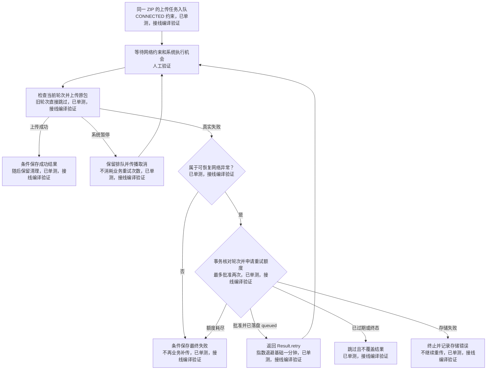

### 当前实现：手动入队确认

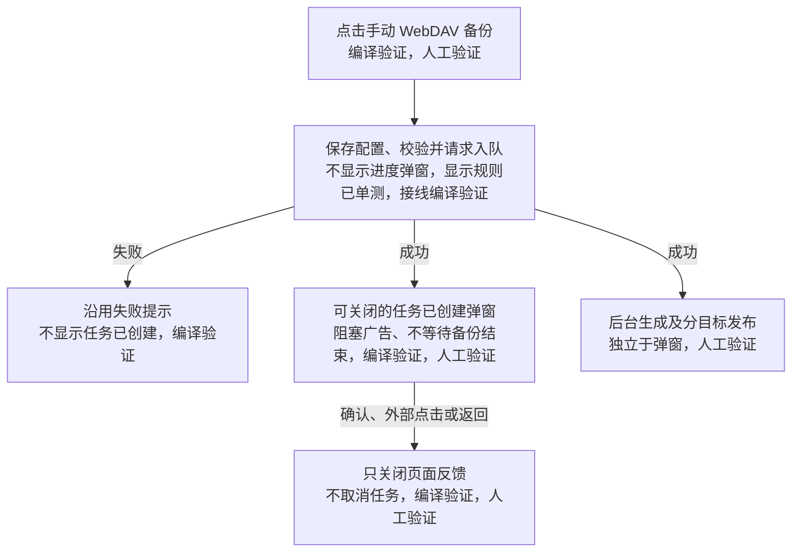

### 当前实现：手动云端完成反馈

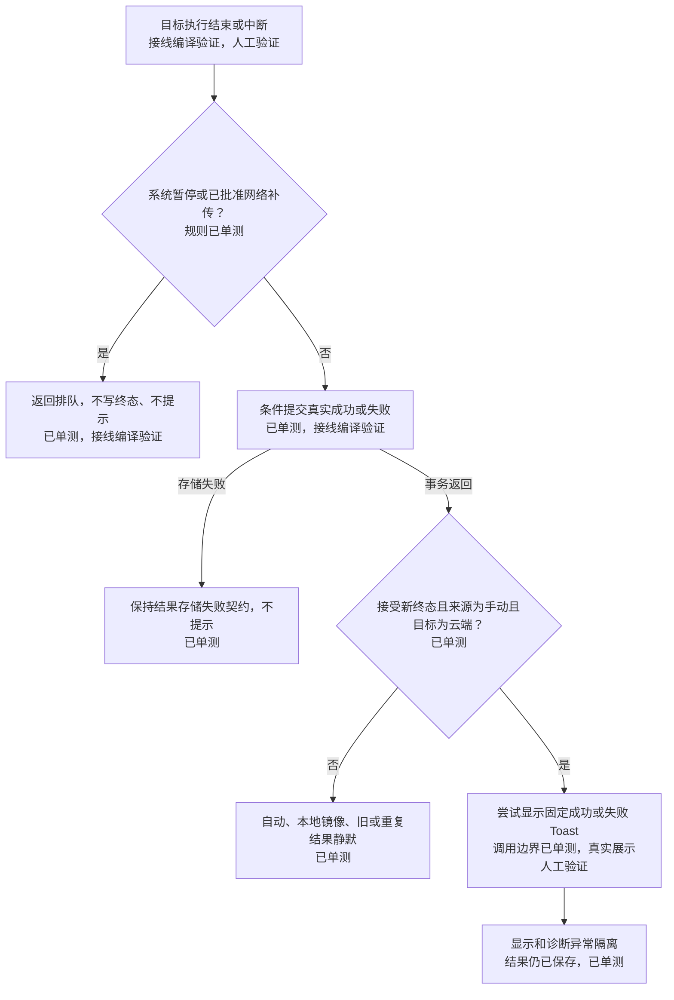

### 当前实现：单 ZIP 上传

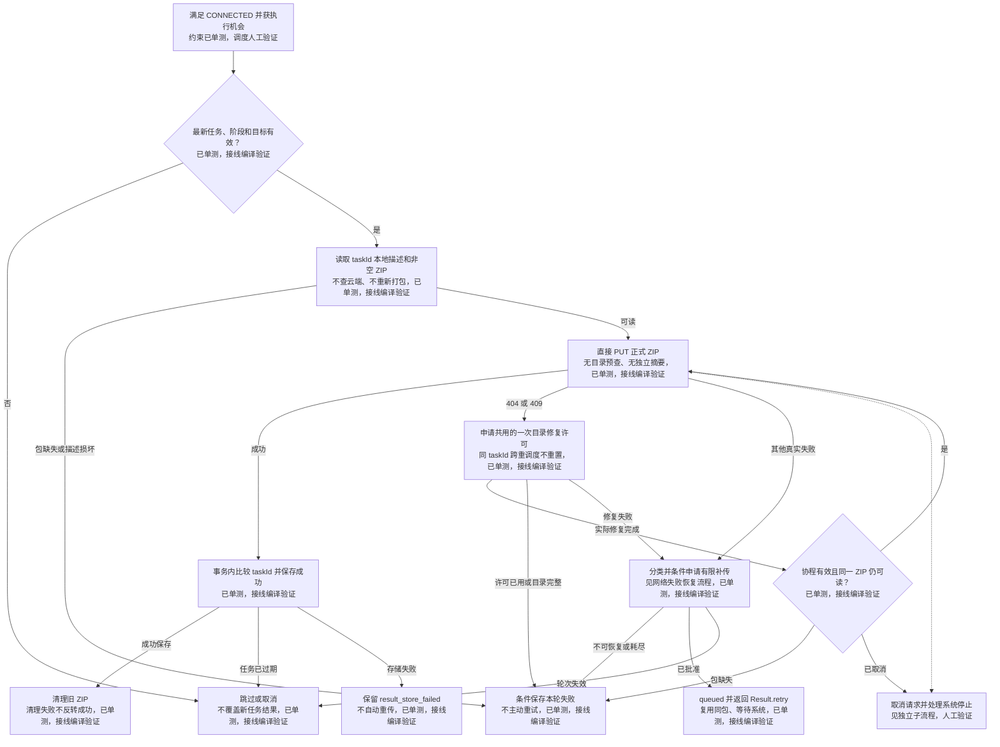

### 当前实现：目录缺失修复

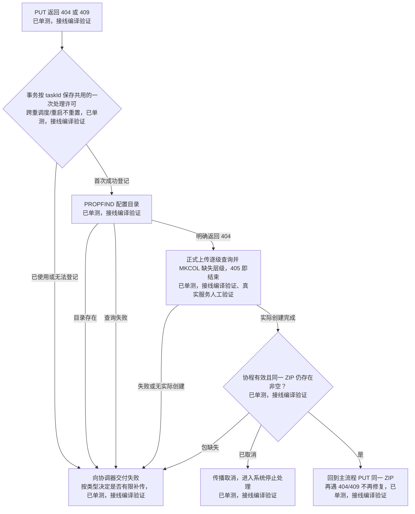

### 当前实现：系统停止与重新执行

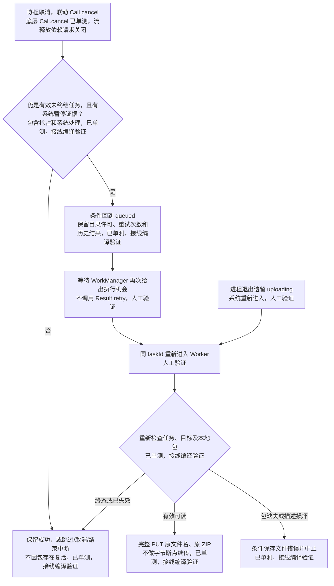

### 当前实现：基础列表与恢复入口

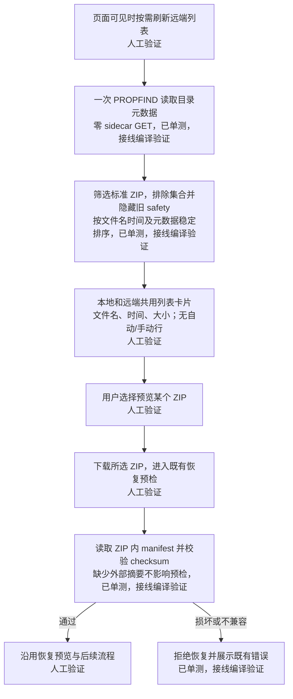

### 当前实现：“我的”页失败原因展示

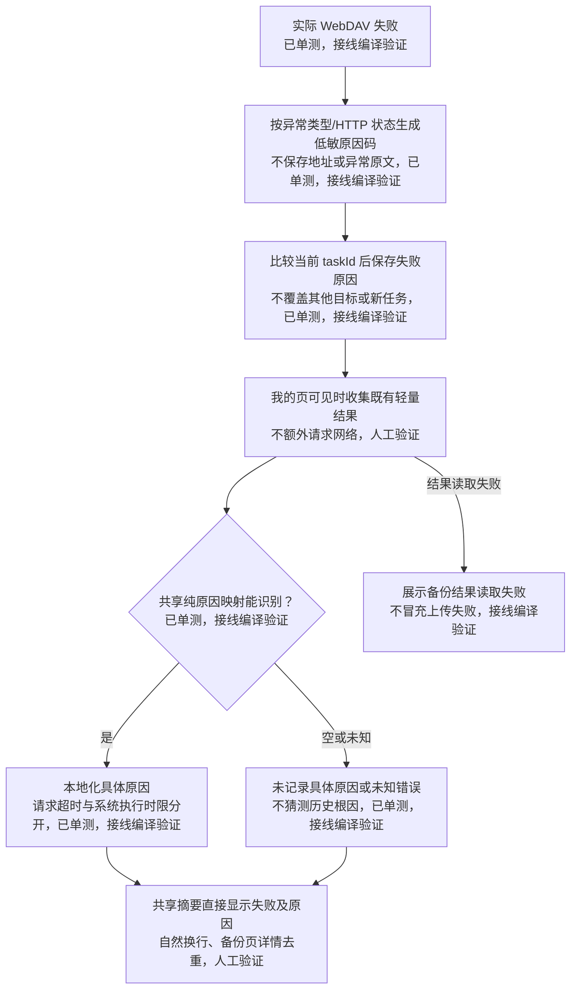

### 当前实现：新轮次生成与并行分派

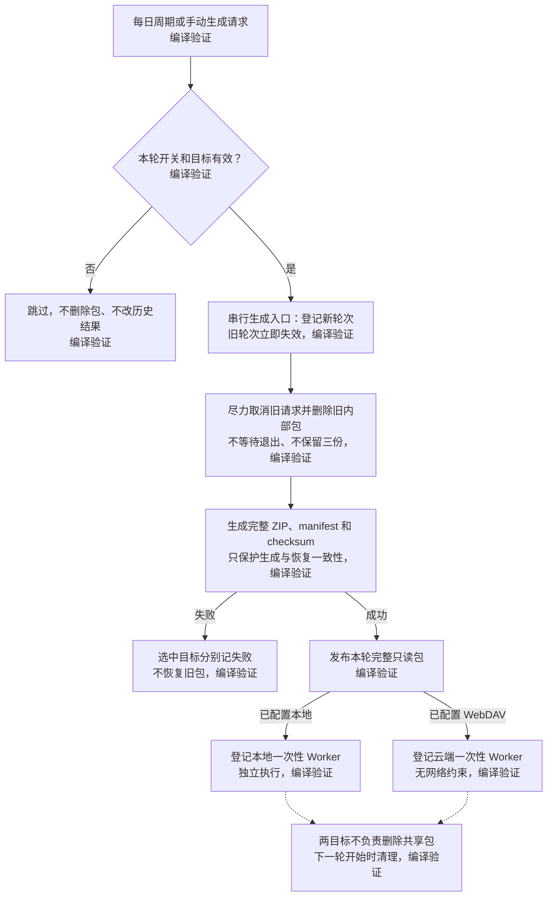

### 当前实现：本地保存

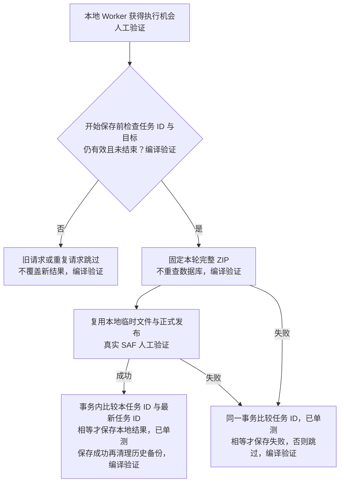

下图表示 2026-10-26 的父图与请求所有权边界；会话有 JVM 回归，导航实际返回、owner 释放及进程重建仍待设备验收。

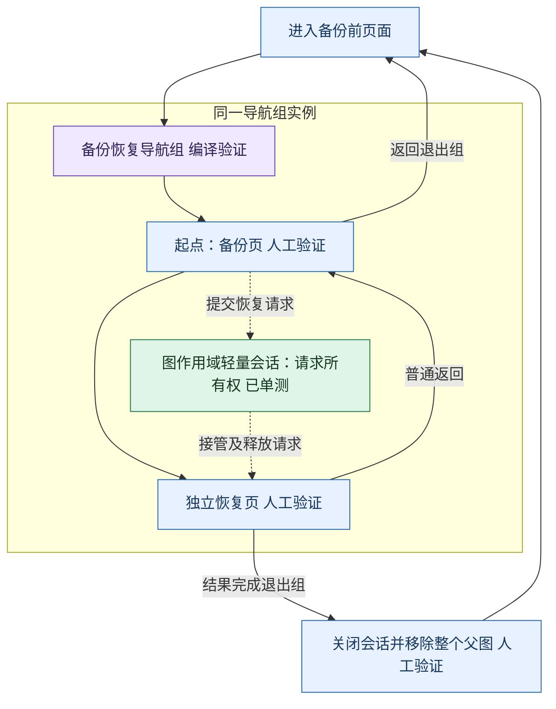

### 恢复流程

以下三张图按 2026-10-26 实现表达读取与预览、分阶段恢复、返回与清理。当前只接受格式 5；已删除媒体入口和媒体运行状态对返回的限制，保留真实恢复期间的门禁和部分成功。

页面状态为 `Hidden → Reading → Preview → Restoring → Result / Error`。`Hidden` 是首次请求检查前的等待状态以及退出后的清理状态；读取失败直接进入 `Error`，功能库或设置阶段失败且携带已提交报告时进入部分成功的 `Result`。

#### 入口、读取与预览

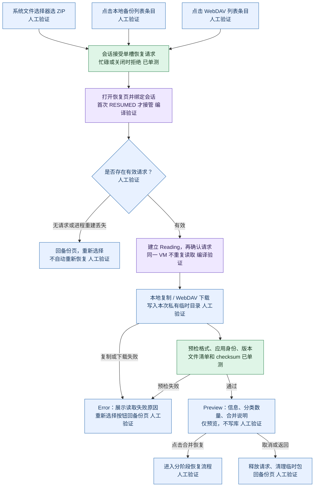

请求先被当前导航组会话接受，再打开恢复页；系统文件选择器取消不提交请求。预览保留同一份私有临时包，显示文件信息、来源、备份时间、版本、校验结果和分类数量。按钮直接启动合并恢复，没有额外的恢复确认弹窗，也不自动生成安全快照。

#### 执行与部分成功

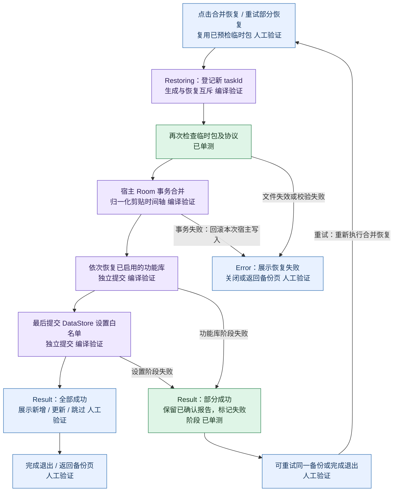

当前 JSONL 备份按宿主 Room、可选功能库、DataStore 设置的顺序恢复，三者不组成跨库事务。非当前版本在预检阶段拒绝，不再存在旧数组恢复入口。宿主事务失败会回滚该事务；功能库或设置失败保留此前已提交的数据，部分结果只承诺异常明确携带的报告，不推测失败阶段写入了多少。部分成功重试会重新执行整个合并恢复，依赖既有幂等规则跳过相同数据，并非仅重试失败阶段。未知异常仍进入 `Error`。

#### 返回、完成与取消清理

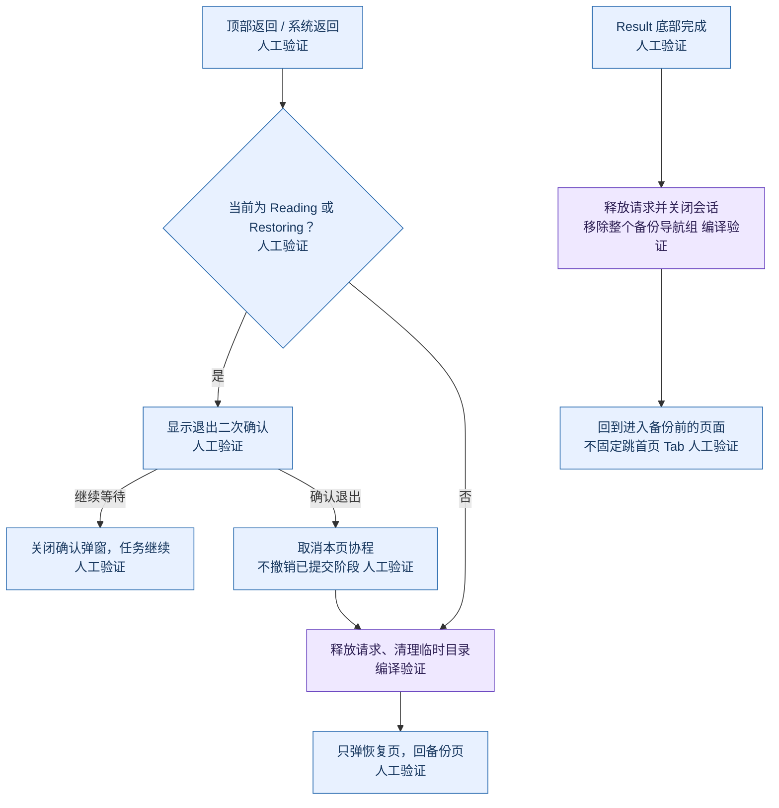

读取/恢复失败先保留错误页；部分成功保留临时包供重试，不在进入失败或结果状态时立即删除。普通返回、确认取消、完成以及恢复 VM 的 `onCleared()` 负责本次临时文件清理。取消只表示取消当前任务；已提交的 Room、功能库或设置不会被整组回滚。页面离开前台不会重复启动读取，也不把已确认任务自动变为后台可续跑任务；进程死亡丢失内存请求和报告后退回备份起点，已提交数据仍保留。

本轮复用既有离线 HTML 生成器；测试与设备验收边界见顶部本次实施记录。已删除媒体关联流程图。

## 数据流

### 本地导出

1. 用户选择“导出本地备份”。
2. 页面通过系统文件创建器拿到写入 URI。
3. `BackupRepository` 记录各表 high-water mark，并按分页读取当前窗口内的数据。
4. `BackupPackageWriter` 先写入各业务 JSONL 临时文件和设置 JSON，再生成 `BackupManifest`。
5. 生成 `.zip` 备份包，校验包内 `manifest.json`、业务 entry、文件大小和 checksum 后写入用户选择的文件。

### 本地备份文件夹

1. 用户通过系统目录选择器选择本地备份文件夹，应用保存持久化读写授权 URI，并尽量解析目录 displayName 或 URI 尾段作为页面展示路径。
2. 本地备份文件夹 URI 只保存在本机配置，不进入备份包，系统 Auto Backup 也需要排除。
3. 后续 WebDAV 手动备份或自动备份复用该目录时，必须用同一份 `BackupExportResult` 写入 `.zip` 文件和 manifest sidecar，确保本地与远端备份内容一致。
4. 本地授权失效或发布失败时仅结束本地目标；云端已独立登记，两目标互不覆盖。

### 本地导入

1. 用户通过系统文件选择器选择备份文件。
2. `BackupRepository` 通过私有临时文件和 `ZipFile` 校验格式标识、`applicationId`、schemaVersion、包内文件清单和 checksum。
3. 页面展示预检摘要，只预览不写库。
4. 用户确认后，Repository 按 JSONL 行和 chunk 解析数据；剪贴记录写库前先归一化未来时间字段，再在事务中合并恢复。
5. 恢复完成后展示恢复报告。

### WebDAV 手动备份

1. 提交并验证目标草稿，再登记一次性生成请求；页面返回仅表示已安排，不表示 ZIP 或远端已经完成。
2. 生成 Worker 在生成/恢复锁内登记新轮次，尽力取消旧目标并清理受控旧内部包及后台生成缓存，再生成完整 ZIP。
3. 完整 ZIP/sidecar 复制至 `noBackupFilesDir/backup_pending_upload/<roundId>` 后原子推进 ready，清理本轮生成缓存并分别登记本地/云端唯一任务。
4. 两目标只读取自己的 roundId 和固定包，不互相等待；开始前核对当前身份、阶段和目标配置。
5. 云端实际执行时读取密码，直接 PUT 正式 ZIP，无预查目录、无外部 manifest PUT、无网络约束/回读/latest.json；404/409 按 taskId 共用一次持久化目录修复机会，实际创建后补传同包。
6. 成功/真实失败通过事务内条件提交；有证据的系统停止仍有效时回到 queued 而不覆盖历史结果，等待系统重调度；主动/未知停止沿用终结契约。成功实际落盘后才清理，清理异常不反转成功，共享包不由消费方删除。

### 自动备份

1. 启动、开机和设置变化仅更新 24 小时唯一周期，取消旧 `backup_auto_dirty`；首次启用初始延迟 24 小时，不立即生成。
2. 普通业务保存不触发备份。生成 Worker 自动关闭或无目标时直接跳过，不删除当前完整包、不改历史结果。
3. 有效新轮次先替换身份，再取消旧目标和删除旧内部产物；新包失败不恢复旧包，只结束选中目标。
4. 本地和云端分别登记一次性任务，无网络约束、互不依赖。排队显示等待执行；历史结果继续保留。
5. 无网、认证、实际请求超时和发布失败不调用 Result.retry。WebDAV 有证据的系统停止可恢复 queued，系统重新进入允许 ready/queued/uploading，但共用修复许可不重置；终态不得重传。本地中断保持原契约，当前完整包保留到下轮开始。
6. 升级仅取消旧 artifact 请求并清除 pending 引用，旧内部文件留到下一轮开始清理；旧输入缺少 round_id 时安全退出；启动不补入队，ready 到入队之间进程死亡接受等待下一次周期/手动触发。

### 保留份数

1. 普通备份默认保留 5 份，用户可设置 1-20；本地和 WebDAV 都按该数量保留最近的普通备份。
2. 手动备份和自动备份都算普通备份，统一参与保留清理，不再区分当前安装标识或旧安装标识。
3. 本地沿用 manifest 安全识别；WebDAV 仅清理标准普通 ZIP 文件，不删除 safety、不可识别文件、集合目录或其它用户资源，不查询/删除旧 sidecar。
4. 新备份完整写入、校验和发布成功后才清理旧备份，避免新备份失败时旧备份也被删除；手动刷新列表也会触发一次保留清理，让历史超额备份立即收敛。
5. 本地排序沿用 manifest `created_at`；WebDAV 使用标准文件名时间，失败时用修改时间和文件名兜底，但修改时间不能使未知文件获得清理资格。
6. 只统计可识别普通 ZIP；本地仍删除其 sidecar，WebDAV 只删除 ZIP，旧 sidecar 不参与保留份数。
7. 每次备份或刷新清理后记录本地/WebDAV 清理了多少旧备份，最近成功摘要中展示自动备份产生的清理结果。

### 恢复安全边界

1. 恢复前只做预检，不再自动生成 `backupKind = safety` 的恢复前安全快照。
2. 宿主写库保持 Room transaction，该事务失败会回滚本次宿主写入；可选功能库和 DataStore 设置分别在宿主事务之后提交，不承诺跨库整体原子性。后续阶段失败保留已提交数据及明确报告，页面展示部分成功，允许幂等重试；取消任务也不撤销已提交阶段。
3. 恢复确认文案提示用户：恢复会合并到当前数据，不会清空；如需保留恢复前状态，请先手动导出普通备份。
4. 历史版本已经生成的 `backupKind = safety` 文件不会被新流程自动删除，但备份列表会隐藏这些旧回滚文件，避免干扰普通备份选择。

### WebDAV 手动恢复

1. 一次 PROPFIND 读取远端文件元数据，筛选标准 ZIP，排除集合；不 GET 外部 manifest 或完整包。
2. 按文件名时间及目录元数据排序，不读取共享“最新备份”指针；列表不展示自动/手动类型。用户选择具体 ZIP 后才下载并读取包内 manifest/checksum。
3. 用户预览指定备份时下载完整 `.zip` 快照并执行同本地导入的预检流程。
4. 用户确认后执行合并恢复。

## 备份格式

当前使用格式 5 的单个 ZIP 包；只接受 JSONL，不再读取旧数组协议。完整宿主 entry 清单和可选 contributor 边界以顶部协议章节为准。

- `manifest.json` 保存格式、版本、摘要、业务文件大小与 checksum；`data_format` 为 `jsonl`。
- 剪贴、来源 App、链接预览与搜索历史使用 `.jsonl`；设置使用 `data/settings.json`。
- 设置中的 `blocked_clip_source_packages` 只保存规范化包名，恢复时与本机名单取并集并裁剪到 500 个。
- 下载任务不进入 ZIP、摘要或恢复报告；可选 TorrentSearch 的版本与字段仍由其 contributor 定义。

当前 `source_apps` 保存历史来源名称，并保留旧图标元数据字段兼容备份；Shizuku 图标同步和图标预热写库链路已停止，新内存图标与主色不会写入此表。升级前或旧备份中可能仍有仅由旧预热链路生成、没有现存剪贴记录的来源缓存，沿用现有恢复和候选规则，不自动过滤、清洗或删除这些历史数据。

剪贴保存过滤选择页使用主进程 `QUERY_ALL_PACKAGES` + `PackageManager` 在页面可见或用户刷新时直读当前安装应用；当前安装应用列表、读取状态和图标不写 Room、不写文件、不进入 `source_apps`、`data/settings.json`、JSONL、WebDAV/本地备份或系统 Auto Backup。卸载重装或换设备后重新读取本机安装应用即可，真正需要迁移的是 `blocked_clip_source_packages` 包名名单。

manifest 简化示例：

```json
{
  "format": "clip_master_backup",
  "application_id": "com.cla.clip.master",
  "schema_version": 5,
  "data_format": "jsonl",
  "encryption": "none",
  "compression": "zip",
  "created_at": 1716000000000,
  "app_version_code": 19,
  "app_version_name": "0.3.2",
  "device_label": "install-ab12cd34",
  "source": "local_manual",
  "backup_kind": "manual",
  "snapshot_file_name": "clip_master_backup_install-ab12cd34_20260519_120000.zip",
  "file_size": 4096,
  "checksum": "sha256-hex",
  "files": [
    {
      "path": "data/clips.jsonl",
      "size": 1234,
      "checksum": "sha256-hex"
    }
  ],
  "summary": {
    "clip_count": 10,
    "source_app_count": 3,
    "link_preview_count": 2,
    "search_history_count": 5,
    "feature_counts": {
      "torrent_search_count": 3
    }
  }
}
```

`checksum` 对包内各业务数据文件的路径、大小和文件 SHA-256 生成汇总 SHA-256，用来发现半截文件、业务文件缺失或服务端异常改写。恢复时必须先校验 manifest、逐文件 checksum 和 App 身份，再按事务分批恢复，避免半包数据写入本地。后续可按需求评估压缩或备份包加密，但不能回退成单条 JSON 保存所有业务数据。

## 恢复规则

- 恢复时不清空本地数据，采用合并去重；同一个备份重复恢复多次结果稳定。
- 同一条剪贴记录按内容、来源包名和时间状态构造稳定去重 key；字段冲突默认按更新时间较新者优先。
- 来源 App 按包名幂等恢复；链接预览按链接 URL 幂等恢复；搜索历史按“搜索范围 + 规范化关键词”幂等恢复。恢复报告必须按真实新增、更新、跳过统计，不能把 `upsert` 写入条数直接当成新增数量。
- 恢复后的剪贴数据继续使用当前入库规则参与后续复制去重：已有来源为空、`Unknown` 或“未知”的同内容记录可被后续明确来源覆盖升级；不同明确来源的同内容记录可以并存；本次未知来源遇到已有明确来源时跳过。
- 本地在备份创建时间之后产生的新状态不被旧备份覆盖；若备份 manifest 创建时间来自未来设备，则先归一到本机恢复开始时间再参与比较。
- 恢复剪贴数据时保留备份内时间的相对顺序，但会把远端未来时间归一到本机时间轴，避免 `timestamp` 或置顶/折叠/删除时间一直显示“现在”并影响列表排序。
- 回收站剪贴数据继续备份，恢复后仍在回收站。
- 彻底删除的剪贴数据不会进入新的备份；恢复格式 5 的较早快照可能带回旧数据。
- 恢复剪贴数据时重新计算 `searchText` 等派生字段，不盲信旧备份中的派生值。
- TorrentSearch 恢复按其稳定 infoHash、规范化查询等键幂等合并，并由恢复报告单列新增、更新和跳过；旧磁力 JSONL 无论功能开关均标记为“不兼容并跳过”，不得迁移或计入成功。
- checksum、格式标识或 `applicationId` 校验失败时禁止导入。

## 安全与隐私

- 备份包第一版不加密，用户可见界面必须提示备份包含剪贴内容。
- 日志和非凭据编辑 UI 不输出剪贴内容、账号、密码、Cookie 或完整 URL 查询参数；WebDAV 密码仅在用户主动点击查看后于密码输入框内显示，切换可见性不复制、不额外持久化密码。
- WebDAV 密码只在本机以 Android Keystore 认证密文保存，不进入备份包；密文不可解时提示重新输入，系统云备份与设备迁移均排除宿主 DataStore 文件。
- 系统 Auto Backup 需要排除 WebDAV 密码、备份目录 URI、健康状态等敏感或设备绑定配置。
- 系统 Auto Backup 和设备迁移规则额外排除 `clipboard_bridge_icons/` 和 `clipboard_bridge_clip_payloads/`；这些目录只用于 Shizuku Provider 来源图标和剪贴 payload 临时传输，都不是可跨安装恢复的剪贴数据，恢复后继续保留反而可能让旧事件临时文件被误用。
- 文件名使用脱敏短标识，例如 `clip_master_backup_<installId8>_<yyyyMMdd_HHmmss>.zip`；真实设备名只放备份元信息，不直接暴露在文件名中。

## DataStore 替换方案接入影响（已实施）

宿主设置设计见 [MMKV 替换为 DataStore 方案](datastore_replacement_plan.md)。导出读取 `ClipSettingsRepository` 的一次性白名单快照；恢复按宿主 Room、可选功能库、DataStore 设置分阶段提交，后续阶段失败携带已完成报告，页面显示部分成功并提供幂等重试。WebDAV 编辑使用内存草稿，测试连接或上传前成组提交配置与加密凭据；表单直接按当前地址、用户名和密码保存并连接，不要求账号变更时再次输入密码，也不在页面额外拦截。网络操作从同一磁盘快照取得目标和凭据，避免错配。已配置远端即使健康缓存为 unknown 也计入自动备份目标；每次执行读取最新数据，分目标提交结果，不再维护变更或确认版本。宿主 DataStore 文件被系统云备份和设备迁移排除。

备份页首次读取失败提供重试；页面读取已保存密码并回填输入框，默认遮蔽，右侧按钮切换明文与遮蔽显示。密码仅在备份页 ViewModel 内存状态中保留，不使用 SavedStateHandle 或 rememberSaveable 保存；提交成功后回填已提交密码，不再清空输入框。用户编辑中的草稿不被异步读取覆盖；页面不展示“已保存密码”说明或“移除已保存密码”按钮，不保留待移除状态或专门的密码编辑标记。表单提交始终使用输入框当前密码，清空输入框就提交空密码，不再表示保留旧密码。修改账号或地址后仍使用当前密码尝试连接，认证是否成功交给服务端和既有连接错误提示。密码解密失败保留密文并提示重新输入，不阻止用户编辑和修复配置。手动文件导出更新本地结果；手动 WebDAV 的本地镜像与远端上传分别更新结果。完整或部分恢复后均直接展示报告，没有媒体关联步骤。独立存储与系统任务队列间仍有中断窗口，按文件身份和持久阶段核对；无变化时会增加备份 IO。

## TorrentSearch 备份接入影响（已实施）

备份协议已使用 `schemaVersion = 5`。启用 TorrentSearch 实现时，`TorrentSearchBackupContributor` 通过 `BackupFeatureContributor` 扩展点，仅以字段白名单导出版本 1 的书签、搜索历史、已查看和非敏感默认排序设置，并在预检、`feature_counts` 与恢复报告中单列该分类；三张表使用 high-water mark + keyset 分页，恢复按 infoHash、规范化查询等稳定键幂等合并，同页重复键只保留时间最新项并把其余项计为 skipped。Torznab/API Key、Cookie、NSFW、SAF URI、Provider 健康、缓存、临时文件、新数据库、DataStore 和 WebView 数据均不导出，并由系统 Auto Backup 排除。

任务 06A 新增的 Provider 选择初始化哨兵、首次多源隐私披露确认和安全模式开关均属于本机隐私/安全决策，不进入自定义备份，也不触发 dirty；排序字段仍属于任务 7 计划导出的非敏感设置。独立 DataStore 已按任务 05B 从系统云备份和设备迁移整文件排除，因此本切片不新增备份代码或 schema 字段。

任务 06B 点击搜索或 Browse 结果时复用现有 viewed 表刷新已查看时间，不新增 Room 表或列；任务 7 已为 viewed DAO 增加分页导出与按 infoHash 批量冲突查询，成功变化只写业务数据，按每日或手动备份读取。原生详情候选、正文、图片 URL、文件与 Tracker 只保存在页面内存或网络缓存，不进入备份。

任务 06C 已提供书签、搜索历史、已查看三个本地数据目的地；任务 7 的分页 DAO、字段白名单、稳定键幂等恢复、预检计数和分类报告保持；保存、删除、清空、历史记录和书签文件导入不再依赖 dirty marker 或宿主运行状态。书签 SAF URI 仍只是选择器返回后的单次方法参数，原始输入 JSON、输出目标、选择器授权和解析中间态永不进入数据库、DataStore、自定义备份或系统云备份；只有成功写入 Repository 的合法记录具备白名单恢复资格。

旧磁力备份已在预检与报告中标为“不兼容并跳过”，不得迁移或计为成功；首次手动本地导出、手动 WebDAV 上传或开启自动备份前统一披露未加密 ZIP/WebDAV 风险，确认状态只保存在本机且不进入备份。旧数据库与 Academic Torrents 缓存由功能入口的独立确认门按固定路径重新校验后精准清理。完整数据字段、旧数据清理和日志脱敏规则以 [TorrentSearch 主方案](magnet_search_plan.md) 为准。本次只更新实现状态和边界，现有 Mermaid 的备份/恢复节点语义未改变，故不重新生成 `docs/flows` HTML。

## 日志与诊断计划

- 密码回填复用 `BackupSettingsRepository.loadWebDavConnection()` 的 IO/Keystore 边界，仅设置快照变化（包含首次加载和读取重试）及草稿提交后读取，不随后台运行状态更新反复解密；编辑期间不从设置流重新回填。解密失败记录 `logW`、固定 reasonCode 和异常类型，并复用“已保存密码无法读取”提示；不记录密码、密文、地址、用户名或异常 message。密码和回填编辑状态仍排除本地 ZIP、WebDAV ZIP 与系统 Auto Backup；UI state 只在编译期使用，无新增外部协议，不新增 keep/R8 验证。
- 密码查看/隐藏属于组件内展示切换，无网络、文件或数据库副作用，不新增日志，避免记录凭据或制造交互噪声；显隐状态也不作为诊断字段输出。
- 自动备份、手动本地备份、手动 WebDAV 备份、恢复、保留清理和 WebDAV 健康检查都生成短 `taskId`，同一次流程的开始、关键阶段、成功、失败、跳过和重试日志必须带同一个 `taskId`。
- 备份相关日志正文、阶段描述、错误说明和人工可读提示必须统一使用简体中文；`taskId`、`reasonCode`、`backupKind`、`target`、字段名、TAG、枚举稳定值等结构化标识保留英文，便于搜索和聚合。
- TorrentSearch 备份/恢复日志只允许记录分类数量、是否含敏感设置、合法性跳过数量和 `reasonCode`；禁止记录搜索词、书签/历史/已查看内容、完整 URL、API Key、Cookie、磁力原文、完整 infoHash 或 Provider 响应。
- TorrentSearch 任务 05C 的书签导入文件只作为一次性输入，解析结果需经既有书签 Repository 写入后才按任务 7 的字段白名单参与自定义备份；原始 JSON、导入 URI、失败条目和解析中间态不持久化。Torznab 配置与 API Key 继续整体排除自定义备份；Keystore AES-GCM 密文所在 `torrent_search_torznab_secrets.xml` 也必须从系统云备份和设备迁移排除，避免恢复到缺失原 Keystore key 的安装后留下不可解密或误导性的凭据状态。
- 自动备份调度记录每日周期更新、旧任务取消、同包入队、阶段切换、身份替换和终态清理；字段只包含开关、24 小时周期、source、artifactId、网络约束和稳定 reasonCode，不记录 WebDAV 地址或本地授权 URI。
- 自动备份执行记录开始、跳过、快照生成、本地写入开始/成功/失败、WebDAV 上传开始/成功/失败、结束和失败，不记录应用已取消的重试路径；字段包括目标是否配置、保留份数、备份类型、文件名、文件大小、条目数量、清理数量、耗时和 reasonCode。
- 手动本地备份记录开始、快照生成和成功；手动 WebDAV 备份记录开始、本地镜像写入、WebDAV 上传和成功；字段包括文件名、文件大小、条目数量、耗时和目标状态，不记录用户选择文件 URI、WebDAV endpoint、用户名或密码。
- 备份 zip 组装阶段不再把真实 `fileSize` 写回包内 manifest；包内 manifest 固定 `fileSize = 0`，避免 fileSize 字段改变 JSON 长度后影响 zip 压缩结果并产生大小震荡。当前实现保留本地目录 sidecar、私有描述、导出摘要和阶段日志中的真实文件大小，WebDAV 不独立发布 sidecar，不需要另一份共享摘要；日志字段包含 `taskId`、文件名、真实文件大小、包内 manifest fileSize 和 entry 数量，不输出临时目录绝对路径和备份内容。
- 恢复流程记录 `restore start/success/failed`，字段包括备份类型、文件大小、预检数量摘要、新增/更新/跳过数量、未来时间归一化字段数、正向时钟偏移毫秒数和耗时；失败日志输出 reasonCode 和异常类型，不输出备份内容。
- 来源过滤名单恢复裁剪时记录 `reasonCode=backup_blocked_packages_trimmed`、本机数量、备份数量和合并后数量；禁止记录具体包名列表、App 名称或拦截次数。
- 导出职责拆分后，`BackupSnapshotExporter` 继续复用既有 high-water mark、分页兜底和快照生成日志；本轮不新增新的敏感字段，也不记录单条业务 JSONL 内容。
- 恢复职责拆分后，`BackupSnapshotRestorer` 继续复用既有恢复写库完成日志和解析失败日志；本轮不新增新的敏感字段，也不记录单条恢复内容。
- 本地和 WebDAV 保留清理记录候选数量、待删除数量、成功删除数量、备份类型、保留份数和删除失败 reasonCode；只记录本 App 生成的备份文件名，不记录目录 URI 或 WebDAV URL。
- WebDAV 健康检查和上传记录远端目录长度、是否允许 HTTP、是否存在用户名、状态码、请求阶段和 reasonCode；不输出 endpoint、Authorization、账号、密码、请求体、响应体或完整 header。
- WebDAV 目录存在性检查只在 404 时进入创建分支；IO/TLS 异常统一映射为 `remote_failed` 并记录请求阶段和异常类型，避免误导为目录不存在或不可写。
- `logD` 用于阶段性流程、调度和数量摘要；`logI` 用于用户触发或后台关键任务成功；`logW` 用于跳过、部分成功、可恢复重试或 WebDAV 健康不可用；`logE` 用于任务失败、恢复被阻止或清理删除失败。
- 验证时需要检查 `git diff` 中新增日志是否只包含结构化低敏字段，确认未出现剪贴内容、搜索词全文、完整 URL、WebDAV 密码、本地授权 URI、Cookie、Token、请求/响应全文和备份包内容。

## 实现步骤

### v1 必须完成

- 新增 `BackupSnapshot`、`BackupManifest`、预检摘要和恢复报告模型。
- 备份文件使用 `.zip` 包格式，包内以 `manifest.json` 管理多个业务 JSON 文件和逐文件 checksum。
- 新增 DAO 导出接口和恢复合并接口。
- 新增 `BackupRepository`，支持生成备份、解析备份、预检、恢复和 checksum 校验。
- 新增本地导出/导入 UI。
- 本地备份文件夹选择复用系统授权；WebDAV 手动备份同时选择已配置本地目标，完整包后两目标独立分派。
- 备份和恢复长任务都使用不可取消弹窗提示当前状态，并保持紧凑进度指示。
- 新增 WebDAV 配置、测试连接、手动上传、列举、预览和恢复。
- 新增 `backupKind = manual / auto / safety`，其中 `safety` 仅用于兼容识别旧版恢复前回滚文件；新流程只生成 `manual` 和 `auto`。
- 自动备份统一开关、保留份数 1-20 和两类目标最近完成结果，退役仅 Wi-Fi 选项。
- WorkManager 每日生成、同包分目标保存，无网络约束；生成/恢复串行，消费并行，轮次条件提交，完整包下轮删除；真实失败不主动重试。
- 新增本地和 WebDAV 普通备份保留清理；手动和自动普通备份都纳入最近 N 份限制，旧版 safety 和异常文件不删除。
- 新增本地备份目录列表，展示普通手动/自动备份并支持预览；旧版 safety 回滚文件只识别隐藏，不作为普通备份展示。
- 更新 `AGENTS.md` 的备份覆盖维护规则。
- 编译验证 `./gradlew :base:general:compileDebugKotlin` 和 `./gradlew :app:compileDebugKotlin`。

### 当前阶段：大数据量备份导出/导入流式化

- 本地对外仍保持单个 `.zip` 备份文件和 manifest sidecar，WebDAV 对外只发布单 `.zip`，不改成本地目录包，不备份媒体文件本体。
- 新导出使用 `schemaVersion = 5` 和 JSONL 数据文件，旧数组模型与恢复入口已删除；所有非当前版本在预检阶段拒绝。
- `BackupFeatureContributor` 继续追加模块白名单数据和 `feature_counts`，宿主五个必需 entry 不限制模块额外条目。
- 导出不再生成整包 `ByteArray`：先分页写 JSONL 临时文件并计算 size/checksum，再生成 manifest，最后组装 zip。
- 导出开始时记录可分页表的 high-water mark，本次只导出已存在记录；导出期间新增变化由下一次每日或手动快照读取。
- 导出流程由 `BackupSnapshotExporter` 承载，仓库入口只负责互斥和对外 API；新增备份表时优先扩展 exporter 的分页导出方法、`BackupSummaryBuilder` 和 mapper，不把导出细节继续塞回 `BackupRepository`。
- 恢复流程由 `BackupSnapshotRestorer` 承载，仓库入口只负责互斥和对外 API；新增备份表时优先扩展 restorer 的 v1/v2 分支、chunk 合并规则、分类报告和 mapper，不把恢复事务继续塞回 `BackupRepository`。
- Room 实体与备份协议模型转换集中在 `BackupEntityMappers.kt`；这些 mapper 只处理字段白名单、派生字段重建、敏感字段剔除和运行中任务降级，不直接读取数据库、文件或网络。
- 预览和恢复改为 `BackupPackageRef` 文件引用；外部 URI 和 WebDAV 下载先复制到应用私有临时文件，再用 `ZipFile` 读取 manifest、entry 和 checksum。
- 预览只解析 manifest 和流式校验完整性，不反序列化全部业务数据。
- 恢复按 JSONL 行和 chunk 解析、查询已有记录并写库；进入 Room transaction 后不可取消。
- 本地 SAF 和 WebDAV 写入都改为文件流复制；WebDAV 上传使用带 `Content-Length` 的文件 RequestBody，发布正式文件前重新校验远端临时 zip。
- 临时文件按导出和导入下载分区保存，文件名带 taskId；由任务自身清理，后台导出残留在新轮次开始清理，不再在启动、备份页初始化或恢复请求接管时按年龄扫描删除；用户正式备份保留清理继续忽略 `.tmp`。
- 备份/恢复弹窗从单一文案升级为阶段 + 数量；日志按阶段和类别节流记录，不按 JSONL 每行输出。

### 后续增强

- 首次恢复引导。
- 前台通知和长任务取消边界。
- 分类恢复。
- gzip 压缩和加密备份。
- 媒体文件化备份目录：只在明确启用媒体备份后保存媒体文件本体。
- golden 备份测试文件。

## 测试验证

- 2026-09-30 密码表单：先补回归测试，覆盖已保存密码回填、异步加载保护编辑和清空输入、变更用户名/地址后按当前密码提交、空密码真实提交而不沿用旧密码。删除已废弃的移除按钮和强制密码动作测试，由 `BackupWebDavFormMapperTest` 保护表单映射与提交契约。复用 `OutlinedPasswordTextField` 默认隐藏及显隐按钮，不新增 Compose 组件。运行 `./gradlew.bat :app:compileDebugKotlin :app:testDebugUnitTest`；真机验收提示与移除按钮消失、默认遮蔽回填、保存后继续显示、清空密码后提交空密码、变更账号后由连接结果决定成功或失败。状态映射由 feature-local `BackupWebDavFormMapper` 承载，ViewModel 只编排读取与提交。
- 密码显隐验收：初次进入为掩码；输入后点击可查看当前完整密码，再次点击恢复掩码；切换后继续编辑不丢字；空密码可切换；长密码、小屏、大字体和深色主题下按钮仍可用；离开后重新进入默认隐藏；TalkBack 分别读出“查看密码”与“隐藏密码”。
- 2026-09-28 密码显隐测试判断：仅 Compose 局部展示状态和按钮接线，没有抽出业务规则，不新增 JVM 单测或走 TDD；运行 `./gradlew.bat :app:compileDebugKotlin` 与 `git diff --check`，交互、焦点和键盘观感需要真机验收。无协议、反射或序列化改动，不新增 keep/R8 验证；备份数据范围保持不变。
- 本地导出后从文件预检，确认摘要正确。
- 同一个备份重复恢复不会产生重复数据。
- App 身份不匹配、schemaVersion 不支持、checksum 损坏、半截 zip 或缺失业务数据文件均禁止导入。
- WebDAV 默认目录可用，用户修改目录后能保存并规范化。
- 设置本地备份文件夹后，同一完整包独立交给本地和 WebDAV；本地发布 ZIP/sidecar，WebDAV 只 PUT ZIP，互不等待。
- 设置本地备份文件夹后，页面展示已设置的目录路径或目录名。
- 本地备份文件夹授权失效时，只记录本地失败；同轮 WebDAV 不受影响。
- WebDAV 目录存在时不应触发创建；只有服务端明确返回 404 时才逐级创建目录。TLS、证书、网络、认证、跳转失败或服务端错误不能被误判为“目录不存在”，应直接按远端失败或认证失败提示。
- WebDAV 列表只读取目录元数据；旧 sidecar/共享指针存在、缺失或损坏都不影响列表，恢复仍校验 ZIP 内 manifest/checksum。
- 大量剪贴数据备份时不明显卡死或 OOM。
- 备份包内 manifest 的 `fileSize` 保持为 0，本地目录 sidecar 与私有描述 manifest 的 `fileSize` 应等于真实 zip 大小，WebDAV 不独立上传 sidecar；导出不应再因为 `43333/43334` 这类自引用大小震荡而失败。
- 从远端或本地恢复来自未来时间轴的备份后，剪贴卡片不再长期显示“现在”；恢复后新复制的普通数据应排在置顶数据下方、旧恢复普通数据上方。
- 恢复结果没有媒体关联入口，恢复期间不申请相册权限；自定义导出/恢复完全不读写三张下载任务表。
- release/R8 构建下最近自动备份状态和 WebDAV 健康状态应能从宿主 DataStore 的稳定 code 恢复，不依赖枚举名。

## 已知取舍

- 自定义备份不包含媒体文件本体及下载运行态，系统自动备份保持现有规则。
- 第一版不做多设备同步，只做备份快照和手动恢复。
- 第一版不做备份包加密，隐私依赖用户选择可信存储位置与 WebDAV HTTPS。
- 当前仅使用格式 5 的 `.zip` + JSONL 流式管线，不维护旧版本导入兼容。
- WebDAV 密码现采用独立 Android Keystore alias 的 AES-GCM 密文；该设备绑定方案不提供跨安装密码恢复，用户需在新安装重新输入。
- 自动备份第一版使用统一开关，不拆分本地/WebDAV 独立开关；本地目录和 WebDAV 配置作为目标可用性共同决定执行范围。
- 保留清理默认清理本地/WebDAV 目标内所有可识别的普通备份，手动和自动、当前安装和旧安装都纳入最近 N 份限制，换取更简单直观的用户模型。
- 恢复前安全快照已移除；如用户需要恢复前回滚点，应手动导出普通备份，降低自动生成空回滚文件导致误解的风险。
- 未来时间归一化只修正剪贴记录的用户可见时间轴，不调整搜索历史时间；下载运行态不进入自定义备份。
- 本轮已将恢复事务、chunk 写库、幂等报告和本地较新保护收敛到 `BackupSnapshotRestorer`；暂不再细分到每张表独立 restorer，原因是 v1/v2 分类报告、设置恢复和 Room transaction 仍需要统一编排，过早拆成多类会增加事务边界和报告聚合的维护成本。

## 开放问题

- 自动备份执行时是否需要前台通知由阶段 4 统一评估。
- 备份包加密是否作为默认能力，需要在用户愿意管理恢复密码后再开启。

## 验证记录

- 2026-10-10：本轮仅梳理恢复页现有行为并更新三张流程图；`python tools/render_doc_flow_html.py docs/webdav_backup_plan.md`、对应 `--check` 与 `git diff --check` 通过。已核对三类入口、首次 RESUMED 接管、预检只读、分阶段提交、部分成功重试、媒体入口与返回/完成/取消清理。未修改生成器、Kotlin、资源、测试或备份协议，不新增单测，不运行 Gradle/R8；测试徽标只表示既有覆盖。浏览器无法访问本地 HTTP 预览，且文件 URL 被浏览器安全策略禁止，因此离线 HTML 的浏览器渲染和视觉布局尚未验收，最终回复直接展示主流程 Mermaid 图供查看。

- 2026-10-08：三 Worker、最新轮次和直接上传实施完成。最终运行 `.\gradlew.bat :app:testDebugUnitTest :base:general:testDebugUnitTest :app:compileDebugKotlin :app:minifyReleaseWithR8 --console=plain`，`BUILD SUCCESSFUL`；app 60 个套件 296 项、base/general 17 个套件 82 项，失败/错误/跳过均为 0。证据位于 `build/backup-final-verify.log`，mapping 保留于 `app/build/outputs/mapping/release/mapping.txt`。独立代码复核发现的分派取消及 HTTP 503 自动重发均经失败回归修复；重新复核未发现剩余缺陷。临时移除事务 ID 守卫可使两项过期结果回归失败，已恢复守卫并通过全量检查。流程 HTML 重新生成、`--check` 与 `git diff --check` 通过；生成器未变，不新增脚本测试。既有 Gradle/R8 Shizuku 警告保留。未安装、未提交、未连接真实 WebDAV，设备调度、SAF、离线、进程重建和视觉验收仍待完成；JVM 消费挂起替身不证明真实 WorkManager 并行。

- 2026-10-08：仅澄清任务 ID 比较与备份结果保存的文档措辞，补充 A/B 时序示例并同步本地/云端流程图。运行 `python -X utf8 tools/render_doc_flow_html.py docs/webdav_backup_plan.md`、对应 `--check` 及 `git diff --check` 通过；未修改生产代码、测试、日志或协议，按文档变更范围不运行 Gradle/R8，未作浏览器视觉验收。

- 2026-10-08：核对 BackupManifest、BackupPackageWriter 与 WebDavClient：latest.json 与该包的独立 manifest 使用完全相同的 export.manifestJson，应用业务源码仅写入、未发现读取调用；列表直接扫描 ZIP 并读取各自 sidecar。据此将已确认方案改为停止生成该副本，移除其发布锁/额外回调要求，并修正文档中不存在的指针读取回退流程。运行 `python -X utf8 tools/render_doc_flow_html.py docs/webdav_backup_plan.md`、对应 `--check` 及 `git diff --check` 通过。本次仅修改文档和生成流程图，未实施运行时代码，未运行 Gradle/R8 或浏览器视觉验收。

- 2026-10-08：按用户要求精简本轮待实施方案，核对两处主要任务 ID 检查、原子结果提交、仅 latest 写入的单个 Mutex 和既有终态保护；取消预设多层协调器、任务领取协议及按目标锁池。运行 `python -X utf8 tools/render_doc_flow_html.py docs/webdav_backup_plan.md`、对应 `--check` 及 `git diff --check` 通过。仅修改主文档和配套图，未修改生产代码/测试或运行 Gradle、R8，未作浏览器视觉验收；新行为仍未实施。

- 2026-10-08：本轮只形成“最新轮次并行备份与 WebDAV 直接上传”的已确认方案；已核对调度器、两个现有 Worker、执行协调器、共享锁、包存储、分目标状态、WebDavClient 及 UI/设置调用方。运行 `python tools/render_doc_flow_html.py docs/webdav_backup_plan.md`、对应 `--check` 及 `git diff --check` 通过，修改范围仅主文档和配套生成 HTML。未修改 Kotlin/资源/测试，未运行 Gradle、R8、设备操作或真实上传；新流程全部待实施、待补测。HTML 同步检查不代替浏览器视觉验收。

- 2026-10-02：导航组实施及独立复审完成。新增 13 项会话/归约测试，首轮 API 占位 11 项中 10 项按预期失败，审查新增两项退出回归也先断言失败后修复。最终执行 `./gradlew.bat :app:testDebugUnitTest :app:compileDebugKotlin :app:minifyReleaseWithR8 --console=plain`，BUILD SUCCESSFUL，app 57 个测试套件、276 项测试，失败/错误/跳过均为 0；release mapping 保留在 `app/build/outputs/mapping/release/mapping.txt`。既有 WebView 废弃 API、Shizuku 恒假类型判断和 OnOpNotedListener R8 警告未修改。流程 HTML 重生成及 `--check`、`git diff --check` 通过。已发现连接设备，但本轮没有安装或操作设备应用；组内转场、owner 释放、配置/进程重建、真实权限/SAF 和广告交互不视为已验收。导航薄接线未新增 instrumentation 测试，不以纯对象测试替代系统边界。

- 2026-10-02：导航组草案已完成代码引用与文档边界核对；运行 `D:/Python/python.exe tools/render_doc_flow_html.py docs/webdav_backup_plan.md`、对应 `--check` 与 `git diff --check` 通过。本轮仅修改方案及生成图，未运行 Android 单测、编译、R8 或设备验收；这些属于尚未实施的改造验收，不复用历史验证结论。

- 2026-10-01：本轮实现及独立审查修复完成。运行 `.\gradlew.bat :app:testDebugUnitTest :base:general:testDebugUnitTest :feature:torrent-search:testDebugUnitTest :app:compileDebugKotlin -PenableMagnetFeature=true --continue --console=plain`，BUILD SUCCESSFUL，app 184、base/general 70、TorrentSearch 656 项，合计 910 项，失败/错误/跳过均为 0；最后一处测试去掉未接入常量的镜像断言后，再运行 `.\gradlew.bat :app:testDebugUnitTest -PenableMagnetFeature=true --console=plain` 通过，app 仍为 184 项。分别使用 `-PenableMagnetFeature=false` 和 `true` 运行 `.\gradlew.bat :app:compileDebugKotlin :app:minifyReleaseWithR8 --console=plain`，两次均 BUILD SUCCESSFUL，最新 true 配置 mapping 保留在 `app/build/outputs/mapping/release/mapping.txt`。既有 Shizuku 恒假判断及 OnOpNotedListener R8 警告未变。流程 HTML 重新生成、一致性检查及 `git -c safe.directory=D:/project/personal/ClipMaster diff --check` 通过；日志及有限例外记录在 `.superpowers/sdd/webdav_backup_plan/`。当前 `adb devices` 无设备，未执行系统周期、SAF、真实 WebDAV、强杀、Preview 渲染及 TalkBack 验收，不将 JVM 测试视为这些系统边界的证明。

- 2026-09-30：同包分阶段流程本次仅修改方案与生成图；已运行 `python tools/render_doc_flow_html.py docs/webdav_backup_plan.md`、`python tools/render_doc_flow_html.py --check docs/webdav_backup_plan.md` 和 `git -c safe.directory=D:/project/personal/ClipMaster diff --check`，结果通过。文档自检覆盖每日生成无网络约束、远端消费同包、等待不记失败、已终结包不重试、最新产物替换、模块依赖及待上传数据排除。新增规则尚未实施，未新增测试、App 日志或运行 Android 编译、单测、R8；其他并行改动未回退，上述检查不代表产品流程已验证。

- 2026-09-30：本轮每日备份草案只修改文档，已运行 `python tools/render_doc_flow_html.py docs/webdav_backup_plan.md` 与 `python tools/render_doc_flow_html.py --check docs/webdav_backup_plan.md`，结果通过；`git -c safe.directory=D:/project/personal/ClipMaster diff --check` 通过。检查了最新调度/版本/dirty 的生产及测试引用，HEAD 仍为 `d9952fa`；用户及其他正在进行的来源过滤文档改动未回退。未运行 Android 单测、编译或 R8，因为尚未修改产品代码，草案的结果、调度和清理验收留待实施时验证。

- 2026-09-30：密码表单简化已完成。3 项新提交契约测试先按预期失败，再随实现通过；最终运行 `./gradlew.bat :app:compileDebugKotlin :app:testDebugUnitTest --no-daemon "-Pkotlin.compiler.execution.strategy=in-process" "-Pksp.incremental=false" --console=plain`，结果 BUILD SUCCESSFUL，app 共 150 项测试通过，无失败、错误或跳过，包含本次 8 项表单 mapper 测试；`git diff --check` 通过。验证期间同一工作区的其他聊天新增 `InstalledAppAutoLoadStateTest`，曾因 `needsInitialLoad` 尚未实现而阻止测试编译，该属性随后由其所属改动补齐；又遇到 KSP 增量备份文件 `MainVm_HiltModules.java` 缺失，等待另一轮编译结束后仅在本次命令关闭增量生成完成验证，未修改构建配置或清理缓存。临时关闭增量生成的诊断方式见 [KSP 官方说明](https://kotlinlang.org/docs/ksp-incremental.html)。未修改其他聊天的文件；真机布局、显隐与真实服务连接未验收；无协议或混淆变更，不新增 release/R8 验证。
- 2026-09-30：密码回填调整已完成。先运行定向回归测试，13 项中 8 项按预期因回填/编辑保护未实现或回填误判为替换而失败；实现后运行 `./gradlew.bat :app:compileDebugKotlin :app:testDebugUnitTest --no-daemon "-Pkotlin.compiler.execution.strategy=in-process" --console=plain`，结果 BUILD SUCCESSFUL，app 共 149 项测试通过，无失败、错误或跳过；`git diff --check` 通过。初次测试因 Gradle 缓存 AccessDeniedException 未执行到断言，随后在沙盒外运行同一测试流程成功，未修改构建配置或缓存。保留既有 WebView 废弃 API 与 Shizuku 恒假判断警告；真机回填/显隐、键盘和 TalkBack 未验收。无协议或混淆变更，不新增 release/R8 验证。
- 2026-09-28：WebDAV 密码显隐改动已通过 `./gradlew.bat :app:compileDebugKotlin`（BUILD SUCCESSFUL）及 `git diff --check`；编译提示既有 `ShizukuServiceUnavailableTip.kt` 恒假类型判断警告，本次未修改该文件。未执行真机点击、键盘焦点和 TalkBack 验收，相关交互仍待设备验证。
- 2026-09-12：TorrentSearch 任务 7 全量验证通过：feature 模块与宿主 App 单测、功能开关开/关 Kotlin 和 AndroidTest 编译、发布静态扫描及两条 Release/R8 均成功；分页内重复稳定键、幂等恢复计数、dirty、首次未加密备份披露、旧数据固定路径清理与 Auto Backup 排除已有回归覆盖。当前主机无 Android 设备/AVD，真实系统备份与卸载重装恢复保留为设备环境补测。本次未改变 Mermaid 备份/恢复节点，只补齐 contributor 的实际状态与验证证据。

- 2026-09-12：运行 `python tools/render_doc_flow_html.py --check docs/webdav_backup_plan.md` 通过；本次只补充 TorrentSearch 06C 三类本地数据写入与一次性 SAF URI 排除边界，未改变 Mermaid 备份/恢复节点，因此无需重新生成 HTML。
- 2026-09-12：运行 `python tools/render_doc_flow_html.py --check docs/webdav_backup_plan.md` 通过；本次仅补充 TorrentSearch 06B 已查看与详情内存数据边界，未改变 Mermaid 备份/恢复节点，因此无需重生成 HTML。
- 2026-09-12：运行 `python tools/render_doc_flow_html.py --check docs/webdav_backup_plan.md` 通过；本次只补充 TorrentSearch 06A 本机隐私/安全设置的备份排除文字，未改变 Mermaid 备份、恢复或媒体关联流程节点，因此无需重生成 HTML。
- 2026-05-26：新增 Shizuku Provider 图标传输临时目录备份排除说明；原因是 `files/clipboard_bridge_icons/` 只保存 Provider 验证通道的临时 PNG，不具备跨安装意义，已同步规划 `backup_rules.xml` 与 `data_extraction_rules.xml` 排除。
- 2026-05-24：已运行 `python -m unittest tools.test_render_doc_flow_html`，结果通过；确认方案文档 HTML 流程图生成脚本的 Mermaid 提取、中文命名、离线资源检查和漂移检测可用。
- 2026-05-24：已运行 `python tools/render_doc_flow_html.py docs/webdav_backup_plan.md` 与 `python tools/render_doc_flow_html.py --check docs/webdav_backup_plan.md`，结果通过；确认 `docs/flows/WebDAV本地自动备份恢复流程.html` 已生成并与本方案 Markdown 同步。
- 2026-05-24：根据流程图细节反馈，已运行 `python tools/render_doc_flow_html.py docs/webdav_backup_plan.md` 与 `python tools/render_doc_flow_html.py --check docs/webdav_backup_plan.md`，结果通过；确认细化后的页面边界流程图已重新生成并与本方案 Markdown 同步。
- 2026-05-24：根据流程图可读性反馈，已运行 `python -m unittest tools.test_render_doc_flow_html`、`python tools/render_doc_flow_html.py docs/webdav_backup_plan.md` 与 `python tools/render_doc_flow_html.py --check docs/webdav_backup_plan.md`，结果通过；确认备份流程和恢复流程已拆成两个 HTML 内容块，并通过共同备份产物节点表达交互关系。
- 2026-05-24：根据流程图结构反馈，已运行 `python tools/render_doc_flow_html.py docs/webdav_backup_plan.md` 与 `python tools/render_doc_flow_html.py --check docs/webdav_backup_plan.md`，结果通过；确认备份、恢复、本地媒体关联已拆成三个 HTML 内容块，并在恢复和媒体关联两块中分别表达入口和事件回显边界。
- 2026-05-24：根据流程图可读性反馈，已运行 `python tools/render_doc_flow_html.py docs/webdav_backup_plan.md` 与 `python tools/render_doc_flow_html.py --check docs/webdav_backup_plan.md`，结果通过；确认三个流程图已改为自上而下方向，减少横向宽度导致的缩放压力。
- 2026-05-19：已运行 `./gradlew :base:general:compileDebugKotlin`，结果通过；备份模型、DAO 导出/恢复接口、checksum、WebDAV 客户端和备份仓库在 base 模块编译通过。
- 2026-05-19：已运行 `./gradlew :app:compileDebugKotlin`，结果通过；“我的”页入口、备份与恢复页、系统文件选择器、WebDAV 配置和导航接入编译通过。
- 2026-05-19：反馈修复后再次运行 `./gradlew :base:general:compileDebugKotlin` 和 `./gradlew :app:compileDebugKotlin`，结果通过；恢复弹窗、WebDAV 列表提示、WebDAV 密码加密 MMKV 和方案文档更新编译通过。
- 2026-05-19：已运行 `./gradlew :base:general:compileDebugKotlin`，结果通过；备份协议从单 JSON 调整为 `.zip` 文件化备份包，base 模块的模型、checksum、解包预检和 WebDAV 字节上传下载编译通过。
- 2026-05-19：已运行 `./gradlew :app:compileDebugKotlin`，结果通过；本地文件选择器 MIME、二进制 zip 导入导出、WebDAV `.zip` 列表/上传/下载和恢复弹窗接入编译通过。
- 2026-05-19：修正注释和 checksum 汇总顺序后再次运行 `./gradlew :base:general:compileDebugKotlin` 与 `./gradlew :app:compileDebugKotlin`，结果通过；确认 zip 包解析校验和页面接入最终编译通过。
- 2026-05-19：已运行 `./gradlew :app:compileDebugKotlin`，结果通过；本地备份文件夹授权、WebDAV 备份前先写本地目录、同份 zip 复用上传流程编译通过。
- 2026-05-19：已运行 `./gradlew :app:compileDebugKotlin`，结果通过；本地备份文件夹路径展示、备份中不可取消弹窗和紧凑恢复进度圈编译通过。
- 2026-05-19：已运行 `./gradlew :base:general:compileDebugKotlin` 与 `./gradlew :app:compileDebugKotlin`，结果通过；自动备份设置、WorkManager 调度、保留份数清理、任务级互斥、本地安全快照和备份页状态展示编译通过。
- 2026-05-19：已运行 `./gradlew :base:general:compileDebugKotlin` 与 `./gradlew :app:compileDebugKotlin`，结果通过；自动备份、保留清理、安全快照、WebDAV 健康检查和手动备份/恢复的脱敏日志接入编译通过，并通过 `git diff --check` 检查。
- 2026-05-19：移除仅充电备份选项后，再次运行 `./gradlew :base:general:compileDebugKotlin` 与 `./gradlew :app:compileDebugKotlin`，结果通过；确认自动备份设置和 WorkManager 约束只保留统一开关、保留份数和仅 Wi-Fi。
- 2026-05-19：已运行 `git diff --check`、`./gradlew :base:general:compileDebugKotlin` 与 `./gradlew :app:compileDebugKotlin`，结果通过；备份相关日志正文已统一调整为简体中文，并保留低敏结构化字段英文命名。
- 2026-05-19：已运行 `./gradlew :base:general:compileDebugKotlin` 与 `./gradlew :app:compileDebugKotlin`，结果通过；schemaVersion 2、JSONL 导出、文件引用预览/恢复、WebDAV 文件流上传下载、本地 SAF 两阶段发布、临时文件清理和阶段进度弹窗接入编译通过。
- 2026-05-19：最终再次运行 `./gradlew :base:general:compileDebugKotlin`、`./gradlew :app:compileDebugKotlin` 和 `git diff --check`，结果通过；确认非法 zip entry 拒绝、包内 manifest fileSize 稳定重写和 v1/v2 校验边界编译通过。
- 2026-05-19：新增 `BackupPackageIoTest` 并运行 `./gradlew :base:general:testDebugUnitTest`，结果通过；覆盖 v2 JSONL zip 的 manifest/checksum 校验和非法 zip entry 路径拒绝。
- 2026-05-19：针对“备份包约 2KB、预览无有效数据”反馈，已运行 `./gradlew :base:general:compileDebugKotlin`、`./gradlew :app:compileDebugKotlin`、`./gradlew :base:general:testDebugUnitTest` 和 `git diff --check`，结果通过；新增分页导出为空时的旧全量查询兜底和 high-water mark 脱敏日志。
- 2026-05-19：针对“本地备份列表刷新后不是从新到旧排序”反馈，已运行 `./gradlew :base:general:compileDebugKotlin`、`./gradlew :app:compileDebugKotlin`、`./gradlew :base:general:testDebugUnitTest` 和 `git diff --check`，结果通过；本地/WebDAV 列表排序新增文件名时间戳兜底，覆盖无 manifest 的手动导出 zip。
- 2026-05-19：针对“清数据后安全快照 2KB 文件显示成最新备份”反馈，已运行 `./gradlew :base:general:compileDebugKotlin`、`./gradlew :app:compileDebugKotlin`、`./gradlew :base:general:testDebugUnitTest` 和 `git diff --check`，结果通过；本地备份列表改为普通备份与安全快照分组展示，安全快照通过 manifest 或文件名兜底识别，不参与普通备份最新排序。
- 2026-05-20：根据“安全快照增加复杂度、用户不好理解”的反馈，已运行 `./gradlew :base:general:compileDebugKotlin`、`./gradlew :app:compileDebugKotlin`、`./gradlew :base:general:testDebugUnitTest` 和 `git diff --check`，结果通过；新流程移除恢复前自动安全快照生成和展示，历史 safety 文件仅识别隐藏。
- 2026-05-20：根据“本地备份文件夹旁不需要清除按钮、本地备份也需要刷新说明”的反馈，已运行 `./gradlew :app:compileDebugKotlin` 和 `git diff --check`，结果通过；本地备份区移除清除按钮，保留刷新按钮并补充本地列表刷新提示。
- 2026-05-20：根据“本地备份和 WebDAV 都只保留最近 5 份备份”的反馈，已运行 `./gradlew :base:general:compileDebugKotlin`、`./gradlew :app:compileDebugKotlin`、`./gradlew :base:general:testDebugUnitTest` 和 `git diff --check`，结果通过；保留清理调整为手动/自动普通备份共同保留最近 N 份，刷新列表也会触发清理。
- 2026-05-20：根据“读取、预览、恢复结果合并为底部弹出弹窗”的反馈，已运行 `./gradlew :base:general:compileDebugKotlin`、`./gradlew :app:compileDebugKotlin` 和 `git diff --check`，结果通过；恢复链路曾改为统一 BottomSheet 状态机，并补充恢复前摘要、恢复后分类报告和低敏状态切换日志。
- 2026-05-20：根据“BottomSheet 容易下滑关闭，改成独立页面；读取中、恢复中二次确认返回”的反馈，恢复链路改为页面级恢复流程，保留同一套读取/预览/恢复/结果/失败状态，读取和恢复期间返回需要二次确认，确认后取消任务并清理临时文件；已运行 `./gradlew :base:general:compileDebugKotlin`、`./gradlew :app:compileDebugKotlin` 和 `git diff --check`，结果通过。
- 2026-05-20：针对“连续两次恢复同一备份仍显示链接预览、搜索历史新增”的反馈，恢复报告改为对来源 App、链接预览和搜索历史按稳定业务键统计真实新增/更新/跳过，避免把 upsert 条数误报为新增；已运行 `./gradlew :base:general:compileDebugKotlin`、`./gradlew :app:compileDebugKotlin` 和 `git diff --check`，结果通过。
- 2026-05-20：根据“恢复流程必须是真正页面，且不要让 BackupVm 长期持有恢复状态”的反馈，恢复页接入独立 `BackupRestoreRoute` 和 `BackupRestoreVm`，备份页通过一次性请求流传递打开目标；恢复页标题固定，状态行增加统一图标；已运行 `./gradlew :app:compileDebugKotlin` 和 `git diff --check`，结果通过。
- 2026-05-20：根据“恢复页状态不能一眼识别、图片项更新含义不清”的反馈，恢复页状态行改为按阶段显示不同图标和颜色；图片项恢复报告改为比较白名单元数据，重复恢复相同备份时相同图片项计入跳过而不是更新；已运行 `./gradlew :base:general:compileDebugKotlin`、`./gradlew :app:compileDebugKotlin` 和 `git diff --check`，结果通过。
- 2026-05-21：针对“远端恢复后部分剪贴时间一直是现在，导致新复制内容排在旧恢复数据后面”的反馈，新增恢复剪贴时间归一化，修正来自未来时间轴的 `timestamp`、`pinned_time`、`folded_at` 和 `deleted_at`；已运行 `./gradlew :base:general:testDebugUnitTest`、`./gradlew :base:general:compileDebugKotlin`、`./gradlew :app:compileDebugKotlin` 和 `git diff --check`，结果通过。
- 2026-05-21：整理备份恢复代码职责，已运行 `./gradlew :base:general:compileDebugKotlin`、`./gradlew :app:compileDebugKotlin`、`./gradlew :base:general:testDebugUnitTest` 和 `git diff --check`，结果通过；确认 `BackupSnapshotExporter`、`BackupEntityMappers` 与 `BackupRepository` 拆分后协议和恢复测试仍通过。
- 2026-05-21：继续收敛备份恢复职责，已运行 `./gradlew :base:general:compileDebugKotlin`、`./gradlew :app:compileDebugKotlin`、`./gradlew :base:general:testDebugUnitTest`、`./gradlew :app:minifyReleaseWithR8` 和 `git diff --check`，结果通过；确认 `BackupSnapshotRestorer` 拆分后 debug、单元测试和 release/R8 混淆链路仍通过。R8 过程中仍存在既有 `VideoProbeWebViewLayer.databaseEnabled` deprecated warning 和 `ClipboardListener`/`AppOpsManager.OnOpNotedListener` warning，本次备份拆分未新增 keep 或序列化告警。
- 2026-05-21：根据“WebDAV 上传先提示成功但上传弹窗延迟关闭”的反馈，已运行 `./gradlew :app:compileDebugKotlin` 和 `git diff --check`，结果通过；WebDAV 手动上传成功提示调整为远端保留清理和列表刷新完成后再展示。
- 2026-05-21：根据“目录已存在但测试连接日志显示目录不存在并 MKCOL 后 SSLHandshakeException”的反馈，已运行 `./gradlew :base:general:compileDebugKotlin`、`./gradlew :app:compileDebugKotlin` 和 `git diff --check`，结果通过；WebDAV 目录检查改为只有 404 才创建目录，TLS/证书/网络异常统一映射为 `remote_failed`。当时 app 编译仍存在既有前台剪贴服务和 `ShizukuServiceUnavailableTip` 相关 warning，本次未新增相关 warning。
- 2026-05-21：计划并实现恢复后下载媒体重新定位入口；原因是备份只恢复视频/图片下载元数据，恢复后旧 `savePath` / `outputUri` 可能只是旧安装 hint，需要由用户手动检查当前设备本地媒体并在高可信唯一匹配时写回新引用。
- 2026-05-21：优化媒体重新定位权限策略；原因是旧 `outputUri` 或当前应用可见的 MediaStore 记录可能无需额外媒体读取权限即可验证/定位，恢复页应先尝试无权限可见候选，只有仍需要共享媒体库可见性时才请求图片或视频读取权限。
- 2026-05-21：补充媒体重新定位准备阶段低敏诊断日志；原因是用户需要区分旧引用不可读、无权限可见候选不足和确实需要授权继续扫描三类情况，日志仅输出数量、布尔值和 reasonCode，不输出路径、URI 或文件名。
- 2026-05-21：收紧 Android 14+ 部分媒体访问处理；原因是用户只选择部分照片/视频时，授权集合不足以支持按目录批量扫描，权限回调后必须复查候选可见性，不足则按权限不足结束。
- 2026-05-21：优化媒体重新定位权限拒绝后的交互；原因是用户取消授权或选择部分媒体后仍需要再次申请完整权限，不应回到“恢复本地媒体关联”首次入口导致重复预估。
- 2026-05-21：优化媒体重新定位完成后的入口文案；原因是重新定位结束后继续显示首次入口不易区分当前是否已有结果，改为“再次恢复关联”表达重复触发。
- 2026-05-21：统一媒体重新定位入口和进度文案，已运行 `./gradlew :app:compileDebugKotlin`、`./gradlew :app:testDebugUnitTest` 和 `git diff --check`，结果通过；原因是“检查本地媒体”容易弱化功能真实行为，改为“恢复本地媒体关联 / 再次恢复关联”让用户明确这是恢复本地媒体引用的操作。
- 2026-05-21：将媒体重新定位入口文案从“重新定位媒体”调整为“恢复本地媒体关联”，已运行 `./gradlew :app:compileDebugKotlin`、`./gradlew :app:testDebugUnitTest` 和 `git diff --check`，结果通过；原因是后者更贴近用户语言，也能避免误以为会恢复媒体文件本体。

## 变更记录

- 2026-10-26：确认当前格式 5 与精简恢复链路完成，记录 483 项测试、编译/R8 和系统备份未改证据；HTML 已同步，设备行为验收仍待进行。

- 2026-10-26：执行已确认的格式 5 与媒体任务排除方案，删除旧数组入口和重新定位链路，更新当前格式/恢复图；系统 Auto Backup 配置保持不变。

- 2026-10-26：按用户明确要求撤回系统整库备份收口建议，保持 Android 自动备份与设备迁移配置不变，接受系统恢复多余任务行；修正“新装任务表为空”的绝对承诺，媒体排除仅适用于应用自定义备份恢复。本轮只更新方案。

- 2026-10-26：新增宿主下载媒体任务退出备份恢复的草案，定义仅接受格式 5、删除媒体数据类别/重新定位、保留当前下载任务与可选模块备份，以及系统整库备份收口建议。原因是用户决定开发阶段不考虑旧数据兼容，希望移除低价值下载历史带来的恢复复杂度；本轮未实施协议或流程变更。

- 2026-10-17：经用户确认完成网络失败有限补传，上传请求接入 CONNECTED 与指数退避，新增每轮最多两次的持久化条件事务，Worker 只在 queued 落盘后返回 retry，保留新轮次立即替代旧轮次、同包补传及目录许可不重置。补充脱敏 HTTP 阶段诊断与 20 项测试，共 453 项 JVM 回归、Debug 编译、Release/R8、最终独立复核及流程图/差异检查通过；未安装设备，保留隔离设备和小米息屏验收待办。原因：落实已确认修复方案，恢复短暂网络错误后的上传机会并避免旧任务继续重试或写回新状态。

- 2026-10-17：按用户“给出修复方案”新增未实施草案，推荐上传 CONNECTED 约束、每轮最多两次网络失败业务重试、queued 条件事务与同包补传，明确替代原无等待/不重试约定的范围。补充类型白名单、跨进程次数、终态/取消/目录许可、幂等与备份排除、最小请求阶段日志、分步 TDD 和小米真机验收；新增独立草案图并同步 HTML。原因：修复日志已确认的失败终态阻断恢复链路，同时保留后台冻结原因尚未证实的边界；本轮不修改生产代码。

- 2026-10-17：读取用户提供的应用日志，确认 10-14/15 自动 ZIP PUT 的 DNS 失败、10-16 21:15 开始且 21:49 报超时、本地成功，以及 GreedyScheduler 先执行、FAILED 后系统执行被跳过的链路。修正失败时间与此前“待取得日志”状态，说明 33 分钟包含休眠、前台回起与失败的时间关联、屏幕状态/系统冻结的证据边界和手动成功日志缺失。原因：以实际失败链路替代纯静态推测；本轮仅更新文档，后台网络/冻结仍为待验证机制，未修改上传策略。

- 2026-10-16：记录小米 14、Android 16、0.9.4 在后台于 21:15 自动备份请求超时、测试连接及手动成功的反馈，确认故障设备与本机三星不同；核对共用 Worker/客户端、超时及不重试契约，并引用 Android 16 网络约束与 App Standby 临时豁免机制作为待验证假设。补齐日志阶段含义、设备取证和隐私边界；原因是不能用其他设备、前台成功或错误文案直接推断后台失败根因。本轮仅更新排查记录，未改生产代码或流程图。

- 2026-10-13：按用户开始执行指令完成日志开关、实际计数/目录打开、原生 10 MiB/20 历史轮转及 WebDAV 固定分类；修复独立审查的目录重绑和未知设置展示。新增 17 项回归，最终 413 项单测、Debug、Release/R8 与差异检查通过；本轮平台验收边界和完整证据以应用日志主方案及执行记录为准。

- 2026-10-13：按用户已确认的取消时间归档、10 MiB/20 历史加当前及最旧淘汰，修正文件留证引用为 logcat 直接保存与原生大小轮转；具体文件族、删除授权和平台验收统一归应用日志主方案。原因：利用标准命令简化实现，避免页面/备份文档仍描述已撤销的小时策略；本轮只改文档。
- 2026-10-13：按用户最新方案将文件留证引用改为开关控制 logcat 子进程、每日目录和小时追加，明确只采本应用实际输出、不要求主进程结束后持续保存；SDK/原生与权限/生命周期细节仍统一归应用日志主方案。原因：统一日志入口的 SDK 覆盖不足；本轮只修正文档，不修改 WebDAV 执行或诊断代码。
- 2026-10-13：引用用户最新提出的统一日志入口、自然小时文件和我的页保存开关可行性评估，修正同日独立采集线程仍作为候选的过期描述；WebDAV 只维护请求细分证据，文件/开关及日志覆盖细节归应用日志主方案。原因：用户倾向长期统一入口方案，本轮只评估，不修改上传、重试、结果或运行代码。
- 2026-10-13：按用户追加的 Download 日志保存需求和“本应用进程全部日志”范围，修正本次分类诊断草案中仅 Logcat 的约束，引用应用日志主方案的保存方式比较与独立采集线程建议。原因：后台失败需要事后文件留证；本次仍只更新设计，不改变上传、重试、失败提示、备份协议或当前代码。
- 2026-10-13：新增 WebDAV 请求失败分类日志草案，规划复用执行器、聚合原因码及统一 Logcat，以纯 mapper 区分 DNS/连接/路由/超时/TLS/流结束/套接字等类型，并补响应消费失败诊断、取消与隐私回归。原因：用户反馈仅自动备份出现“网络请求失败”，希望日志能提供更明确的异常证据；本轮只更新待确认设计，不修改生产代码、日志保存或重试策略。

- 2026-10-12：按用户要求移除备份临时文件的 24 小时过期扫描、三个入口调用及无用注入，并移除启动兼容分支的旧内部目录删除，保留每轮备份前旧包/后台中间文件清理和单任务清理；同步记录异常退出后手动导出/恢复导入残留不再自动过期回收的取舍、既有测试复用与日志边界。原因：将旧备份包淘汰保持在新轮次开始，避免应用启动和页面进入承担额外全局扫描。

- 2026-10-11：按用户要求整理备份实现、回归及方案的主分支提交，补充提交前核心模块共 390 项单测和 Debug 编译的集成验证；核对只暂存本会话备份相关文件，最终增量审查无可行动问题。原因：确认实际待提交代码与已验证方案一致，设备与服务端验收仍保留原边界。

- 2026-10-11：完成手动 WebDAV 上传仅保留任务已创建确认弹窗的修正，将页面模态进度限定为实际本地导出，显式保留手动提交的广告抑制，按钮忙碌及后台 Toast 契约沿用。新增 3 项回归，旧规则手动提交一项先失败，修复后 app 289 项完整单测与 Debug 编译成功，独立增量复核无可行动问题。更新手动入队流程节点并同步 HTML，实际视觉效果留设备验收。原因：避免短暂创建进度与确认弹窗连续切换。

- 2026-10-11：开始修正手动上传入口短暂进度弹窗与入队确认连续出现的问题；只保留真实入队成功确认，提交忙碌与广告抑制沿用，将已有模态判断抽出做失败回归。原因：用户明确要求点击上传仅出现一个确认弹窗，原判断仍把任务提交当成页面内长任务。

- 2026-10-11：完成可关闭的手动 WebDAV 入队确认弹窗及手动云端终态 Toast，自动任务、本地镜像、旧/重复结果和系统暂停静默；新增纯结果反馈边界、应用级 Toast 协作者及共享确认弹窗，沿用结果事务与后台调度。新增 11 项选择性 TDD 回归，最小旧行为上 5 项按预期失败，最终 app 286 项单测零失败/错误/跳过，Debug 编译通过，独立增量复核无可行动问题。同步两张独立反馈图和旧入口说明，HTML 同步检查与差异检查通过；无持久化/备份格式/反射变化，不重跑 Release/R8。真实 UI、跨页面与后台 Toast 留设备验收。原因：落实用户确认方案及自动备份不提示的明确约束，避免入队与完成混淆。

- 2026-10-11：用户确认实施入队确认弹窗与手动备份完成 Toast，并明确自动备份不得弹出 Toast；先补纯反馈规则失败测试，按纯结果边界、应用上下文 Toast 和共享确认弹窗拆分，既有协调器仅接入统一提交。无持久化或备份格式变化，入队确认薄 UI 接线不新增提交框架，真实 UI/后台 Toast 留设备验收；该实施开始记录的验证结果见上方完成记录。

- 2026-10-11：按用户最新提议评估“入队成功后可关闭的任务已创建弹窗，后台真实结束后给出 Toast”，新节为草案并将持续等待弹窗评估标为已废弃。复用标准文字 Toast、来源与条件结果提交，明确手动 WebDAV 主目标、成功/失败、暂停/过期不提示、跨页面接线、后台限流与进程间隙漏提示，以及反馈不得改变备份结果的边界；补充选择性 TDD、低敏日志与设备验收。原因：入队确认可避免系统暂停造成页面长期阻塞，Toast 需作为持久化结果的补充而非可靠完成通知；本轮仅文档评估，未实施。

- 2026-10-11：记录手动备份“运行转圈、结束展示结果、结束前禁止外部点击关闭”的可行性评估，标为草案且未实施；明确现有弹窗只跟踪入队、本次请求/轮次与结果归属、生成及上传完成的区别、系统暂停长期阻塞、返回键与完成边界，补充复用、生命周期、备份排除、选择性 TDD 和低敏日志计划。原因：用户要求先评估可行性，不能把增加弹窗当成已完成任务跟踪，也不能把未确认交互写成当前实现。

- 2026-10-11：按用户接受的两项 P2 建议完成修复，补齐抢占/系统处理的可恢复系统暂停分类，并区分连接测试与正式上传的 MKCOL 405 处理；三项回归先失败再通过，受影响模块完整 376 项单测与 Debug Kotlin 编译通过，独立增量复核未发现可行动问题。原因：已知系统暂停不能终结可重调度的同包任务，正式上传的无进展限制不能使连接测试提前放弃子目录准备。日志沿用既有低敏证据，无备份或外部协议变化；本次未重跑 Release/R8，真实设备调度与服务端兼容性仍待验收。

- 2026-10-11：按用户授权完成单 ZIP 发布、taskId 持久化共用一次 404/409 目录修复、可取消 HTTP、系统停止等待重调度和 uploading 重进入；元数据列表取消外部摘要 GET/DELETE 与自动/手动行，“我的”共享摘要显示稳定具体原因。选择性 TDD 补回归，修正协程异常包装、同任务许可重置、实际缺包原因、MKCOL 405（含父级已创建）及 ZIP 同名集合清理，移除继承的完整 URL logger；独立复核无剩余问题。最终 373 项单测零失败/错误/跳过、Kotlin 编译与 assembleRelease/R8/lint/打包通过，HTML 同步和差异检查通过。同步当前流程/我的页，保留既有用户来源图标与恢复说明；真机调度、服务端/SAF、视觉和读屏仍待验收。原因：落实用户最终方案并补齐审查发现的边界；未提交、安装、推送或访问用户服务器。

- 2026-10-11：按用户最终要求，将 PUT 404/409 改为同一 taskId 共用一次目录查询/修复机会，系统重调度和进程重启均不重置；规划一个共用运行态标记和事务许可，替代尚未实施的“404 一次、409 每次”设计。补充“我的”页直接显示 WebDAV 具体失败原因：复用现有 reasonCode、纯原因映射和共享摘要，细化有证据的网络/HTTP/目录失败并与系统中断区分，空或未知原因明确提示，备份页详情去重。同步我的页接入文档、选择性 TDD、日志、设备验收及五张待实施图。原因：用户要求按任务统一限制目录处理次数，并避免入口只有泛化的失败文案；本轮仅更新文档与生成 HTML，未实施代码、资源或测试。

- 2026-10-11：按用户对“404 只处理一次”的澄清，将范围从每次 Worker 执行改为同一 taskId 的完整生命周期；系统重调度和进程重启不重置，新任务才重置。规划复用运行态/DataStore 保存一个已处理标记、事务获取一次许可及客户端窄回调，补跨重调度、写入失败与新任务重置回归，更新两张方案图和 HTML；标记属于安装内临时任务状态，不进入备份。原因：仅用执行内局部标记会让同一任务多次取得 404 修复机会，不符合用户所说的一次边界；本轮仍未实施代码或测试。

- 2026-10-11：按用户最新澄清区分目录恢复策略：PUT 404 每次执行兼容处理一次，任意一次 PUT 409 都重新检查并修复实际缺失目录，取消固定两次 PUT/一次修复上限；目录完整、查询/创建失败或取消/包缺失仍结束，修复后才重传同一包。纠正“409 等于父目录缺失”的反向推断，补充重复 409、404 标记、无进展结束和持续目录抖动的日志/回归/验收边界，更新两张方案图并同步 HTML。原因：此前次数限制是额外策略，并非 WebDAV 协议要求，也不符合用户对后续 409 的处理意图；本轮仅方案调整，代码和测试未实施，之前“一次修复”的记录作为讨论历史保留。

- 2026-10-11：用户确认 checksum、远端保留清理及目录查询策略，并要求明确 409 的处理；澄清首次 ZIP PUT 返回 409 即进入目录查询，无额外冲突原因判断，只有目录查询 404 才逐级创建并最多补传一次，继续保留首次 PUT 404 的兼容入口。原因：避免把“409 只是目录缺失候选”误读为不查询目录；仅修正文案，原方案图和日志/测试计划已覆盖该分支，运行时代码未改，HTML 同步检查和差异检查继续验证。

- 2026-10-11：按用户最终确认，将讨论草案收敛为 WebDAV 单 ZIP 上传与系统中断恢复修改方案，状态改为已确认、未实施；明确上传取消外部 manifest、列表取消逐包摘要 GET 和自动/手动展示、清理只删除 ZIP、保留包内 manifest/checksum 与本地摘要。补齐 taskId 命名/有效任务检查、404/409 有界目录修复、可取消 HTTP 执行、复用 queued 与系统重执行、文件职责、选择性 TDD、日志、兼容和验收任务；新增四张待实施方案图并同步离线 HTML，保留既有当前实现和用户文档改动。原因：减少网络操作和失败点，同时修正系统停止后任务终结导致重调度跳过；本轮未修改运行时代码、资源或单测。

- 2026-10-11：记录用户对先 PUT/目录修复、包与有效任务检查、系统中断重新执行三项建议的确认；补充本地校验不请求网络、ZIP 已含恢复 manifest、外部 sidecar 仅服务摘要和现有第二次 PUT 失败契约。新增 WebDAV 单 ZIP 发布与列表取消逐包摘要 GET 的待确认候选，说明类型/时间兜底、恢复兼容及测试日志边界。原因：用户质疑两次上传增加失败点，需要重新评估发布物而非默认为必需；本轮仍只更新方案，不改生产代码、测试或当前流程图。

- 2026-10-11：新增 WebDAV 先 PUT、目录缺失修复及本地 taskId 包检查的可行性评估草案；记录已明确的本地包语义、推荐 404/409 恢复入口、系统中断重执行、取消联动、文件名兼容、复用/测试/日志与待确认边界。原因：日志确认系统停止后目录请求超时、重调度被终态跳过，原两条规则尚不足以完整处理恢复；仅更新文档，不改变代码、备份协议或图块，保留已有用户改动。

- 2026-10-11：同步图标可见 UI 按包名加载边界，列表对象不持图片；原因是用户确认以局部会话替代图像快照。备份 schema、白名单、dirty、恢复与日志不变，本次无 Mermaid 变化，无需重生成流程图。

- 2026-10-11：核对图标备份与恢复代码，修正独立图标订阅、发布写库及 Shizuku 预热的过期现行描述。图标图片和新主色不进入备份，旧路径/hash/主色字段仍按原协议兼容，恢复展示只使用本机系统图标；不修改生产代码、备份格式、恢复合并或既有日志，不新增运行时日志。仅文档说明调整，验证 HTML 同步与差异检查，无需重跑 Android 编译或单元测试。原因是用户确认纯内存方案后的备份边界，文档必须与当前实现一致。

- 2026-10-10：按当前代码重新梳理恢复页面，将旧恢复图拆为入口/预览、执行/结果、返回/清理三个图块，并同步生成离线 HTML；补全首次可见接管、无会话降级、部分成功重试、完整结果媒体入口、返回与完成差异及取消边界。原因：用户要求恢复页面流程图，原图遗漏部分成功且把取消/失败和整体事务回滚描述混淆；仅调整文档，不改变恢复代码或协议。
- 2026-10-10：完成公共录制与私有诊断文件留证移除，保留即时日志、稳定停止原因及备份业务结果；最终 362 项完整单测、Debug、Release/R8 与独立复核通过。详细验证归应用日志主方案，未改备份协议/dirty/恢复，未安装或实际上传，历史日志保留。
- 2026-10-10：用户批准完整移除方案，开始删除两条日志文件保存链路并保留即时 Logcat；验证记录在应用日志主方案统一维护，不改备份业务与恢复协议。
- 2026-10-10：新增本地日志保存移除草案并引用应用日志主方案；用户确认同时停止公共录制与私有诊断落盘，保留常规 Logcat、备份最近结果和停止原因映射，明确当前代码仍未实施与历史证据边界。原因是用户反馈 WebDAV 备份已正常，开发文件留证已完成用途。

- 2026-10-08：完成最新两个提交的三 Worker 和直接上传实现；更新当前数据流、两目标阶段及独立流程图，移除过期串行/网络等待图块，保留历史诊断证据并注明由新策略替代。新增轮次、分派取消、受控清理和实际 HTTP 503 不重发回归，完整单测、Debug、R8 通过，设备验收明确保留。原因：将已确认方案落实到代码，避免主文档与实现继续分叉。

- 2026-10-08：开始按 d56d025、5b4262d 实施三 Worker、最新轮次事务提交和直接上传；就地维护现有主文档，不创建提交。轮次与上传规则先写回归，真实 WorkManager/SAF/设备后台边界保留为设备验收；运行态、目标身份和私有包继续排除用户与系统备份。

- 2026-10-08：按用户确认澄清“原子检查并写状态”：实际是结束时在同一次 DataStore 事务中比较本任务 roundId 与当前 currentRoundId，相等才保存本地或 WebDAV 的成功/失败、完成时间及失败原因。同步目标决策、最小实现约束、执行契约和流程图，补充 A/B 任务时序示例。原因：避免把任务身份检查误解为额外上传状态判断或新增状态机；本次只改文档措辞，不改变已确认行为。

- 2026-10-08：按用户确认从目标方案移除 latest.json 及专用发布 Mutex、额外轮次检查回调和并发写入测试要求；直接上传只保留正式 ZIP 与对应 manifest，保留开始前 ID 检查和结束时原子条件提交。原因：源码确认共享副本内容重复且没有业务读取方，继续为其协调发布会引入无收益的复杂度。同步精简日志/测试/流程图并修正旧恢复回退说明，服务器历史文件仅忽略、不新增删除；下方之前设计发布锁的记录仅作讨论历史，已由本条决策取代。

- 2026-10-08：精简最新轮次方案的实施约束，明确上传/保存前检查 ID、结束时事务内检查并写结果；latest.json 只用单个发布 Mutex 加一次检查，取消整段元数据发布门、按目标锁池和必须新增一组协调器的设计。同步简化测试清单及流程图，保留服务器在途请求无法撤回的边界。原因：用户要求避免实施复杂化，以既有能力和必要检查满足最新轮次隔离，不构建额外任务管理框架。

- 2026-10-08：按用户讨论结论新增已确认、未实施的最新轮次并行备份方案：拆分生成/本地/云端三个 Worker，无网络等待、无网即失败，新一轮开始删除旧内部包，保留轮次隔离，正式 ZIP 直接上传并去掉临时上传和回读校验；补充文件影响、升级兼容、日志、选择性 TDD、失败取舍及三张独立目标流程图。原因：用户只需要最新备份，希望去掉本地/云端串行、等待网络及旧包回退复杂度；复用既有主文档并区分当前实现与未来方案，同时修正旧“本地失败停止云端”和页面返回即上传成功的过期描述。

- 2026-10-08：接入开发阶段公共 Download 应用日志方案引用，方便无 root 设备取得各级日志及备份停止证据；不修改备份协议、上传或重试。

- 2026-10-07：按用户确认范围完成自动备份诊断增强，独立留存有界低敏阶段、单调耗时、稳定失败 code 和当次系统停止证据；补中断/超时/配额/约束/取消/入队/交接提示及 8 项新测试。最终 16 项相关测试、Debug 编译、Release/R8、签名核验及独立复核通过，安装包已生成，未安装或上传。原因：原设备的 upload_interrupted 历史已失去停止细节，需让下一次实际后台执行可追溯；上传、终态清理及重试策略保持，根因确认仍待真机留证。

- 2026-10-07：用户强调自动 WebDAV 持续每次失败，补充持久化低敏阶段/耗时/停止原因与明确错误提示的待确认范围；复用现有 Worker、协调器和结果组件，保持上传及重试策略，避免只补不可追溯的 Logcat。当前未实施生产代码。

- 2026-10-07：回应后台超时假设，核对本地生成与网络上传为两个独立普通 CoroutineWorker，引用官方单次时限及 Android 16 应用配额约束，说明入队至失败的墙钟时间不能代替单次运行耗时。仅补充诊断边界，无生产代码、测试或配置改动。

- 2026-10-07：正式包设备只读取证确认 WebDAV 于 16:32:58 保存 upload_interrupted，本地 13:49 成功且 pending 已清除；记录 WorkSpec 成功不能替代目标结果、16:53 内存回收不构成失败因果及历史停止日志缺失。临时同签名仪器编译、运行、卸载完成，全程不触发备份或上传，不修改生产代码。

- 2026-10-07：连接真正出现失败提示的正式包设备，记录通用错误、定时任务等待及系统回收证据的边界；准备同签名白名单只读仪器以取得实际失败码，避免再次上传覆盖历史结果。

- 2026-10-07：根据用户确认区分成功诊断的三星设备与另台失败截图设备，明确截图只显示最近目标结果、不能独立识别失败原因或手动/自动来源；原因是两台设备的本地完成时间和 WebDAV 状态不同，前者成功不能排除后者的真实失败。本次只更新排查证据边界，无生产改动。

- 2026-10-07：补充已连接设备的单次真实自动来源备份结果，记录初始自动关闭/WebDAV 未保存、用户补齐配置、JobScheduler 提前触发被 WorkManager 时间检查拦截、仪器运行现有自动 Worker 成功及结果落盘。通过临时 init script 的 `:app:assembleDebugAndroidTest` 编译和单项仪器运行；卸载测试包并移除临时源码，不修改生产逻辑，不把本次成功解释为已确认历史根因。

- 2026-10-07：记录自动 WebDAV 持续失败的静态排查与 8 项既有测试结果，区分手动入队提示、历史结果保留、上传取消终态、缺失原因文案及发布后临时清理异常；原因是用户反馈连接测试和手动操作成功而概览仍失败，本机未连接设备，尚不能确认真实失败原因。本次不修改执行策略或生产代码。

- 2026-10-02：按用户确认实施父图 BackupGraphRoute、BackupNavigation、图作用域 BackupFlowVm 和同步 BackupFlowSession；三个业务 VM 仍独立，取消两个 Singleton 发送器，保留请求/事件模型。同步现行说明与四类流程图，补齐无会话回起点、Running 同步门禁、来源 entry 及一次关闭许可；独立审查两项 P2 经失败回归修复。原因是将导航入口、跨页通信与整组退出统一到当前会话，避免离组后旧请求/迟到事件影响新流程。未修改备份数据范围、schema 或扫描算法，设备验收边界另列待办。

- 2026-10-02：新增备份、恢复及媒体关联导航组改造草案，确定 BackupRoute 为组起点，推荐父图作用域轻量会话、三个页面独立 VM、同步状态归约及整组完成退出；补充 Hilt 注入边界、请求接管、进程重建降级、日志、选择性 TDD 与 release 验收，并新增独立草案流程图。原因是用户要求将相互通信的三个页面组织为导航组；本次仅写方案，未修改生产代码。

- 2026-10-02：来源缓存实施后复核备份边界，保持来源元数据白名单和历史路径 hint；系统备份/迁移增加 app_icons 精确排除，版本文件/孤儿/运行时会话不进入备份，不新增迁移或备份协议。

- 2026-10-02：同步用户确认的来源展示/分页解耦与逐项图标提交方案；明确查询/UI 模型和包名订阅会话不是新持久表，来源字段白名单、恢复路径提示和不备份图片/临时态边界保持原契约。仅修改文档，产品待实施。

- 2026-10-02：评估来源图标后台批量补齐草案的备份覆盖；保留现有来源元数据白名单与路径提示语义，不新增图标文件/临时态或额外备份触发。原因是版本文件仍为本机可重建缓存，仅修改方案，未改变备份实现或系统排除规则。

- 2026-10-01：完成每日同包改造及一次独立审查修复，状态更新为已完成。发布成功后结果写盘失败不再误记备份失败，新包入队失败保留仍有效旧等待包；补齐回归、910 项全量单测、功能开/关编译与 R8 证据及设备验收边界。原因：完成用户授权实施并修正异常路径，避免文档继续停留在实施前状态。

- 2026-10-01：实施每日生成、本地优先、同包联网上传与两行结果；删除业务保存版本、变更调度和旧全局状态，收敛过期数据流与日志说明。原因：用户确认实施已讨论方案。

- 2026-09-30：按用户确认撤销“本地随 WebDAV 等待 Wi-Fi”的草案约束，改为一个每日生成/本地保存任务及一个网络约束上传任务，上传复用已有完整 ZIP；补齐独立待上传存储、临时文件所有权、次日替换、重启等待、手动反馈、目标绑定、终态清理、备份排除及测试日志规则，并把草案图拆为生成与上传两个小图。原因是本地写入不依赖网络，同时应避免分别生成两份快照；生产代码未变。

- 2026-09-30：依据最新代码基线 `d9952fa` 新增每日备份与分目标结果改造草案，明确手动/自动归属、独立发布与状态存储、移除跨模块 dirty/版本/调度、旧任务取消与状态初始化、最新字段 Flow 与 WebDAV 表单 mapper 复用，以及日志、测试门禁和待办；增加独立草案流程图，旧备份/恢复图保留为当前实现。本次只写方案，未改生产代码。原因是用户要求减少备份频次、分本地/WebDAV 展示并彻底清理保存链路版本控制，且在设计过程中更新了代码。

- 2026-09-30：补齐提交前组合验证结果。运行 `.\gradlew.bat :app:compileDebugKotlin :app:testDebugUnitTest :base:general:testDebugUnitTest --no-daemon '-Pkotlin.compiler.execution.strategy=in-process' '-Pksp.incremental=false' --console=plain`，结果 `BUILD SUCCESSFUL`，150 项 app 和 64 项 base/general 单测通过；日志位于 `build/commit-validation.log`。仅本次命令采用进程内编译并关闭 KSP 增量生成，未更改构建配置；真实服务、设备交互及 release/R8 未验证，无新增协议或运行时日志。

- 2026-09-30：恢复流程底栏移除局部导航栏 Insets 处理，委托公共二级骨架；原因是统一页面安全区归属。只调整布局，不修改备份覆盖、协议、dirty 或恢复状态机。

- 2026-09-30：按用户补充要求完成密码下方说明和专用移除按钮移除，取消页面账号/地址变更的密码动作拦截，改为直接提交输入框当前值；清空密码表示提交空密码。删除 `WebDavPasswordDecision` 及已废弃的动作测试，清理编辑标记、移除状态和相关字符串；`BackupWebDavFormMapper` 承载回填与直接提交映射。保留默认遮蔽回填、加密存储和备份排除；编译与 150 项 app 单测通过，设备交互待验收。不新增交互日志，沿用既有保存/连接错误诊断，禁止输出密码和账号。
- 2026-09-30：按用户明确要求完成已保存密码回填输入框、默认遮蔽并可切换明文；撤销 2026-09-29 的空草稿展示设计，保留 Keystore 加密存储、备份排除和目标切换校验。新增 feature-local 表单 mapper，调整 ViewModel 读取/提交接线，复用现有显隐组件；149 项 app 单测及编译通过，设备交互待验收。
- 2026-09-29：备份目标、运行状态和白名单设置接入宿主 DataStore；WebDAV 密码改用 Android Keystore 密文，恢复按 Room 后 DataStore 分阶段报告，自动备份按变更版本确认；原因是彻底移除旧设置介质并防止并发新变化丢失。

- 2026-09-29：按用户补充要求调整 DataStore 替换草案，实施时删除 MMKV 专用备份规则及相关代码，不保留旧目录兼容支持；新 DataStore 排除与现有白名单备份继续按主方案执行。
- 2026-09-29：增加 DataStore 替换草案引用，标明设置快照、挂起恢复、密码加密、系统备份排除及 dirty 并发的待实施影响；原因是用户提出开发阶段直接替换 MMKV，需要提前明确备份边界，当前运行行为未改变。
- 2026-09-28：WebDAV 密码输入框接入共享 `OutlinedPasswordTextField`，新增框内右侧查看/隐藏图标，默认隐藏并仅在组件内保存可见性；原因是用户需要核对当前输入，同时保持现有凭据存储和备份行为。补充无障碍、隐私、日志及手动验收边界，现有备份/恢复流程图语义不变。
- 2026-09-27：恢复页广告调整到状态标题/摘要之后、备份信息之前；媒体关联页广告放到标题/用途说明之后、关联详情之前。两页继续共同滚动，沿用 20dp 左右边界及 16dp 区块间隔，广告和锚点约定以 [广告主方案](ad_module_plan.md) 为准；不修改恢复和媒体关联数据流程。

- 2026-09-27：恢复预览/结果页广告下方增加随实际广告显隐的 16dp 间隔；恢复本地媒体关联页接入独立顶部广告，仅确认、权限说明和结果阶段具备资格，纯扫描与失败阶段隐藏。复用页面会话、滚动锚点和共享头部布局，不改变恢复或扫描数据行为；设计、配置、测试和日志边界以 [广告主方案](ad_module_plan.md) 为准。

- 2026-09-27：备份总览广告补齐与自动备份、本地备份等卡片相同的左右 16dp 外边距；恢复流程广告填满已有左右 20dp 的正文容器。纯外观调整，不改变备份、恢复或广告请求行为；内边距、完整边界审计和验证以 [广告主方案](ad_module_plan.md) 为准。

- 2026-09-27：广告临时暂停、弹窗和多选仅阻止新增请求/布局与点击；页面离开、停止、销毁或隐私撤销才释放，Lazy 离屏解绑遵循页面最多 3 个资源的有限缓存。完整契约与释放诊断以 [广告主方案](ad_module_plan.md) 为准。

- 2026-09-27：备份主页与恢复广告共享页面返回重载修复；主页广告放在自动备份卡后并与该卡共用稳定列表项，避免独立零高头部被 LazyColumn 跳过或在加载后移出组合，首卡正文锚点不受展开/收起影响，不主动拉回阅读位置。凭据编辑和业务进度抑制保持原约定；无备份协议变化，生命周期、15 秒预算及验证以 [广告主方案](ad_module_plan.md) 为准。

- 2026-09-12：修正“TorrentSearch 尚未注册 contributor/dirty”的过期当前状态描述，使其与已实施章节和 schema v4 真实代码一致；原因是任务 7 已完成后不能继续保留互相矛盾的方案结论。
- 2026-09-12：完成 TorrentSearch schema v4 备份接入；新增 feature contributor、四类字段白名单、high-water/keyset 分页、稳定键幂等恢复与准确分类报告，成功变化接入 dirty，旧磁力备份只报告不兼容，旧安装数据经确认后按固定路径精确清理，并补首次未加密 ZIP/WebDAV 披露与 Auto Backup 数据库 sidecar/WebView 排除。原因是正式发布前必须让自定义备份和系统备份边界覆盖新功能的全部持久数据与旧安装状态。
- 2026-09-12：完成 TorrentSearch 任务 7 发布回归并把 contributor 状态由待接入更新为已落地；原因是字段白名单、分页、幂等恢复、dirty、首次披露、旧数据清理和系统排除已经通过 JVM、编译、静态门禁及 Release/R8 验证，文档必须描述当前真实实现。
- 2026-09-12：补充 TorrentSearch 06D 的设置备份分类；默认排序条件/方向列入任务 7 非敏感白名单，Provider 开关、任意 HTTP/HTTPS Torznab 配置、API Key、安全模式、DoH 与披露确认保持本机状态且不触发 dirty。原因是恢复网络目标、凭据或隐私选择会改变新安装的联网范围，而排序偏好不具有该风险。
- 2026-09-12：补充 TorrentSearch 06C 三类本地数据页与书签 SAF 导入导出的备份边界；原因是本切片已经会新增、删除和清空可恢复数据，但 contributor、dirty、分页与幂等恢复仍必须留在任务 7，且一次性 SAF URI 和原始文档不得进入任何备份。
- 2026-09-12：补充 TorrentSearch 06B 已查看写入与原生详情内存数据的备份边界；原因是本切片复用 viewed 表但任务 7 尚未接入 contributor、dirty 与幂等恢复，需要明确不提前改变 WebDAV 协议。
- 2026-09-12：补充 TorrentSearch 06A 的 Provider 选择初始化、首次多源披露确认和安全模式均为本机状态、不参与自定义备份或 dirty；原因是跨安装恢复这些隐私/安全选择可能在用户未重新确认时恢复第三方联网范围，排序设置仍按任务 7 白名单处理。
- 2026-09-12：同步 TorrentSearch Room v1/DataStore 的实际落地状态并精确排除系统云备份与设备迁移；原因是新数据库已经会保存查询、书签和 magnet 快照，必须在自定义 contributor 完成前阻止系统整文件恢复，同时明确任务 7 才负责白名单、dirty、幂等恢复、计数和报告。
- 2026-08-31：清理当前备份协议、恢复、日志和实施步骤中的旧磁力可选恢复规则；原因是旧磁力备份现在统一“不兼容并跳过”。已复核 Mermaid 图块未含旧磁力节点，备份/恢复流程语义不变，未重新生成 HTML。
- 2026-08-30：同步 TorrentSearch schemaVersion 4、备份白名单、旧磁力备份跳过和 Auto Backup 排除边界；原因是固定快照功能将替换旧磁力数据协议。本次未改 Mermaid，流程图语义不变，未重新生成 HTML。
- 2026-06-29：来源过滤页改为主进程 `QUERY_ALL_PACKAGES` + `PackageManager` 直读当前安装应用，删除未发布的安装应用缓存表、安装图标目录和相关 no-backup 排除说明；原因是当前安装列表只服务本机展示，真正参与备份恢复的仍只有 `blocked_clip_source_packages` 包名名单。
- 2026-06-18：废弃前方案曾补充 `installed_app_icon_state_batch_payloads/` 和安装应用缓存相关 no-backup 目录的备份排除说明；本轮已删除可执行链路和资源排除项，仅保留为历史取舍记录。
- 2026-06-17：补充剪贴保存过滤选择页按需 App 图标的备份排除边界；原因是图标只服务当前设备页面识别，可由 Shizuku 重新查询，备份仍只保存过滤包名。
- 2026-06-17：`data/settings.json` 新增 `blocked_clip_source_packages` 来源过滤包名名单，并规定恢复时与本机名单取并集；原因是用户期望屏蔽来源规则可随 WebDAV/本地备份恢复，但不能覆盖当前设备新增规则。
- 2026-06-05：补充剪贴入库同内容来源判定对备份恢复后的影响；原因是该规则只影响后续写库时覆盖、插入或跳过以及 dirty 标记触发，不改变剪贴、来源 App 或备份协议字段，也不需要提升 schemaVersion。
- 2026-06-05：记录历史 `permission_expanded` 为已废弃 UI-only 偏好，不纳入备份恢复协议；原因是我的页权限区改为固定展示 Shizuku 和通知两条权限项，不再存在展开状态。
- 2026-06-01：补充广告源选择、广告总开关、广告同意状态、广告隐私政策版本、广告会话保险丝和后续本地广告事件缓存不纳入备份；原因是这些状态只影响本机广告展示、隐私同意门禁和运行时降级，不属于用户生成数据或跨安装恢复价值数据，也不应触发备份 dirty。
- 2026-05-29：补充 Shizuku 安装级 pid 和当前期望进程名不纳入 WebDAV 备份；原因是二者只服务本机安装身份、Shizuku 进程名和运行态校验，卸载重装后重新生成符合预期，备份文件名 device label 继续使用其脱敏前缀即可。
- 2026-05-29：移除备份 zip 包内 manifest 真实 `fileSize` 自校准；原因是日志确认写入 fileSize 会让压缩包大小在相邻字节间震荡，最终实现改为包内 manifest 固定 `fileSize = 0`，真实大小只保存在 sidecar/latest manifest 和导出摘要。
- 2026-05-29：补充 Shizuku 剪贴板 payload 临时目录备份排除说明；原因是 `files/clipboard_bridge_clip_payloads/` 只承载 `/clip/<eventId>` 的短期敏感传输 payload，提交结束即清理，不属于备份恢复数据，已同步规划 `backup_rules.xml` 与 `data_extraction_rules.xml` 排除。
- 2026-05-27：备份页和恢复流程页接入统一二级页面骨架；原因是本轮 UI 刷新要求流程页标题栏、背景和底部入口统一，但备份导出、WebDAV、预检恢复和媒体关联状态机保持不变。
- 2026-05-27：补充 Shizuku Provider 异步图标补全的备份边界；原因是剪贴 payload 入库先写入来源基础信息，`commit_icon` 后置保存图标并更新来源 App 的图标路径、主色和 `Bitmap.toStableHash()`，传输中的 `<eventId>.tmp` 半文件仍属于临时态，不应进入备份。
- 2026-05-25：备份协议升级到 schemaVersion 4，并将磁力备份从 base 固定字段拆为可选 `BackupFeatureContributor`；原因是磁力搜索已独立为编译期可选模块，默认构建不能展示、统计或恢复磁力数据，启用模块时仍保留磁力 JSONL 导出恢复能力。
- 2026-05-25：补充 App 自更新上次检查时间不进入备份范围；原因是该值仅用于当前安装的自动检查限频，跨设备或卸载重装恢复没有用户价值，也不应触发备份 dirty。
- 2026-05-24：将媒体关联成功/无须处理后的返回判断补强为 ViewModel 终态标记；原因是日志显示返回时没有进入页面 `Result/NoWork` 分支，需要以发送终态 summary 时记录的闭环语义兜底，避免 UI state 收集时序导致普通返回。
- 2026-06-05：将恢复结果页底部“完成”调整为关闭恢复页和备份页，顶部返回和系统返回只回备份页；原因是恢复流程也需要区分“完成闭环”和“返回上一层”，避免返回动作直接结束整条链路。
- 2026-06-05：将媒体关联成功或无须处理后的底部“完成”从固定跳转首页“我的”Tab 调整为只关闭本地媒体关联页、恢复页和备份页，同时让顶部返回和系统返回只回恢复结果页；原因是“完成”表示流程闭环，“返回”表示回上一层查看结果，二者语义应分开。
- 2026-05-24：收敛媒体关联成功终态旧返回实现的代码组织；原因是当时的 UI state 闭环判断、日志 code 和 summary type 闭环判断分别属于状态模型派生语义，应与 `isRunning` 集中在状态模型文件，导航层复杂收栈细节也应封装到命名函数。
- 2026-05-24：统一媒体关联页成功态底部“完成”和顶部/系统返回的旧处理入口；原因是复测发现 `BackupMediaRelocationPage` 返回日志 lambda 行未执行，成功态底部按钮此前会直接调用导航回调，当时改为统一经过 `requestBack()`，并将日志字段提前到非惰性代码路径计算。
- 2026-05-24：根据复测反馈收紧媒体关联成功终态旧返回实现；原因是类型化 `popUpTo<MainRoute>` 在带参数首页路由下仍可能没有清理恢复链路，当时改为按导航图起始目的地 id 收栈，确保不再回到恢复完成页。
- 2026-05-24：调整媒体关联成功终态固定首页 Tab 旧策略；原因是恢复后进入本地媒体关联页且关联成功/无须处理时，恢复补充流程已经闭环，当时要求返回和“完成”都收起恢复链路，失败、权限不足和非终态仍回恢复页便于重试。
- 2026-05-24：新增 `flow-title` 和 Mermaid 流程图，生成中文 HTML 试点时可展示备份、恢复、媒体关联主流程和测试覆盖状态；原因是 WebDAV 方案文档较长，需要通过可视化入口降低阅读成本，同时保持 Markdown 为事实来源。
- 2026-05-24：细化 Mermaid 流程图，将备份页、独立恢复页、独立媒体关联页和 `BackupMediaRelocationEvents` 回显链路拆成独立分组；原因是“恢复本地媒体关联”属于单独页面、单独 ViewModel 和 feature 内部事件回传，不能只作为恢复流程里的普通节点展示。
- 2026-05-24：将单张 Mermaid 大图拆成“备份流程”和“恢复流程”两个内容块，并通过本地 zip、本地备份目录条目和 WebDAV 远端条目说明交互边界；原因是单图细化后线条过密，不利于阅读，拆分后能同时看清备份产物和恢复入口关系。
- 2026-05-24：将本地媒体关联从恢复流程内容块中拆出为第三个内容块；原因是媒体关联是恢复完成后的独立页面和独立 ViewModel，恢复流程只需要展示入口和回显边界，媒体关联内部预估、权限、扫描和写回应单独查看。
- 2026-05-24：将三个 Mermaid 流程图方向从左到右改为自上而下；原因是左到右图在常见屏幕宽度下容易被横向压缩，导致节点字体过小、不利于查看。
- 2026-05-22：备份协议升级到 schemaVersion 3，新增磁力搜索历史和磁力复制/打开记录 JSONL 导出、预览计数、恢复合并与恢复报告；原因是磁力搜索第一版将两类磁力用户数据纳入 WebDAV/本地备份，同时保持 Academic Torrents 源索引缓存不备份。
- 2026-05-19：将大数据量备份导出/导入流式化提升为当前阶段，明确 schemaVersion 2、JSONL、文件引用、临时文件治理和 WebDAV 文件流上传；原因是当前 zip 包仍围绕整包 `ByteArray`，大量数据时存在 OOM 和半成品备份风险。
- 2026-05-19：落地大数据量备份导出/导入流式化，新导出统一使用 schemaVersion 2 + JSONL，预览/恢复改为文件引用，WebDAV 和本地目录写入改为流式文件复制；原因是降低备份包在导出、上传、预览和恢复阶段的内存峰值，并减少半成品正式备份风险。
- 2026-05-19：修复 v2 导出可能生成小体积空备份的问题，分页导出仍作为主路径，但当分页结果为空而旧全量查询能读到数据时，写入旧全量查询结果并记录 `paged_export_empty` 诊断日志；原因是优先保证用户已有数据能进入备份包，同时保留后续定位分页通道异常的低敏线索。
- 2026-05-19：修复本地备份列表排序兜底，列表排序从 `manifest.createdAt -> lastModified -> fileName` 调整为 `manifest.createdAt -> 文件名时间戳 -> lastModified -> fileName`；原因是系统文件创建器导出的单 zip 可能没有 sidecar manifest，且部分 SAF Provider 不提供可靠修改时间。
- 2026-05-19：修复安全快照混入普通备份列表的问题，普通备份与 `backupKind = safety` 回滚点分组展示，并在 manifest 缺失时通过文件名 `_safety_` 兜底识别；原因是清除 App 数据后可能出现只有 2KB 的空安全快照，不能让它覆盖用户真正需要恢复的普通备份入口。
- 2026-05-20：移除恢复前自动安全快照功能，恢复流程只做预检、事务写库和恢复报告，历史 `backupKind = safety` 文件只识别并隐藏；原因是自动回滚点文件增加用户理解成本，且清数据后可能生成空备份造成误导。
- 2026-05-20：移除本地备份文件夹旁的“清除文件夹”按钮，并为本地备份列表补充自动读取和手动刷新的提示文案；原因是降低本地备份区按钮密度，同时让用户理解本地备份列表也需要刷新查看。
- 2026-05-20：将本地和 WebDAV 保留清理从“仅当前安装的自动备份”改为“所有可识别普通备份最近 N 份”；原因是让“备份保留 5 份”的含义与用户直觉一致，避免列表出现明显超过设置数量的普通备份。
- 2026-05-20：修复备份列表使用文件名作为唯一 key 导致的 Compose 崩溃；原因是同一份备份可能同时存在于本地镜像和 WebDAV 远端，文件名相同但列表来源不同。
- 2026-05-20：将备份读取、预览、恢复中、恢复完成和失败提示先收敛为统一 BottomSheet 流程；原因是减少多个弹窗切换造成的打断，让用户在一个连续面板中完成恢复确认和结果查看。
- 2026-05-20：将恢复流程从 BottomSheet 调整为独立恢复流程页，并为读取中、恢复中返回增加二次确认；原因是 BottomSheet 存在下滑误关闭风险，页面级流程更符合备份恢复这类高风险操作。
- 2026-05-20：修复来源 App、链接预览和搜索历史恢复报告不幂等的问题；原因是这些表通过主键或唯一索引 upsert 写库，但报告原先直接按备份条数算新增，导致重复恢复同一备份仍显示新增。
- 2026-05-20：将恢复流程从备份页内嵌全屏组件调整为真正导航页面，并用一次性请求流只传递恢复请求；原因是避免把 `BackupVm` 提升为长期页面流程状态，同时让恢复页拥有独立生命周期和清理边界。
- 2026-05-20：优化恢复页状态视觉和图片项报告口径；原因是统一图标和颜色不利于快速识别当前阶段，且图片项原先只要本地已有同 id 就计入更新，容易让重复恢复同一备份误报大量更新。
- 2026-05-21：新增恢复剪贴时间归一化规则；原因是远端设备或备份来源时钟偏快时，恢复数据可能带有未来时间，导致卡片长期显示“现在”并在普通列表中压过用户恢复后新复制的内容。
- 2026-05-21：将导出快照和 Room/备份模型 mapper 从 `BackupRepository` 拆分为 `BackupSnapshotExporter` 与 `BackupEntityMappers`；原因是备份仓库文件已同时承担导出分页、恢复事务、字段映射和报告统计，继续增长会影响后续新增备份表和恢复规则维护。
- 2026-05-21：将恢复事务和幂等合并从 `BackupRepository` 拆分为 `BackupSnapshotRestorer`，并完成 release/R8 验证；原因是用户要求继续收敛并确认 release 混淆下备份协议模型、枚举名称契约和导航 keep 规则可通过构建验证。
- 2026-05-21：调整 WebDAV 手动上传成功提示时机；原因是上传完成后仍会执行远端保留清理和列表刷新，成功提示过早会让用户看到“已成功”但不可取消弹窗仍停留，改为后置提示以匹配长任务真实结束点。
- 2026-05-21：收紧 WebDAV 目录存在性判断和网络异常映射；原因是旧逻辑把 `PROPFIND` 的任意异常都视为目录不存在，可能在 TLS/证书异常时误发 MKCOL 并输出误导日志，改为仅 404 创建目录，其它 IO/TLS 异常统一按远端失败处理。
- 2026-05-21：新增恢复后媒体重新定位方案约束；原因是用户确认第一版需要恢复完成页手动触发、先预估、按需权限、正式扫描不可退出、图片文件夹前置和高可信写回，且 App 重新进入后不得自动续跑。
- 2026-05-21：补充媒体重新定位权限诊断日志；原因是需要解释“为什么本次需要申请图片/视频媒体权限”，同时继续遵守不输出完整 URI、路径、文件名和页面标题的日志边界。
- 2026-05-21：明确 Android 14+ 部分媒体访问不满足媒体重定位；原因是该功能需要扫描整批目录候选，用户单独选择图片或视频只能授予有限集合，不能作为正式扫描前置条件。
- 2026-05-21：权限拒绝或取消后继续保留媒体重定位权限请求态；原因是重新申请权限不需要重复执行数据库预估和旧引用验证。
- 2026-05-21：媒体重新定位结果态按钮改为“再次恢复关联”；原因是重新定位完成后应明确提示这是重复执行入口，而不是首次恢复关联状态。
- 2026-05-22：落地恢复本地媒体关联独立页和 feature 内部事件流；原因是将预估、权限、确认、正式扫描和结果展示从 `BackupRestoreVm` 拆到 `BackupMediaRelocationVm`，恢复页只保留入口状态和结构化 summary 回显，避免媒体扫描职责继续挤在恢复流程入口类中。
- 2026-05-22：将备份页到恢复页的一次性打开请求从 Activity 级 `AppSharedViewModel` 收敛为备份恢复 feature 内部 `BackupRestoreRequests` 单槽请求流；原因是该通信只属于备份恢复流程，直接由 `BackupVm` 写入、`BackupRestoreVm` 消费可以减少导航层和 Activity 作用域中转复杂度。
- 2026-05-22：为媒体关联权限回调增加 `PermissionChecking` 过渡态；原因是系统权限弹窗返回后仍需复查 Android 14+ 部分媒体访问和可见候选，过渡态可以避免按钮停留在“申请权限”造成卡顿感。
- 2026-05-21：将恢复本地媒体关联规划为独立页面和独立 ViewModel，并用 feature 内部不可重放事件流向恢复页回显结构化 summary；原因是该流程包含预估、权限、正式扫描不可退出和结果报告，页面承载比弹窗更适合横竖屏、亮暗色和动态字体，且不可重放事件流可以避免引入 Activity 作用域业务状态。
- 2026-05-20：为 `BackupTaskStatus` 和 `BackupTargetHealth` 补充 `@Keep`；原因是两者以枚举名保存本机 MMKV 状态，但仍属于设备绑定运行态，不进入备份包，只需要保留 release 混淆后的名称契约。
- 2026-09-12：补充 TorrentSearch 06C 一次性 SAF 书签传输与正式备份发布的边界；原因是外部 ContentProvider 在部分写后失败时无法保证原子删除，必须准确披露该限制且不能把 06C 语义误用于任务 7 的 WebDAV/本地备份发布。
- 2026-09-12：补充 TorrentSearch 06C 取消关闭线程与 Provider 打开阶段边界；原因是取得流后可异步主动关闭不代表调用 Main 可以执行阻塞 close，也不代表尚未返回流的外部打开操作可被立即中断。
- 2026-05-19：新增 WebDAV + 本地备份恢复方案并标记为实现中；原因是需要为卸载重装后恢复数据建立统一备份闭环。
- 2026-05-19：落地 v1 本地手动导出/导入预检恢复、WebDAV 手动测试/上传/列表/预览/恢复、备份字段白名单和系统 Auto Backup 排除；原因是先完成可恢复闭环并为后续自动备份阶段保留扩展点。
- 2026-05-19：根据手动验证反馈优化恢复弹窗、WebDAV 列表刷新提示、WebDAV 密码加密 MMKV 存储，并记录单 JSON 大数据量风险和文件化备份包升级方向；原因是提升恢复过程可感知性、安全边界和大数据量可演进性。
- 2026-05-19：移除 WebDAV 密码旧配置迁移逻辑；原因是功能仍处于开发阶段，直接使用独立加密 MMKV 可以减少兼容分支和误读默认配置的风险。
- 2026-05-19：将 v1 备份协议从单个 JSON 快照改为 `.zip` 文件化备份包，包内拆分 manifest 与多份业务 JSON；原因是当前仍处开发阶段，可以直接调整协议以降低单 JSON 在大数据量下的内存峰值和失败重试成本。
- 2026-05-19：新增本地备份文件夹规则，WebDAV 手动备份在已配置本地目录时先写本地再上传远端；原因是提高备份冗余可靠性，并保证本地和 WebDAV 使用同一份快照内容。
- 2026-05-19：补充本地备份文件夹路径展示、备份中不可取消弹窗和紧凑恢复进度圈要求；原因是提升用户对当前备份位置和长任务状态的感知。
- 2026-05-19：将自动备份、保留份数和恢复前安全快照提升为当前实现范围；原因是手动备份恢复闭环已验证，需要继续补齐后台兜底、旧备份清理和恢复回滚点。
- 2026-05-19：落地自动备份、保留份数和恢复前安全快照，并补充任务级互斥、WebDAV 健康缓存和本地安全快照固定保留 3 份；原因是避免恢复期间生成中间状态备份，并让用户能看到最近自动备份结果和回滚点。
- 2026-05-19：新增日志与诊断计划，并为自动备份、手动备份、恢复、安全快照、本地/WebDAV 保留清理和 WebDAV 健康检查补充脱敏日志；原因是提升后台任务和恢复链路的可排障性，同时遵守不输出敏感数据的日志规则。
- 2026-05-19：移除“仅充电时备份”选项及 WorkManager 充电约束；原因是该选项对当前备份场景收益较低，保留统一开关、保留份数和仅 Wi-Fi 能降低设置复杂度。
- 2026-05-19：补充备份日志必须使用简体中文的约束，并保留结构化字段英文命名；原因是落实全局日志语言规则，同时维持排障字段的稳定搜索能力。


## 2026-09-18 AdMob 接入变更（实现中）

主页与恢复流程广告仅在标题栏下正文上方，随正文滚动，记录列表不插广告。凭据编辑、系统选择器、明文披露及弹窗抑制；恢复读取和纯执行进度不展示。未改协议、schema、事务、锁或 dirty。系统备份已排除四个经 SDK 核实的 Google 专用偏好文件。用户于 2026-09-19 确认仅保留这四项广告相关排除，不排除默认偏好文件或整个 sharedpref 目录；默认偏好中的同意键可能随系统恢复，此项不再等待授权，详见广告主方案。自定义本地/WebDAV 备份字段白名单保持不变。

共享广告的隐私、生命周期、资源、布局及低敏日志契约以 [广告主方案](ad_module_plan.md) 为准；本页验证重点为业务交互不回归及广告异步加载时的内容锚点保护。

变更记录：2026-09-19，按实际接入更新页面差异与边界；集成编译/测试结果见主方案。

变更记录：2026-09-19，确认仅排除 Google 专用文件，保留默认偏好系统备份行为，避免影响其他设置；现有 XML 无须修改。本次仅更新文档，无新增副作用或日志，不新增单测及编译/R8 验证，以 XML 规则核对和文档差异检查验证。
